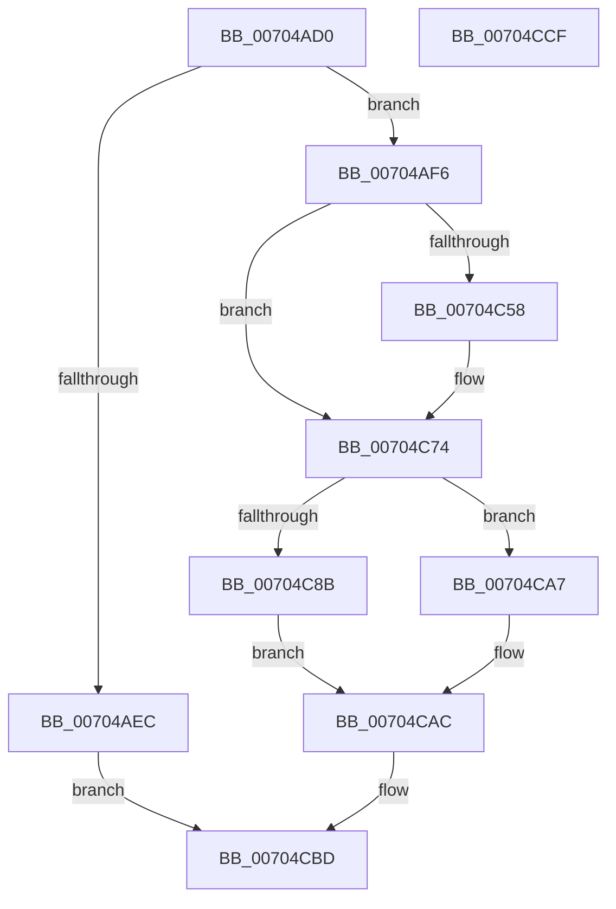

# PopPdcRegister

- RVA: `0x00704AD0`–`0x00704CD0` (길이 `512` bytes)
- VA: `0x0000000140704AD0`
- 실행 섹션: `PAGE`
- PDB 이름 있음: `예`; PDB Function 태그: `아니요`
- unwind 정보 RVA: `0x00060BC4`
- 디코드: `112`개 명령, `512/512` bytes 표시
- 미해석 바이트: `0` (있으면 어셈블리에 `.byte`로 보존)

> 이 문서는 커널 이미지의 기계어와 PDB 기호를 분석해 생성했습니다. 4번과 5번은 함수 원형과 자료형을 바이너리 사용 방식에서 추정한 C 해석이며 원본 소스 복구 결과는 아닙니다.

## 1. Dependencies

- 직접 호출 지점: **8**; 고유 호출 대상: **7**
- 직접 호출자로 확인된 함수: **1**
- RIP 상대 이미지 참조: **25**

### Outgoing calls
- `0x00704AF6` → [PopAcquirePolicyLock](../../pagelk/B7/PopAcquirePolicyLock_function_00B783C0.md) (function, `0x00B783C0`)
- `0x00704C4F` → [Feature_14FBugcheckMinidumpDiagnostics__private_IsEnabledDeviceUsageNoInline](../../text/59/Feature_14FBugcheckMinidumpDiagnostics__private_IsEnabledDeviceUsageNoInline_function_005919CC.md) (function, `0x005919CC`)
- `0x00704C82` → [PopIsPlatformAoAcCapableInitialized](../../text/49/PopIsPlatformAoAcCapableInitialized_function_004970F4.md) (function, `0x004970F4`)
- `0x00704C8B` → [PopIsPlatformAoAcCapable](../../text/49/PopIsPlatformAoAcCapable_function_0049BF40.md) (function, `0x0049BF40`)
- `0x00704C92` → [PopReleasePolicyLock](../../pagelk/B7/PopReleasePolicyLock_function_00B78410.md) (function, `0x00B78410`)
- `0x00704CA0` → [guard_dispatch_icall](../../text/6B/guard_dispatch_icall_function_006BAAD0.md) (function, `0x006BAAD0`)
- `0x00704CA7` → [PopReleasePolicyLock](../../pagelk/B7/PopReleasePolicyLock_function_00B78410.md) (function, `0x00B78410`)
- `0x00704CB8` → [ExQueueWorkItem](../../text/2F/ExQueueWorkItem_function_002F9520.md) (function, `0x002F9520`)

### Direct callers
- [PopPdcInvocation](../AD/PopPdcInvocation_function_00AD87F8.md) at `0x00AD8837`

### Static image references
- `0x00704AFB` → RVA `0x00E0B840` (`.data`; write)
- `0x00704B09` → RVA `0x00E67770` (`.data`; read)
- `0x00704B84` → RVA `0x00A314B0` (`PdcPoResiliencyClient`; read)
- `0x00704B8E` → RVA `0x004D3F20` (`PdcPoLowPower`; read)
- `0x00704B99` → RVA `0x00769520` (`PdcPoSetPowerAction`; read)
- `0x00704BA4` → RVA `0x007694A0` (`PdcPoReportButton`; read)
- `0x00704BAF` → RVA `0x00AC3480` (`PdcPoReportLidState`; read)
- `0x00704BBA` → RVA `0x00769450` (`PdcPoRecordButton`; read)
- `0x00704BC5` → RVA `0x00769580` (`PdcPoVerifyActionPolicy`; read)
- `0x00704BD0` → RVA `0x007695B0` (`PdcPoVerifyPowerState`; read)
- `0x00704BDB` → RVA `0x00769340` (`PdcPoBlockSessionSwitchEx`; read)
- `0x00704BE6` → RVA `0x0098A7F0` (`PopControlMonitor`; read)
- `0x00704BF1` → RVA `0x00911F60` (`PopNotifyCsStateExited`; read)
- `0x00704BFC` → RVA `0x005D9E70` (`PdcPoCurrentPdcPhase`; read)
- `0x00704C07` → RVA `0x00769430` (`PdcPoPpmRegisterProfiles`; read)
- `0x00704C12` → RVA `0x00A52AF0` (`PdcPoPpmApplyProfile`; read)
- `0x00704C1D` → RVA `0x00ABA420` (`PdcPoPpmResetProfile`; read)
- `0x00704C28` → RVA `0x007693A0` (`PdcPoNetworkResiliency`; read)
- `0x00704C33` → RVA `0x0043ADD0` (`PpmQueryDripsResidency`; read)
- `0x00704C41` → RVA `0x00AAFB10` (`PdcPoSleepStudyHelperSetPhaseActive`; read)
- `0x00704C58` → RVA `0x005C3650` (`KeQueryCurrentWaitInformationThread`; read)
- `0x00704C66` → RVA `0x008C9B30` (`PsEnumProcessThreads`; read)
- `0x00704C74` → RVA `0x0075F110` (`PdcPoLidReliabilityUpdateCallback`; read)
- `0x00704C97` → RVA `0x00E67840` (`.data`; read)
- `0x00704CB1` → RVA `0x00F08460` (`.data`; read)

## 2. Other-region calls and transfers

- 다른 실행 섹션으로 향하는 call: **8**
  - `0x00704AF6` → [PopAcquirePolicyLock](../../pagelk/B7/PopAcquirePolicyLock_function_00B783C0.md) (`PAGE` → `PAGELK`)
  - `0x00704C4F` → [Feature_14FBugcheckMinidumpDiagnostics__private_IsEnabledDeviceUsageNoInline](../../text/59/Feature_14FBugcheckMinidumpDiagnostics__private_IsEnabledDeviceUsageNoInline_function_005919CC.md) (`PAGE` → `.text`)
  - `0x00704C82` → [PopIsPlatformAoAcCapableInitialized](../../text/49/PopIsPlatformAoAcCapableInitialized_function_004970F4.md) (`PAGE` → `.text`)
  - `0x00704C8B` → [PopIsPlatformAoAcCapable](../../text/49/PopIsPlatformAoAcCapable_function_0049BF40.md) (`PAGE` → `.text`)
  - `0x00704C92` → [PopReleasePolicyLock](../../pagelk/B7/PopReleasePolicyLock_function_00B78410.md) (`PAGE` → `PAGELK`)
  - `0x00704CA0` → [guard_dispatch_icall](../../text/6B/guard_dispatch_icall_function_006BAAD0.md) (`PAGE` → `.text`)
  - `0x00704CA7` → [PopReleasePolicyLock](../../pagelk/B7/PopReleasePolicyLock_function_00B78410.md) (`PAGE` → `PAGELK`)
  - `0x00704CB8` → [ExQueueWorkItem](../../text/2F/ExQueueWorkItem_function_002F9520.md) (`PAGE` → `.text`)
- 별도 외부 분기/꼬리 이동을 확인하지 못했습니다.

## 3. Assembly (complete function range)

```asm
00704AD0  48 89 5C 24 08                  mov qword ptr [rsp + 8], rbx
00704AD5  48 89 74 24 10                  mov qword ptr [rsp + 0x10], rsi
00704ADA  57                              push rdi
00704ADB  48 83 EC 20                     sub rsp, 0x20
00704ADF  33 FF                           xor edi, edi
00704AE1  48 8B DA                        mov rbx, rdx
00704AE4  48 8B F1                        mov rsi, rcx
00704AE7  48 85 D2                        test rdx, rdx
00704AEA  75 0A                           jne 0x140704af6
00704AEC  BF 0D 00 00 C0                  mov edi, 0xc000000d
00704AF1  E9 C7 01 00 00                  jmp 0x140704cbd
00704AF6  E8 C5 38 47 00                  call 0x140b783c0
00704AFB  48 89 3D 3E 6D 70 00            mov qword ptr [rip + 0x706d3e], rdi
00704B02  48 8D 46 08                     lea rax, [rsi + 8]
00704B06  0F 10 00                        movups xmm0, xmmword ptr [rax]
00704B09  48 8D 0D 60 2C 76 00            lea rcx, [rip + 0x762c60]
00704B10  BA 80 00 00 00                  mov edx, 0x80
00704B15  0F 11 01                        movups xmmword ptr [rcx], xmm0
00704B18  0F 10 48 10                     movups xmm1, xmmword ptr [rax + 0x10]
00704B1C  0F 11 49 10                     movups xmmword ptr [rcx + 0x10], xmm1
00704B20  0F 10 40 20                     movups xmm0, xmmword ptr [rax + 0x20]
00704B24  0F 11 41 20                     movups xmmword ptr [rcx + 0x20], xmm0
00704B28  0F 10 48 30                     movups xmm1, xmmword ptr [rax + 0x30]
00704B2C  0F 11 49 30                     movups xmmword ptr [rcx + 0x30], xmm1
00704B30  0F 10 40 40                     movups xmm0, xmmword ptr [rax + 0x40]
00704B34  0F 11 41 40                     movups xmmword ptr [rcx + 0x40], xmm0
00704B38  0F 10 48 50                     movups xmm1, xmmword ptr [rax + 0x50]
00704B3C  0F 11 49 50                     movups xmmword ptr [rcx + 0x50], xmm1
00704B40  0F 10 40 60                     movups xmm0, xmmword ptr [rax + 0x60]
00704B44  0F 11 41 60                     movups xmmword ptr [rcx + 0x60], xmm0
00704B48  48 03 CA                        add rcx, rdx
00704B4B  0F 10 40 70                     movups xmm0, xmmword ptr [rax + 0x70]
00704B4F  48 03 C2                        add rax, rdx
00704B52  0F 11 41 F0                     movups xmmword ptr [rcx - 0x10], xmm0
00704B56  0F 10 08                        movups xmm1, xmmword ptr [rax]
00704B59  0F 11 09                        movups xmmword ptr [rcx], xmm1
00704B5C  0F 10 40 10                     movups xmm0, xmmword ptr [rax + 0x10]
00704B60  0F 11 41 10                     movups xmmword ptr [rcx + 0x10], xmm0
00704B64  0F 10 48 20                     movups xmm1, xmmword ptr [rax + 0x20]
00704B68  0F 11 49 20                     movups xmmword ptr [rcx + 0x20], xmm1
00704B6C  0F 10 40 30                     movups xmm0, xmmword ptr [rax + 0x30]
00704B70  0F 11 41 30                     movups xmmword ptr [rcx + 0x30], xmm0
00704B74  0F 10 48 40                     movups xmm1, xmmword ptr [rax + 0x40]
00704B78  0F 11 49 40                     movups xmmword ptr [rcx + 0x40], xmm1
00704B7C  48 8B 40 50                     mov rax, qword ptr [rax + 0x50]
00704B80  48 89 41 50                     mov qword ptr [rcx + 0x50], rax
00704B84  48 8D 05 25 C9 32 00            lea rax, [rip + 0x32c925]
00704B8B  48 89 03                        mov qword ptr [rbx], rax
00704B8E  48 8D 05 8B F3 DC FF            lea rax, [rip - 0x230c75]
00704B95  48 89 43 08                     mov qword ptr [rbx + 8], rax
00704B99  48 8D 05 80 49 06 00            lea rax, [rip + 0x64980]
00704BA0  48 89 43 10                     mov qword ptr [rbx + 0x10], rax
00704BA4  48 8D 05 F5 48 06 00            lea rax, [rip + 0x648f5]
00704BAB  48 89 43 18                     mov qword ptr [rbx + 0x18], rax
00704BAF  48 8D 05 CA E8 3B 00            lea rax, [rip + 0x3be8ca]
00704BB6  48 89 43 20                     mov qword ptr [rbx + 0x20], rax
00704BBA  48 8D 05 8F 48 06 00            lea rax, [rip + 0x6488f]
00704BC1  48 89 43 28                     mov qword ptr [rbx + 0x28], rax
00704BC5  48 8D 05 B4 49 06 00            lea rax, [rip + 0x649b4]
00704BCC  48 89 43 30                     mov qword ptr [rbx + 0x30], rax
00704BD0  48 8D 05 D9 49 06 00            lea rax, [rip + 0x649d9]
00704BD7  48 89 43 38                     mov qword ptr [rbx + 0x38], rax
00704BDB  48 8D 05 5E 47 06 00            lea rax, [rip + 0x6475e]
00704BE2  48 89 43 40                     mov qword ptr [rbx + 0x40], rax
00704BE6  48 8D 05 03 5C 28 00            lea rax, [rip + 0x285c03]
00704BED  48 89 43 48                     mov qword ptr [rbx + 0x48], rax
00704BF1  48 8D 05 68 D3 20 00            lea rax, [rip + 0x20d368]
00704BF8  48 89 43 50                     mov qword ptr [rbx + 0x50], rax
00704BFC  48 8D 05 6D 52 ED FF            lea rax, [rip - 0x12ad93]
00704C03  48 89 43 58                     mov qword ptr [rbx + 0x58], rax
00704C07  48 8D 05 22 48 06 00            lea rax, [rip + 0x64822]
00704C0E  48 89 43 60                     mov qword ptr [rbx + 0x60], rax
00704C12  48 8D 05 D7 DE 34 00            lea rax, [rip + 0x34ded7]
00704C19  48 89 43 68                     mov qword ptr [rbx + 0x68], rax
00704C1D  48 8D 05 FC 57 3B 00            lea rax, [rip + 0x3b57fc]
00704C24  48 89 43 70                     mov qword ptr [rbx + 0x70], rax
00704C28  48 8D 05 71 47 06 00            lea rax, [rip + 0x64771]
00704C2F  48 89 43 78                     mov qword ptr [rbx + 0x78], rax
00704C33  48 8D 05 96 61 D3 FF            lea rax, [rip - 0x2c9e6a]
00704C3A  48 89 83 80 00 00 00            mov qword ptr [rbx + 0x80], rax
00704C41  48 8D 05 C8 AE 3A 00            lea rax, [rip + 0x3aaec8]
00704C48  48 89 83 88 00 00 00            mov qword ptr [rbx + 0x88], rax
00704C4F  E8 78 CD E8 FF                  call 0x1405919cc
00704C54  85 C0                           test eax, eax
00704C56  74 1C                           je 0x140704c74
00704C58  48 8D 05 F1 E9 EB FF            lea rax, [rip - 0x14160f]
00704C5F  48 89 83 98 00 00 00            mov qword ptr [rbx + 0x98], rax
00704C66  48 8D 05 C3 4E 1C 00            lea rax, [rip + 0x1c4ec3]
00704C6D  48 89 83 A0 00 00 00            mov qword ptr [rbx + 0xa0], rax
00704C74  48 8D 05 95 A4 05 00            lea rax, [rip + 0x5a495]
00704C7B  48 89 83 90 00 00 00            mov qword ptr [rbx + 0x90], rax
00704C82  E8 6D 24 D9 FF                  call 0x1404970f4
00704C87  84 C0                           test al, al
00704C89  74 1C                           je 0x140704ca7
00704C8B  E8 B0 72 D9 FF                  call 0x14049bf40
00704C90  8A D8                           mov bl, al
00704C92  E8 79 37 47 00                  call 0x140b78410
00704C97  48 8B 05 A2 2B 76 00            mov rax, qword ptr [rip + 0x762ba2]
00704C9E  8A CB                           mov cl, bl
00704CA0  E8 2B 5E FB FF                  call 0x1406baad0
00704CA5  EB 05                           jmp 0x140704cac
00704CA7  E8 64 37 47 00                  call 0x140b78410
00704CAC  BA 01 00 00 00                  mov edx, 1
00704CB1  48 8D 0D A8 37 80 00            lea rcx, [rip + 0x8037a8]
00704CB8  E8 63 48 BF FF                  call 0x1402f9520
00704CBD  48 8B 5C 24 30                  mov rbx, qword ptr [rsp + 0x30]
00704CC2  8B C7                           mov eax, edi
00704CC4  48 8B 74 24 38                  mov rsi, qword ptr [rsp + 0x38]
00704CC9  48 83 C4 20                     add rsp, 0x20
00704CCD  5F                              pop rdi
00704CCE  C3                              ret
00704CCF  CC                              int3
```

## 4. C-style interpretation (structured pseudocode)

```c
__int64 __fastcall PopPdcRegister(__int64 a1, __int64 a2)
{
    __int64 result;
    __int64 v_rdi;
    __int64 v_rsp;
    unsigned __int64 v_stack_p10;
    unsigned __int64 v_stack_p8;

    v_stack_p8 = v_rbx;
    v_stack_p10 = v_rsi;
    v_rsp = (v_rsp) - (32);
    v_rdi = 0;
    if (a2 != 0) goto loc_00704AF6;
    goto loc_00704CBD;
loc_00704AF6:
    result = PopAcquirePolicyLock(a1, a2, a3, a4);
    *(unsigned __int64 *)(v_rip + 7367998) = (unsigned int)(0xC000000DULL);
    *(unsigned __int64 *)(v_rip + 7744608) = v_xmm0;
    *(unsigned __int64 *)(v_rip + 7744608 + 16) = v_xmm1;
    *(unsigned __int64 *)(v_rip + 7744608 + 32) = v_xmm0;
    *(unsigned __int64 *)(v_rip + 7744608 + 48) = v_xmm1;
    *(unsigned __int64 *)(v_rip + 7744608 + 64) = v_xmm0;
    *(unsigned __int64 *)(v_rip + 7744608 + 80) = v_xmm1;
    *(unsigned __int64 *)(v_rip + 7744608 + 96) = v_xmm0;
    a1 = (v_rip + 7744608) + (128);
    result = (a1 + 8) + (128);
    *(unsigned __int64 *)(a1 - 16) = v_xmm0;
    *(unsigned __int64 *)(a1) = v_xmm1;
    *(unsigned __int64 *)(a1 + 16) = v_xmm0;
    *(unsigned __int64 *)(a1 + 32) = v_xmm1;
    *(unsigned __int64 *)(a1 + 48) = v_xmm0;
    *(unsigned __int64 *)(a1 + 64) = v_xmm1;
    *(unsigned __int64 *)(a1 + 80) = *(unsigned __int64 *)(result + 80);
    *(unsigned __int64 *)(a2) = v_rip + 3328293;
    *(unsigned __int64 *)(a2 + 8) = v_rip - 2296949;
    *(unsigned __int64 *)(a2 + 16) = v_rip + 412032;
    *(unsigned __int64 *)(a2 + 24) = v_rip + 411893;
    *(unsigned __int64 *)(a2 + 32) = v_rip + 3926218;
    *(unsigned __int64 *)(a2 + 40) = v_rip + 411791;
    *(unsigned __int64 *)(a2 + 48) = v_rip + 412084;
    *(unsigned __int64 *)(a2 + 56) = v_rip + 412121;
    *(unsigned __int64 *)(a2 + 64) = v_rip + 411486;
    *(unsigned __int64 *)(a2 + 72) = v_rip + 2644995;
    *(unsigned __int64 *)(a2 + 80) = v_rip + 2151272;
    *(unsigned __int64 *)(a2 + 88) = v_rip - 1224083;
    *(unsigned __int64 *)(a2 + 96) = v_rip + 411682;
    *(unsigned __int64 *)(a2 + 104) = v_rip + 3464919;
    *(unsigned __int64 *)(a2 + 112) = v_rip + 3889148;
    *(unsigned __int64 *)(a2 + 120) = v_rip + 411505;
    *(unsigned __int64 *)(a2 + 128) = v_rip - 2924138;
    *(unsigned __int64 *)(a2 + 136) = v_rip + 3845832;
    result = Feature_14FBugcheckMinidumpDiagnostics__private_IsEnabledDeviceUsageNoInline(a1, 128, a3, a4);
    if ((unsigned int)(result) != 0) {
        result = v_rip - 1316367;
        *(unsigned __int64 *)(a2 + 152) = result;
        result = v_rip + 1855171;
        *(unsigned __int64 *)(a2 + 160) = result;
    }
    *(unsigned __int64 *)(a2 + 144) = v_rip + 369813;
    result = PopIsPlatformAoAcCapableInitialized(a1, 128, a3, a4);
    if ((unsigned __int8)(result) == 0) goto loc_00704CA7;
    result = PopIsPlatformAoAcCapable(a1, 128, a3, a4);
    result = PopReleasePolicyLock(a1, 128, a3, a4);
    result = guard_dispatch_icall((unsigned __int8)((unsigned __int8)(result)), 128, a3, a4);
    goto loc_00704CAC;
loc_00704CA7:
    result = PopReleasePolicyLock((unsigned __int8)((unsigned __int8)(result)), 128, a3, a4);
loc_00704CAC:
    result = ExQueueWorkItem(v_rip + 8402856, 1, a3, a4);
loc_00704CBD:
    v_rsp = (v_rsp) + (32);
    return (unsigned int)((unsigned int)((unsigned int)(0xC000000DULL)));
}
```

## 5. (Beta) C Style

```c
int64_t PopPdcRegister(void *Arg1, void *Arg2)
{
    uint8_t *arg1 = (uint8_t *)Arg1;
    uint8_t *arg2 = (uint8_t *)Arg2;

    int64_t result;
    int64_t local_rdi;
    int64_t local_rsp;
    uint64_t v_stack_p10;
    uint64_t v_stack_p8;

    v_stack_p8 = local_rbx;
    v_stack_p10 = local_rsi;
    local_rsp = (local_rsp) - (32);
    local_rdi = 0;
    if (Arg2 != NULL) goto loc_00704AF6;
    goto loc_00704CBD;
loc_00704AF6:
    result = PopAcquirePolicyLock(Arg1, Arg2, a3, a4);
    *(uint64_t *)(v_rip + 0x706D3E) = (uint32_t)(0xC000000DULL);
    *(uint64_t *)(v_rip + 0x762C60) = v_xmm0;
    *(uint64_t *)(v_rip + 0x762C60 + 0x10) = v_xmm1;
    *(uint64_t *)(v_rip + 0x762C60 + 0x20) = v_xmm0;
    *(uint64_t *)(v_rip + 0x762C60 + 0x30) = v_xmm1;
    *(uint64_t *)(v_rip + 0x762C60 + 0x40) = v_xmm0;
    *(uint64_t *)(v_rip + 0x762C60 + 0x50) = v_xmm1;
    *(uint64_t *)(v_rip + 0x762C60 + 0x60) = v_xmm0;
    Arg1 = (v_rip + 7744608) + (128);
    result = (Arg1 + 8) + (128);
    *(uint64_t *)(arg1 - 0x10) = v_xmm0;
    *(uint64_t *)(arg1) = v_xmm1;
    *(uint64_t *)(arg1 + 0x10) = v_xmm0;
    *(uint64_t *)(arg1 + 0x20) = v_xmm1;
    *(uint64_t *)(arg1 + 0x30) = v_xmm0;
    *(uint64_t *)(arg1 + 0x40) = v_xmm1;
    *(uint64_t *)(arg1 + 0x50) = *(uint64_t *)(result + 0x50);
    *(uint64_t *)(arg2) = v_rip + 3328293;
    *(uint64_t *)(arg2 + 0x8) = v_rip - 2296949;
    *(uint64_t *)(arg2 + 0x10) = v_rip + 412032;
    *(uint64_t *)(arg2 + 0x18) = v_rip + 411893;
    *(uint64_t *)(arg2 + 0x20) = v_rip + 3926218;
    *(uint64_t *)(arg2 + 0x28) = v_rip + 411791;
    *(uint64_t *)(arg2 + 0x30) = v_rip + 412084;
    *(uint64_t *)(arg2 + 0x38) = v_rip + 412121;
    *(uint64_t *)(arg2 + 0x40) = v_rip + 411486;
    *(uint64_t *)(arg2 + 0x48) = v_rip + 2644995;
    *(uint64_t *)(arg2 + 0x50) = v_rip + 2151272;
    *(uint64_t *)(arg2 + 0x58) = v_rip - 1224083;
    *(uint64_t *)(arg2 + 0x60) = v_rip + 411682;
    *(uint64_t *)(arg2 + 0x68) = v_rip + 3464919;
    *(uint64_t *)(arg2 + 0x70) = v_rip + 3889148;
    *(uint64_t *)(arg2 + 0x78) = v_rip + 411505;
    *(uint64_t *)(arg2 + 0x80) = v_rip - 2924138;
    *(uint64_t *)(arg2 + 0x88) = v_rip + 3845832;
    result = Feature_14FBugcheckMinidumpDiagnostics__private_IsEnabledDeviceUsageNoInline(Arg1, 128, a3, a4);
    if ((uint32_t)(result) != 0) {
        result = v_rip - 1316367;
        *(uint64_t *)(arg2 + 0x98) = result;
        result = v_rip + 1855171;
        *(uint64_t *)(arg2 + 0xA0) = result;
    }
    *(uint64_t *)(arg2 + 0x90) = v_rip + 369813;
    result = PopIsPlatformAoAcCapableInitialized(Arg1, 128, a3, a4);
    if ((uint8_t)(result) == 0) goto loc_00704CA7;
    result = PopIsPlatformAoAcCapable(Arg1, 128, a3, a4);
    result = PopReleasePolicyLock(Arg1, 128, a3, a4);
    result = guard_dispatch_icall((uint8_t)((uint8_t)(result)), 128, a3, a4);
    goto loc_00704CAC;
loc_00704CA7:
    result = PopReleasePolicyLock((uint8_t)((uint8_t)(result)), 128, a3, a4);
loc_00704CAC:
    result = ExQueueWorkItem(v_rip + 8402856, 1, a3, a4);
loc_00704CBD:
    local_rsp = (local_rsp) + (32);
    return (uint32_t)((uint32_t)((uint32_t)(0xC000000DULL)));
}
```

### 관측된 메모리 오프셋

구조체 형식이 확인되지 않은 접근은 인자 기준의 오프셋으로만 기록했습니다.

| 기준 인자 | 오프셋 표현 | 폭 (bit) | 접근 |
|---|---:|---:|---|
| `Arg1` | `+ 0x0` | `128` | `R` |
| `Arg1` | `+ 0x8` | `64` | `R` |
| `Arg1` | `+ 0x10` | `128` | `R` |
| `Arg1` | `+ 0x20` | `128` | `R` |
| `Arg1` | `+ 0x30` | `128` | `R` |
| `Arg1` | `+ 0x40` | `128` | `R` |
| `Arg1` | `+ 0x50` | `64` | `R` |
| `Arg1` | `+ 0x50` | `128` | `R` |
| `Arg1` | `+ 0x60` | `128` | `R` |
| `Arg1` | `+ 0x70` | `128` | `R` |
| `Arg2` | `+ 0x0` | `64` | `W` |
| `Arg2` | `+ 0x8` | `64` | `W` |
| `Arg2` | `+ 0x10` | `64` | `W` |
| `Arg2` | `+ 0x18` | `64` | `W` |
| `Arg2` | `+ 0x20` | `64` | `W` |
| `Arg2` | `+ 0x28` | `64` | `W` |
| `Arg2` | `+ 0x30` | `64` | `W` |
| `Arg2` | `+ 0x38` | `64` | `W` |
| `Arg2` | `+ 0x40` | `64` | `W` |
| `Arg2` | `+ 0x48` | `64` | `W` |
| `Arg2` | `+ 0x50` | `64` | `W` |
| `Arg2` | `+ 0x58` | `64` | `W` |
| `Arg2` | `+ 0x60` | `64` | `W` |
| `Arg2` | `+ 0x68` | `64` | `W` |
| `Arg2` | `+ 0x70` | `64` | `W` |
| `Arg2` | `+ 0x78` | `64` | `W` |
| `Arg2` | `+ 0x80` | `64` | `W` |
| `Arg2` | `+ 0x88` | `64` | `W` |
| `Arg2` | `+ 0x90` | `64` | `W` |
| `Arg2` | `+ 0x98` | `64` | `W` |
| `Arg2` | `+ 0xA0` | `64` | `W` |

## 6. Execution-region graph

[열기: 2D/3D 그래프와 함수 탐색 컨트롤 패널](../../../control-panel.html?section=page&rva=0x00704AD0&view=graph)

- 2D 그래프는 위에서 아래로 흐르고, 3D 그래프는 빈 공간을 드래그해 회전합니다. Shift+드래그는 이동, 휠은 확대·축소, 함수 노드 선택은 대상 보고서 이동입니다.

### Static fallback


