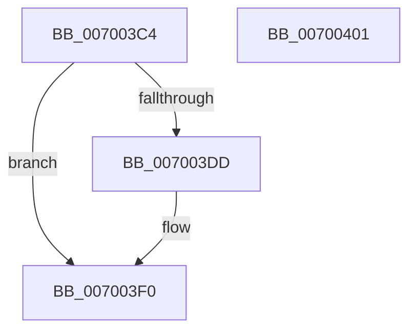

# PopPowerAggregatorNotifyDisplayPoweredOn

- RVA: `0x007003C4`–`0x00700402` (길이 `62` bytes)
- VA: `0x00000001407003C4`
- 실행 섹션: `PAGE`
- PDB 이름 있음: `예`; PDB Function 태그: `아니요`
- unwind 정보 RVA: `0x0005C788`
- 디코드: `13`개 명령, `62/62` bytes 표시
- 미해석 바이트: `0` (있으면 어셈블리에 `.byte`로 보존)

> 이 문서는 커널 이미지의 기계어와 PDB 기호를 분석해 생성했습니다. 4번과 5번은 함수 원형과 자료형을 바이너리 사용 방식에서 추정한 C 해석이며 원본 소스 복구 결과는 아닙니다.

## 1. Dependencies

- 직접 호출 지점: **3**; 고유 호출 대상: **3**
- 직접 호출자로 확인된 함수: **2**
- RIP 상대 이미지 참조: **4**

### Outgoing calls
- `0x007003CF` → [PopAcquireRwLockExclusive](../../text/43/PopAcquireRwLockExclusive_function_00430B44.md) (function, `0x00430B44`)
- `0x007003EB` → [PopPowerAggregatorScheduleWorker](../91/PopPowerAggregatorScheduleWorker_function_00912B9C.md) (function, `0x00912B9C`)
- `0x007003F7` → [PopReleaseRwLock](../../text/2D/PopReleaseRwLock_function_002DFBBC.md) (function, `0x002DFBBC`)

### Direct callers
- [NtPowerInformation](../95/NtPowerInformation_function_00955D80.md) at `0x00956DE6`
- [PopPowerInformationInternal](../A8/PopPowerInformationInternal_function_00A8B7C0.md) at `0x00A8BCF7`

### Static image references
- `0x007003C8` → RVA `0x00F09710` (`.data`; read)
- `0x007003D4` → RVA `0x00F09778` (`.data`; read)
- `0x007003DD` → RVA `0x00F09740` (`.data`; read)
- `0x007003E4` → RVA `0x00F09788` (`.data`; write)

## 2. Other-region calls and transfers

- 다른 실행 섹션으로 향하는 call: **2**
  - `0x007003CF` → [PopAcquireRwLockExclusive](../../text/43/PopAcquireRwLockExclusive_function_00430B44.md) (`PAGE` → `.text`)
  - `0x007003F7` → [PopReleaseRwLock](../../text/2D/PopReleaseRwLock_function_002DFBBC.md) (`PAGE` → `.text`)
- 별도 외부 분기/꼬리 이동을 확인하지 못했습니다.

## 3. Assembly (complete function range)

```asm
007003C4  48 83 EC 28                     sub rsp, 0x28
007003C8  48 8D 0D 41 93 80 00            lea rcx, [rip + 0x809341]
007003CF  E8 70 07 D3 FF                  call 0x140430b44
007003D4  83 3D 9D 93 80 00 02            cmp dword ptr [rip + 0x80939d], 2
007003DB  75 13                           jne 0x1407003f0
007003DD  48 8D 0D 5C 93 80 00            lea rcx, [rip + 0x80935c]
007003E4  C6 05 9D 93 80 00 01            mov byte ptr [rip + 0x80939d], 1
007003EB  E8 AC 27 21 00                  call 0x140912b9c
007003F0  48 8D 0D 19 93 80 00            lea rcx, [rip + 0x809319]
007003F7  E8 C0 F7 BD FF                  call 0x1402dfbbc
007003FC  48 83 C4 28                     add rsp, 0x28
00700400  C3                              ret
00700401  CC                              int3
```

## 4. C-style interpretation (structured pseudocode)

```c
__int64 __fastcall PopPowerAggregatorNotifyDisplayPoweredOn(void)
{
    __int64 result;
    __int64 v_rsp;

    v_rsp = (v_rsp) - (40);
    result = PopAcquireRwLockExclusive(v_rip + 8426305, a2, a3, a4);
    if ((*(unsigned int *)(v_rip + 8426397)) == 2) {
        a1 = v_rip + 8426332;
        *(unsigned __int8 *)(v_rip + 8426397) = 1;
        result = PopPowerAggregatorScheduleWorker(a1, a2, a3, a4);
    }
    result = PopReleaseRwLock(v_rip + 8426265, a2, a3, a4);
    v_rsp = (v_rsp) + (40);
    return result;
}
```

## 5. (Beta) C Style

```c
void PopPowerAggregatorNotifyDisplayPoweredOn(void)
{
    int64_t result;
    int64_t local_rsp;

    local_rsp = (local_rsp) - (40);
    result = PopAcquireRwLockExclusive(v_rip + 8426305, a2, a3, a4);
    if ((*(uint32_t *)(v_rip + 0x80939D)) == 2) {
        a1 = v_rip + 8426332;
        *(uint8_t *)(v_rip + 0x80939D) = 1;
        result = PopPowerAggregatorScheduleWorker(a1, a2, a3, a4);
    }
    result = PopReleaseRwLock(v_rip + 8426265, a2, a3, a4);
    local_rsp = (local_rsp) + (40);
    return result;
}
```

## 6. Execution-region graph

[열기: 2D/3D 그래프와 함수 탐색 컨트롤 패널](../../../control-panel.html?section=page&rva=0x007003C4&view=graph)

- 2D 그래프는 위에서 아래로 흐르고, 3D 그래프는 빈 공간을 드래그해 회전합니다. Shift+드래그는 이동, 휠은 확대·축소, 함수 노드 선택은 대상 보고서 이동입니다.

### Static fallback


