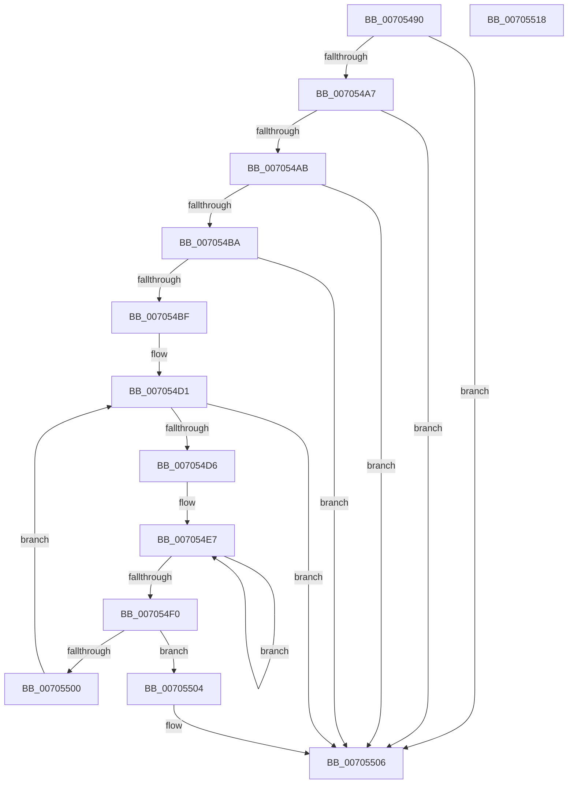

# PopPowerRequestStatsIsDetailedRequestReason

- RVA: `0x00705490`–`0x00705519` (길이 `137` bytes)
- VA: `0x0000000140705490`
- 실행 섹션: `PAGE`
- PDB 이름 있음: `예`; PDB Function 태그: `아니요`
- unwind 정보 RVA: `0x00060BC4`
- 디코드: `42`개 명령, `137/137` bytes 표시
- 미해석 바이트: `0` (있으면 어셈블리에 `.byte`로 보존)

> 이 문서는 커널 이미지의 기계어와 PDB 기호를 분석해 생성했습니다. 4번과 5번은 함수 원형과 자료형을 바이너리 사용 방식에서 추정한 C 해석이며 원본 소스 복구 결과는 아닙니다.

## 1. Dependencies

- 직접 호출 지점: **1**; 고유 호출 대상: **1**
- 직접 호출자로 확인된 함수: **1**
- RIP 상대 이미지 참조: **1**

### Outgoing calls
- `0x007054F7` → [strncmp](../../text/6C/strncmp_function_006C6720.md) (function, `0x006C6720`)

### Direct callers
- [PopPowerRequestStatsGetIdForRequest](../A2/PopPowerRequestStatsGetIdForRequest_function_00A2D784.md) at `0x00A2D7B4`

### Static image references
- `0x007054D8` → RVA `0x00FD8710` (`PAGEDATA`; read)

## 2. Other-region calls and transfers

- 다른 실행 섹션으로 향하는 call: **1**
  - `0x007054F7` → [strncmp](../../text/6C/strncmp_function_006C6720.md) (`PAGE` → `.text`)
- 별도 외부 분기/꼬리 이동을 확인하지 못했습니다.

## 3. Assembly (complete function range)

```asm
00705490  48 89 5C 24 08                  mov qword ptr [rsp + 8], rbx
00705495  48 89 74 24 10                  mov qword ptr [rsp + 0x10], rsi
0070549A  57                              push rdi
0070549B  48 83 EC 20                     sub rsp, 0x20
0070549F  33 DB                           xor ebx, ebx
007054A1  48 39 59 30                     cmp qword ptr [rcx + 0x30], rbx
007054A5  74 5F                           je 0x140705506
007054A7  39 19                           cmp dword ptr [rcx], ebx
007054A9  74 5B                           je 0x140705506
007054AB  48 8D 41 3F                     lea rax, [rcx + 0x3f]
007054AF  48 83 E0 F8                     and rax, 0xfffffffffffffff8
007054B3  8B 08                           mov ecx, dword ptr [rax]
007054B5  F6 C1 01                        test cl, 1
007054B8  75 4C                           jne 0x140705506
007054BA  F6 C1 02                        test cl, 2
007054BD  74 47                           je 0x140705506
007054BF  65 48 8B 04 25 88 01 00 00      mov rax, qword ptr gs:[0x188]
007054C8  8B FB                           mov edi, ebx
007054CA  48 8B B0 B8 00 00 00            mov rsi, qword ptr [rax + 0xb8]
007054D1  83 FF 02                        cmp edi, 2
007054D4  73 30                           jae 0x140705506
007054D6  8B C7                           mov eax, edi
007054D8  48 8D 15 31 32 8D 00            lea rdx, [rip + 0x8d3231]
007054DF  49 83 C8 FF                     or r8, 0xffffffffffffffff
007054E3  48 8B 14 C2                     mov rdx, qword ptr [rdx + rax*8]
007054E7  49 FF C0                        inc r8
007054EA  42 38 1C 02                     cmp byte ptr [rdx + r8], bl
007054EE  75 F7                           jne 0x1407054e7
007054F0  48 8D 8E 38 03 00 00            lea rcx, [rsi + 0x338]
007054F7  E8 24 12 FC FF                  call 0x1406c6720
007054FC  85 C0                           test eax, eax
007054FE  74 04                           je 0x140705504
00705500  FF C7                           inc edi
00705502  EB CD                           jmp 0x1407054d1
00705504  B3 01                           mov bl, 1
00705506  48 8B 74 24 38                  mov rsi, qword ptr [rsp + 0x38]
0070550B  8A C3                           mov al, bl
0070550D  48 8B 5C 24 30                  mov rbx, qword ptr [rsp + 0x30]
00705512  48 83 C4 20                     add rsp, 0x20
00705516  5F                              pop rdi
00705517  C3                              ret
00705518  CC                              int3
```

## 4. C-style interpretation (structured pseudocode)

```c
__int64 __fastcall PopPowerRequestStatsIsDetailedRequestReason(__int64 a1, __int64 a2, __int64 a3)
{
    __int64 result;
    __int64 v_rbx;
    __int64 v_rdi;
    __int64 v_rsp;
    unsigned __int64 v_stack_p10;
    unsigned __int64 v_stack_p8;

    v_stack_p8 = v_rbx;
    v_stack_p10 = v_rsi;
    v_rsp = (v_rsp) - (32);
    v_rbx = 0;
    if ((*(unsigned __int64 *)(a1 + 48)) == 0) goto loc_00705506;
    if ((*(unsigned int *)(a1)) == 0) goto loc_00705506;
    result = (a1 + 63) & (-8);
    if ((((unsigned __int8)((unsigned int)(*(unsigned int *)(result)))) & (1)) != 0) goto loc_00705506;
    if ((((unsigned __int8)((unsigned int)(*(unsigned int *)(result)))) & (2)) == 0) goto loc_00705506;
loc_007054D1:
    if (0 >= 2) goto loc_00705506;
    a3 = (a3) | (-1);
loc_007054E7:
    a3 = (a3) + 1;
    if ((*(unsigned __int8 *)(*(unsigned __int64 *)(v_rip + 9253425 + 0 * 8) + a3 * 1)) != 0) goto loc_007054E7;
    result = strncmp(*(unsigned __int64 *)(*(unsigned __int64 *)(gs_base + (0 + 392)) + 184) + 824, *(unsigned __int64 *)(v_rip + 9253425 + 0 * 8), a3, a4);
    if ((unsigned int)(result) == 0) goto loc_00705504;
    v_rdi = (unsigned int)((0) + 1);
    goto loc_007054D1;
loc_00705504:
loc_00705506:
    v_rsp = (v_rsp) + (32);
    return 1;
}
```

## 5. (Beta) C Style

```c
int64_t PopPowerRequestStatsIsDetailedRequestReason(void *Arg1, int64_t Arg2, int64_t Arg3)
{
    uint8_t *arg1 = (uint8_t *)Arg1;

    int64_t result;
    int64_t local_rbx;
    int64_t local_rdi;
    int64_t local_rsp;
    uint64_t v_stack_p10;
    uint64_t v_stack_p8;

    v_stack_p8 = local_rbx;
    v_stack_p10 = local_rsi;
    local_rsp = (local_rsp) - (32);
    local_rbx = 0;
    if ((*(uint64_t *)(arg1 + 0x30)) == 0) goto loc_00705506;
    if ((*(uint32_t *)(arg1)) == 0) goto loc_00705506;
    result = (Arg1 + 63) & (-8);
    if ((((uint8_t)((uint32_t)(*(uint32_t *)(result)))) & (1)) != 0) goto loc_00705506;
    if ((((uint8_t)((uint32_t)(*(uint32_t *)(result)))) & (2)) == 0) goto loc_00705506;
loc_007054D1:
    if (0 >= 2) goto loc_00705506;
    Arg3 = (Arg3) | (-1);
loc_007054E7:
    Arg3 = (Arg3) + 1;
    if ((*(uint8_t *)(*(uint64_t *)(v_rip + 0x8D3231 + 0x0 * 8) + Arg3 * 1)) != 0) goto loc_007054E7;
    result = strncmp(*(uint64_t *)(*(uint64_t *)(gs_base + (0 + 0x188)) + 0xB8) + 824, *(uint64_t *)(v_rip + 0x8D3231 + 0x0 * 8), Arg3, a4);
    if ((uint32_t)(result) == 0) goto loc_00705504;
    local_rdi = (uint32_t)((0) + 1);
    goto loc_007054D1;
loc_00705504:
loc_00705506:
    local_rsp = (local_rsp) + (32);
    return 1;
}
```

### 관측된 메모리 오프셋

구조체 형식이 확인되지 않은 접근은 인자 기준의 오프셋으로만 기록했습니다.

| 기준 인자 | 오프셋 표현 | 폭 (bit) | 접근 |
|---|---:|---:|---|
| `Arg1` | `+ 0x0` | `32` | `R` |
| `Arg1` | `+ 0x30` | `64` | `R` |
| `Arg1` | `+ 0x3F` | `64` | `R` |

## 6. Execution-region graph

[열기: 2D/3D 그래프와 함수 탐색 컨트롤 패널](../../../control-panel.html?section=page&rva=0x00705490&view=graph)

- 2D 그래프는 위에서 아래로 흐르고, 3D 그래프는 빈 공간을 드래그해 회전합니다. Shift+드래그는 이동, 휠은 확대·축소, 함수 노드 선택은 대상 보고서 이동입니다.

### Static fallback


