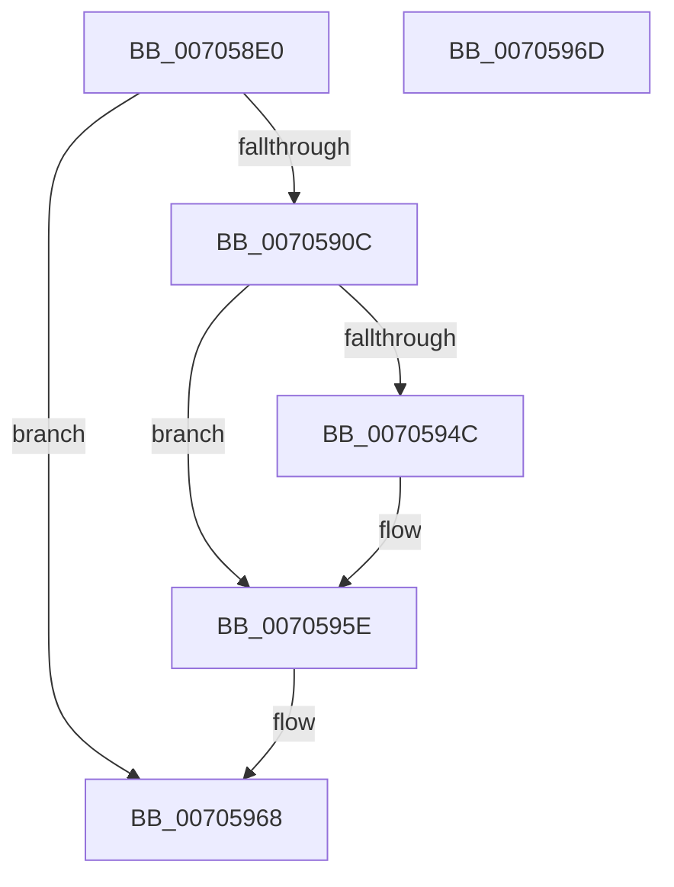

# PopResetActionDefaults

- RVA: `0x007058E0`–`0x0070596E` (길이 `142` bytes)
- VA: `0x00000001407058E0`
- 실행 섹션: `PAGE`
- PDB 이름 있음: `예`; PDB Function 태그: `아니요`
- unwind 정보 RVA: `0x0005C788`
- 디코드: `24`개 명령, `142/142` bytes 표시
- 미해석 바이트: `0` (있으면 어셈블리에 `.byte`로 보존)

> 이 문서는 커널 이미지의 기계어와 PDB 기호를 분석해 생성했습니다. 4번과 5번은 함수 원형과 자료형을 바이너리 사용 방식에서 추정한 C 해석이며 원본 소스 복구 결과는 아닙니다.

## 1. Dependencies

- 직접 호출 지점: **1**; 고유 호출 대상: **1**
- 직접 호출자로 확인된 함수: **3**
- RIP 상대 이미지 참조: **15**

### Outgoing calls
- `0x00705951` → [ExFreePoolWithTag](../../poolcode/B8/ExFreePoolWithTag_function_00B82870.md) (function, `0x00B82870`)

### Direct callers
- [PopExecutePowerAction](../75/PopExecutePowerAction_function_0075E6B4.md) at `0x0075E854`
- [PopTransitionSystemPowerStateEx](../../pagelk/B7/PopTransitionSystemPowerStateEx_function_00B7E8C0.md) at `0x00B7EABB`
- [PopTransitionSystemPowerStateEx](../../pagelk/B7/PopTransitionSystemPowerStateEx_function_00B7E8C0.md) at `0x00B7FB19`
- [PoInitSystem](../../init/C7/PoInitSystem_function_00C72358.md) at `0x00C7293E`

### Static image references
- `0x007058E4` → RVA `0x00F0BD6C` (`.data`; read/write)
- `0x007058EB` → RVA `0x00F0BD74` (`.data`; read/write)
- `0x007058F2` → RVA `0x00F0BD40` (`.data`; read)
- `0x007058F9` → RVA `0x00F0BD78` (`.data`; write)
- `0x00705903` → RVA `0x00F0BD69` (`.data`; write)
- `0x0070590C` → RVA `0x00F0BD44` (`.data`; read/write)
- `0x00705913` → RVA `0x00F0BD48` (`.data`; read/write)
- `0x0070591A` → RVA `0x00F0BD50` (`.data`; read/write)
- `0x00705921` → RVA `0x00F0BD60` (`.data`; read)
- `0x00705928` → RVA `0x00F0BD40` (`.data`; write)
- `0x0070592F` → RVA `0x00F0BD42` (`.data`; write)
- `0x00705936` → RVA `0x00F0BD68` (`.data`; write)
- `0x0070593D` → RVA `0x00F0BD54` (`.data`; write)
- `0x00705956` → RVA `0x00F0BD60` (`.data`; read/write)
- `0x0070595E` → RVA `0x00F0BD4C` (`.data`; write)

## 2. Other-region calls and transfers

- 다른 실행 섹션으로 향하는 call: **1**
  - `0x00705951` → [ExFreePoolWithTag](../../poolcode/B8/ExFreePoolWithTag_function_00B82870.md) (`PAGE` → `POOLCODE`)
- 별도 외부 분기/꼬리 이동을 확인하지 못했습니다.

## 3. Assembly (complete function range)

```asm
007058E0  48 83 EC 28                     sub rsp, 0x28
007058E4  83 25 81 64 80 00 00            and dword ptr [rip + 0x806481], 0
007058EB  83 25 82 64 80 00 00            and dword ptr [rip + 0x806482], 0
007058F2  F6 05 47 64 80 00 02            test byte ptr [rip + 0x806447], 2
007058F9  C7 05 75 64 80 00 01 00 00 00   mov dword ptr [rip + 0x806475], 1
00705903  C6 05 5F 64 80 00 00            mov byte ptr [rip + 0x80645f], 0
0070590A  75 5C                           jne 0x140705968
0070590C  83 25 31 64 80 00 00            and dword ptr [rip + 0x806431], 0
00705913  83 25 2E 64 80 00 00            and dword ptr [rip + 0x80642e], 0
0070591A  83 25 2F 64 80 00 00            and dword ptr [rip + 0x80642f], 0
00705921  48 8B 0D 38 64 80 00            mov rcx, qword ptr [rip + 0x806438]
00705928  C6 05 11 64 80 00 00            mov byte ptr [rip + 0x806411], 0
0070592F  C6 05 0C 64 80 00 00            mov byte ptr [rip + 0x80640c], 0
00705936  C6 05 2B 64 80 00 00            mov byte ptr [rip + 0x80642b], 0
0070593D  C7 05 0D 64 80 00 11 00 00 00   mov dword ptr [rip + 0x80640d], 0x11
00705947  48 85 C9                        test rcx, rcx
0070594A  74 12                           je 0x14070595e
0070594C  BA 50 64 69 67                  mov edx, 0x67696450
00705951  E8 1A CF 47 00                  call 0x140b82870
00705956  48 83 25 02 64 80 00 00         and qword ptr [rip + 0x806402], 0
0070595E  C7 05 E4 63 80 00 03 00 00 10   mov dword ptr [rip + 0x8063e4], 0x10000003
00705968  48 83 C4 28                     add rsp, 0x28
0070596C  C3                              ret
0070596D  CC                              int3
```

## 4. C-style interpretation (structured pseudocode)

```c
__int64 __fastcall PopResetActionDefaults(void)
{
    __int64 result;
    __int64 v_rsp;

    v_rsp = (v_rsp) - (40);
    *(unsigned int *)(v_rip + 8414325) = 1;
    *(unsigned __int8 *)(v_rip + 8414303) = 0;
    if (((*(unsigned __int8 *)(v_rip + 8414279)) & (2)) != 0) goto loc_00705968;
    *(unsigned __int8 *)(v_rip + 8414225) = 0;
    *(unsigned __int8 *)(v_rip + 8414220) = 0;
    *(unsigned __int8 *)(v_rip + 8414251) = 0;
    *(unsigned int *)(v_rip + 8414221) = 17;
    if (*(unsigned __int64 *)(v_rip + 8414264) != 0) {
        a2 = 0x67696450ULL;
        result = ExFreePoolWithTag(*(unsigned __int64 *)(v_rip + 8414264), a2, a3, a4);
    }
    *(unsigned int *)(v_rip + 8414180) = 0x10000003ULL;
loc_00705968:
    v_rsp = (v_rsp) + (40);
    return result;
}
```

## 5. (Beta) C Style

```c
void PopResetActionDefaults(void)
{
    int64_t result;
    int64_t local_rsp;

    local_rsp = (local_rsp) - (40);
    *(uint32_t *)(v_rip + 0x806475) = 1;
    *(uint8_t *)(v_rip + 0x80645F) = 0;
    if (((*(uint8_t *)(v_rip + 0x806447)) & (2)) != 0) goto loc_00705968;
    *(uint8_t *)(v_rip + 0x806411) = 0;
    *(uint8_t *)(v_rip + 0x80640C) = 0;
    *(uint8_t *)(v_rip + 0x80642B) = 0;
    *(uint32_t *)(v_rip + 0x80640D) = 17;
    if (*(uint64_t *)(v_rip + 0x806438) != 0) {
        a2 = 0x67696450ULL;
        result = ExFreePoolWithTag(*(uint64_t *)(v_rip + 0x806438), a2, a3, a4);
    }
    *(uint32_t *)(v_rip + 0x8063E4) = 0x10000003ULL;
loc_00705968:
    local_rsp = (local_rsp) + (40);
    return result;
}
```

## 6. Execution-region graph

[열기: 2D/3D 그래프와 함수 탐색 컨트롤 패널](../../../control-panel.html?section=page&rva=0x007058E0&view=graph)

- 2D 그래프는 위에서 아래로 흐르고, 3D 그래프는 빈 공간을 드래그해 회전합니다. Shift+드래그는 이동, 휠은 확대·축소, 함수 노드 선택은 대상 보고서 이동입니다.

### Static fallback


