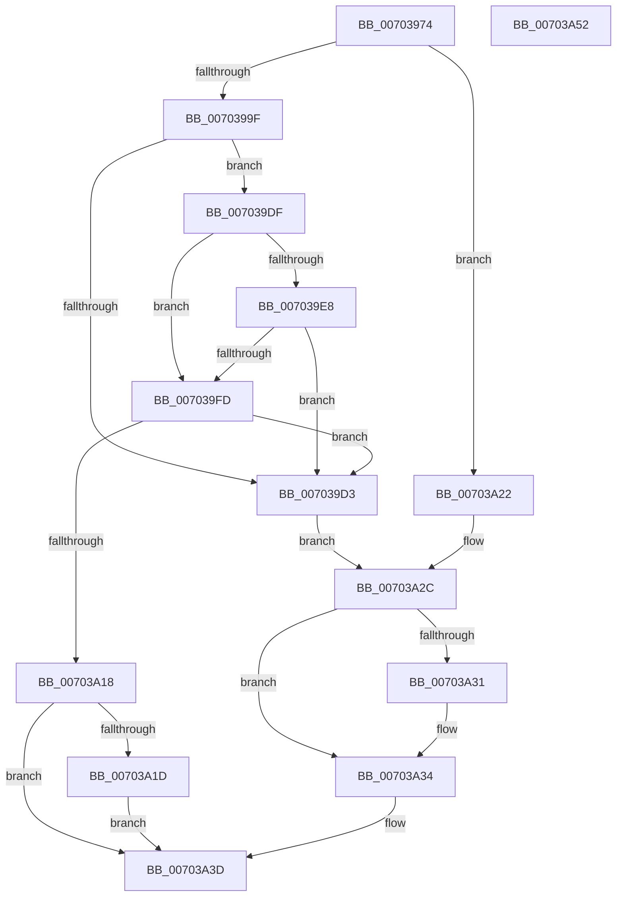

# PopSetHiberFileSize

- RVA: `0x00703974`–`0x00703A53` (길이 `223` bytes)
- VA: `0x0000000140703974`
- 실행 섹션: `PAGE`
- PDB 이름 있음: `예`; PDB Function 태그: `아니요`
- unwind 정보 RVA: `0x000BF954`
- 디코드: `67`개 명령, `223/223` bytes 표시
- 미해석 바이트: `0` (있으면 어셈블리에 `.byte`로 보존)

> 이 문서는 커널 이미지의 기계어와 PDB 기호를 분석해 생성했습니다. 4번과 5번은 함수 원형과 자료형을 바이너리 사용 방식에서 추정한 C 해석이며 원본 소스 복구 결과는 아닙니다.

## 1. Dependencies

- 직접 호출 지점: **5**; 고유 호출 대상: **5**
- 직접 호출자로 확인된 함수: **1**
- RIP 상대 이미지 참조: **2**

### Outgoing calls
- `0x007039B1` → [PopCalculateHiberFileSize](../75/PopCalculateHiberFileSize_function_0075CC98.md) (function, `0x0075CC98`)
- `0x007039C8` → [PopValidateHiberFileSize](../A9/PopValidateHiberFileSize_function_00A90678.md) (function, `0x00A90678`)
- `0x007039F2` → [PopSetHiberFileType](PopSetHiberFileType_function_00703268.md) (function, `0x00703268`)
- `0x00703A0D` → [PopSetHiberPersistedRegValue](../6F/PopSetHiberPersistedRegValue_function_006FE9F0.md) (function, `0x006FE9F0`)
- `0x00703A38` → [PopDiagTraceSetHiberFileFailurePoint](../76/PopDiagTraceSetHiberFileFailurePoint_function_00762D50.md) (function, `0x00762D50`)

### Direct callers
- [NtPowerInformation](../95/NtPowerInformation_function_00955D80.md) at `0x0095732B`

### Static image references
- `0x0070399F` → RVA `0x00FC5070` (`ALMOSTRO`; read)
- `0x007039A7` → RVA `0x00FC5070` (`ALMOSTRO`; write)

## 2. Other-region calls and transfers

- 다른 실행 섹션으로 향하는 call: **0**
- 별도 외부 분기/꼬리 이동을 확인하지 못했습니다.

## 3. Assembly (complete function range)

```asm
00703974  48 8B C4                        mov rax, rsp
00703977  48 89 58 10                     mov qword ptr [rax + 0x10], rbx
0070397B  48 89 68 18                     mov qword ptr [rax + 0x18], rbp
0070397F  56                              push rsi
00703980  57                              push rdi
00703981  41 56                           push r14
00703983  48 83 EC 20                     sub rsp, 0x20
00703987  48 83 60 20 00                  and qword ptr [rax + 0x20], 0
0070398C  4D 8B F0                        mov r14, r8
0070398F  83 60 08 00                     and dword ptr [rax + 8], 0
00703993  48 8B F2                        mov rsi, rdx
00703996  83 F9 64                        cmp ecx, 0x64
00703999  0F 87 83 00 00 00               ja 0x140703a22
0070399F  8B 3D CB 16 8C 00               mov edi, dword ptr [rip + 0x8c16cb]
007039A5  33 D2                           xor edx, edx
007039A7  89 0D C3 16 8C 00               mov dword ptr [rip + 0x8c16c3], ecx
007039AD  48 8D 48 20                     lea rcx, [rax + 0x20]
007039B1  E8 E2 92 05 00                  call 0x14075cc98
007039B6  48 8B 6C 24 58                  mov rbp, qword ptr [rsp + 0x58]
007039BB  4C 8D 4C 24 40                  lea r9, [rsp + 0x40]
007039C0  48 8B CD                        mov rcx, rbp
007039C3  45 33 C0                        xor r8d, r8d
007039C6  33 D2                           xor edx, edx
007039C8  E8 AB CC 38 00                  call 0x140a90678
007039CD  8B D8                           mov ebx, eax
007039CF  85 C0                           test eax, eax
007039D1  79 0C                           jns 0x1407039df
007039D3  8B 4C 24 40                     mov ecx, dword ptr [rsp + 0x40]
007039D7  89 3D 93 16 8C 00               mov dword ptr [rip + 0x8c1693], edi
007039DD  EB 4D                           jmp 0x140703a2c
007039DF  83 3D 8A 16 8C 00 28            cmp dword ptr [rip + 0x8c168a], 0x28
007039E6  72 15                           jb 0x1407039fd
007039E8  33 D2                           xor edx, edx
007039EA  4C 8D 44 24 40                  lea r8, [rsp + 0x40]
007039EF  8D 4A 02                        lea ecx, [rdx + 2]
007039F2  E8 71 F8 FF FF                  call 0x140703268
007039F7  8B D8                           mov ebx, eax
007039F9  85 C0                           test eax, eax
007039FB  78 D6                           js 0x1407039d3
007039FD  8B 15 6D 16 8C 00               mov edx, dword ptr [rip + 0x8c166d]
00703A03  4C 8D 44 24 40                  lea r8, [rsp + 0x40]
00703A08  B9 01 00 00 00                  mov ecx, 1
00703A0D  E8 DE AF FF FF                  call 0x1406fe9f0
00703A12  8B D8                           mov ebx, eax
00703A14  85 C0                           test eax, eax
00703A16  78 BB                           js 0x1407039d3
00703A18  48 85 F6                        test rsi, rsi
00703A1B  74 20                           je 0x140703a3d
00703A1D  48 89 2E                        mov qword ptr [rsi], rbp
00703A20  EB 1B                           jmp 0x140703a3d
00703A22  B9 02 00 00 00                  mov ecx, 2
00703A27  BB 0D 00 00 C0                  mov ebx, 0xc000000d
00703A2C  4D 85 F6                        test r14, r14
00703A2F  74 03                           je 0x140703a34
00703A31  41 89 0E                        mov dword ptr [r14], ecx
00703A34  8B D1                           mov edx, ecx
00703A36  8B CB                           mov ecx, ebx
00703A38  E8 13 F3 05 00                  call 0x140762d50
00703A3D  48 8B 6C 24 50                  mov rbp, qword ptr [rsp + 0x50]
00703A42  8B C3                           mov eax, ebx
00703A44  48 8B 5C 24 48                  mov rbx, qword ptr [rsp + 0x48]
00703A49  48 83 C4 20                     add rsp, 0x20
00703A4D  41 5E                           pop r14
00703A4F  5F                              pop rdi
00703A50  5E                              pop rsi
00703A51  C3                              ret
00703A52  CC                              int3
```

## 4. C-style interpretation (structured pseudocode)

```c
__int64 __fastcall PopSetHiberFileSize(int a1, __int64 a2, __int64 a3)
{
    __int64 result;
    __int64 v_rsp;
    unsigned __int64 v_stack_p10;
    unsigned __int64 v_stack_p18;
    unsigned __int64 v_stack_p20;
    unsigned __int64 v_stack_p8;

    *(unsigned __int64 *)(v_rsp + 16) = v_rbx;
    *(unsigned __int64 *)(v_rsp + 24) = v_rbp;
    v_rsp = (v_rsp) - (32);
    if (a1 > 100) goto loc_00703A22;
    a2 = 0;
    *(unsigned int *)(v_rip + 9180867) = a1;
    result = PopCalculateHiberFileSize(v_rsp + 32, a2, a3, a4);
    a3 = 0;
    a2 = 0;
    result = PopValidateHiberFileSize(v_stack_p20, a2, a3, v_stack_p8);
    if (!sign_flag) goto loc_007039DF;
loc_007039D3:
    *(unsigned int *)(v_rip + 9180819) = (unsigned int)((unsigned int)(*(unsigned int *)(v_rip + 9180875)));
    goto loc_00703A2C;
loc_007039DF:
    if ((*(unsigned int *)(v_rip + 9180810)) < 40) goto loc_007039FD;
    a2 = 0;
    result = PopSetHiberFileType(a2 + 2, a2, v_stack_p8, v_stack_p8);
    if (sign_flag) goto loc_007039D3;
loc_007039FD:
    result = PopSetHiberPersistedRegValue(1, (unsigned int)(*(unsigned int *)(v_rip + 9180781)), v_stack_p8, v_stack_p8);
    if (sign_flag) goto loc_007039D3;
    if (0 == 0) goto loc_00703A3D;
    *(unsigned __int64 *)(a2) = v_stack_p20;
    goto loc_00703A3D;
loc_00703A22:
loc_00703A2C:
    if (0 != 0) {
        *(unsigned int *)(a3) = 2;
    }
    result = PopDiagTraceSetHiberFileFailurePoint((unsigned int)((unsigned int)((unsigned int)(0xC000000DULL))), 2, v_stack_p8, v_stack_p8);
loc_00703A3D:
    v_rsp = (v_rsp) + (32);
    return (unsigned int)((unsigned int)((unsigned int)(0xC000000DULL)));
}
```

## 5. (Beta) C Style

```c
int64_t PopSetHiberFileSize(int32_t Arg1, int64_t Arg2, int64_t Arg3)
{
    int64_t result;
    int64_t local_rsp;
    uint64_t v_stack_p10;
    uint64_t v_stack_p18;
    uint64_t v_stack_p20;
    uint64_t v_stack_p8;

    *(uint64_t *)(local_rsp + 0x10) = local_rbx;
    *(uint64_t *)(local_rsp + 0x18) = local_rbp;
    local_rsp = (local_rsp) - (32);
    if (Arg1 > 100) goto loc_00703A22;
    Arg2 = 0;
    *(uint32_t *)(v_rip + 0x8C16C3) = Arg1;
    result = PopCalculateHiberFileSize(local_rsp + 32, Arg2, Arg3, a4);
    Arg3 = 0;
    Arg2 = 0;
    result = PopValidateHiberFileSize(v_stack_p20, Arg2, Arg3, v_stack_p8);
    if (!sign_flag) goto loc_007039DF;
loc_007039D3:
    *(uint32_t *)(v_rip + 0x8C1693) = (uint32_t)((uint32_t)(*(uint32_t *)(v_rip + 0x8C16CB)));
    goto loc_00703A2C;
loc_007039DF:
    if ((*(uint32_t *)(v_rip + 0x8C168A)) < 40) goto loc_007039FD;
    Arg2 = 0;
    result = PopSetHiberFileType(Arg2 + 2, Arg2, v_stack_p8, v_stack_p8);
    if (sign_flag) goto loc_007039D3;
loc_007039FD:
    result = PopSetHiberPersistedRegValue(1, (uint32_t)(*(uint32_t *)(v_rip + 0x8C166D)), v_stack_p8, v_stack_p8);
    if (sign_flag) goto loc_007039D3;
    if (0 == 0) goto loc_00703A3D;
    *(uint64_t *)(Arg2) = v_stack_p20;
    goto loc_00703A3D;
loc_00703A22:
loc_00703A2C:
    if (0 != 0) {
        *(uint32_t *)(Arg3) = 2;
    }
    result = PopDiagTraceSetHiberFileFailurePoint((uint32_t)((uint32_t)((uint32_t)(0xC000000DULL))), 2, v_stack_p8, v_stack_p8);
loc_00703A3D:
    local_rsp = (local_rsp) + (32);
    return (uint32_t)((uint32_t)((uint32_t)(0xC000000DULL)));
}
```

## 6. Execution-region graph

[열기: 2D/3D 그래프와 함수 탐색 컨트롤 패널](../../../control-panel.html?section=page&rva=0x00703974&view=graph)

- 2D 그래프는 위에서 아래로 흐르고, 3D 그래프는 빈 공간을 드래그해 회전합니다. Shift+드래그는 이동, 휠은 확대·축소, 함수 노드 선택은 대상 보고서 이동입니다.

### Static fallback


