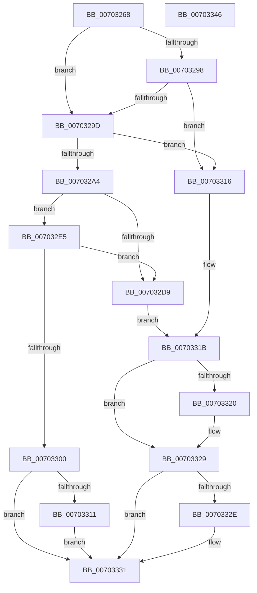

# PopSetHiberFileType

- RVA: `0x00703268`–`0x00703347` (길이 `223` bytes)
- VA: `0x0000000140703268`
- 실행 섹션: `PAGE`
- PDB 이름 있음: `예`; PDB Function 태그: `아니요`
- unwind 정보 RVA: `0x000A2264`
- 디코드: `67`개 명령, `223/223` bytes 표시
- 미해석 바이트: `0` (있으면 어셈블리에 `.byte`로 보존)

> 이 문서는 커널 이미지의 기계어와 PDB 기호를 분석해 생성했습니다. 4번과 5번은 함수 원형과 자료형을 바이너리 사용 방식에서 추정한 C 해석이며 원본 소스 복구 결과는 아닙니다.

## 1. Dependencies

- 직접 호출 지점: **4**; 고유 호출 대상: **4**
- 직접 호출자로 확인된 함수: **2**
- RIP 상대 이미지 참조: **4**

### Outgoing calls
- `0x007032B7` → [PopCalculateHiberFileSize](../75/PopCalculateHiberFileSize_function_0075CC98.md) (function, `0x0075CC98`)
- `0x007032CE` → [PopValidateHiberFileSize](../A9/PopValidateHiberFileSize_function_00A90678.md) (function, `0x00A90678`)
- `0x007032F5` → [PopSetHiberPersistedRegValue](../6F/PopSetHiberPersistedRegValue_function_006FE9F0.md) (function, `0x006FE9F0`)
- `0x00703324` → [PopDiagTraceSetHiberFileFailurePoint](../76/PopDiagTraceSetHiberFileFailurePoint_function_00762D50.md) (function, `0x00762D50`)

### Direct callers
- [PopSetHiberFileSize](PopSetHiberFileSize_function_00703974.md) at `0x007039F2`
- [NtPowerInformation](../95/NtPowerInformation_function_00955D80.md) at `0x00957CC7`

### Static image references
- `0x0070328A` → RVA `0x00FC5070` (`ALMOSTRO`; read)
- `0x007032A4` → RVA `0x00FC5074` (`ALMOSTRO`; read)
- `0x007032AC` → RVA `0x00FC5074` (`ALMOSTRO`; write)
- `0x00703306` → RVA `0x00FC5198` (`ALMOSTRO`; write)

## 2. Other-region calls and transfers

- 다른 실행 섹션으로 향하는 call: **0**
- 별도 외부 분기/꼬리 이동을 확인하지 못했습니다.

## 3. Assembly (complete function range)

```asm
00703268  48 8B C4                        mov rax, rsp
0070326B  48 89 58 08                     mov qword ptr [rax + 8], rbx
0070326F  48 89 68 10                     mov qword ptr [rax + 0x10], rbp
00703273  56                              push rsi
00703274  57                              push rdi
00703275  41 56                           push r14
00703277  48 83 EC 30                     sub rsp, 0x30
0070327B  48 83 60 D8 00                  and qword ptr [rax - 0x28], 0
00703280  4D 8B F0                        mov r14, r8
00703283  83 60 20 00                     and dword ptr [rax + 0x20], 0
00703287  48 8B F2                        mov rsi, rdx
0070328A  83 3D DF 1D 8C 00 28            cmp dword ptr [rip + 0x8c1ddf], 0x28
00703291  BB 01 00 00 00                  mov ebx, 1
00703296  72 05                           jb 0x14070329d
00703298  83 F9 02                        cmp ecx, 2
0070329B  75 79                           jne 0x140703316
0070329D  8D 41 FF                        lea eax, [rcx - 1]
007032A0  3B C3                           cmp eax, ebx
007032A2  77 72                           ja 0x140703316
007032A4  8B 1D CA 1D 8C 00               mov ebx, dword ptr [rip + 0x8c1dca]
007032AA  33 D2                           xor edx, edx
007032AC  89 0D C2 1D 8C 00               mov dword ptr [rip + 0x8c1dc2], ecx
007032B2  48 8D 4C 24 20                  lea rcx, [rsp + 0x20]
007032B7  E8 DC 99 05 00                  call 0x14075cc98
007032BC  48 8B 6C 24 20                  mov rbp, qword ptr [rsp + 0x20]
007032C1  4C 8D 4C 24 68                  lea r9, [rsp + 0x68]
007032C6  48 8B CD                        mov rcx, rbp
007032C9  45 33 C0                        xor r8d, r8d
007032CC  33 D2                           xor edx, edx
007032CE  E8 A5 D3 38 00                  call 0x140a90678
007032D3  8B F8                           mov edi, eax
007032D5  85 C0                           test eax, eax
007032D7  79 0C                           jns 0x1407032e5
007032D9  89 1D 95 1D 8C 00               mov dword ptr [rip + 0x8c1d95], ebx
007032DF  8B 5C 24 68                     mov ebx, dword ptr [rsp + 0x68]
007032E3  EB 36                           jmp 0x14070331b
007032E5  8B 15 89 1D 8C 00               mov edx, dword ptr [rip + 0x8c1d89]
007032EB  4C 8D 44 24 68                  lea r8, [rsp + 0x68]
007032F0  B9 02 00 00 00                  mov ecx, 2
007032F5  E8 F6 B6 FF FF                  call 0x1406fe9f0
007032FA  8B F8                           mov edi, eax
007032FC  85 C0                           test eax, eax
007032FE  78 D9                           js 0x1407032d9
00703300  8B 05 6E 1D 8C 00               mov eax, dword ptr [rip + 0x8c1d6e]
00703306  89 05 8C 1E 8C 00               mov dword ptr [rip + 0x8c1e8c], eax
0070330C  48 85 F6                        test rsi, rsi
0070330F  74 20                           je 0x140703331
00703311  48 89 2E                        mov qword ptr [rsi], rbp
00703314  EB 1B                           jmp 0x140703331
00703316  BF 0D 00 00 C0                  mov edi, 0xc000000d
0070331B  48 85 F6                        test rsi, rsi
0070331E  74 09                           je 0x140703329
00703320  8B D3                           mov edx, ebx
00703322  8B CF                           mov ecx, edi
00703324  E8 27 FA 05 00                  call 0x140762d50
00703329  4D 85 F6                        test r14, r14
0070332C  74 03                           je 0x140703331
0070332E  41 89 1E                        mov dword ptr [r14], ebx
00703331  48 8B 5C 24 50                  mov rbx, qword ptr [rsp + 0x50]
00703336  8B C7                           mov eax, edi
00703338  48 8B 6C 24 58                  mov rbp, qword ptr [rsp + 0x58]
0070333D  48 83 C4 30                     add rsp, 0x30
00703341  41 5E                           pop r14
00703343  5F                              pop rdi
00703344  5E                              pop rsi
00703345  C3                              ret
00703346  CC                              int3
```

## 4. C-style interpretation (structured pseudocode)

```c
__int64 __fastcall PopSetHiberFileType(__int64 a1, __int64 a2, __int64 a3)
{
    __int64 result;
    __int64 v_rsp;
    unsigned __int64 v_stack_m28;
    unsigned __int64 v_stack_p10;
    unsigned __int64 v_stack_p20;
    unsigned __int64 v_stack_p8;

    *(unsigned __int64 *)(v_rsp + 8) = v_rbx;
    *(unsigned __int64 *)(v_rsp + 16) = v_rbp;
    v_rsp = (v_rsp) - (48);
    if ((*(unsigned int *)(v_rip + 9182687)) < 40) goto loc_0070329D;
    if (((unsigned int)(a1)) != 2) goto loc_00703316;
loc_0070329D:
    if (((unsigned int)(a1 - 1)) > 1) goto loc_00703316;
    a2 = 0;
    *(unsigned int *)(v_rip + 9182658) = (unsigned int)(a1);
    result = PopCalculateHiberFileSize(v_stack_m28, a2, a3, a4);
    a3 = 0;
    a2 = 0;
    result = PopValidateHiberFileSize(v_stack_m28, a2, a3, v_stack_p20);
    if (!sign_flag) goto loc_007032E5;
loc_007032D9:
    *(unsigned int *)(v_rip + 9182613) = (unsigned int)((unsigned int)(*(unsigned int *)(v_rip + 9182666)));
    goto loc_0070331B;
loc_007032E5:
    result = PopSetHiberPersistedRegValue(2, (unsigned int)(*(unsigned int *)(v_rip + 9182601)), v_stack_p20, v_stack_p20);
    if (sign_flag) goto loc_007032D9;
    *(unsigned int *)(v_rip + 9182860) = (unsigned int)((unsigned int)(*(unsigned int *)(v_rip + 9182574)));
    if (0 == 0) goto loc_00703331;
    *(unsigned __int64 *)(a2) = v_stack_m28;
    goto loc_00703331;
loc_00703316:
loc_0070331B:
    result = (unsigned int)(*(unsigned int *)(v_rip + 9182574));
    if (0 != 0) {
        a2 = (unsigned int)((unsigned int)(v_stack_p20));
        a1 = (unsigned int)((unsigned int)(0xC000000DULL));
        result = PopDiagTraceSetHiberFileFailurePoint(a1, a2, v_stack_p20, v_stack_p20);
    }
    if (0 != 0) {
        *(unsigned int *)(a3) = (unsigned int)((unsigned int)(v_stack_p20));
    }
    v_rsp = (v_rsp) + (48);
    return (unsigned int)((unsigned int)((unsigned int)(0xC000000DULL)));
}
```

## 5. (Beta) C Style

```c
int64_t PopSetHiberFileType(int64_t Arg1, int64_t Arg2, int64_t Arg3)
{
    int64_t result;
    int64_t local_rsp;
    uint64_t v_stack_m28;
    uint64_t v_stack_p10;
    uint64_t v_stack_p20;
    uint64_t v_stack_p8;

    *(uint64_t *)(local_rsp + 0x8) = local_rbx;
    *(uint64_t *)(local_rsp + 0x10) = local_rbp;
    local_rsp = (local_rsp) - (48);
    if ((*(uint32_t *)(v_rip + 0x8C1DDF)) < 40) goto loc_0070329D;
    if (((uint32_t)(Arg1)) != 2) goto loc_00703316;
loc_0070329D:
    if (((uint32_t)(Arg1 - 1)) > 1) goto loc_00703316;
    Arg2 = 0;
    *(uint32_t *)(v_rip + 0x8C1DC2) = (uint32_t)(Arg1);
    result = PopCalculateHiberFileSize(v_stack_m28, Arg2, Arg3, a4);
    Arg3 = 0;
    Arg2 = 0;
    result = PopValidateHiberFileSize(v_stack_m28, Arg2, Arg3, v_stack_p20);
    if (!sign_flag) goto loc_007032E5;
loc_007032D9:
    *(uint32_t *)(v_rip + 0x8C1D95) = (uint32_t)((uint32_t)(*(uint32_t *)(v_rip + 0x8C1DCA)));
    goto loc_0070331B;
loc_007032E5:
    result = PopSetHiberPersistedRegValue(2, (uint32_t)(*(uint32_t *)(v_rip + 0x8C1D89)), v_stack_p20, v_stack_p20);
    if (sign_flag) goto loc_007032D9;
    *(uint32_t *)(v_rip + 0x8C1E8C) = (uint32_t)((uint32_t)(*(uint32_t *)(v_rip + 0x8C1D6E)));
    if (0 == 0) goto loc_00703331;
    *(uint64_t *)(Arg2) = v_stack_m28;
    goto loc_00703331;
loc_00703316:
loc_0070331B:
    result = (uint32_t)(*(uint32_t *)(v_rip + 0x8C1D6E));
    if (0 != 0) {
        Arg2 = (uint32_t)((uint32_t)(v_stack_p20));
        Arg1 = (uint32_t)((uint32_t)(0xC000000DULL));
        result = PopDiagTraceSetHiberFileFailurePoint(Arg1, Arg2, v_stack_p20, v_stack_p20);
    }
    if (0 != 0) {
        *(uint32_t *)(Arg3) = (uint32_t)((uint32_t)(v_stack_p20));
    }
    local_rsp = (local_rsp) + (48);
    return (uint32_t)((uint32_t)((uint32_t)(0xC000000DULL)));
}
```

## 6. Execution-region graph

[열기: 2D/3D 그래프와 함수 탐색 컨트롤 패널](../../../control-panel.html?section=page&rva=0x00703268&view=graph)

- 2D 그래프는 위에서 아래로 흐르고, 3D 그래프는 빈 공간을 드래그해 회전합니다. Shift+드래그는 이동, 휠은 확대·축소, 함수 노드 선택은 대상 보고서 이동입니다.

### Static fallback


