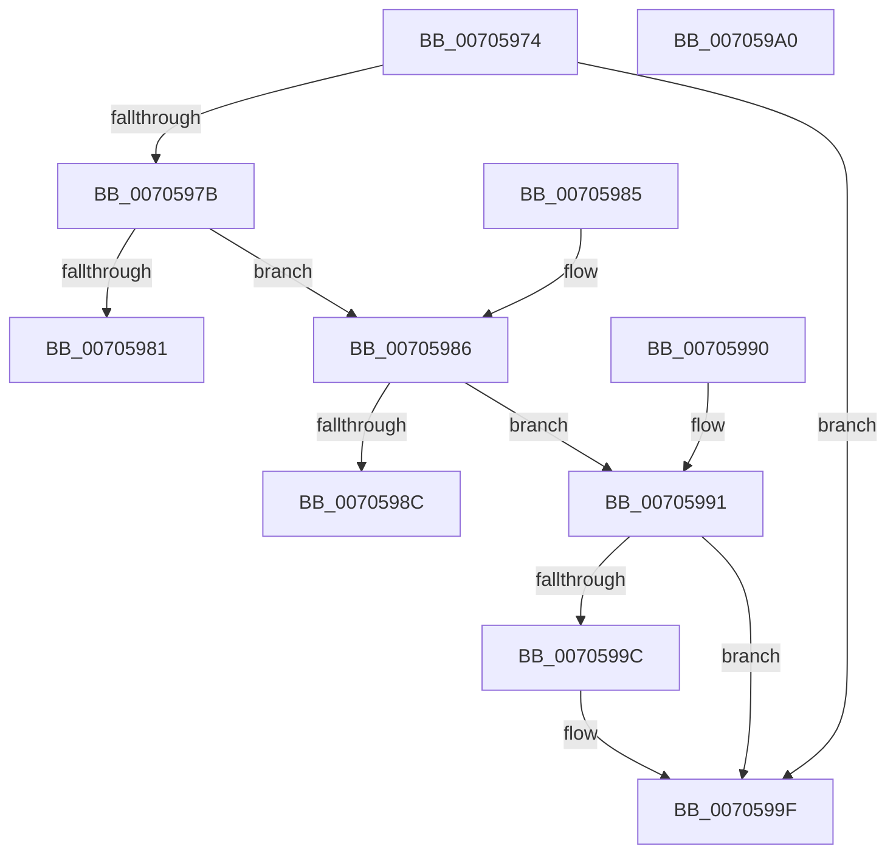

# PopTransitionGetWakeTimerType

- RVA: `0x00705974`–`0x007059A1` (길이 `45` bytes)
- VA: `0x0000000140705974`
- 실행 섹션: `PAGE`
- PDB 이름 있음: `예`; PDB Function 태그: `아니요`
- unwind 정보 RVA: `0x000DB714`
- 디코드: `19`개 명령, `45/45` bytes 표시
- 미해석 바이트: `0` (있으면 어셈블리에 `.byte`로 보존)

> 이 문서는 커널 이미지의 기계어와 PDB 기호를 분석해 생성했습니다. 4번과 5번은 함수 원형과 자료형을 바이너리 사용 방식에서 추정한 C 해석이며 원본 소스 복구 결과는 아닙니다.

## 1. Dependencies

- 직접 호출 지점: **0**; 고유 호출 대상: **0**
- 직접 호출자로 확인된 함수: **1**
- RIP 상대 이미지 참조: **0**

### Outgoing calls
- 직접 디코드된 call 명령이 없습니다.

### Direct callers
- [PopTransitionSystemPowerStateEx](../../pagelk/B7/PopTransitionSystemPowerStateEx_function_00B7E8C0.md) at `0x00B7F608`
- [PopTransitionSystemPowerStateEx](../../pagelk/B7/PopTransitionSystemPowerStateEx_function_00B7E8C0.md) at `0x00B7F61A`

### Static image references
- 디코드된 RIP-relative 메모리 참조가 없습니다.

## 2. Other-region calls and transfers

- 다른 실행 섹션으로 향하는 call: **0**
- 별도 외부 분기/꼬리 이동을 확인하지 못했습니다.

## 3. Assembly (complete function range)

```asm
00705974  33 C0                           xor eax, eax
00705976  48 85 C9                        test rcx, rcx
00705979  74 24                           je 0x14070599f
0070597B  48 83 F9 FF                     cmp rcx, -1
0070597F  75 05                           jne 0x140705986
00705981  8D 41 05                        lea eax, [rcx + 5]
00705984  C3                              ret
00705985  CC                              int3
00705986  48 83 F9 FE                     cmp rcx, -2
0070598A  75 05                           jne 0x140705991
0070598C  8D 41 07                        lea eax, [rcx + 7]
0070598F  C3                              ret
00705990  CC                              int3
00705991  B8 06 00 00 00                  mov eax, 6
00705996  48 83 F9 FD                     cmp rcx, -3
0070599A  74 03                           je 0x14070599f
0070599C  8B 41 08                        mov eax, dword ptr [rcx + 8]
0070599F  C3                              ret
007059A0  CC                              int3
```

## 4. C-style interpretation (structured pseudocode)

```c
__int64 __fastcall PopTransitionGetWakeTimerType(__int64 a1)
{
    __int64 result;

    result = 0;
    if (a1 == 0) goto loc_0070599F;
    if (a1 != -1) goto loc_00705986;
    return a1 + 5;
loc_00705986:
    if (a1 != -2) goto loc_00705991;
    return a1 + 7;
loc_00705991:
    result = 6;
    if (a1 != -3) {
        result = *(unsigned int *)(a1 + 8);
    }
    return result;
}
```

## 5. (Beta) C Style

```c
int64_t PopTransitionGetWakeTimerType(int64_t Arg1)
{
    int64_t result;

    result = 0;
    if (Arg1 == 0) goto loc_0070599F;
    if (Arg1 != -1) goto loc_00705986;
    return Arg1 + 5;
loc_00705986:
    if (Arg1 != -2) goto loc_00705991;
    return Arg1 + 7;
loc_00705991:
    result = 6;
    if (Arg1 != -3) {
        result = *(uint32_t *)(Arg1 + 0x8);
    }
    return result;
}
```

## 6. Execution-region graph

[열기: 2D/3D 그래프와 함수 탐색 컨트롤 패널](../../../control-panel.html?section=page&rva=0x00705974&view=graph)

- 2D 그래프는 위에서 아래로 흐르고, 3D 그래프는 빈 공간을 드래그해 회전합니다. Shift+드래그는 이동, 휠은 확대·축소, 함수 노드 선택은 대상 보고서 이동입니다.

### Static fallback


