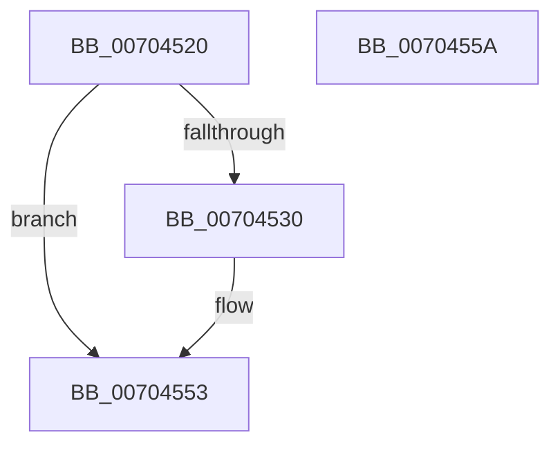

# PpDevCfgRequestDeviceInstall

- RVA: `0x00704520`–`0x0070455B` (길이 `59` bytes)
- VA: `0x0000000140704520`
- 실행 섹션: `PAGE`
- PDB 이름 있음: `예`; PDB Function 태그: `아니요`
- unwind 정보 RVA: `0x00063458`
- 디코드: `18`개 명령, `59/59` bytes 표시
- 미해석 바이트: `0` (있으면 어셈블리에 `.byte`로 보존)

> 이 문서는 커널 이미지의 기계어와 PDB 기호를 분석해 생성했습니다. 4번과 5번은 함수 원형과 자료형을 바이너리 사용 방식에서 추정한 C 해석이며 원본 소스 복구 결과는 아닙니다.

## 1. Dependencies

- 직접 호출 지점: **1**; 고유 호출 대상: **1**
- 직접 호출자로 확인된 함수: **2**
- RIP 상대 이미지 참조: **2**

### Outgoing calls
- `0x0070454C` → [ZwUpdateWnfStateData](../../text/6B/ZwUpdateWnfStateData_function_006B0D10.md) (function, `0x006B0D10`)

### Direct callers
- [PiUEventNotifyUserMode](../95/PiUEventNotifyUserMode_function_00954CB4.md) at `0x00954D4C`
- [PpDevCfgInit](../../init/C3/PpDevCfgInit_function_00C351A4.md) at `0x00C353FA`

### Static image references
- `0x00704524` → RVA `0x00FD8030` (`PAGEDATA`; read)
- `0x00704545` → RVA `0x00020908` (`.rdata`; read)

## 2. Other-region calls and transfers

- 다른 실행 섹션으로 향하는 call: **1**
  - `0x0070454C` → [ZwUpdateWnfStateData](../../text/6B/ZwUpdateWnfStateData_function_006B0D10.md) (`PAGE` → `.text`)
- 별도 외부 분기/꼬리 이동을 확인하지 못했습니다.

## 3. Assembly (complete function range)

```asm
00704520  48 83 EC 48                     sub rsp, 0x48
00704524  8B 05 06 3B 8D 00               mov eax, dword ptr [rip + 0x8d3b06]
0070452A  33 C9                           xor ecx, ecx
0070452C  A8 02                           test al, 2
0070452E  74 23                           je 0x140704553
00704530  89 4C 24 30                     mov dword ptr [rsp + 0x30], ecx
00704534  45 33 C9                        xor r9d, r9d
00704537  89 4C 24 28                     mov dword ptr [rsp + 0x28], ecx
0070453B  45 33 C0                        xor r8d, r8d
0070453E  48 89 4C 24 20                  mov qword ptr [rsp + 0x20], rcx
00704543  33 D2                           xor edx, edx
00704545  48 8D 0D BC C3 91 FF            lea rcx, [rip - 0x6e3c44]
0070454C  E8 BF C7 FA FF                  call 0x1406b0d10
00704551  8B C8                           mov ecx, eax
00704553  8B C1                           mov eax, ecx
00704555  48 83 C4 48                     add rsp, 0x48
00704559  C3                              ret
0070455A  CC                              int3
```

## 4. C-style interpretation (structured pseudocode)

```c
__int64 __fastcall PpDevCfgRequestDeviceInstall(int a1, int a2, int a3, int a4)
{
    __int64 result;
    __int64 v_rsp;
    unsigned int v_stack_m18;
    unsigned int v_stack_m20;
    unsigned __int64 v_stack_m28;

    v_rsp = (v_rsp) - (72);
    a1 = 0;
    result = (unsigned int)(*(unsigned int *)(v_rip + 9255686));
    if ((((unsigned __int8)((unsigned int)(*(unsigned int *)(v_rip + 9255686)))) & (2)) != 0) {
        v_stack_m18 = 0;
        a4 = 0;
        v_stack_m20 = 0;
        a3 = 0;
        v_stack_m28 = 0;
        a2 = 0;
        a1 = v_rip - 7224388;
        result = ZwUpdateWnfStateData(a1, a2, a3, a4);
        a1 = (unsigned int)(result);
    }
    v_rsp = (v_rsp) + (72);
    return (unsigned int)(a1);
}
```

## 5. (Beta) C Style

```c
int64_t PpDevCfgRequestDeviceInstall(int32_t Arg1, int32_t Arg2, int32_t Arg3, int32_t Arg4)
{
    int64_t result;
    int64_t local_rsp;
    uint32_t v_stack_m18;
    uint32_t v_stack_m20;
    uint64_t v_stack_m28;

    local_rsp = (local_rsp) - (72);
    Arg1 = 0;
    result = (uint32_t)(*(uint32_t *)(v_rip + 0x8D3B06));
    if ((((uint8_t)((uint32_t)(*(uint32_t *)(v_rip + 0x8D3B06)))) & (2)) != 0) {
        v_stack_m18 = 0;
        Arg4 = 0;
        v_stack_m20 = 0;
        Arg3 = 0;
        v_stack_m28 = 0;
        Arg2 = 0;
        Arg1 = v_rip - 7224388;
        result = ZwUpdateWnfStateData(Arg1, Arg2, Arg3, Arg4);
        Arg1 = (uint32_t)(result);
    }
    local_rsp = (local_rsp) + (72);
    return (uint32_t)(Arg1);
}
```

## 6. Execution-region graph

[열기: 2D/3D 그래프와 함수 탐색 컨트롤 패널](../../../control-panel.html?section=page&rva=0x00704520&view=graph)

- 2D 그래프는 위에서 아래로 흐르고, 3D 그래프는 빈 공간을 드래그해 회전합니다. Shift+드래그는 이동, 휠은 확대·축소, 함수 노드 선택은 대상 보고서 이동입니다.

### Static fallback


