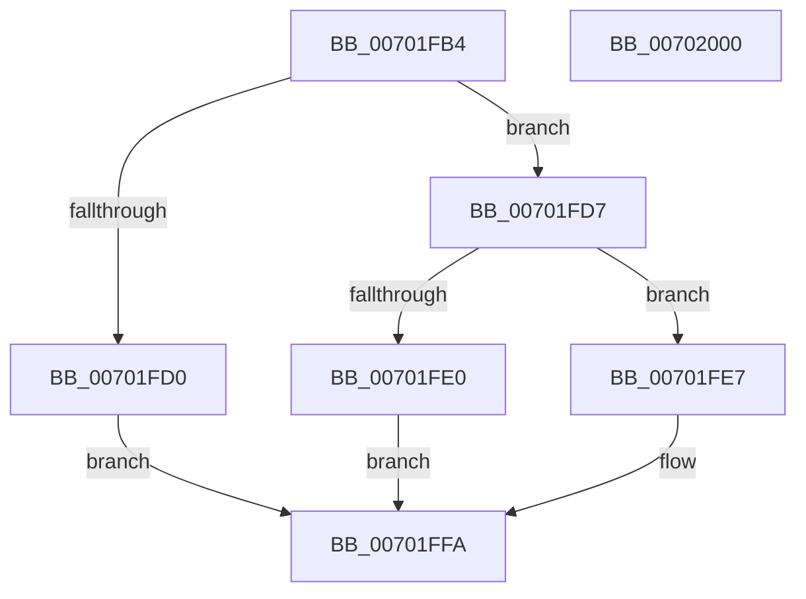

# PpmUpdateIdleContext

- RVA: `0x00701FB4`–`0x00702001` (길이 `77` bytes)
- VA: `0x0000000140701FB4`
- 실행 섹션: `PAGE`
- PDB 이름 있음: `예`; PDB Function 태그: `아니요`
- unwind 정보 RVA: `0x0005CF00`
- 디코드: `21`개 명령, `77/77` bytes 표시
- 미해석 바이트: `0` (있으면 어셈블리에 `.byte`로 보존)

> 이 문서는 커널 이미지의 기계어와 PDB 기호를 분석해 생성했습니다. 4번과 5번은 함수 원형과 자료형을 바이너리 사용 방식에서 추정한 C 해석이며 원본 소스 복구 결과는 아닙니다.

## 1. Dependencies

- 직접 호출 지점: **1**; 고유 호출 대상: **1**
- 직접 호출자로 확인된 함수: **1**
- RIP 상대 이미지 참조: **0**

### Outgoing calls
- `0x00701FBD` → [KeGetPrcb](../../text/2D/KeGetPrcb_function_002D85D0.md) (function, `0x002D85D0`)

### Direct callers
- [PpmUpdateIdleStates](../A7/PpmUpdateIdleStates_function_00A7E370.md) at `0x00A7E3F1`

### Static image references
- 디코드된 RIP-relative 메모리 참조가 없습니다.

## 2. Other-region calls and transfers

- 다른 실행 섹션으로 향하는 call: **1**
  - `0x00701FBD` → [KeGetPrcb](../../text/2D/KeGetPrcb_function_002D85D0.md) (`PAGE` → `.text`)
- 별도 외부 분기/꼬리 이동을 확인하지 못했습니다.

## 3. Assembly (complete function range)

```asm
00701FB4  40 53                           push rbx
00701FB6  48 83 EC 20                     sub rsp, 0x20
00701FBA  48 8B DA                        mov rbx, rdx
00701FBD  E8 0E 66 BD FF                  call 0x1402d85d0
00701FC2  4C 8B 80 40 88 00 00            mov r8, qword ptr [rax + 0x8840]
00701FC9  33 C0                           xor eax, eax
00701FCB  4D 85 C0                        test r8, r8
00701FCE  75 07                           jne 0x140701fd7
00701FD0  B8 BB 00 00 C0                  mov eax, 0xc00000bb
00701FD5  EB 23                           jmp 0x140701ffa
00701FD7  49 39 80 98 02 00 00            cmp qword ptr [r8 + 0x298], rax
00701FDE  75 07                           jne 0x140701fe7
00701FE0  B8 89 01 00 C0                  mov eax, 0xc0000189
00701FE5  EB 13                           jmp 0x140701ffa
00701FE7  41 C7 40 2C 04 00 00 00         mov dword ptr [r8 + 0x2c], 4
00701FEF  48 8B 4B 08                     mov rcx, qword ptr [rbx + 8]
00701FF3  49 89 88 98 02 00 00            mov qword ptr [r8 + 0x298], rcx
00701FFA  48 83 C4 20                     add rsp, 0x20
00701FFE  5B                              pop rbx
00701FFF  C3                              ret
00702000  CC                              int3
```

## 4. C-style interpretation (structured pseudocode)

```c
__int64 __fastcall PpmUpdateIdleContext(__int64 a1, __int64 a2)
{
    __int64 result;
    __int64 v_rsp;

    v_rsp = (v_rsp) - (32);
    result = KeGetPrcb(a1, a2, a3, a4);
    result = 0;
    if (*(unsigned __int64 *)(result + 34880) != 0) goto loc_00701FD7;
    goto loc_00701FFA;
loc_00701FD7:
    if ((*(unsigned __int64 *)(*(unsigned __int64 *)(result + 34880) + 664)) != ((unsigned int)(0xC00000BBULL))) goto loc_00701FE7;
    goto loc_00701FFA;
loc_00701FE7:
    *(unsigned int *)(*(unsigned __int64 *)(result + 34880) + 44) = 4;
    *(unsigned __int64 *)(*(unsigned __int64 *)(result + 34880) + 664) = *(unsigned __int64 *)(a2 + 8);
loc_00701FFA:
    v_rsp = (v_rsp) + (32);
    return (unsigned int)(0xC0000189ULL);
}
```

## 5. (Beta) C Style

```c
int64_t PpmUpdateIdleContext(int64_t Arg1, void *Arg2)
{
    uint8_t *arg2 = (uint8_t *)Arg2;

    int64_t result;
    int64_t local_rsp;

    local_rsp = (local_rsp) - (32);
    result = KeGetPrcb(Arg1, Arg2, a3, a4);
    result = 0;
    if (*(uint64_t *)(result + 0x8840) != 0) goto loc_00701FD7;
    goto loc_00701FFA;
loc_00701FD7:
    if ((*(uint64_t *)(*(uint64_t *)(result + 0x8840) + 0x298)) != ((uint32_t)(0xC00000BBULL))) goto loc_00701FE7;
    goto loc_00701FFA;
loc_00701FE7:
    *(uint32_t *)(*(uint64_t *)(result + 0x8840) + 0x2C) = 4;
    *(uint64_t *)(*(uint64_t *)(result + 0x8840) + 0x298) = *(uint64_t *)(arg2 + 0x8);
loc_00701FFA:
    local_rsp = (local_rsp) + (32);
    return (uint32_t)(0xC0000189ULL);
}
```

### 관측된 메모리 오프셋

구조체 형식이 확인되지 않은 접근은 인자 기준의 오프셋으로만 기록했습니다.

| 기준 인자 | 오프셋 표현 | 폭 (bit) | 접근 |
|---|---:|---:|---|
| `Arg2` | `+ 0x8` | `64` | `R` |

## 6. Execution-region graph

[열기: 2D/3D 그래프와 함수 탐색 컨트롤 패널](../../../control-panel.html?section=page&rva=0x00701FB4&view=graph)

- 2D 그래프는 위에서 아래로 흐르고, 3D 그래프는 빈 공간을 드래그해 회전합니다. Shift+드래그는 이동, 휠은 확대·축소, 함수 노드 선택은 대상 보고서 이동입니다.

### Static fallback


