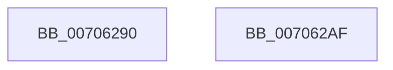

# PsQueryThreadTerminationPort

- RVA: `0x00706290`–`0x007062B0` (길이 `32` bytes)
- VA: `0x0000000140706290`
- 실행 섹션: `PAGE`
- PDB 이름 있음: `예`; PDB Function 태그: `아니요`
- unwind 정보 RVA: `0x000DB714`
- 디코드: `7`개 명령, `32/32` bytes 표시
- 미해석 바이트: `0` (있으면 어셈블리에 `.byte`로 보존)

> 이 문서는 커널 이미지의 기계어와 PDB 기호를 분석해 생성했습니다. 4번과 5번은 함수 원형과 자료형을 바이너리 사용 방식에서 추정한 C 해석이며 원본 소스 복구 결과는 아닙니다.

## 1. Dependencies

- 직접 호출 지점: **0**; 고유 호출 대상: **0**
- 직접 호출자로 확인된 함수: **1**
- RIP 상대 이미지 참조: **2**

### Outgoing calls
- 직접 디코드된 call 명령이 없습니다.

### Direct callers
- [sub_0069B640](../../text/69/Unknown_function_0069B640.md) at `0x0069B65C`

### Static image references
- `0x00706299` → RVA `0x00028AA0` (`.rdata`; read)
- `0x007062A4` → RVA `0x00028AF0` (`.rdata`; read)

## 2. Other-region calls and transfers

- 다른 실행 섹션으로 향하는 call: **0**
- 별도 외부 분기/꼬리 이동을 확인하지 못했습니다.

## 3. Assembly (complete function range)

```asm
00706290  65 48 8B 0C 25 20 00 00 00      mov rcx, qword ptr gs:[0x20]
00706299  48 8B 05 00 28 92 FF            mov rax, qword ptr [rip - 0x6dd800]
007062A0  48 8B 14 08                     mov rdx, qword ptr [rax + rcx]
007062A4  48 8B 05 45 28 92 FF            mov rax, qword ptr [rip - 0x6dd7bb]
007062AB  48 03 C2                        add rax, rdx
007062AE  C3                              ret
007062AF  CC                              int3
```

## 4. C-style interpretation (structured pseudocode)

```c
__int64 __fastcall PsQueryThreadTerminationPort(void)
{
    __int64 result;

    result = (*(unsigned __int64 *)(v_rip - 7198651)) + (*(unsigned __int64 *)(*(unsigned __int64 *)(v_rip - 7198720) + *(unsigned __int64 *)(gs_base + (0 + 32)) * 1));
    return result;
}
```

## 5. (Beta) C Style

```c
void PsQueryThreadTerminationPort(void)
{
    int64_t result;

    result = (*(uint64_t *)(v_rip - 0x6DD7BB)) + (*(uint64_t *)(*(uint64_t *)(v_rip - 0x6DD800) + *(uint64_t *)(gs_base + (0 + 0x20)) * 1));
    return result;
}
```

## 6. Execution-region graph

[열기: 2D/3D 그래프와 함수 탐색 컨트롤 패널](../../../control-panel.html?section=page&rva=0x00706290&view=graph)

- 2D 그래프는 위에서 아래로 흐르고, 3D 그래프는 빈 공간을 드래그해 회전합니다. Shift+드래그는 이동, 휠은 확대·축소, 함수 노드 선택은 대상 보고서 이동입니다.

### Static fallback


