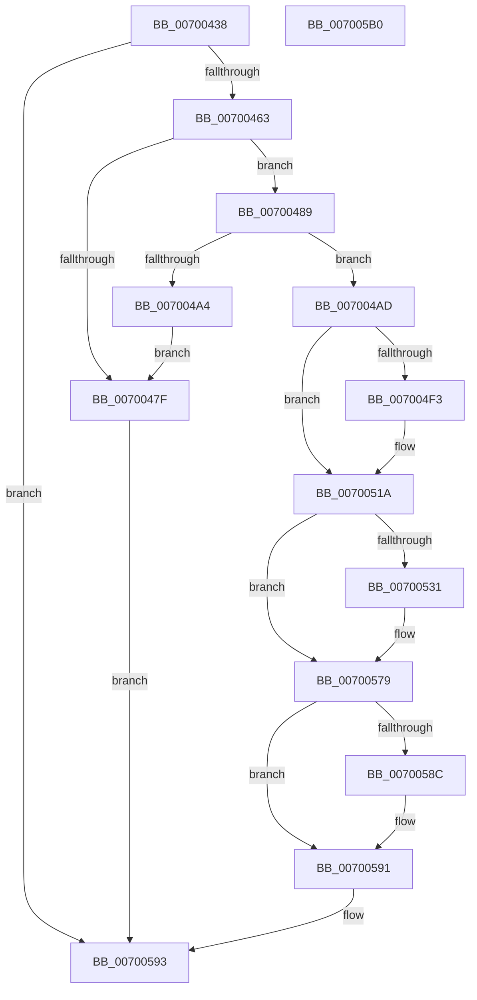

# PsSessionCreate

- RVA: `0x00700438`–`0x007005B1` (길이 `377` bytes)
- VA: `0x0000000140700438`
- 실행 섹션: `PAGE`
- PDB 이름 있음: `예`; PDB Function 태그: `아니요`
- unwind 정보 RVA: `0x000B6754`
- 디코드: `86`개 명령, `377/377` bytes 표시
- 미해석 바이트: `0` (있으면 어셈블리에 `.byte`로 보존)

> 이 문서는 커널 이미지의 기계어와 PDB 기호를 분석해 생성했습니다. 4번과 5번은 함수 원형과 자료형을 바이너리 사용 방식에서 추정한 C 해석이며 원본 소스 복구 결과는 아닙니다.

## 1. Dependencies

- 직접 호출 지점: **14**; 고유 호출 대상: **14**
- 직접 호출자로 확인된 함수: **2**
- RIP 상대 이미지 참조: **3**

### Outgoing calls
- `0x00700456` → [PspInitializeSessionGlobals](PspInitializeSessionGlobals_function_007005B8.md) (function, `0x007005B8`)
- `0x00700473` → [PspGetNewSessionId](../78/PspGetNewSessionId_function_00789108.md) (function, `0x00789108`)
- `0x00700497` → [ExAllocatePool2](../../poolcode/B8/ExAllocatePool2_function_00B820F0.md) (function, `0x00B820F0`)
- `0x007004A6` → [PspFreeSessionId](../78/PspFreeSessionId_function_007890B8.md) (function, `0x007890B8`)
- `0x007004C4` → [KeQueryInterruptTimePrecise](../../text/20/KeQueryInterruptTimePrecise_function_00209530.md) (function, `0x00209530`)
- `0x007004E2` → [PsGetCurrentServerSilo](../../text/22/PsGetCurrentServerSilo_function_00225710.md) (function, `0x00225710`)
- `0x007004FB` → [ObfReferenceObjectWithTag](../../text/21/ObfReferenceObjectWithTag_function_00210710.md) (function, `0x00210710`)
- `0x00700507` → [PsGetServerSiloGlobals](../../text/22/PsGetServerSiloGlobals_function_002250A0.md) (function, `0x002250A0`)
- `0x00700520` → [PspMarkSessionReferenceProcess](../78/PspMarkSessionReferenceProcess_function_00789220.md) (function, `0x00789220`)
- `0x00700574` → [EtwTraceKernelEvent](../../text/23/EtwTraceKernelEvent_function_00235350.md) (function, `0x00235350`)
- `0x0070057C` → [PspMakeSessionVisible](../AC/PspMakeSessionVisible_function_00ACA0B8.md) (function, `0x00ACA0B8`)
- `0x00700581` → [PspSessionObjectCreate](../78/PspSessionObjectCreate_function_007892A8.md) (function, `0x007892A8`)
- `0x0070058C` → [PsDereferenceSession](../A1/PsDereferenceSession_function_00A1827C.md) (function, `0x00A1827C`)
- `0x0070059B` → [_security_check_cookie](../../text/6A/_security_check_cookie_function_006AC640.md) (function, `0x006AC640`)

### Direct callers
- [MmInitializeProcessAddressSpace](../8C/MmInitializeProcessAddressSpace_function_008CF6B0.md) at `0x008CFA4A`
- [MiMapProcessExecutable](../8C/MiMapProcessExecutable_function_008CFDB4.md) at `0x008CFED3`

### Static image references
- `0x00700447` → RVA `0x00E0A740` (`.data`; read)
- `0x007004BB` → RVA `0x00FD9A98` (`PAGEDATA`; read)
- `0x00700525` → RVA `0x00FC6B04` (`ALMOSTRO`; read)

## 2. Other-region calls and transfers

- 다른 실행 섹션으로 향하는 call: **7**
  - `0x00700497` → [ExAllocatePool2](../../poolcode/B8/ExAllocatePool2_function_00B820F0.md) (`PAGE` → `POOLCODE`)
  - `0x007004C4` → [KeQueryInterruptTimePrecise](../../text/20/KeQueryInterruptTimePrecise_function_00209530.md) (`PAGE` → `.text`)
  - `0x007004E2` → [PsGetCurrentServerSilo](../../text/22/PsGetCurrentServerSilo_function_00225710.md) (`PAGE` → `.text`)
  - `0x007004FB` → [ObfReferenceObjectWithTag](../../text/21/ObfReferenceObjectWithTag_function_00210710.md) (`PAGE` → `.text`)
  - `0x00700507` → [PsGetServerSiloGlobals](../../text/22/PsGetServerSiloGlobals_function_002250A0.md) (`PAGE` → `.text`)
  - `0x00700574` → [EtwTraceKernelEvent](../../text/23/EtwTraceKernelEvent_function_00235350.md) (`PAGE` → `.text`)
  - `0x0070059B` → [_security_check_cookie](../../text/6A/_security_check_cookie_function_006AC640.md) (`PAGE` → `.text`)
- 별도 외부 분기/꼬리 이동을 확인하지 못했습니다.

## 3. Assembly (complete function range)

```asm
00700438  48 89 5C 24 08                  mov qword ptr [rsp + 8], rbx
0070043D  48 89 74 24 10                  mov qword ptr [rsp + 0x10], rsi
00700442  57                              push rdi
00700443  48 83 EC 60                     sub rsp, 0x60
00700447  48 8B 05 F2 A2 70 00            mov rax, qword ptr [rip + 0x70a2f2]
0070044E  48 33 C4                        xor rax, rsp
00700451  48 89 44 24 58                  mov qword ptr [rsp + 0x58], rax
00700456  E8 5D 01 00 00                  call 0x1407005b8
0070045B  85 C0                           test eax, eax
0070045D  0F 88 30 01 00 00               js 0x140700593
00700463  65 48 8B 04 25 88 01 00 00      mov rax, qword ptr gs:[0x188]
0070046C  48 8B B0 B8 00 00 00            mov rsi, qword ptr [rax + 0xb8]
00700473  E8 90 8C 08 00                  call 0x140789108
00700478  8B F8                           mov edi, eax
0070047A  83 F8 FF                        cmp eax, -1
0070047D  75 0A                           jne 0x140700489
0070047F  B8 17 00 00 C0                  mov eax, 0xc0000017
00700484  E9 0A 01 00 00                  jmp 0x140700593
00700489  BA B0 00 00 00                  mov edx, 0xb0
0070048E  41 B8 4D 69 53 73               mov r8d, 0x7353694d
00700494  8D 4A 90                        lea ecx, [rdx - 0x70]
00700497  E8 54 1C 48 00                  call 0x140b820f0
0070049C  48 8B D8                        mov rbx, rax
0070049F  48 85 C0                        test rax, rax
007004A2  75 09                           jne 0x1407004ad
007004A4  8B CF                           mov ecx, edi
007004A6  E8 0D 8C 08 00                  call 0x1407890b8
007004AB  EB D2                           jmp 0x14070047f
007004AD  C7 00 01 00 00 00               mov dword ptr [rax], 1
007004B3  48 8D 4C 24 30                  lea rcx, [rsp + 0x30]
007004B8  89 78 08                        mov dword ptr [rax + 8], edi
007004BB  8B 05 D7 95 8D 00               mov eax, dword ptr [rip + 0x8d95d7]
007004C1  89 43 30                        mov dword ptr [rbx + 0x30], eax
007004C4  E8 67 90 B0 FF                  call 0x140209530
007004C9  48 89 83 A8 00 00 00            mov qword ptr [rbx + 0xa8], rax
007004D0  48 8D 43 10                     lea rax, [rbx + 0x10]
007004D4  48 89 40 08                     mov qword ptr [rax + 8], rax
007004D8  48 89 00                        mov qword ptr [rax], rax
007004DB  C7 43 0C 01 00 00 00            mov dword ptr [rbx + 0xc], 1
007004E2  E8 29 52 B2 FF                  call 0x140225710
007004E7  48 89 83 A0 00 00 00            mov qword ptr [rbx + 0xa0], rax
007004EE  48 85 C0                        test rax, rax
007004F1  74 27                           je 0x14070051a
007004F3  BA 4D 6D 53 73                  mov edx, 0x73536d4d
007004F8  48 8B C8                        mov rcx, rax
007004FB  E8 10 02 B1 FF                  call 0x140210710
00700500  48 8B 8B A0 00 00 00            mov rcx, qword ptr [rbx + 0xa0]
00700507  E8 94 4B B2 FF                  call 0x1402250a0
0070050C  48 8B 90 08 05 00 00            mov rdx, qword ptr [rax + 0x508]
00700513  83 C8 FF                        or eax, 0xffffffff
00700516  F0 0F B1 3A                     lock cmpxchg dword ptr [rdx], edi
0070051A  48 8B D3                        mov rdx, rbx
0070051D  48 8B CE                        mov rcx, rsi
00700520  E8 FB 8C 08 00                  call 0x140789220
00700525  F7 05 D5 65 8C 00 00 00 40 00   test dword ptr [rip + 0x8c65d5], 0x400000
0070052F  74 48                           je 0x140700579
00700531  83 64 24 44 00                  and dword ptr [rsp + 0x44], 0
00700536  48 8D 44 24 38                  lea rax, [rsp + 0x38]
0070053B  83 64 24 54 00                  and dword ptr [rsp + 0x54], 0
00700540  48 8D 4C 24 48                  lea rcx, [rsp + 0x48]
00700545  41 B9 4B 02 00 00               mov r9d, 0x24b
0070054B  48 89 44 24 48                  mov qword ptr [rsp + 0x48], rax
00700550  BA 01 00 00 00                  mov edx, 1
00700555  89 7C 24 40                     mov dword ptr [rsp + 0x40], edi
00700559  41 B8 00 00 40 20               mov r8d, 0x20400000
0070055F  48 89 5C 24 38                  mov qword ptr [rsp + 0x38], rbx
00700564  C7 44 24 50 0C 00 00 00         mov dword ptr [rsp + 0x50], 0xc
0070056C  C7 44 24 20 03 18 50 00         mov dword ptr [rsp + 0x20], 0x501803
00700574  E8 D7 4D B3 FF                  call 0x140235350
00700579  48 8B CB                        mov rcx, rbx
0070057C  E8 37 9B 3C 00                  call 0x140aca0b8
00700581  E8 22 8D 08 00                  call 0x1407892a8
00700586  8B D8                           mov ebx, eax
00700588  85 C0                           test eax, eax
0070058A  79 05                           jns 0x140700591
0070058C  E8 EB 7C 31 00                  call 0x140a1827c
00700591  8B C3                           mov eax, ebx
00700593  48 8B 4C 24 58                  mov rcx, qword ptr [rsp + 0x58]
00700598  48 33 CC                        xor rcx, rsp
0070059B  E8 A0 C0 FA FF                  call 0x1406ac640
007005A0  48 8B 5C 24 70                  mov rbx, qword ptr [rsp + 0x70]
007005A5  48 8B 74 24 78                  mov rsi, qword ptr [rsp + 0x78]
007005AA  48 83 C4 60                     add rsp, 0x60
007005AE  5F                              pop rdi
007005AF  C3                              ret
007005B0  CC                              int3
```

## 4. C-style interpretation (structured pseudocode)

```c
__int64 __fastcall PsSessionCreate(void)
{
    __int64 result;
    __int64 v_rsp;
    unsigned __int64 v_stack_m10;
    unsigned int v_stack_m14;
    unsigned int v_stack_m18;
    unsigned __int64 v_stack_m20;
    unsigned int v_stack_m24;
    unsigned int v_stack_m28;
    unsigned __int64 v_stack_m30;
    unsigned __int64 v_stack_m38;
    unsigned int v_stack_m48;
    unsigned __int64 v_stack_p10;
    unsigned __int64 v_stack_p8;

    v_stack_p8 = v_rbx;
    v_stack_p10 = v_rsi;
    v_rsp = (v_rsp) - (96);
    result = (*(unsigned __int64 *)(v_rip + 7381746)) ^ (v_rsp);
    v_stack_m10 = result;
    result = PspInitializeSessionGlobals(a1, a2, a3, a4);
    if (sign_flag) goto loc_00700593;
    result = PspGetNewSessionId(a1, a2, a3, a4);
    if (((unsigned int)(result)) != -1) goto loc_00700489;
loc_0070047F:
    goto loc_00700593;
loc_00700489:
    result = ExAllocatePool2(176 - 112, 176, (unsigned int)(0x7353694DULL), a4);
    if (result != 0) goto loc_007004AD;
    result = PspFreeSessionId((unsigned int)((unsigned int)((unsigned int)((unsigned int)(result)))), 176, (unsigned int)(0x7353694DULL), a4);
    goto loc_0070047F;
loc_007004AD:
    *(unsigned int *)(result) = 1;
    *(unsigned int *)(result + 8) = (unsigned int)((unsigned int)((unsigned int)(result)));
    *(unsigned int *)(result + 48) = (unsigned int)((unsigned int)(*(unsigned int *)(v_rip + 9278935)));
    result = KeQueryInterruptTimePrecise(v_stack_m38, 176, (unsigned int)(0x7353694DULL), a4);
    *(unsigned __int64 *)(result + 168) = result;
    *(unsigned __int64 *)(result + 16 + 8) = result + 16;
    *(unsigned __int64 *)(result + 16) = result + 16;
    *(unsigned int *)(result + 12) = 1;
    result = PsGetCurrentServerSilo(v_stack_m38, 176, (unsigned int)(0x7353694DULL), a4);
    *(unsigned __int64 *)(result + 160) = result;
    if (result != 0) {
        a2 = 0x73536D4DULL;
        a1 = result;
        result = ObfReferenceObjectWithTag(a1, a2, (unsigned int)(0x7353694DULL), a4);
        a1 = *(unsigned __int64 *)(result + 160);
        result = PsGetServerSiloGlobals(a1, a2, (unsigned int)(0x7353694DULL), a4);
        a2 = *(unsigned __int64 *)(result + 1288);
        result = (unsigned int)((result) | (0xFFFFFFFFULL));
    }
    result = PspMarkSessionReferenceProcess(*(unsigned __int64 *)(*(unsigned __int64 *)(gs_base + (0 + 392)) + 184), result, (unsigned int)(0x7353694DULL), a4);
    if (((*(unsigned int *)(v_rip + 9201109)) & (0x400000ULL)) != 0) {
        result = v_stack_m30;
        a1 = v_stack_m20;
        a4 = 587;
        v_stack_m20 = result;
        a2 = 1;
        v_stack_m28 = (unsigned int)((unsigned int)((unsigned int)(result)));
        a3 = 0x20400000ULL;
        v_stack_m30 = result;
        v_stack_m18 = 12;
        v_stack_m48 = 0x501803ULL;
        result = EtwTraceKernelEvent(a1, a2, a3, a4);
    }
    result = PspMakeSessionVisible(result, a2, a3, a4);
    result = PspSessionObjectCreate(result, a2, a3, a4);
    if (sign_flag) {
        result = PsDereferenceSession(result, a2, a3, a4);
    }
loc_00700593:
    a1 = (v_stack_m10) ^ (v_rsp);
    result = _security_check_cookie(a1, a2, a3, a4);
    v_rsp = (v_rsp) + (96);
    return result;
}
```

## 5. (Beta) C Style

```c
void PsSessionCreate(void)
{
    int64_t result;
    int64_t local_rsp;
    uint64_t v_stack_m10;
    uint32_t v_stack_m14;
    uint32_t v_stack_m18;
    uint64_t v_stack_m20;
    uint32_t v_stack_m24;
    uint32_t v_stack_m28;
    uint64_t v_stack_m30;
    uint64_t v_stack_m38;
    uint32_t v_stack_m48;
    uint64_t v_stack_p10;
    uint64_t v_stack_p8;

    v_stack_p8 = local_rbx;
    v_stack_p10 = local_rsi;
    local_rsp = (local_rsp) - (96);
    result = (*(uint64_t *)(v_rip + 0x70A2F2)) ^ (local_rsp);
    v_stack_m10 = result;
    result = PspInitializeSessionGlobals(a1, a2, a3, a4);
    if (sign_flag) goto loc_00700593;
    result = PspGetNewSessionId(a1, a2, a3, a4);
    if (((uint32_t)(result)) != -1) goto loc_00700489;
loc_0070047F:
    goto loc_00700593;
loc_00700489:
    result = ExAllocatePool2(176 - 112, 176, (uint32_t)(0x7353694DULL), a4);
    if (result != 0) goto loc_007004AD;
    result = PspFreeSessionId((uint32_t)((uint32_t)((uint32_t)((uint32_t)(result)))), 176, (uint32_t)(0x7353694DULL), a4);
    goto loc_0070047F;
loc_007004AD:
    *(uint32_t *)(result) = 1;
    *(uint32_t *)(result + 0x8) = (uint32_t)((uint32_t)((uint32_t)(result)));
    *(uint32_t *)(result + 0x30) = (uint32_t)((uint32_t)(*(uint32_t *)(v_rip + 0x8D95D7)));
    result = KeQueryInterruptTimePrecise(v_stack_m38, 176, (uint32_t)(0x7353694DULL), a4);
    *(uint64_t *)(result + 0xA8) = result;
    *(uint64_t *)(result + 0x10 + 0x8) = result + 16;
    *(uint64_t *)(result + 0x10) = result + 16;
    *(uint32_t *)(result + 0xC) = 1;
    result = PsGetCurrentServerSilo(v_stack_m38, 176, (uint32_t)(0x7353694DULL), a4);
    *(uint64_t *)(result + 0xA0) = result;
    if (result != 0) {
        a2 = 0x73536D4DULL;
        a1 = result;
        result = ObfReferenceObjectWithTag(a1, a2, (uint32_t)(0x7353694DULL), a4);
        a1 = *(uint64_t *)(result + 0xA0);
        result = PsGetServerSiloGlobals(a1, a2, (uint32_t)(0x7353694DULL), a4);
        a2 = *(uint64_t *)(result + 0x508);
        result = (uint32_t)((result) | (0xFFFFFFFFULL));
    }
    result = PspMarkSessionReferenceProcess(*(uint64_t *)(*(uint64_t *)(gs_base + (0 + 0x188)) + 0xB8), result, (uint32_t)(0x7353694DULL), a4);
    if (((*(uint32_t *)(v_rip + 0x8C65D5)) & (0x400000ULL)) != 0) {
        result = v_stack_m30;
        a1 = v_stack_m20;
        a4 = 587;
        v_stack_m20 = result;
        a2 = 1;
        v_stack_m28 = (uint32_t)((uint32_t)((uint32_t)(result)));
        a3 = 0x20400000ULL;
        v_stack_m30 = result;
        v_stack_m18 = 12;
        v_stack_m48 = 0x501803ULL;
        result = EtwTraceKernelEvent(a1, a2, a3, a4);
    }
    result = PspMakeSessionVisible(result, a2, a3, a4);
    result = PspSessionObjectCreate(result, a2, a3, a4);
    if (sign_flag) {
        result = PsDereferenceSession(result, a2, a3, a4);
    }
loc_00700593:
    a1 = (v_stack_m10) ^ (local_rsp);
    result = _security_check_cookie(a1, a2, a3, a4);
    local_rsp = (local_rsp) + (96);
    return result;
}
```

## 6. Execution-region graph

[열기: 2D/3D 그래프와 함수 탐색 컨트롤 패널](../../../control-panel.html?section=page&rva=0x00700438&view=graph)

- 2D 그래프는 위에서 아래로 흐르고, 3D 그래프는 빈 공간을 드래그해 회전합니다. Shift+드래그는 이동, 휠은 확대·축소, 함수 노드 선택은 대상 보고서 이동입니다.

### Static fallback


