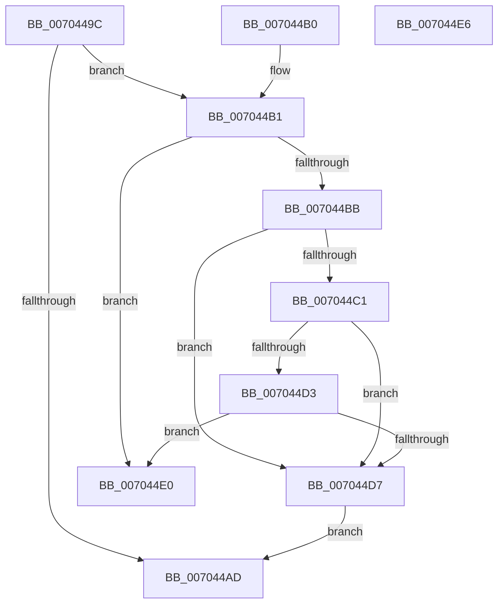

# PspConvertJobToMixed

- RVA: `0x0070449C`–`0x007044E7` (길이 `75` bytes)
- VA: `0x000000014070449C`
- 실행 섹션: `PAGE`
- PDB 이름 있음: `예`; PDB Function 태그: `아니요`
- unwind 정보 RVA: `0x000DB714`
- 디코드: `23`개 명령, `75/75` bytes 표시
- 미해석 바이트: `0` (있으면 어셈블리에 `.byte`로 보존)

> 이 문서는 커널 이미지의 기계어와 PDB 기호를 분석해 생성했습니다. 4번과 5번은 함수 원형과 자료형을 바이너리 사용 방식에서 추정한 C 해석이며 원본 소스 복구 결과는 아닙니다.

## 1. Dependencies

- 직접 호출 지점: **0**; 고유 호출 대상: **0**
- 직접 호출자로 확인된 함수: **2**
- RIP 상대 이미지 참조: **0**

### Outgoing calls
- 직접 디코드된 call 명령이 없습니다.

### Direct callers
- [PspSetJobMemoryPartition](../78/PspSetJobMemoryPartition_function_00785574.md) at `0x00785629`
- [PspBindProcessSessionToJob](../87/PspBindProcessSessionToJob_function_0087E660.md) at `0x0087E6A8`

### Static image references
- 디코드된 RIP-relative 메모리 참조가 없습니다.

## 2. Other-region calls and transfers

- 다른 실행 섹션으로 향하는 call: **0**
- 별도 외부 분기/꼬리 이동을 확인하지 못했습니다.

## 3. Assembly (complete function range)

```asm
0070449C  8B 81 40 02 00 00               mov eax, dword ptr [rcx + 0x240]
007044A2  41 B8 FE FF FF FF               mov r8d, 0xfffffffe
007044A8  41 3B C0                        cmp eax, r8d
007044AB  75 04                           jne 0x1407044b1
007044AD  33 C0                           xor eax, eax
007044AF  C3                              ret
007044B0  CC                              int3
007044B1  8B 81 10 06 00 00               mov eax, dword ptr [rcx + 0x610]
007044B7  A8 10                           test al, 0x10
007044B9  75 25                           jne 0x1407044e0
007044BB  0F BA E0 1E                     bt eax, 0x1e
007044BF  72 16                           jb 0x1407044d7
007044C1  48 8B 81 00 07 00 00            mov rax, qword ptr [rcx + 0x700]
007044C8  48 FF C0                        inc rax
007044CB  48 A9 FE FF FF FF               test rax, -2
007044D1  75 04                           jne 0x1407044d7
007044D3  85 D2                           test edx, edx
007044D5  74 09                           je 0x1407044e0
007044D7  44 89 81 40 02 00 00            mov dword ptr [rcx + 0x240], r8d
007044DE  EB CD                           jmp 0x1407044ad
007044E0  B8 22 00 00 C0                  mov eax, 0xc0000022
007044E5  C3                              ret
007044E6  CC                              int3
```

## 4. C-style interpretation (structured pseudocode)

```c
__int64 __fastcall PspConvertJobToMixed(__int64 a1, int a2)
{
    __int64 result;

    if (((unsigned int)((unsigned int)(*(unsigned int *)(a1 + 576)))) != ((unsigned int)((unsigned int)(0xFFFFFFFEULL)))) goto loc_007044B1;
loc_007044AD:
    result = 0;
    return result;
loc_007044B1:
    if ((((unsigned __int8)((unsigned int)(*(unsigned int *)(a1 + 1552)))) & (16)) != 0) goto loc_007044E0;
    if (condition_is_below) goto loc_007044D7;
    result = (*(unsigned __int64 *)(a1 + 1792)) + 1;
    if (((result) & (-2)) != 0) goto loc_007044D7;
    if (a2 == 0) goto loc_007044E0;
loc_007044D7:
    *(unsigned int *)(a1 + 576) = (unsigned int)((unsigned int)(0xFFFFFFFEULL));
    goto loc_007044AD;
loc_007044E0:
    return (unsigned int)(0xC0000022ULL);
}
```

## 5. (Beta) C Style

```c
int64_t PspConvertJobToMixed(void *Arg1, int32_t Arg2)
{
    uint8_t *arg1 = (uint8_t *)Arg1;

    int64_t result;

    if (((uint32_t)((uint32_t)(*(uint32_t *)(arg1 + 0x240)))) != ((uint32_t)((uint32_t)(0xFFFFFFFEULL)))) goto loc_007044B1;
loc_007044AD:
    result = 0;
    return result;
loc_007044B1:
    if ((((uint8_t)((uint32_t)(*(uint32_t *)(arg1 + 0x610)))) & (16)) != 0) goto loc_007044E0;
    if (condition_is_below) goto loc_007044D7;
    result = (*(uint64_t *)(arg1 + 0x700)) + 1;
    if (((result) & (-2)) != 0) goto loc_007044D7;
    if (Arg2 == 0) goto loc_007044E0;
loc_007044D7:
    *(uint32_t *)(arg1 + 0x240) = (uint32_t)((uint32_t)(0xFFFFFFFEULL));
    goto loc_007044AD;
loc_007044E0:
    return (uint32_t)(0xC0000022ULL);
}
```

### 관측된 메모리 오프셋

구조체 형식이 확인되지 않은 접근은 인자 기준의 오프셋으로만 기록했습니다.

| 기준 인자 | 오프셋 표현 | 폭 (bit) | 접근 |
|---|---:|---:|---|
| `Arg1` | `+ 0x240` | `32` | `R` |
| `Arg1` | `+ 0x240` | `32` | `W` |
| `Arg1` | `+ 0x610` | `32` | `R` |
| `Arg1` | `+ 0x700` | `64` | `R` |

## 6. Execution-region graph

[열기: 2D/3D 그래프와 함수 탐색 컨트롤 패널](../../../control-panel.html?section=page&rva=0x0070449C&view=graph)

- 2D 그래프는 위에서 아래로 흐르고, 3D 그래프는 빈 공간을 드래그해 회전합니다. Shift+드래그는 이동, 휠은 확대·축소, 함수 노드 선택은 대상 보고서 이동입니다.

### Static fallback


