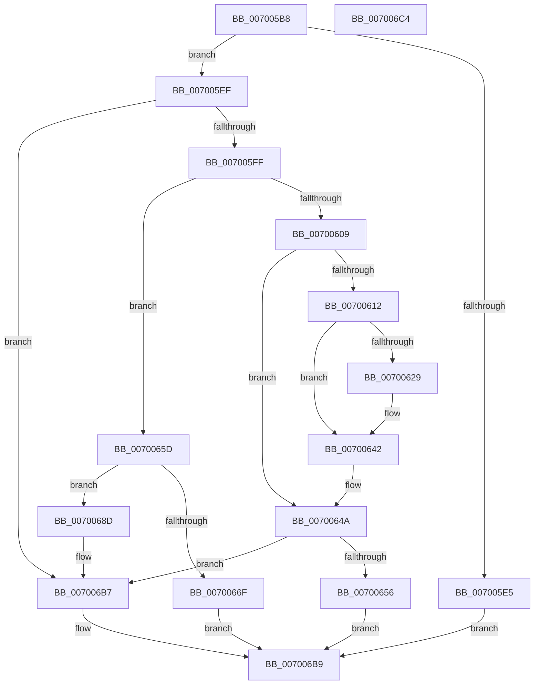

# PspInitializeSessionGlobals

- RVA: `0x007005B8`–`0x007006C5` (길이 `269` bytes)
- VA: `0x00000001407005B8`
- 실행 섹션: `PAGE`
- PDB 이름 있음: `예`; PDB Function 태그: `아니요`
- unwind 정보 RVA: `0x0005CAAC`
- 디코드: `64`개 명령, `269/269` bytes 표시
- 미해석 바이트: `0` (있으면 어셈블리에 `.byte`로 보존)

> 이 문서는 커널 이미지의 기계어와 PDB 기호를 분석해 생성했습니다. 4번과 5번은 함수 원형과 자료형을 바이너리 사용 방식에서 추정한 C 해석이며 원본 소스 복구 결과는 아닙니다.

## 1. Dependencies

- 직접 호출 지점: **13**; 고유 호출 대상: **7**
- 직접 호출자로 확인된 함수: **1**
- RIP 상대 이미지 참조: **2**

### Outgoing calls
- `0x007005F2` → [PspIsSessionLeaderProcess](../A8/PspIsSessionLeaderProcess_function_00A8F728.md) (function, `0x00A8F728`)
- `0x00700609` → [PsIsCurrentThreadInServerSilo](../../text/43/PsIsCurrentThreadInServerSilo_function_004362E0.md) (function, `0x004362E0`)
- `0x00700615` → [PspLockProcessListExclusive](../../text/22/PspLockProcessListExclusive_function_0022578C.md) (function, `0x0022578C`)
- `0x0070061A` → [PsGetCurrentServerSiloGlobals](../../text/2F/PsGetCurrentServerSiloGlobals_function_002FE1F0.md) (function, `0x002FE1F0`)
- `0x00700629` → [PsGetCurrentServerSiloGlobals](../../text/2F/PsGetCurrentServerSiloGlobals_function_002FE1F0.md) (function, `0x002FE1F0`)
- `0x0070063D` → [ObfReferenceObjectWithTag](../../text/21/ObfReferenceObjectWithTag_function_00210710.md) (function, `0x00210710`)
- `0x00700645` → [PspUnlockProcessListExclusive](../../text/2D/PspUnlockProcessListExclusive_function_002DFD18.md) (function, `0x002DFD18`)
- `0x0070064D` → [PspIsSessionLeaderProcess](../A8/PspIsSessionLeaderProcess_function_00A8F728.md) (function, `0x00A8F728`)
- `0x00700660` → [PspLockProcessListExclusive](../../text/22/PspLockProcessListExclusive_function_0022578C.md) (function, `0x0022578C`)
- `0x00700672` → [PspUnlockProcessListExclusive](../../text/2D/PspUnlockProcessListExclusive_function_002DFD18.md) (function, `0x002DFD18`)
- `0x00700696` → [PsGetServerSiloGlobals](../../text/22/PsGetServerSiloGlobals_function_002250A0.md) (function, `0x002250A0`)
- `0x007006A5` → [PspUnlockProcessListExclusive](../../text/2D/PspUnlockProcessListExclusive_function_002DFD18.md) (function, `0x002DFD18`)
- `0x007006B2` → [ObfReferenceObjectWithTag](../../text/21/ObfReferenceObjectWithTag_function_00210710.md) (function, `0x00210710`)

### Direct callers
- [PsSessionCreate](PsSessionCreate_function_00700438.md) at `0x00700456`

### Static image references
- `0x007005FF` → RVA `0x00F05D58` (`.data`; read)
- `0x0070068F` → RVA `0x00F05D58` (`.data`; write)

## 2. Other-region calls and transfers

- 다른 실행 섹션으로 향하는 call: **11**
  - `0x00700609` → [PsIsCurrentThreadInServerSilo](../../text/43/PsIsCurrentThreadInServerSilo_function_004362E0.md) (`PAGE` → `.text`)
  - `0x00700615` → [PspLockProcessListExclusive](../../text/22/PspLockProcessListExclusive_function_0022578C.md) (`PAGE` → `.text`)
  - `0x0070061A` → [PsGetCurrentServerSiloGlobals](../../text/2F/PsGetCurrentServerSiloGlobals_function_002FE1F0.md) (`PAGE` → `.text`)
  - `0x00700629` → [PsGetCurrentServerSiloGlobals](../../text/2F/PsGetCurrentServerSiloGlobals_function_002FE1F0.md) (`PAGE` → `.text`)
  - `0x0070063D` → [ObfReferenceObjectWithTag](../../text/21/ObfReferenceObjectWithTag_function_00210710.md) (`PAGE` → `.text`)
  - `0x00700645` → [PspUnlockProcessListExclusive](../../text/2D/PspUnlockProcessListExclusive_function_002DFD18.md) (`PAGE` → `.text`)
  - `0x00700660` → [PspLockProcessListExclusive](../../text/22/PspLockProcessListExclusive_function_0022578C.md) (`PAGE` → `.text`)
  - `0x00700672` → [PspUnlockProcessListExclusive](../../text/2D/PspUnlockProcessListExclusive_function_002DFD18.md) (`PAGE` → `.text`)
  - `0x00700696` → [PsGetServerSiloGlobals](../../text/22/PsGetServerSiloGlobals_function_002250A0.md) (`PAGE` → `.text`)
  - `0x007006A5` → [PspUnlockProcessListExclusive](../../text/2D/PspUnlockProcessListExclusive_function_002DFD18.md) (`PAGE` → `.text`)
  - `0x007006B2` → [ObfReferenceObjectWithTag](../../text/21/ObfReferenceObjectWithTag_function_00210710.md) (`PAGE` → `.text`)
- 별도 외부 분기/꼬리 이동을 확인하지 못했습니다.

## 3. Assembly (complete function range)

```asm
007005B8  48 89 5C 24 08                  mov qword ptr [rsp + 8], rbx
007005BD  57                              push rdi
007005BE  48 83 EC 20                     sub rsp, 0x20
007005C2  65 48 8B 1C 25 88 01 00 00      mov rbx, qword ptr gs:[0x188]
007005CB  48 8B 83 B8 00 00 00            mov rax, qword ptr [rbx + 0xb8]
007005D2  48 8B BB 20 02 00 00            mov rdi, qword ptr [rbx + 0x220]
007005D9  F7 80 F4 01 00 00 00 00 01 00   test dword ptr [rax + 0x1f4], 0x10000
007005E3  74 0A                           je 0x1407005ef
007005E5  B8 21 00 00 C0                  mov eax, 0xc0000021
007005EA  E9 CA 00 00 00                  jmp 0x1407006b9
007005EF  48 8B CF                        mov rcx, rdi
007005F2  E8 31 F1 38 00                  call 0x140a8f728
007005F7  85 C0                           test eax, eax
007005F9  0F 85 B8 00 00 00               jne 0x1407006b7
007005FF  48 83 3D 51 57 80 00 00         cmp qword ptr [rip + 0x805751], 0
00700607  74 54                           je 0x14070065d
00700609  E8 D2 5C D3 FF                  call 0x1404362e0
0070060E  84 C0                           test al, al
00700610  74 38                           je 0x14070064a
00700612  48 8B CB                        mov rcx, rbx
00700615  E8 72 51 B2 FF                  call 0x14022578c
0070061A  E8 D1 DB BF FF                  call 0x1402fe1f0
0070061F  48 83 B8 48 03 00 00 00         cmp qword ptr [rax + 0x348], 0
00700627  75 19                           jne 0x140700642
00700629  E8 C2 DB BF FF                  call 0x1402fe1f0
0070062E  BA 4D 6D 53 73                  mov edx, 0x73536d4d
00700633  48 8B CF                        mov rcx, rdi
00700636  48 89 B8 48 03 00 00            mov qword ptr [rax + 0x348], rdi
0070063D  E8 CE 00 B1 FF                  call 0x140210710
00700642  48 8B CB                        mov rcx, rbx
00700645  E8 CE F6 BD FF                  call 0x1402dfd18
0070064A  48 8B CF                        mov rcx, rdi
0070064D  E8 D6 F0 38 00                  call 0x140a8f728
00700652  85 C0                           test eax, eax
00700654  75 61                           jne 0x1407006b7
00700656  B8 1C 00 00 C0                  mov eax, 0xc000001c
0070065B  EB 5C                           jmp 0x1407006b9
0070065D  48 8B CB                        mov rcx, rbx
00700660  E8 27 51 B2 FF                  call 0x14022578c
00700665  48 83 3D EB 56 80 00 00         cmp qword ptr [rip + 0x8056eb], 0
0070066D  74 1E                           je 0x14070068d
0070066F  48 8B CB                        mov rcx, rbx
00700672  E8 A1 F6 BD FF                  call 0x1402dfd18
00700677  48 8B 05 DA 56 80 00            mov rax, qword ptr [rip + 0x8056da]
0070067E  48 2B C7                        sub rax, rdi
00700681  48 F7 D8                        neg rax
00700684  1B C0                           sbb eax, eax
00700686  25 1C 00 00 C0                  and eax, 0xc000001c
0070068B  EB 2C                           jmp 0x1407006b9
0070068D  33 C9                           xor ecx, ecx
0070068F  48 89 3D C2 56 80 00            mov qword ptr [rip + 0x8056c2], rdi
00700696  E8 05 4A B2 FF                  call 0x1402250a0
0070069B  48 8B CB                        mov rcx, rbx
0070069E  48 89 B8 48 03 00 00            mov qword ptr [rax + 0x348], rdi
007006A5  E8 6E F6 BD FF                  call 0x1402dfd18
007006AA  BA 4D 6D 53 73                  mov edx, 0x73536d4d
007006AF  48 8B CF                        mov rcx, rdi
007006B2  E8 59 00 B1 FF                  call 0x140210710
007006B7  33 C0                           xor eax, eax
007006B9  48 8B 5C 24 30                  mov rbx, qword ptr [rsp + 0x30]
007006BE  48 83 C4 20                     add rsp, 0x20
007006C2  5F                              pop rdi
007006C3  C3                              ret
007006C4  CC                              int3
```

## 4. C-style interpretation (structured pseudocode)

```c
__int64 __fastcall PspInitializeSessionGlobals(void)
{
    __int64 result;
    __int64 v_rsp;
    unsigned __int64 v_stack_p8;

    v_stack_p8 = v_rbx;
    v_rsp = (v_rsp) - (32);
    if (((*(unsigned int *)(*(unsigned __int64 *)(*(unsigned __int64 *)(gs_base + (0 + 392)) + 184) + 500)) & (0x10000ULL)) == 0) goto loc_007005EF;
    goto loc_007006B9;
loc_007005EF:
    result = PspIsSessionLeaderProcess(*(unsigned __int64 *)(*(unsigned __int64 *)(gs_base + (0 + 392)) + 544), a2, a3, a4);
    if ((unsigned int)(result) != 0) goto loc_007006B7;
    if ((*(unsigned __int64 *)(v_rip + 8410961)) == 0) goto loc_0070065D;
    result = PsIsCurrentThreadInServerSilo(*(unsigned __int64 *)(*(unsigned __int64 *)(gs_base + (0 + 392)) + 544), a2, a3, a4);
    if ((unsigned __int8)(result) == 0) goto loc_0070064A;
    result = PspLockProcessListExclusive(*(unsigned __int64 *)(gs_base + (0 + 392)), a2, a3, a4);
    result = PsGetCurrentServerSiloGlobals(*(unsigned __int64 *)(gs_base + (0 + 392)), a2, a3, a4);
    if ((*(unsigned __int64 *)(result + 840)) == 0) {
        result = PsGetCurrentServerSiloGlobals(*(unsigned __int64 *)(gs_base + (0 + 392)), a2, a3, a4);
        a2 = 0x73536D4DULL;
        a1 = *(unsigned __int64 *)(*(unsigned __int64 *)(gs_base + (0 + 392)) + 544);
        *(unsigned __int64 *)(result + 840) = *(unsigned __int64 *)(*(unsigned __int64 *)(gs_base + (0 + 392)) + 544);
        result = ObfReferenceObjectWithTag(a1, a2, a3, a4);
    }
    result = PspUnlockProcessListExclusive(*(unsigned __int64 *)(gs_base + (0 + 392)), a2, a3, a4);
loc_0070064A:
    result = PspIsSessionLeaderProcess(*(unsigned __int64 *)(*(unsigned __int64 *)(gs_base + (0 + 392)) + 544), a2, a3, a4);
    if ((unsigned int)(result) != 0) goto loc_007006B7;
    goto loc_007006B9;
loc_0070065D:
    result = PspLockProcessListExclusive(*(unsigned __int64 *)(gs_base + (0 + 392)), a2, a3, a4);
    if ((*(unsigned __int64 *)(v_rip + 8410859)) == 0) goto loc_0070068D;
    result = PspUnlockProcessListExclusive(*(unsigned __int64 *)(gs_base + (0 + 392)), a2, a3, a4);
    result = (*(unsigned __int64 *)(v_rip + 8410842)) - (*(unsigned __int64 *)(*(unsigned __int64 *)(gs_base + (0 + 392)) + 544));
    result = -(result);
    result = (unsigned int)((result) & (0xC000001CULL));
    goto loc_007006B9;
loc_0070068D:
    a1 = 0;
    *(unsigned __int64 *)(v_rip + 8410818) = *(unsigned __int64 *)(*(unsigned __int64 *)(gs_base + (0 + 392)) + 544);
    result = PsGetServerSiloGlobals(a1, a2, a3, a4);
    *(unsigned __int64 *)(result + 840) = *(unsigned __int64 *)(*(unsigned __int64 *)(gs_base + (0 + 392)) + 544);
    result = PspUnlockProcessListExclusive(*(unsigned __int64 *)(gs_base + (0 + 392)), a2, a3, a4);
    result = ObfReferenceObjectWithTag(*(unsigned __int64 *)(*(unsigned __int64 *)(gs_base + (0 + 392)) + 544), (unsigned int)(0x73536D4DULL), a3, a4);
loc_007006B7:
    result = 0;
loc_007006B9:
    v_rsp = (v_rsp) + (32);
    return result;
}
```

## 5. (Beta) C Style

```c
void PspInitializeSessionGlobals(void)
{
    int64_t result;
    int64_t local_rsp;
    uint64_t v_stack_p8;

    v_stack_p8 = local_rbx;
    local_rsp = (local_rsp) - (32);
    if (((*(uint32_t *)(*(uint64_t *)(*(uint64_t *)(gs_base + (0 + 0x188)) + 0xB8) + 0x1F4)) & (0x10000ULL)) == 0) goto loc_007005EF;
    goto loc_007006B9;
loc_007005EF:
    result = PspIsSessionLeaderProcess(*(uint64_t *)(*(uint64_t *)(gs_base + (0 + 0x188)) + 0x220), a2, a3, a4);
    if ((uint32_t)(result) != 0) goto loc_007006B7;
    if ((*(uint64_t *)(v_rip + 0x805751)) == 0) goto loc_0070065D;
    result = PsIsCurrentThreadInServerSilo(*(uint64_t *)(*(uint64_t *)(gs_base + (0 + 0x188)) + 0x220), a2, a3, a4);
    if ((uint8_t)(result) == 0) goto loc_0070064A;
    result = PspLockProcessListExclusive(*(uint64_t *)(gs_base + (0 + 0x188)), a2, a3, a4);
    result = PsGetCurrentServerSiloGlobals(*(uint64_t *)(gs_base + (0 + 0x188)), a2, a3, a4);
    if ((*(uint64_t *)(result + 0x348)) == 0) {
        result = PsGetCurrentServerSiloGlobals(*(uint64_t *)(gs_base + (0 + 0x188)), a2, a3, a4);
        a2 = 0x73536D4DULL;
        a1 = *(uint64_t *)(*(uint64_t *)(gs_base + (0 + 0x188)) + 0x220);
        *(uint64_t *)(result + 0x348) = *(uint64_t *)(*(uint64_t *)(gs_base + (0 + 0x188)) + 0x220);
        result = ObfReferenceObjectWithTag(a1, a2, a3, a4);
    }
    result = PspUnlockProcessListExclusive(*(uint64_t *)(gs_base + (0 + 0x188)), a2, a3, a4);
loc_0070064A:
    result = PspIsSessionLeaderProcess(*(uint64_t *)(*(uint64_t *)(gs_base + (0 + 0x188)) + 0x220), a2, a3, a4);
    if ((uint32_t)(result) != 0) goto loc_007006B7;
    goto loc_007006B9;
loc_0070065D:
    result = PspLockProcessListExclusive(*(uint64_t *)(gs_base + (0 + 0x188)), a2, a3, a4);
    if ((*(uint64_t *)(v_rip + 0x8056EB)) == 0) goto loc_0070068D;
    result = PspUnlockProcessListExclusive(*(uint64_t *)(gs_base + (0 + 0x188)), a2, a3, a4);
    result = (*(uint64_t *)(v_rip + 0x8056DA)) - (*(uint64_t *)(*(uint64_t *)(gs_base + (0 + 0x188)) + 0x220));
    result = -(result);
    result = (uint32_t)((result) & (0xC000001CULL));
    goto loc_007006B9;
loc_0070068D:
    a1 = 0;
    *(uint64_t *)(v_rip + 0x8056C2) = *(uint64_t *)(*(uint64_t *)(gs_base + (0 + 0x188)) + 0x220);
    result = PsGetServerSiloGlobals(a1, a2, a3, a4);
    *(uint64_t *)(result + 0x348) = *(uint64_t *)(*(uint64_t *)(gs_base + (0 + 0x188)) + 0x220);
    result = PspUnlockProcessListExclusive(*(uint64_t *)(gs_base + (0 + 0x188)), a2, a3, a4);
    result = ObfReferenceObjectWithTag(*(uint64_t *)(*(uint64_t *)(gs_base + (0 + 0x188)) + 0x220), (uint32_t)(0x73536D4DULL), a3, a4);
loc_007006B7:
    result = 0;
loc_007006B9:
    local_rsp = (local_rsp) + (32);
    return result;
}
```

## 6. Execution-region graph

[열기: 2D/3D 그래프와 함수 탐색 컨트롤 패널](../../../control-panel.html?section=page&rva=0x007005B8&view=graph)

- 2D 그래프는 위에서 아래로 흐르고, 3D 그래프는 빈 공간을 드래그해 회전합니다. Shift+드래그는 이동, 휠은 확대·축소, 함수 노드 선택은 대상 보고서 이동입니다.

### Static fallback


