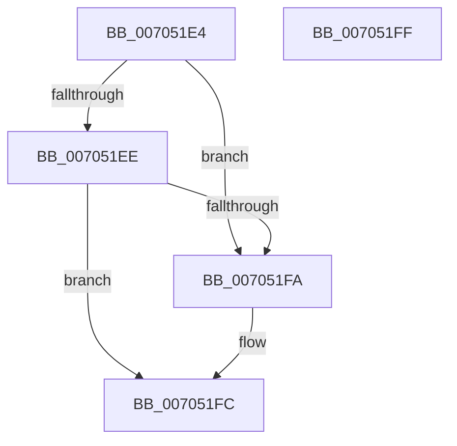

# PspJobHasChildren

- RVA: `0x007051E4`–`0x00705200` (길이 `28` bytes)
- VA: `0x00000001407051E4`
- 실행 섹션: `PAGE`
- PDB 이름 있음: `예`; PDB Function 태그: `아니요`
- unwind 정보 RVA: `0x000DB714`
- 디코드: `10`개 명령, `28/28` bytes 표시
- 미해석 바이트: `0` (있으면 어셈블리에 `.byte`로 보존)

> 이 문서는 커널 이미지의 기계어와 PDB 기호를 분석해 생성했습니다. 4번과 5번은 함수 원형과 자료형을 바이너리 사용 방식에서 추정한 C 해석이며 원본 소스 복구 결과는 아닙니다.

## 1. Dependencies

- 직접 호출 지점: **0**; 고유 호출 대상: **0**
- 직접 호출자로 확인된 함수: **3**
- RIP 상대 이미지 참조: **0**

### Outgoing calls
- 직접 디코드된 call 명령이 없습니다.

### Direct callers
- [PspConvertSiloToServerSilo](../77/PspConvertSiloToServerSilo_function_0077F9B4.md) at `0x0077FAC9`
- [PspCreateSilo](../A8/PspCreateSilo_function_00A89CFC.md) at `0x00A89D55`
- [sub_00B307F0](../B3/Unknown_function_00B307F0.md) at `0x00B30807`

### Static image references
- 디코드된 RIP-relative 메모리 참조가 없습니다.

## 2. Other-region calls and transfers

- 다른 실행 섹션으로 향하는 call: **0**
- 별도 외부 분기/꼬리 이동을 확인하지 못했습니다.

## 3. Assembly (complete function range)

```asm
007051E4  33 D2                           xor edx, edx
007051E6  39 91 D4 00 00 00               cmp dword ptr [rcx + 0xd4], edx
007051EC  75 0C                           jne 0x1407051fa
007051EE  48 8D 81 08 05 00 00            lea rax, [rcx + 0x508]
007051F5  48 39 00                        cmp qword ptr [rax], rax
007051F8  74 02                           je 0x1407051fc
007051FA  B2 01                           mov dl, 1
007051FC  8A C2                           mov al, dl
007051FE  C3                              ret
007051FF  CC                              int3
```

## 4. C-style interpretation (structured pseudocode)

```c
__int64 __fastcall PspJobHasChildren(__int64 a1, int a2)
{
    a2 = 0;
    if ((*(unsigned int *)(a1 + 212)) != 0) goto loc_007051FA;
    if ((*(unsigned __int64 *)(a1 + 1288)) != (a1 + 1288)) {
        a2 = 1;
    }
    return (unsigned __int8)(a2);
}
```

## 5. (Beta) C Style

```c
int64_t PspJobHasChildren(void *Arg1, int32_t Arg2)
{
    uint8_t *arg1 = (uint8_t *)Arg1;

    Arg2 = 0;
    if ((*(uint32_t *)(arg1 + 0xD4)) != 0) goto loc_007051FA;
    if ((*(uint64_t *)(arg1 + 0x508)) != (Arg1 + 1288)) {
        Arg2 = 1;
    }
    return (uint8_t)(Arg2);
}
```

### 관측된 메모리 오프셋

구조체 형식이 확인되지 않은 접근은 인자 기준의 오프셋으로만 기록했습니다.

| 기준 인자 | 오프셋 표현 | 폭 (bit) | 접근 |
|---|---:|---:|---|
| `Arg1` | `+ 0x0` | `64` | `R` |
| `Arg1` | `+ 0xD4` | `32` | `R` |
| `Arg1` | `+ 0x508` | `64` | `R` |

## 6. Execution-region graph

[열기: 2D/3D 그래프와 함수 탐색 컨트롤 패널](../../../control-panel.html?section=page&rva=0x007051E4&view=graph)

- 2D 그래프는 위에서 아래로 흐르고, 3D 그래프는 빈 공간을 드래그해 회전합니다. Shift+드래그는 이동, 휠은 확대·축소, 함수 노드 선택은 대상 보고서 이동입니다.

### Static fallback


