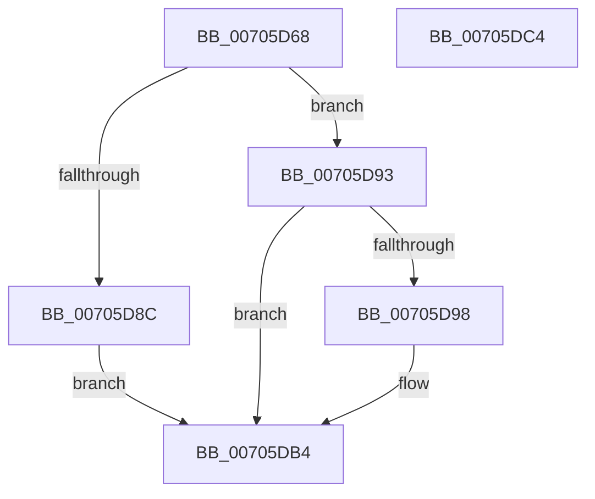

# RtlCopyToUser

- RVA: `0x00705D68`–`0x00705DC5` (길이 `93` bytes)
- VA: `0x0000000140705D68`
- 실행 섹션: `PAGE`
- PDB 이름 있음: `예`; PDB Function 태그: `아니요`
- unwind 정보 RVA: `0x00060BC4`
- 디코드: `28`개 명령, `93/93` bytes 표시
- 미해석 바이트: `0` (있으면 어셈블리에 `.byte`로 보존)

> 이 문서는 커널 이미지의 기계어와 PDB 기호를 분석해 생성했습니다. 4번과 5번은 함수 원형과 자료형을 바이너리 사용 방식에서 추정한 C 해석이며 원본 소스 복구 결과는 아닙니다.

## 1. Dependencies

- 직접 호출 지점: **3**; 고유 호출 대상: **3**
- 직접 호출자로 확인된 함수: **8**
- RIP 상대 이미지 참조: **1**

### Outgoing calls
- `0x00705D8C` → `indirect target` (indirect, 간접 대상)
- `0x00705DA1` → [ProbeForRead](../9C/ProbeForRead_function_009C5130.md) (function, `0x009C5130`)
- `0x00705DAF` → [RtlCopyVolatileMemory](../../text/6B/RtlCopyVolatileMemory_function_006BC9D0.md) (function, `0x006BC9D0`)

### Direct callers
- [VslQueryRuntimeAttestationReport](../71/VslQueryRuntimeAttestationReport_function_00719100.md) at `0x007192B3`
- [PspCopyUserAttributes](../78/PspCopyUserAttributes_function_00784234.md) at `0x007842BC`
- [PspCopyUserAttributes](../78/PspCopyUserAttributes_function_00784234.md) at `0x007842D2`
- [PspQueryWobTicketPriority](../78/PspQueryWobTicketPriority_function_007898C8.md) at `0x0078995F`
- [PspQueryWobTicketQos](../78/PspQueryWobTicketQos_function_007899B0.md) at `0x00789A64`
- [SeQueryHSTIResults](../84/SeQueryHSTIResults_function_00841388.md) at `0x008413DF`
- [PspWow64ReadOrWriteThreadCpuArea](../8C/PspWow64ReadOrWriteThreadCpuArea_function_008CD404.md) at `0x008CD505`
- [PspWow64ReadOrWriteThreadCpuArea](../8C/PspWow64ReadOrWriteThreadCpuArea_function_008CD404.md) at `0x008CD6AF`
- [PspCopyAndFixupParameters](../AE/PspCopyAndFixupParameters_function_00AEB878.md) at `0x00AEBB9C`
- [sub_00B316B4](../B3/Unknown_function_00B316B4.md) at `0x00B3206B`
- [sub_00B316B4](../B3/Unknown_function_00B316B4.md) at `0x00B32091`

### Static image references
- `0x00705D77` → RVA `0x00151790` (`.idata`; read)

## 2. Other-region calls and transfers

- 다른 실행 섹션으로 향하는 call: **1**
  - `0x00705DAF` → [RtlCopyVolatileMemory](../../text/6B/RtlCopyVolatileMemory_function_006BC9D0.md) (`PAGE` → `.text`)
- 별도 외부 분기/꼬리 이동을 확인하지 못했습니다.

## 3. Assembly (complete function range)

```asm
00705D68  48 89 5C 24 08                  mov qword ptr [rsp + 8], rbx
00705D6D  48 89 74 24 10                  mov qword ptr [rsp + 0x10], rsi
00705D72  57                              push rdi
00705D73  48 83 EC 20                     sub rsp, 0x20
00705D77  48 8B 05 12 BA A4 FF            mov rax, qword ptr [rip - 0x5b45ee]
00705D7E  49 8B D8                        mov rbx, r8
00705D81  48 8B F2                        mov rsi, rdx
00705D84  48 8B F9                        mov rdi, rcx
00705D87  48 85 C0                        test rax, rax
00705D8A  74 07                           je 0x140705d93
00705D8C  FF D0                           call rax
00705D8E  0F 1F 00                        nop dword ptr [rax]
00705D91  EB 21                           jmp 0x140705db4
00705D93  48 85 DB                        test rbx, rbx
00705D96  74 1C                           je 0x140705db4
00705D98  41 B8 01 00 00 00               mov r8d, 1
00705D9E  48 8B D3                        mov rdx, rbx
00705DA1  E8 8A F3 2B 00                  call 0x1409c5130
00705DA6  4C 8B C3                        mov r8, rbx
00705DA9  48 8B D6                        mov rdx, rsi
00705DAC  48 8B CF                        mov rcx, rdi
00705DAF  E8 1C 6C FB FF                  call 0x1406bc9d0
00705DB4  48 8B 5C 24 30                  mov rbx, qword ptr [rsp + 0x30]
00705DB9  48 8B 74 24 38                  mov rsi, qword ptr [rsp + 0x38]
00705DBE  48 83 C4 20                     add rsp, 0x20
00705DC2  5F                              pop rdi
00705DC3  C3                              ret
00705DC4  CC                              int3
```

## 4. C-style interpretation (structured pseudocode)

```c
__int64 __fastcall RtlCopyToUser(__int64 a1, __int64 a2, __int64 a3)
{
    __int64 result;
    __int64 v_rsp;
    unsigned __int64 v_stack_p10;
    unsigned __int64 v_stack_p8;

    v_stack_p8 = v_rbx;
    v_stack_p10 = v_rsi;
    v_rsp = (v_rsp) - (32);
    if (*(unsigned __int64 *)(v_rip - 5981678) == 0) goto loc_00705D93;
    result = kernel_indirect_call(a1, a2, a3, a4);
    goto loc_00705DB4;
loc_00705D93:
    if (a3 != 0) {
        a3 = 1;
        a2 = a3;
        result = ProbeForRead(a1, a2, a3, a4);
        a3 = a3;
        a2 = a2;
        a1 = a1;
        result = RtlCopyVolatileMemory(a1, a2, a3, a4);
    }
    v_rsp = (v_rsp) + (32);
    return result;
}
```

## 5. (Beta) C Style

```c
int64_t RtlCopyToUser(int64_t Arg1, int64_t Arg2, int64_t Arg3)
{
    int64_t result;
    int64_t local_rsp;
    uint64_t v_stack_p10;
    uint64_t v_stack_p8;

    v_stack_p8 = local_rbx;
    v_stack_p10 = local_rsi;
    local_rsp = (local_rsp) - (32);
    if (*(uint64_t *)(v_rip - 0x5B45EE) == 0) goto loc_00705D93;
    result = kernel_indirect_call(Arg1, Arg2, Arg3, a4);
    goto loc_00705DB4;
loc_00705D93:
    if (Arg3 != 0) {
        Arg3 = 1;
        Arg2 = Arg3;
        result = ProbeForRead(Arg1, Arg2, Arg3, a4);
        Arg3 = Arg3;
        Arg2 = Arg2;
        Arg1 = Arg1;
        result = RtlCopyVolatileMemory(Arg1, Arg2, Arg3, a4);
    }
    local_rsp = (local_rsp) + (32);
    return result;
}
```

## 6. Execution-region graph

[열기: 2D/3D 그래프와 함수 탐색 컨트롤 패널](../../../control-panel.html?section=page&rva=0x00705D68&view=graph)

- 2D 그래프는 위에서 아래로 흐르고, 3D 그래프는 빈 공간을 드래그해 회전합니다. Shift+드래그는 이동, 휠은 확대·축소, 함수 노드 선택은 대상 보고서 이동입니다.

### Static fallback


