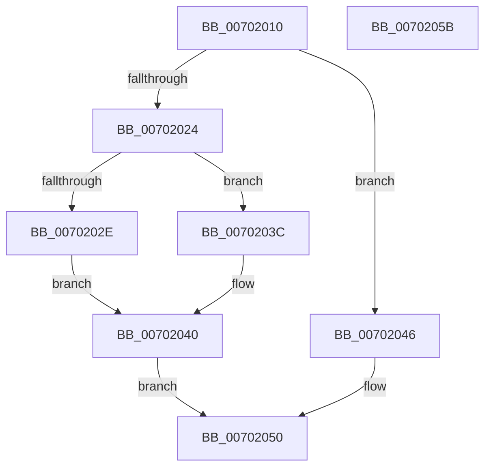

# RtlGetLastRange

- RVA: `0x00702010`–`0x0070205C` (길이 `76` bytes)
- VA: `0x0000000140702010`
- 실행 섹션: `PAGE`
- PDB 이름 있음: `예`; PDB Function 태그: `아니요`
- unwind 정보 RVA: `0x000DB714`
- 디코드: `24`개 명령, `76/76` bytes 표시
- 미해석 바이트: `0` (있으면 어셈블리에 `.byte`로 보존)

> 이 문서는 커널 이미지의 기계어와 PDB 기호를 분석해 생성했습니다. 4번과 5번은 함수 원형과 자료형을 바이너리 사용 방식에서 추정한 C 해석이며 원본 소스 복구 결과는 아닙니다.

## 1. Dependencies

- 직접 호출 지점: **0**; 고유 호출 대상: **0**
- 직접 호출자로 확인된 함수: **0**
- RIP 상대 이미지 참조: **0**

### Outgoing calls
- 직접 디코드된 call 명령이 없습니다.

### Direct callers
- 이 함수 시작 RVA로 연결되는 직접 call은 확인되지 않았습니다. 간접 호출은 완전히 역산할 수 없습니다.

### Static image references
- 디코드된 RIP-relative 메모리 참조가 없습니다.

## 2. Other-region calls and transfers

- 다른 실행 섹션으로 향하는 call: **0**
- 별도 외부 분기/꼬리 이동을 확인하지 못했습니다.

## 3. Assembly (complete function range)

```asm
00702010  48 89 0A                        mov qword ptr [rdx], rcx
00702013  45 33 C9                        xor r9d, r9d
00702016  8B 41 18                        mov eax, dword ptr [rcx + 0x18]
00702019  45 8B D1                        mov r10d, r9d
0070201C  89 42 18                        mov dword ptr [rdx + 0x18], eax
0070201F  48 39 09                        cmp qword ptr [rcx], rcx
00702022  74 22                           je 0x140702046
00702024  48 8B 49 08                     mov rcx, qword ptr [rcx + 8]
00702028  F6 41 FA 01                     test byte ptr [rcx - 6], 1
0070202C  74 0E                           je 0x14070203c
0070202E  48 8D 41 E8                     lea rax, [rcx - 0x18]
00702032  48 89 42 08                     mov qword ptr [rdx + 8], rax
00702036  48 8B 49 F0                     mov rcx, qword ptr [rcx - 0x10]
0070203A  EB 04                           jmp 0x140702040
0070203C  4C 89 4A 08                     mov qword ptr [rdx + 8], r9
00702040  4C 8D 49 D8                     lea r9, [rcx - 0x28]
00702044  EB 0A                           jmp 0x140702050
00702046  4C 89 4A 08                     mov qword ptr [rdx + 8], r9
0070204A  41 BA 1A 00 00 80               mov r10d, 0x8000001a
00702050  4C 89 4A 10                     mov qword ptr [rdx + 0x10], r9
00702054  41 8B C2                        mov eax, r10d
00702057  4D 89 08                        mov qword ptr [r8], r9
0070205A  C3                              ret
0070205B  CC                              int3
```

## 4. C-style interpretation (structured pseudocode)

```c
__int64 __fastcall RtlGetLastRange(__int64 a1, __int64 a2, __int64 a3, int a4)
{
    *(unsigned __int64 *)(a2) = a1;
    a4 = 0;
    *(unsigned int *)(a2 + 24) = (unsigned int)((unsigned int)(*(unsigned int *)(a1 + 24)));
    if ((*(unsigned __int64 *)(a1)) == a1) goto loc_00702046;
    if (((*(unsigned __int8 *)(*(unsigned __int64 *)(a1 + 8) - 6)) & (1)) == 0) goto loc_0070203C;
    *(unsigned __int64 *)(a2 + 8) = *(unsigned __int64 *)(a1 + 8) - 24;
    goto loc_00702040;
loc_0070203C:
    *(unsigned __int64 *)(a2 + 8) = 0;
loc_00702040:
    goto loc_00702050;
loc_00702046:
    *(unsigned __int64 *)(a2 + 8) = *(unsigned __int64 *)(*(unsigned __int64 *)(a1 + 8) - 16) - 40;
loc_00702050:
    *(unsigned __int64 *)(a2 + 16) = *(unsigned __int64 *)(*(unsigned __int64 *)(a1 + 8) - 16) - 40;
    *(unsigned __int64 *)(a3) = *(unsigned __int64 *)(*(unsigned __int64 *)(a1 + 8) - 16) - 40;
    return (unsigned int)((unsigned int)((unsigned int)(0x8000001AULL)));
}
```

## 5. (Beta) C Style

```c
int64_t RtlGetLastRange(void *Arg1, void *Arg2, void *Arg3, int32_t Arg4)
{
    uint8_t *arg1 = (uint8_t *)Arg1;
    uint8_t *arg2 = (uint8_t *)Arg2;
    uint8_t *arg3 = (uint8_t *)Arg3;

    *(void **)(arg2) = Arg1;
    Arg4 = 0;
    *(uint32_t *)(arg2 + 0x18) = (uint32_t)((uint32_t)(*(uint32_t *)(arg1 + 0x18)));
    if ((*(uint64_t *)(arg1)) == Arg1) goto loc_00702046;
    if (((*(uint8_t *)(*(uint64_t *)(arg1 + 0x8) - 0x6)) & (1)) == 0) goto loc_0070203C;
    *(uint64_t *)(arg2 + 0x8) = *(uint64_t *)(arg1 + 0x8) - 24;
    goto loc_00702040;
loc_0070203C:
    *(uint64_t *)(arg2 + 0x8) = 0;
loc_00702040:
    goto loc_00702050;
loc_00702046:
    *(uint64_t *)(arg2 + 0x8) = *(uint64_t *)(*(uint64_t *)(arg1 + 0x8) - 0x10) - 40;
loc_00702050:
    *(uint64_t *)(arg2 + 0x10) = *(uint64_t *)(*(uint64_t *)(arg1 + 0x8) - 0x10) - 40;
    *(uint64_t *)(arg3) = *(uint64_t *)(*(uint64_t *)(arg1 + 0x8) - 0x10) - 40;
    return (uint32_t)((uint32_t)((uint32_t)(0x8000001AULL)));
}
```

### 관측된 메모리 오프셋

구조체 형식이 확인되지 않은 접근은 인자 기준의 오프셋으로만 기록했습니다.

| 기준 인자 | 오프셋 표현 | 폭 (bit) | 접근 |
|---|---:|---:|---|
| `Arg1` | `+ 0x0` | `64` | `R` |
| `Arg1` | `+ 0x8` | `64` | `R` |
| `Arg1` | `+ 0x18` | `32` | `R` |
| `Arg2` | `+ 0x0` | `64` | `W` |
| `Arg2` | `+ 0x8` | `64` | `W` |
| `Arg2` | `+ 0x10` | `64` | `W` |
| `Arg2` | `+ 0x18` | `32` | `W` |
| `Arg3` | `+ 0x0` | `64` | `W` |

## 6. Execution-region graph

[열기: 2D/3D 그래프와 함수 탐색 컨트롤 패널](../../../control-panel.html?section=page&rva=0x00702010&view=graph)

- 2D 그래프는 위에서 아래로 흐르고, 3D 그래프는 빈 공간을 드래그해 회전합니다. Shift+드래그는 이동, 휠은 확대·축소, 함수 노드 선택은 대상 보고서 이동입니다.

### Static fallback


