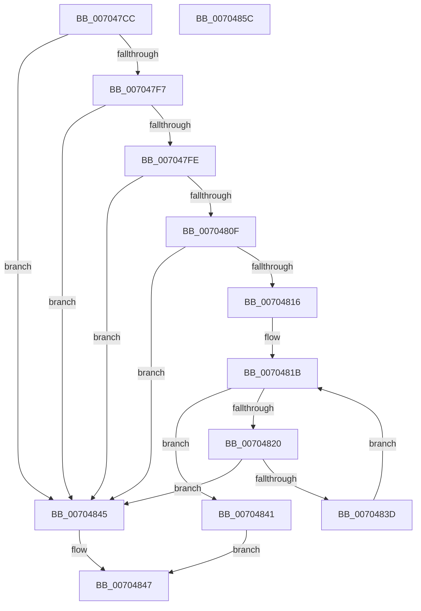

# RtlIsParentOfChildAppContainer

- RVA: `0x007047CC`–`0x0070485D` (길이 `145` bytes)
- VA: `0x00000001407047CC`
- 실행 섹션: `PAGE`
- PDB 이름 있음: `예`; PDB Function 태그: `아니요`
- unwind 정보 RVA: `0x000AEEA8`
- 디코드: `47`개 명령, `145/145` bytes 표시
- 미해석 바이트: `0` (있으면 어셈블리에 `.byte`로 보존)

> 이 문서는 커널 이미지의 기계어와 PDB 기호를 분석해 생성했습니다. 4번과 5번은 함수 원형과 자료형을 바이너리 사용 방식에서 추정한 C 해석이며 원본 소스 복구 결과는 아닙니다.

## 1. Dependencies

- 직접 호출 지점: **4**; 고유 호출 대상: **2**
- 직접 호출자로 확인된 함수: **6**
- RIP 상대 이미지 참조: **0**

### Outgoing calls
- `0x007047EE` → [RtlGetAppContainerSidType](../A7/RtlGetAppContainerSidType_function_00A72160.md) (function, `0x00A72160`)
- `0x00704806` → [RtlGetAppContainerSidType](../A7/RtlGetAppContainerSidType_function_00A72160.md) (function, `0x00A72160`)
- `0x00704825` → [RtlSubAuthoritySid](../../text/45/RtlSubAuthoritySid_function_00456D10.md) (function, `0x00456D10`)
- `0x00704832` → [RtlSubAuthoritySid](../../text/45/RtlSubAuthoritySid_function_00456D10.md) (function, `0x00456D10`)

### Direct callers
- [SepCheckCreateAppContainer](SepCheckCreateAppContainer_function_007006CC.md) at `0x0070075E`
- [SepIsParentOfChildAppContainer](../7A/SepIsParentOfChildAppContainer_function_007A34C0.md) at `0x007A3614`
- [SeTokenCanImpersonate](../8C/SeTokenCanImpersonate_function_008CC4C0.md) at `0x008CC570`
- [sub_008CC5C2](../8C/Unknown_function_008CC5C2.md) at `0x008CC750`
- [SepSetTokenCapabilities](../9C/SepSetTokenCapabilities_function_009C9AF4.md) at `0x009C9C70`
- [SepSetTokenPackage](../A2/SepSetTokenPackage_function_00A20CB8.md) at `0x00A20D65`

### Static image references
- 디코드된 RIP-relative 메모리 참조가 없습니다.

## 2. Other-region calls and transfers

- 다른 실행 섹션으로 향하는 call: **2**
  - `0x00704825` → [RtlSubAuthoritySid](../../text/45/RtlSubAuthoritySid_function_00456D10.md) (`PAGE` → `.text`)
  - `0x00704832` → [RtlSubAuthoritySid](../../text/45/RtlSubAuthoritySid_function_00456D10.md) (`PAGE` → `.text`)
- 별도 외부 분기/꼬리 이동을 확인하지 못했습니다.

## 3. Assembly (complete function range)

```asm
007047CC  48 8B C4                        mov rax, rsp
007047CF  48 89 58 08                     mov qword ptr [rax + 8], rbx
007047D3  48 89 68 10                     mov qword ptr [rax + 0x10], rbp
007047D7  48 89 70 20                     mov qword ptr [rax + 0x20], rsi
007047DB  57                              push rdi
007047DC  48 83 EC 20                     sub rsp, 0x20
007047E0  83 60 18 00                     and dword ptr [rax + 0x18], 0
007047E4  48 8B F2                        mov rsi, rdx
007047E7  48 8D 50 18                     lea rdx, [rax + 0x18]
007047EB  48 8B E9                        mov rbp, rcx
007047EE  E8 6D D9 36 00                  call 0x140a72160
007047F3  85 C0                           test eax, eax
007047F5  78 4E                           js 0x140704845
007047F7  83 7C 24 40 02                  cmp dword ptr [rsp + 0x40], 2
007047FC  75 47                           jne 0x140704845
007047FE  48 8D 54 24 40                  lea rdx, [rsp + 0x40]
00704803  48 8B CE                        mov rcx, rsi
00704806  E8 55 D9 36 00                  call 0x140a72160
0070480B  85 C0                           test eax, eax
0070480D  78 36                           js 0x140704845
0070480F  83 7C 24 40 01                  cmp dword ptr [rsp + 0x40], 1
00704814  75 2F                           jne 0x140704845
00704816  BF 01 00 00 00                  mov edi, 1
0070481B  83 FF 08                        cmp edi, 8
0070481E  73 21                           jae 0x140704841
00704820  8B D7                           mov edx, edi
00704822  48 8B CD                        mov rcx, rbp
00704825  E8 E6 24 D5 FF                  call 0x140456d10
0070482A  8B D7                           mov edx, edi
0070482C  48 8B CE                        mov rcx, rsi
0070482F  48 8B D8                        mov rbx, rax
00704832  E8 D9 24 D5 FF                  call 0x140456d10
00704837  8B 08                           mov ecx, dword ptr [rax]
00704839  39 0B                           cmp dword ptr [rbx], ecx
0070483B  75 08                           jne 0x140704845
0070483D  FF C7                           inc edi
0070483F  EB DA                           jmp 0x14070481b
00704841  B0 01                           mov al, 1
00704843  EB 02                           jmp 0x140704847
00704845  32 C0                           xor al, al
00704847  48 8B 5C 24 30                  mov rbx, qword ptr [rsp + 0x30]
0070484C  48 8B 6C 24 38                  mov rbp, qword ptr [rsp + 0x38]
00704851  48 8B 74 24 48                  mov rsi, qword ptr [rsp + 0x48]
00704856  48 83 C4 20                     add rsp, 0x20
0070485A  5F                              pop rdi
0070485B  C3                              ret
0070485C  CC                              int3
```

## 4. C-style interpretation (structured pseudocode)

```c
__int64 __fastcall RtlIsParentOfChildAppContainer(__int64 a1, __int64 a2)
{
    __int64 result;
    __int64 v_rdi;
    __int64 v_rsp;
    unsigned __int64 v_stack_p10;
    unsigned int v_stack_p18;
    unsigned __int64 v_stack_p20;
    unsigned __int64 v_stack_p8;

    *(unsigned __int64 *)(v_rsp + 8) = v_rbx;
    *(unsigned __int64 *)(v_rsp + 16) = v_rbp;
    *(unsigned __int64 *)(v_rsp + 32) = v_rsi;
    v_rsp = (v_rsp) - (32);
    result = RtlGetAppContainerSidType(a1, v_rsp + 24, a3, a4);
    if (sign_flag) goto loc_00704845;
    if (v_stack_p18 != 2) goto loc_00704845;
    result = RtlGetAppContainerSidType(a2, v_stack_p18, a3, a4);
    if (sign_flag) goto loc_00704845;
    if (v_stack_p18 != 1) goto loc_00704845;
loc_0070481B:
    if (1 >= 8) goto loc_00704841;
    result = RtlSubAuthoritySid(a1, 1, a3, a4);
    result = RtlSubAuthoritySid(a2, 1, a3, a4);
    if ((*(unsigned int *)(result)) != ((unsigned int)((unsigned int)(*(unsigned int *)(result))))) goto loc_00704845;
    v_rdi = (unsigned int)((1) + 1);
    goto loc_0070481B;
loc_00704841:
    goto loc_00704847;
loc_00704845:
    result = 0;
loc_00704847:
    v_rsp = (v_rsp) + (32);
    return result;
}
```

## 5. (Beta) C Style

```c
int64_t RtlIsParentOfChildAppContainer(int64_t Arg1, int64_t Arg2)
{
    int64_t result;
    int64_t local_rdi;
    int64_t local_rsp;
    uint64_t v_stack_p10;
    uint32_t v_stack_p18;
    uint64_t v_stack_p20;
    uint64_t v_stack_p8;

    *(uint64_t *)(local_rsp + 0x8) = local_rbx;
    *(uint64_t *)(local_rsp + 0x10) = local_rbp;
    *(uint64_t *)(local_rsp + 0x20) = local_rsi;
    local_rsp = (local_rsp) - (32);
    result = RtlGetAppContainerSidType(Arg1, local_rsp + 24, a3, a4);
    if (sign_flag) goto loc_00704845;
    if (v_stack_p18 != 2) goto loc_00704845;
    result = RtlGetAppContainerSidType(Arg2, v_stack_p18, a3, a4);
    if (sign_flag) goto loc_00704845;
    if (v_stack_p18 != 1) goto loc_00704845;
loc_0070481B:
    if (1 >= 8) goto loc_00704841;
    result = RtlSubAuthoritySid(Arg1, 1, a3, a4);
    result = RtlSubAuthoritySid(Arg2, 1, a3, a4);
    if ((*(uint32_t *)(result)) != ((uint32_t)((uint32_t)(*(uint32_t *)(result))))) goto loc_00704845;
    local_rdi = (uint32_t)((1) + 1);
    goto loc_0070481B;
loc_00704841:
    goto loc_00704847;
loc_00704845:
    result = 0;
loc_00704847:
    local_rsp = (local_rsp) + (32);
    return result;
}
```

## 6. Execution-region graph

[열기: 2D/3D 그래프와 함수 탐색 컨트롤 패널](../../../control-panel.html?section=page&rva=0x007047CC&view=graph)

- 2D 그래프는 위에서 아래로 흐르고, 3D 그래프는 빈 공간을 드래그해 회전합니다. Shift+드래그는 이동, 휠은 확대·축소, 함수 노드 선택은 대상 보고서 이동입니다.

### Static fallback


