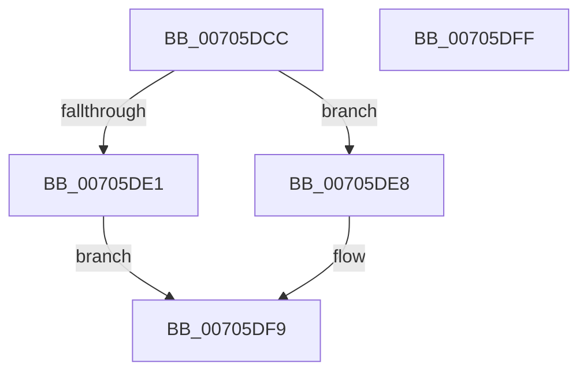

# RtlReadULong64FromUser

- RVA: `0x00705DCC`–`0x00705E00` (길이 `52` bytes)
- VA: `0x0000000140705DCC`
- 실행 섹션: `PAGE`
- PDB 이름 있음: `예`; PDB Function 태그: `아니요`
- unwind 정보 RVA: `0x0005CF00`
- 디코드: `17`개 명령, `52/52` bytes 표시
- 미해석 바이트: `0` (있으면 어셈블리에 `.byte`로 보존)

> 이 문서는 커널 이미지의 기계어와 PDB 기호를 분석해 생성했습니다. 4번과 5번은 함수 원형과 자료형을 바이너리 사용 방식에서 추정한 C 해석이며 원본 소스 복구 결과는 아닙니다.

## 1. Dependencies

- 직접 호출 지점: **2**; 고유 호출 대상: **2**
- 직접 호출자로 확인된 함수: **5**
- RIP 상대 이미지 참조: **1**

### Outgoing calls
- `0x00705DE1` → `indirect target` (indirect, 간접 대상)
- `0x00705DF1` → [ProbeForRead](../9C/ProbeForRead_function_009C5130.md) (function, `0x009C5130`)

### Direct callers
- [PoGetRequester](../../text/5C/PoGetRequester_function_005CE468.md) at `0x005CE54E`
- [PspWow64ReadOrWriteThreadCpuArea](../8C/PspWow64ReadOrWriteThreadCpuArea_function_008CD404.md) at `0x008CD4BF`
- [PspWow64ReadOrWriteThreadCpuArea](../8C/PspWow64ReadOrWriteThreadCpuArea_function_008CD404.md) at `0x008CD543`
- [MmAllocateVirtualMemory](../9A/MmAllocateVirtualMemory_function_009A1A40.md) at `0x009A1ABC`
- [MmAllocateVirtualMemory](../9A/MmAllocateVirtualMemory_function_009A1A40.md) at `0x009A1ADA`
- [EtwpWriteUserEvent](../AF/EtwpWriteUserEvent_function_00AF2FEC.md) at `0x00AF38B9`
- [NtSetSystemInformation](../AF/NtSetSystemInformation_function_00AF4A60.md) at `0x00AF4E96`

### Static image references
- `0x00705DD2` → RVA `0x001517E8` (`.idata`; read)

## 2. Other-region calls and transfers

- 다른 실행 섹션으로 향하는 call: **0**
- 별도 외부 분기/꼬리 이동을 확인하지 못했습니다.

## 3. Assembly (complete function range)

```asm
00705DCC  40 53                           push rbx
00705DCE  48 83 EC 20                     sub rsp, 0x20
00705DD2  48 8B 05 0F BA A4 FF            mov rax, qword ptr [rip - 0x5b45f1]
00705DD9  48 8B D9                        mov rbx, rcx
00705DDC  48 85 C0                        test rax, rax
00705DDF  74 07                           je 0x140705de8
00705DE1  FF D0                           call rax
00705DE3  0F 1F 00                        nop dword ptr [rax]
00705DE6  EB 11                           jmp 0x140705df9
00705DE8  BA 08 00 00 00                  mov edx, 8
00705DED  44 8D 42 F9                     lea r8d, [rdx - 7]
00705DF1  E8 3A F3 2B 00                  call 0x1409c5130
00705DF6  48 8B 03                        mov rax, qword ptr [rbx]
00705DF9  48 83 C4 20                     add rsp, 0x20
00705DFD  5B                              pop rbx
00705DFE  C3                              ret
00705DFF  CC                              int3
```

## 4. C-style interpretation (structured pseudocode)

```c
__int64 __fastcall RtlReadULong64FromUser(__int64 a1)
{
    __int64 result;
    __int64 v_rsp;

    v_rsp = (v_rsp) - (32);
    if (*(unsigned __int64 *)(v_rip - 5981681) == 0) goto loc_00705DE8;
    result = kernel_indirect_call(a1, a2, a3, a4);
    goto loc_00705DF9;
loc_00705DE8:
    result = ProbeForRead(a1, 8, 8 - 7, a4);
loc_00705DF9:
    v_rsp = (v_rsp) + (32);
    return *(unsigned __int64 *)(a1);
}
```

## 5. (Beta) C Style

```c
int64_t RtlReadULong64FromUser(void *Arg1)
{
    uint8_t *arg1 = (uint8_t *)Arg1;

    int64_t result;
    int64_t local_rsp;

    local_rsp = (local_rsp) - (32);
    if (*(uint64_t *)(v_rip - 0x5B45F1) == 0) goto loc_00705DE8;
    result = kernel_indirect_call(Arg1, a2, a3, a4);
    goto loc_00705DF9;
loc_00705DE8:
    result = ProbeForRead(Arg1, 8, 8 - 7, a4);
loc_00705DF9:
    local_rsp = (local_rsp) + (32);
    return *(uint64_t *)(arg1);
}
```

### 관측된 메모리 오프셋

구조체 형식이 확인되지 않은 접근은 인자 기준의 오프셋으로만 기록했습니다.

| 기준 인자 | 오프셋 표현 | 폭 (bit) | 접근 |
|---|---:|---:|---|
| `Arg1` | `+ 0x0` | `64` | `R` |

## 6. Execution-region graph

[열기: 2D/3D 그래프와 함수 탐색 컨트롤 패널](../../../control-panel.html?section=page&rva=0x00705DCC&view=graph)

- 2D 그래프는 위에서 아래로 흐르고, 3D 그래프는 빈 공간을 드래그해 회전합니다. Shift+드래그는 이동, 휠은 확대·축소, 함수 노드 선택은 대상 보고서 이동입니다.

### Static fallback


