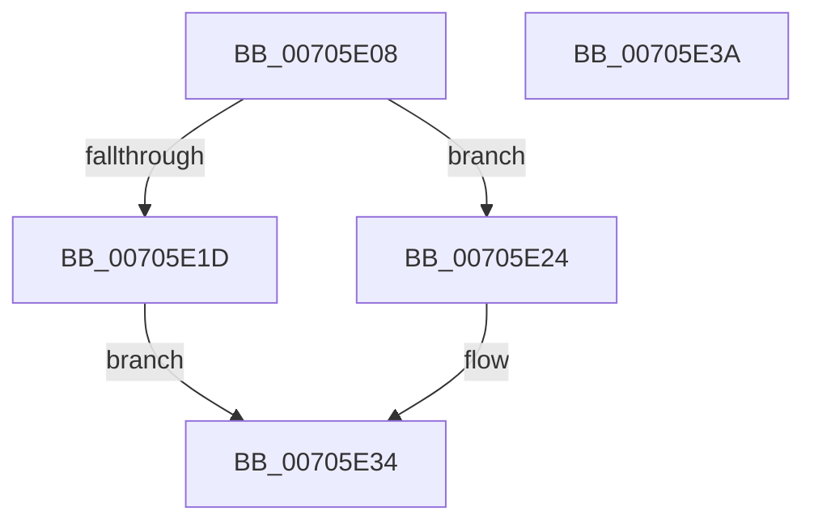

# RtlReadULongFromUser

- RVA: `0x00705E08`–`0x00705E3B` (길이 `51` bytes)
- VA: `0x0000000140705E08`
- 실행 섹션: `PAGE`
- PDB 이름 있음: `예`; PDB Function 태그: `아니요`
- unwind 정보 RVA: `0x0005CF00`
- 디코드: `17`개 명령, `51/51` bytes 표시
- 미해석 바이트: `0` (있으면 어셈블리에 `.byte`로 보존)

> 이 문서는 커널 이미지의 기계어와 PDB 기호를 분석해 생성했습니다. 4번과 5번은 함수 원형과 자료형을 바이너리 사용 방식에서 추정한 C 해석이며 원본 소스 복구 결과는 아닙니다.

## 1. Dependencies

- 직접 호출 지점: **2**; 고유 호출 대상: **2**
- 직접 호출자로 확인된 함수: **4**
- RIP 상대 이미지 참조: **1**

### Outgoing calls
- `0x00705E1D` → `indirect target` (indirect, 간접 대상)
- `0x00705E2D` → [ProbeForRead](../9C/ProbeForRead_function_009C5130.md) (function, `0x009C5130`)

### Direct callers
- [PoGetRequester](../../text/5C/PoGetRequester_function_005CE468.md) at `0x005CE539`
- [PspWow64ReadOrWriteThreadCpuArea](../8C/PspWow64ReadOrWriteThreadCpuArea_function_008CD404.md) at `0x008CD555`
- [PspWow64ReadOrWriteThreadCpuArea](../8C/PspWow64ReadOrWriteThreadCpuArea_function_008CD404.md) at `0x008CD58F`
- [NtSetInformationToken](../AF/NtSetInformationToken_function_00AF0530.md) at `0x00AF13A7`
- [NtSetInformationToken](../AF/NtSetInformationToken_function_00AF0530.md) at `0x00AF1670`
- [NtSetSystemInformation](../AF/NtSetSystemInformation_function_00AF4A60.md) at `0x00AF4E86`

### Static image references
- `0x00705E0E` → RVA `0x001517D8` (`.idata`; read)

## 2. Other-region calls and transfers

- 다른 실행 섹션으로 향하는 call: **0**
- 별도 외부 분기/꼬리 이동을 확인하지 못했습니다.

## 3. Assembly (complete function range)

```asm
00705E08  40 53                           push rbx
00705E0A  48 83 EC 20                     sub rsp, 0x20
00705E0E  48 8B 05 C3 B9 A4 FF            mov rax, qword ptr [rip - 0x5b463d]
00705E15  48 8B D9                        mov rbx, rcx
00705E18  48 85 C0                        test rax, rax
00705E1B  74 07                           je 0x140705e24
00705E1D  FF D0                           call rax
00705E1F  0F 1F 00                        nop dword ptr [rax]
00705E22  EB 10                           jmp 0x140705e34
00705E24  BA 04 00 00 00                  mov edx, 4
00705E29  44 8D 42 FD                     lea r8d, [rdx - 3]
00705E2D  E8 FE F2 2B 00                  call 0x1409c5130
00705E32  8B 03                           mov eax, dword ptr [rbx]
00705E34  48 83 C4 20                     add rsp, 0x20
00705E38  5B                              pop rbx
00705E39  C3                              ret
00705E3A  CC                              int3
```

## 4. C-style interpretation (structured pseudocode)

```c
__int64 __fastcall RtlReadULongFromUser(__int64 a1)
{
    __int64 result;
    __int64 v_rsp;

    v_rsp = (v_rsp) - (32);
    if (*(unsigned __int64 *)(v_rip - 5981757) == 0) goto loc_00705E24;
    result = kernel_indirect_call(a1, a2, a3, a4);
    goto loc_00705E34;
loc_00705E24:
    result = ProbeForRead(a1, 4, 4 - 3, a4);
loc_00705E34:
    v_rsp = (v_rsp) + (32);
    return (unsigned int)(*(unsigned int *)(a1));
}
```

## 5. (Beta) C Style

```c
int64_t RtlReadULongFromUser(void *Arg1)
{
    uint8_t *arg1 = (uint8_t *)Arg1;

    int64_t result;
    int64_t local_rsp;

    local_rsp = (local_rsp) - (32);
    if (*(uint64_t *)(v_rip - 0x5B463D) == 0) goto loc_00705E24;
    result = kernel_indirect_call(Arg1, a2, a3, a4);
    goto loc_00705E34;
loc_00705E24:
    result = ProbeForRead(Arg1, 4, 4 - 3, a4);
loc_00705E34:
    local_rsp = (local_rsp) + (32);
    return (uint32_t)(*(uint32_t *)(arg1));
}
```

### 관측된 메모리 오프셋

구조체 형식이 확인되지 않은 접근은 인자 기준의 오프셋으로만 기록했습니다.

| 기준 인자 | 오프셋 표현 | 폭 (bit) | 접근 |
|---|---:|---:|---|
| `Arg1` | `+ 0x0` | `32` | `R` |

## 6. Execution-region graph

[열기: 2D/3D 그래프와 함수 탐색 컨트롤 패널](../../../control-panel.html?section=page&rva=0x00705E08&view=graph)

- 2D 그래프는 위에서 아래로 흐르고, 3D 그래프는 빈 공간을 드래그해 회전합니다. Shift+드래그는 이동, 휠은 확대·축소, 함수 노드 선택은 대상 보고서 이동입니다.

### Static fallback


