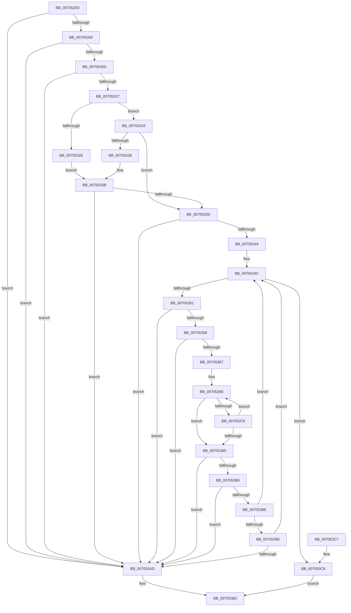

# RtlValidateCorrelationVector

- RVA: `0x007052E0`–`0x007053CC` (길이 `236` bytes)
- VA: `0x00000001407052E0`
- 실행 섹션: `PAGE`
- PDB 이름 있음: `예`; PDB Function 태그: `아니요`
- unwind 정보 RVA: `0x0005F9EC`
- 디코드: `76`개 명령, `236/236` bytes 표시
- 미해석 바이트: `0` (있으면 어셈블리에 `.byte`로 보존)

> 이 문서는 커널 이미지의 기계어와 PDB 기호를 분석해 생성했습니다. 4번과 5번은 함수 원형과 자료형을 바이너리 사용 방식에서 추정한 C 해석이며 원본 소스 복구 결과는 아닙니다.

## 1. Dependencies

- 직접 호출 지점: **4**; 고유 호출 대상: **4**
- 직접 호출자로 확인된 함수: **1**
- RIP 상대 이미지 참조: **1**

### Outgoing calls
- `0x00705300` → [RtlpGetCorrelationVectorBufferLength](../AB/RtlpGetCorrelationVectorBufferLength_function_00AB9518.md) (function, `0x00AB9518`)
- `0x00705310` → [RtlpGetLastContiguosBase64Position](../79/RtlpGetLastContiguosBase64Position_function_00791D1C.md) (function, `0x00791D1C`)
- `0x0070531A` → [RtlpGetCorrelationVectorEndPosition](../../text/5E/RtlpGetCorrelationVectorEndPosition_function_005EC52C.md) (function, `0x005EC52C`)
- `0x007053A4` → [strncmp](../../text/6C/strncmp_function_006C6720.md) (function, `0x006C6720`)

### Direct callers
- [RtlIncrementCorrelationVector](../AB/RtlIncrementCorrelationVector_function_00AB9430.md) at `0x00AB9465`

### Static image references
- `0x00705397` → RVA `0x00B05A90` (` ?? ::NNGAKEGL::`string'`; read)

## 2. Other-region calls and transfers

- 다른 실행 섹션으로 향하는 call: **2**
  - `0x0070531A` → [RtlpGetCorrelationVectorEndPosition](../../text/5E/RtlpGetCorrelationVectorEndPosition_function_005EC52C.md) (`PAGE` → `.text`)
  - `0x007053A4` → [strncmp](../../text/6C/strncmp_function_006C6720.md) (`PAGE` → `.text`)
- 별도 외부 분기/꼬리 이동을 확인하지 못했습니다.

## 3. Assembly (complete function range)

```asm
007052E0  48 89 5C 24 08                  mov qword ptr [rsp + 8], rbx
007052E5  48 89 6C 24 10                  mov qword ptr [rsp + 0x10], rbp
007052EA  48 89 74 24 18                  mov qword ptr [rsp + 0x18], rsi
007052EF  57                              push rdi
007052F0  48 83 EC 20                     sub rsp, 0x20
007052F4  48 8B D9                        mov rbx, rcx
007052F7  48 85 C9                        test rcx, rcx
007052FA  0F 84 AD 00 00 00               je 0x1407053ad
00705300  E8 13 42 3B 00                  call 0x140ab9518
00705305  85 C0                           test eax, eax
00705307  0F 88 A0 00 00 00               js 0x1407053ad
0070530D  48 8B CB                        mov rcx, rbx
00705310  E8 07 CA 08 00                  call 0x140791d1c
00705315  48 8B CB                        mov rcx, rbx
00705318  8B F0                           mov esi, eax
0070531A  E8 0D 72 EE FF                  call 0x1405ec52c
0070531F  85 C0                           test eax, eax
00705321  0F 88 86 00 00 00               js 0x1407053ad
00705327  8A 0B                           mov cl, byte ptr [rbx]
00705329  80 F9 01                        cmp cl, 1
0070532C  75 05                           jne 0x140705333
0070532E  83 FE 0F                        cmp esi, 0xf
00705331  EB 08                           jmp 0x14070533b
00705333  80 F9 02                        cmp cl, 2
00705336  75 05                           jne 0x14070533d
00705338  83 FE 15                        cmp esi, 0x15
0070533B  75 70                           jne 0x1407053ad
0070533D  FF C6                           inc esi
0070533F  48 63 FE                        movsxd rdi, esi
00705342  80 7C 1F 01 2E                  cmp byte ptr [rdi + rbx + 1], 0x2e
00705347  75 64                           jne 0x1407053ad
00705349  48 63 E8                        movsxd rbp, eax
0070534C  48 3B FD                        cmp rdi, rbp
0070534F  7D 77                           jge 0x1407053c8
00705351  80 7C 1F 01 2E                  cmp byte ptr [rdi + rbx + 1], 0x2e
00705356  75 55                           jne 0x1407053ad
00705358  FF C6                           inc esi
0070535A  48 FF C7                        inc rdi
0070535D  33 C9                           xor ecx, ecx
0070535F  4C 63 C6                        movsxd r8, esi
00705362  48 3B FD                        cmp rdi, rbp
00705365  7D 46                           jge 0x1407053ad
00705367  48 8D 53 01                     lea rdx, [rbx + 1]
0070536B  48 03 D7                        add rdx, rdi
0070536E  8A 02                           mov al, byte ptr [rdx]
00705370  2C 30                           sub al, 0x30
00705372  3C 09                           cmp al, 9
00705374  77 0F                           ja 0x140705385
00705376  FF C6                           inc esi
00705378  48 FF C7                        inc rdi
0070537B  48 FF C2                        inc rdx
0070537E  FF C1                           inc ecx
00705380  48 3B FD                        cmp rdi, rbp
00705383  7C E9                           jl 0x14070536e
00705385  85 C9                           test ecx, ecx
00705387  74 24                           je 0x1407053ad
00705389  83 F9 0A                        cmp ecx, 0xa
0070538C  7F 1F                           jg 0x1407053ad
0070538E  75 BC                           jne 0x14070534c
00705390  48 8D 4B 01                     lea rcx, [rbx + 1]
00705394  49 03 C8                        add rcx, r8
00705397  48 8D 15 F2 06 40 00            lea rdx, [rip + 0x4006f2]
0070539E  41 B8 0A 00 00 00               mov r8d, 0xa
007053A4  E8 77 13 FC FF                  call 0x1406c6720
007053A9  85 C0                           test eax, eax
007053AB  7E 9F                           jle 0x14070534c
007053AD  B8 0D 00 00 C0                  mov eax, 0xc000000d
007053B2  48 8B 5C 24 30                  mov rbx, qword ptr [rsp + 0x30]
007053B7  48 8B 6C 24 38                  mov rbp, qword ptr [rsp + 0x38]
007053BC  48 8B 74 24 40                  mov rsi, qword ptr [rsp + 0x40]
007053C1  48 83 C4 20                     add rsp, 0x20
007053C5  5F                              pop rdi
007053C6  C3                              ret
007053C7  CC                              int3
007053C8  33 C0                           xor eax, eax
007053CA  EB E6                           jmp 0x1407053b2
```

## 4. C-style interpretation (structured pseudocode)

```c
__int64 __fastcall RtlValidateCorrelationVector(__int64 a1)
{
    __int64 result;
    __int64 v_rdi;
    __int64 v_rsi;
    __int64 v_rsp;
    unsigned __int64 v_stack_p10;
    unsigned __int64 v_stack_p18;
    unsigned __int64 v_stack_p8;

    v_stack_p8 = v_rbx;
    v_stack_p10 = v_rbp;
    v_stack_p18 = v_rsi;
    v_rsp = (v_rsp) - (32);
    if (a1 == 0) goto loc_007053AD;
    result = RtlpGetCorrelationVectorBufferLength(a1, a2, a3, a4);
    if (sign_flag) goto loc_007053AD;
    result = RtlpGetLastContiguosBase64Position(a1, a2, a3, a4);
    result = RtlpGetCorrelationVectorEndPosition(a1, a2, a3, a4);
    if (sign_flag) goto loc_007053AD;
    if (((unsigned __int8)(*(unsigned __int8 *)(a1))) != 1) goto loc_00705333;
    goto loc_0070533B;
loc_00705333:
    if (((unsigned __int8)(*(unsigned __int8 *)(a1))) != 2) goto loc_0070533D;
loc_0070533B:
    if (((unsigned int)((unsigned int)((unsigned int)(result)))) != 21) goto loc_007053AD;
loc_0070533D:
    v_rsi = (unsigned int)(((unsigned int)((unsigned int)(result))) + 1);
    if ((*(unsigned __int8 *)((int)((unsigned int)(v_rsi)) + a1 * 1 + 1)) != 46) goto loc_007053AD;
loc_0070534C:
    if (((int)((unsigned int)(v_rsi))) >= ((int)((unsigned int)(result)))) goto loc_007053C8;
    if ((*(unsigned __int8 *)((int)((unsigned int)(v_rsi)) + a1 * 1 + 1)) != 46) goto loc_007053AD;
    v_rsi = (unsigned int)((v_rsi) + 1);
    v_rdi = ((int)((unsigned int)(v_rsi))) + 1;
    a1 = 0;
    if (v_rdi >= ((int)((unsigned int)(result)))) goto loc_007053AD;
    a2 = (a1 + 1) + (v_rdi);
loc_0070536E:
    result = (unsigned __int8)((*(unsigned __int8 *)(a2)) - (48));
    if (((unsigned __int8)(result)) > 9) goto loc_00705385;
    v_rsi = (unsigned int)((v_rsi) + 1);
    v_rdi = (v_rdi) + 1;
    a2 = (a2) + 1;
    a1 = (unsigned int)((a1) + 1);
    if (v_rdi < ((int)((unsigned int)(result)))) goto loc_0070536E;
loc_00705385:
    if ((unsigned int)(a1) == 0) goto loc_007053AD;
    if (((unsigned int)(a1)) > 10) goto loc_007053AD;
    if (((unsigned int)(a1)) != 10) goto loc_0070534C;
    a1 = (a1 + 1) + ((int)((unsigned int)(v_rsi)));
    result = strncmp(a1, v_rip + 4196082, 10, a4);
    if (condition_is_less_or_equal) goto loc_0070534C;
loc_007053AD:
loc_007053B2:
    v_rsp = (v_rsp) + (32);
    return (unsigned int)(0xC000000DULL);
loc_007053C8:
    result = 0;
    goto loc_007053B2;
}
```

## 5. (Beta) C Style

```c
int64_t RtlValidateCorrelationVector(void *Arg1)
{
    uint8_t *arg1 = (uint8_t *)Arg1;

    int64_t result;
    int64_t local_rdi;
    int64_t local_rsi;
    int64_t local_rsp;
    uint64_t v_stack_p10;
    uint64_t v_stack_p18;
    uint64_t v_stack_p8;

    v_stack_p8 = local_rbx;
    v_stack_p10 = local_rbp;
    v_stack_p18 = local_rsi;
    local_rsp = (local_rsp) - (32);
    if (Arg1 == NULL) goto loc_007053AD;
    result = RtlpGetCorrelationVectorBufferLength(Arg1, a2, a3, a4);
    if (sign_flag) goto loc_007053AD;
    result = RtlpGetLastContiguosBase64Position(Arg1, a2, a3, a4);
    result = RtlpGetCorrelationVectorEndPosition(Arg1, a2, a3, a4);
    if (sign_flag) goto loc_007053AD;
    if (((uint8_t)(*(uint8_t *)(arg1))) != 1) goto loc_00705333;
    goto loc_0070533B;
loc_00705333:
    if (((uint8_t)(*(uint8_t *)(arg1))) != 2) goto loc_0070533D;
loc_0070533B:
    if (((uint32_t)((uint32_t)((uint32_t)(result)))) != 21) goto loc_007053AD;
loc_0070533D:
    local_rsi = (uint32_t)(((uint32_t)((uint32_t)(result))) + 1);
    if ((*(uint8_t *)((int32_t)((uint32_t)(local_rsi)) + arg1 * 1 + 0x1)) != 46) goto loc_007053AD;
loc_0070534C:
    if (((int32_t)((uint32_t)(local_rsi))) >= ((int32_t)((uint32_t)(result)))) goto loc_007053C8;
    if ((*(uint8_t *)((int32_t)((uint32_t)(local_rsi)) + arg1 * 1 + 0x1)) != 46) goto loc_007053AD;
    local_rsi = (uint32_t)((local_rsi) + 1);
    local_rdi = ((int32_t)((uint32_t)(local_rsi))) + 1;
    Arg1 = 0;
    if (local_rdi >= ((int32_t)((uint32_t)(result)))) goto loc_007053AD;
    a2 = (Arg1 + 1) + (local_rdi);
loc_0070536E:
    result = (uint8_t)((*(uint8_t *)(a2)) - (48));
    if (((uint8_t)(result)) > 9) goto loc_00705385;
    local_rsi = (uint32_t)((local_rsi) + 1);
    local_rdi = (local_rdi) + 1;
    a2 = (a2) + 1;
    Arg1 = (uint32_t)((Arg1) + 1);
    if (local_rdi < ((int32_t)((uint32_t)(result)))) goto loc_0070536E;
loc_00705385:
    if ((uint32_t)(Arg1) == 0) goto loc_007053AD;
    if (((uint32_t)(Arg1)) > 10) goto loc_007053AD;
    if (((uint32_t)(Arg1)) != 10) goto loc_0070534C;
    Arg1 = (Arg1 + 1) + ((int32_t)((uint32_t)(local_rsi)));
    result = strncmp(Arg1, v_rip + 4196082, 10, a4);
    if (condition_is_less_or_equal) goto loc_0070534C;
loc_007053AD:
loc_007053B2:
    local_rsp = (local_rsp) + (32);
    return (uint32_t)(0xC000000DULL);
loc_007053C8:
    result = 0;
    goto loc_007053B2;
}
```

### 관측된 메모리 오프셋

구조체 형식이 확인되지 않은 접근은 인자 기준의 오프셋으로만 기록했습니다.

| 기준 인자 | 오프셋 표현 | 폭 (bit) | 접근 |
|---|---:|---:|---|
| `Arg1` | `+ 0x0` | `8` | `R` |
| `Arg1` | `+ 0x1` | `64` | `R` |

## 6. Execution-region graph

[열기: 2D/3D 그래프와 함수 탐색 컨트롤 패널](../../../control-panel.html?section=page&rva=0x007052E0&view=graph)

- 2D 그래프는 위에서 아래로 흐르고, 3D 그래프는 빈 공간을 드래그해 회전합니다. Shift+드래그는 이동, 휠은 확대·축소, 함수 노드 선택은 대상 보고서 이동입니다.

### Static fallback


