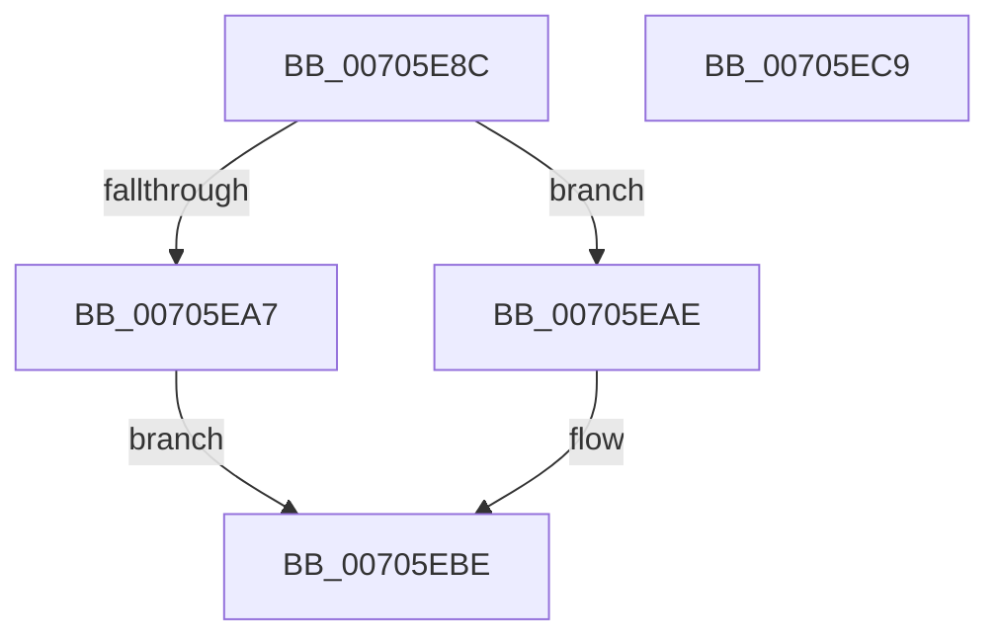

# RtlWriteULongToUser

- RVA: `0x00705E8C`–`0x00705ECA` (길이 `62` bytes)
- VA: `0x0000000140705E8C`
- 실행 섹션: `PAGE`
- PDB 이름 있음: `예`; PDB Function 태그: `아니요`
- unwind 정보 RVA: `0x0005CAAC`
- 디코드: `20`개 명령, `62/62` bytes 표시
- 미해석 바이트: `0` (있으면 어셈블리에 `.byte`로 보존)

> 이 문서는 커널 이미지의 기계어와 PDB 기호를 분석해 생성했습니다. 4번과 5번은 함수 원형과 자료형을 바이너리 사용 방식에서 추정한 C 해석이며 원본 소스 복구 결과는 아닙니다.

## 1. Dependencies

- 직접 호출 지점: **2**; 고유 호출 대상: **2**
- 직접 호출자로 확인된 함수: **4**
- RIP 상대 이미지 참조: **1**

### Outgoing calls
- `0x00705EA7` → `indirect target` (indirect, 간접 대상)
- `0x00705EB7` → [ProbeForRead](../9C/ProbeForRead_function_009C5130.md) (function, `0x009C5130`)

### Direct callers
- [NtManageWobTicket](../78/NtManageWobTicket_function_00789AC0.md) at `0x00789B3B`
- [PspWow64ReadOrWriteThreadCpuArea](../8C/PspWow64ReadOrWriteThreadCpuArea_function_008CD404.md) at `0x008CD529`
- [NtQueryInformationToken](../AE/NtQueryInformationToken_function_00AECDD0.md) at `0x00AEFEED`
- [EtwQueryPerformanceTraceInformation](../AF/EtwQueryPerformanceTraceInformation_function_00AF28A4.md) at `0x00AF2F89`
- [EtwQueryPerformanceTraceInformation](../AF/EtwQueryPerformanceTraceInformation_function_00AF28A4.md) at `0x00AF2FAB`

### Static image references
- `0x00705E96` → RVA `0x001517E0` (`.idata`; read)

## 2. Other-region calls and transfers

- 다른 실행 섹션으로 향하는 call: **0**
- 별도 외부 분기/꼬리 이동을 확인하지 못했습니다.

## 3. Assembly (complete function range)

```asm
00705E8C  48 89 5C 24 08                  mov qword ptr [rsp + 8], rbx
00705E91  57                              push rdi
00705E92  48 83 EC 20                     sub rsp, 0x20
00705E96  48 8B 05 43 B9 A4 FF            mov rax, qword ptr [rip - 0x5b46bd]
00705E9D  8B FA                           mov edi, edx
00705E9F  48 8B D9                        mov rbx, rcx
00705EA2  48 85 C0                        test rax, rax
00705EA5  74 07                           je 0x140705eae
00705EA7  FF D0                           call rax
00705EA9  0F 1F 00                        nop dword ptr [rax]
00705EAC  EB 10                           jmp 0x140705ebe
00705EAE  BA 04 00 00 00                  mov edx, 4
00705EB3  44 8D 42 FD                     lea r8d, [rdx - 3]
00705EB7  E8 74 F2 2B 00                  call 0x1409c5130
00705EBC  89 3B                           mov dword ptr [rbx], edi
00705EBE  48 8B 5C 24 30                  mov rbx, qword ptr [rsp + 0x30]
00705EC3  48 83 C4 20                     add rsp, 0x20
00705EC7  5F                              pop rdi
00705EC8  C3                              ret
00705EC9  CC                              int3
```

## 4. C-style interpretation (structured pseudocode)

```c
__int64 __fastcall RtlWriteULongToUser(__int64 a1, int a2)
{
    __int64 result;
    __int64 v_rsp;
    unsigned __int64 v_stack_p8;

    v_stack_p8 = v_rbx;
    v_rsp = (v_rsp) - (32);
    if (*(unsigned __int64 *)(v_rip - 5981885) == 0) goto loc_00705EAE;
    result = kernel_indirect_call(a1, a2, a3, a4);
    goto loc_00705EBE;
loc_00705EAE:
    result = ProbeForRead(a1, 4, 4 - 3, a4);
    *(unsigned int *)(a1) = (unsigned int)((unsigned int)(a2));
loc_00705EBE:
    v_rsp = (v_rsp) + (32);
    return result;
}
```

## 5. (Beta) C Style

```c
int64_t RtlWriteULongToUser(void *Arg1, int32_t Arg2)
{
    uint8_t *arg1 = (uint8_t *)Arg1;

    int64_t result;
    int64_t local_rsp;
    uint64_t v_stack_p8;

    v_stack_p8 = local_rbx;
    local_rsp = (local_rsp) - (32);
    if (*(uint64_t *)(v_rip - 0x5B46BD) == 0) goto loc_00705EAE;
    result = kernel_indirect_call(Arg1, Arg2, a3, a4);
    goto loc_00705EBE;
loc_00705EAE:
    result = ProbeForRead(Arg1, 4, 4 - 3, a4);
    *(uint32_t *)(arg1) = (uint32_t)((uint32_t)(Arg2));
loc_00705EBE:
    local_rsp = (local_rsp) + (32);
    return result;
}
```

### 관측된 메모리 오프셋

구조체 형식이 확인되지 않은 접근은 인자 기준의 오프셋으로만 기록했습니다.

| 기준 인자 | 오프셋 표현 | 폭 (bit) | 접근 |
|---|---:|---:|---|
| `Arg1` | `+ 0x0` | `32` | `W` |

## 6. Execution-region graph

[열기: 2D/3D 그래프와 함수 탐색 컨트롤 패널](../../../control-panel.html?section=page&rva=0x00705E8C&view=graph)

- 2D 그래프는 위에서 아래로 흐르고, 3D 그래프는 빈 공간을 드래그해 회전합니다. Shift+드래그는 이동, 휠은 확대·축소, 함수 노드 선택은 대상 보고서 이동입니다.

### Static fallback


