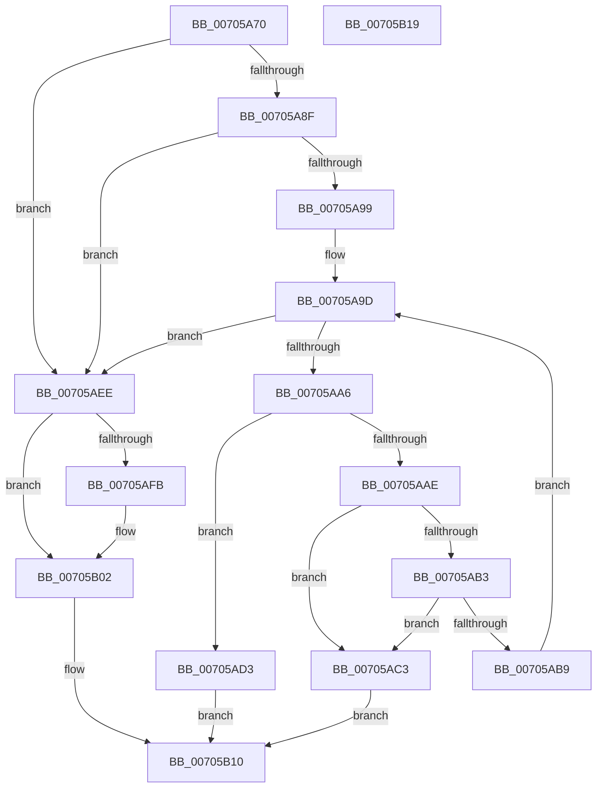

# RtlpAddRange

- RVA: `0x00705A70`–`0x00705B1A` (길이 `170` bytes)
- VA: `0x0000000140705A70`
- 실행 섹션: `PAGE`
- PDB 이름 있음: `예`; PDB Function 태그: `아니요`
- unwind 정보 RVA: `0x0005CF00`
- 디코드: `55`개 명령, `170/170` bytes 표시
- 미해석 바이트: `0` (있으면 어셈블리에 `.byte`로 보존)

> 이 문서는 커널 이미지의 기계어와 PDB 기호를 분석해 생성했습니다. 4번과 5번은 함수 원형과 자료형을 바이너리 사용 방식에서 추정한 C 해석이며 원본 소스 복구 결과는 아닙니다.

## 1. Dependencies

- 직접 호출 지점: **1**; 고유 호출 대상: **1**
- 직접 호출자로 확인된 함수: **3**
- RIP 상대 이미지 참조: **0**

### Outgoing calls
- `0x00705AC9` → [RtlpAddIntersectingRanges](../78/RtlpAddIntersectingRanges_function_0078AB4C.md) (function, `0x0078AB4C`)

### Direct callers
- [RtlMergeRangeLists](../78/RtlMergeRangeLists_function_0078AA40.md) at `0x0078AAC2`
- [RtlMergeRangeLists](../78/RtlMergeRangeLists_function_0078AA40.md) at `0x0078AAF1`
- [RtlpDeleteFromMergedRange](../78/RtlpDeleteFromMergedRange_function_0078AE98.md) at `0x0078AF3F`
- [RtlAddRange](../A8/RtlAddRange_function_00A8E860.md) at `0x00A8E900`

### Static image references
- 디코드된 RIP-relative 메모리 참조가 없습니다.

## 2. Other-region calls and transfers

- 다른 실행 섹션으로 향하는 call: **0**
- 별도 외부 분기/꼬리 이동을 확인하지 못했습니다.

## 3. Assembly (complete function range)

```asm
00705A70  40 53                           push rbx
00705A72  48 83 EC 20                     sub rsp, 0x20
00705A76  80 62 21 FD                     and byte ptr [rdx + 0x21], 0xfd
00705A7A  4C 8B D2                        mov r10, rdx
00705A7D  48 8B 5A 08                     mov rbx, qword ptr [rdx + 8]
00705A81  45 33 DB                        xor r11d, r11d
00705A84  4C 8B 0A                        mov r9, qword ptr [rdx]
00705A87  48 8B 11                        mov rdx, qword ptr [rcx]
00705A8A  48 3B D1                        cmp rdx, rcx
00705A8D  74 5F                           je 0x140705aee
00705A8F  48 8B 41 08                     mov rax, qword ptr [rcx + 8]
00705A93  4C 3B 48 E0                     cmp r9, qword ptr [rax - 0x20]
00705A97  77 55                           ja 0x140705aee
00705A99  48 83 C2 D8                     add rdx, -0x28
00705A9D  48 8D 42 28                     lea rax, [rdx + 0x28]
00705AA1  48 3B C8                        cmp rcx, rax
00705AA4  74 48                           je 0x140705aee
00705AA6  48 8B 02                        mov rax, qword ptr [rdx]
00705AA9  48 3B D8                        cmp rbx, rax
00705AAC  72 25                           jb 0x140705ad3
00705AAE  49 3B C1                        cmp rax, r9
00705AB1  73 10                           jae 0x140705ac3
00705AB3  4C 39 4A 08                     cmp qword ptr [rdx + 8], r9
00705AB7  73 0A                           jae 0x140705ac3
00705AB9  48 8B 52 28                     mov rdx, qword ptr [rdx + 0x28]
00705ABD  48 83 EA 28                     sub rdx, 0x28
00705AC1  EB DA                           jmp 0x140705a9d
00705AC3  45 8B C8                        mov r9d, r8d
00705AC6  4D 8B C2                        mov r8, r10
00705AC9  E8 7E 50 08 00                  call 0x14078ab4c
00705ACE  44 8B D8                        mov r11d, eax
00705AD1  EB 3D                           jmp 0x140705b10
00705AD3  48 8B 52 30                     mov rdx, qword ptr [rdx + 0x30]
00705AD7  49 8D 42 28                     lea rax, [r10 + 0x28]
00705ADB  48 8B 0A                        mov rcx, qword ptr [rdx]
00705ADE  48 89 08                        mov qword ptr [rax], rcx
00705AE1  49 89 52 30                     mov qword ptr [r10 + 0x30], rdx
00705AE5  48 89 41 08                     mov qword ptr [rcx + 8], rax
00705AE9  48 89 02                        mov qword ptr [rdx], rax
00705AEC  EB 22                           jmp 0x140705b10
00705AEE  48 8B 51 08                     mov rdx, qword ptr [rcx + 8]
00705AF2  49 8D 42 28                     lea rax, [r10 + 0x28]
00705AF6  48 39 0A                        cmp qword ptr [rdx], rcx
00705AF9  74 07                           je 0x140705b02
00705AFB  B9 03 00 00 00                  mov ecx, 3
00705B00  CD 29                           int 0x29
00705B02  48 89 08                        mov qword ptr [rax], rcx
00705B05  48 89 50 08                     mov qword ptr [rax + 8], rdx
00705B09  48 89 02                        mov qword ptr [rdx], rax
00705B0C  48 89 41 08                     mov qword ptr [rcx + 8], rax
00705B10  41 8B C3                        mov eax, r11d
00705B13  48 83 C4 20                     add rsp, 0x20
00705B17  5B                              pop rbx
00705B18  C3                              ret
00705B19  CC                              int3
```

## 4. C-style interpretation (structured pseudocode)

```c
__int64 __fastcall RtlpAddRange(__int64 a1, __int64 a2, int a3)
{
    __int64 result;
    __int64 v_r11;
    __int64 v_rsp;

    v_rsp = (v_rsp) - (32);
    v_r11 = 0;
    if ((*(unsigned __int64 *)(a1)) == a1) goto loc_00705AEE;
    if ((*(unsigned __int64 *)(a2)) > (*(unsigned __int64 *)(*(unsigned __int64 *)(a1 + 8) - 32))) goto loc_00705AEE;
    a2 = (*(unsigned __int64 *)(a1)) + (-40);
loc_00705A9D:
    if (a1 == (a2 + 40)) goto loc_00705AEE;
    if ((*(unsigned __int64 *)(a2 + 8)) < (*(unsigned __int64 *)(a2))) goto loc_00705AD3;
    if ((*(unsigned __int64 *)(a2)) >= (*(unsigned __int64 *)(a2))) goto loc_00705AC3;
    if ((*(unsigned __int64 *)(a2 + 8)) >= (*(unsigned __int64 *)(a2))) goto loc_00705AC3;
    a2 = (*(unsigned __int64 *)(a2 + 40)) - (40);
    goto loc_00705A9D;
loc_00705AC3:
    result = RtlpAddIntersectingRanges(a1, a2, a2, (unsigned int)(a3));
    goto loc_00705B10;
loc_00705AD3:
    *(unsigned __int64 *)(a2 + 40) = *(unsigned __int64 *)(*(unsigned __int64 *)(a2 + 48));
    *(unsigned __int64 *)(a2 + 48) = *(unsigned __int64 *)(a2 + 48);
    *(unsigned __int64 *)(*(unsigned __int64 *)(*(unsigned __int64 *)(a2 + 48)) + 8) = a2 + 40;
    *(unsigned __int64 *)(*(unsigned __int64 *)(a2 + 48)) = a2 + 40;
    goto loc_00705B10;
loc_00705AEE:
    if ((*(unsigned __int64 *)(*(unsigned __int64 *)(*(unsigned __int64 *)(*(unsigned __int64 *)(a2 + 48)) + 8))) != (*(unsigned __int64 *)(*(unsigned __int64 *)(a2 + 48)))) {
        a1 = 3;
    }
    *(unsigned __int64 *)(a2 + 40) = a1;
    *(unsigned __int64 *)(a2 + 40 + 8) = *(unsigned __int64 *)(*(unsigned __int64 *)(*(unsigned __int64 *)(a2 + 48)) + 8);
    *(unsigned __int64 *)(*(unsigned __int64 *)(*(unsigned __int64 *)(*(unsigned __int64 *)(a2 + 48)) + 8)) = a2 + 40;
    *(unsigned __int64 *)(a1 + 8) = a2 + 40;
loc_00705B10:
    v_rsp = (v_rsp) + (32);
    return (unsigned int)((unsigned int)((unsigned int)((unsigned int)(result))));
}
```

## 5. (Beta) C Style

```c
int64_t RtlpAddRange(void *Arg1, void *Arg2, int32_t Arg3)
{
    uint8_t *arg1 = (uint8_t *)Arg1;
    uint8_t *arg2 = (uint8_t *)Arg2;

    int64_t result;
    int64_t local_r11;
    int64_t local_rsp;

    local_rsp = (local_rsp) - (32);
    local_r11 = 0;
    if ((*(uint64_t *)(arg1)) == Arg1) goto loc_00705AEE;
    if ((*(uint64_t *)(arg2)) > (*(uint64_t *)(*(uint64_t *)(arg1 + 0x8) - 0x20))) goto loc_00705AEE;
    Arg2 = (*(uint64_t *)(arg1)) + (-40);
loc_00705A9D:
    if (Arg1 == (Arg2 + 40)) goto loc_00705AEE;
    if ((*(uint64_t *)(arg2 + 0x8)) < (*(uint64_t *)(arg2))) goto loc_00705AD3;
    if ((*(uint64_t *)(arg2)) >= (*(uint64_t *)(arg2))) goto loc_00705AC3;
    if ((*(uint64_t *)(arg2 + 0x8)) >= (*(uint64_t *)(arg2))) goto loc_00705AC3;
    Arg2 = (*(uint64_t *)(arg2 + 0x28)) - (40);
    goto loc_00705A9D;
loc_00705AC3:
    result = RtlpAddIntersectingRanges(Arg1, Arg2, Arg2, (uint32_t)(Arg3));
    goto loc_00705B10;
loc_00705AD3:
    *(uint64_t *)(arg2 + 0x28) = *(uint64_t *)(*(uint64_t *)(arg2 + 0x30));
    *(uint64_t *)(arg2 + 0x30) = *(uint64_t *)(arg2 + 0x30);
    *(void **)(*(uint64_t *)(*(uint64_t *)(arg2 + 0x30)) + 0x8) = Arg2 + 40;
    *(void **)(*(uint64_t *)(arg2 + 0x30)) = Arg2 + 40;
    goto loc_00705B10;
loc_00705AEE:
    if ((*(uint64_t *)(*(uint64_t *)(*(uint64_t *)(*(uint64_t *)(arg2 + 0x30)) + 0x8))) != (*(uint64_t *)(*(uint64_t *)(arg2 + 0x30)))) {
        Arg1 = 3;
    }
    *(void **)(arg2 + 0x28) = Arg1;
    *(uint64_t *)(arg2 + 0x28 + 0x8) = *(uint64_t *)(*(uint64_t *)(*(uint64_t *)(arg2 + 0x30)) + 0x8);
    *(void **)(*(uint64_t *)(*(uint64_t *)(*(uint64_t *)(arg2 + 0x30)) + 0x8)) = Arg2 + 40;
    *(void **)(arg1 + 0x8) = Arg2 + 40;
loc_00705B10:
    local_rsp = (local_rsp) + (32);
    return (uint32_t)((uint32_t)((uint32_t)((uint32_t)(result))));
}
```

### 관측된 메모리 오프셋

구조체 형식이 확인되지 않은 접근은 인자 기준의 오프셋으로만 기록했습니다.

| 기준 인자 | 오프셋 표현 | 폭 (bit) | 접근 |
|---|---:|---:|---|
| `Arg1` | `+ 0x0` | `64` | `R` |
| `Arg1` | `+ 0x8` | `64` | `R` |
| `Arg2` | `+ 0x0` | `64` | `R` |
| `Arg2` | `+ 0x0` | `64` | `W` |
| `Arg2` | `+ 0x8` | `64` | `R` |
| `Arg2` | `+ 0x8` | `64` | `W` |
| `Arg2` | `+ 0x21` | `8` | `R/W` |
| `Arg2` | `+ 0x28` | `64` | `R` |
| `Arg2` | `+ 0x30` | `64` | `W` |

## 6. Execution-region graph

[열기: 2D/3D 그래프와 함수 탐색 컨트롤 패널](../../../control-panel.html?section=page&rva=0x00705A70&view=graph)

- 2D 그래프는 위에서 아래로 흐르고, 3D 그래프는 빈 공간을 드래그해 회전합니다. Shift+드래그는 이동, 휠은 확대·축소, 함수 노드 선택은 대상 보고서 이동입니다.

### Static fallback


