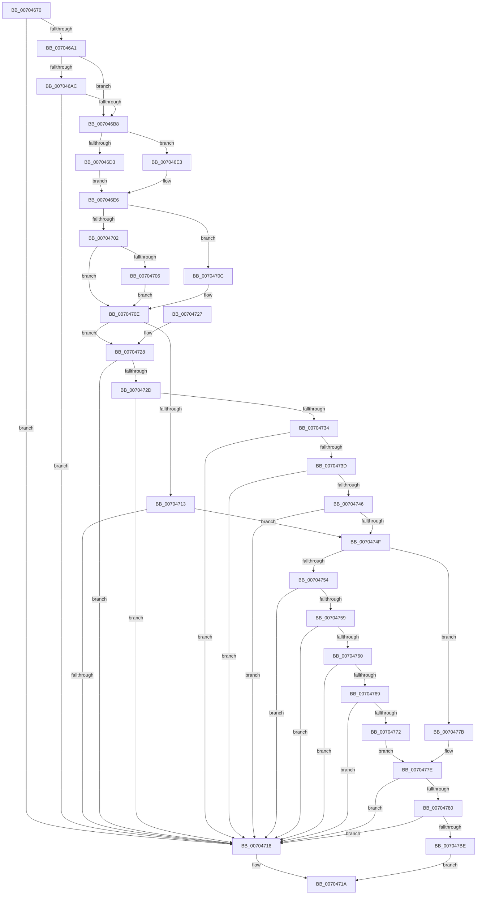

# RtlpCompareKnownObjectAces

- RVA: `0x00704670`–`0x007047C5` (길이 `341` bytes)
- VA: `0x0000000140704670`
- 실행 섹션: `PAGE`
- PDB 이름 있음: `예`; PDB Function 태그: `아니요`
- unwind 정보 RVA: `0x000BFA10`
- 디코드: `115`개 명령, `341/341` bytes 표시
- 미해석 바이트: `0` (있으면 어셈블리에 `.byte`로 보존)

> 이 문서는 커널 이미지의 기계어와 PDB 기호를 분석해 생성했습니다. 4번과 5번은 함수 원형과 자료형을 바이너리 사용 방식에서 추정한 C 해석이며 원본 소스 복구 결과는 아닙니다.

## 1. Dependencies

- 직접 호출 지점: **1**; 고유 호출 대상: **1**
- 직접 호출자로 확인된 함수: **2**
- RIP 상대 이미지 참조: **1**

### Outgoing calls
- `0x007047B1` → [RtlEqualSid](../../text/40/RtlEqualSid_function_00400AD0.md) (function, `0x00400AD0`)

### Direct callers
- [RtlpGenerateInheritedAce](../92/RtlpGenerateInheritedAce_function_0092DB80.md) at `0x0092DF7B`
- [sub_0092EB8D](../92/Unknown_function_0092EB8D.md) at `0x0092EB9C`

### Static image references
- `0x00704686` → RVA `0x00000000` (`image boundary/outside`; read)

## 2. Other-region calls and transfers

- 다른 실행 섹션으로 향하는 call: **1**
  - `0x007047B1` → [RtlEqualSid](../../text/40/RtlEqualSid_function_00400AD0.md) (`PAGE` → `.text`)
- 별도 외부 분기/꼬리 이동을 확인하지 못했습니다.

## 3. Assembly (complete function range)

```asm
00704670  48 89 5C 24 18                  mov qword ptr [rsp + 0x18], rbx
00704675  55                              push rbp
00704676  56                              push rsi
00704677  57                              push rdi
00704678  48 83 EC 20                     sub rsp, 0x20
0070467C  0F B6 01                        movzx eax, byte ptr [rcx]
0070467F  4C 8B D1                        mov r10, rcx
00704682  44 0F B6 02                     movzx r8d, byte ptr [rdx]
00704686  48 8D 0D 73 B9 8F FF            lea rcx, [rip - 0x70468d]
0070468D  4C 8B DA                        mov r11, rdx
00704690  8A 84 08 38 AD B4 00            mov al, byte ptr [rax + rcx + 0xb4ad38]
00704697  41 38 84 08 38 AD B4 00         cmp byte ptr [r8 + rcx + 0xb4ad38], al
0070469F  75 77                           jne 0x140704718
007046A1  41 80 BC 08 08 B0 B4 00 00      cmp byte ptr [r8 + rcx + 0xb4b008], 0
007046AA  74 0C                           je 0x1407046b8
007046AC  8A 4A 01                        mov cl, byte ptr [rdx + 1]
007046AF  41 32 4A 01                     xor cl, byte ptr [r10 + 1]
007046B3  F6 C1 C0                        test cl, 0xc0
007046B6  75 60                           jne 0x140704718
007046B8  8B 6A 08                        mov ebp, dword ptr [rdx + 8]
007046BB  48 8D 4A 0C                     lea rcx, [rdx + 0xc]
007046BF  8B FD                           mov edi, ebp
007046C1  83 E7 01                        and edi, 1
007046C4  8B C7                           mov eax, edi
007046C6  F7 D8                           neg eax
007046C8  4D 1B C9                        sbb r9, r9
007046CB  4C 23 C9                        and r9, rcx
007046CE  83 E5 02                        and ebp, 2
007046D1  74 10                           je 0x1407046e3
007046D3  44 8B C7                        mov r8d, edi
007046D6  49 C1 E0 04                     shl r8, 4
007046DA  49 83 C0 0C                     add r8, 0xc
007046DE  4D 03 C3                        add r8, r11
007046E1  EB 03                           jmp 0x1407046e6
007046E3  45 33 C0                        xor r8d, r8d
007046E6  41 8B 72 08                     mov esi, dword ptr [r10 + 8]
007046EA  49 8D 4A 0C                     lea rcx, [r10 + 0xc]
007046EE  8B DE                           mov ebx, esi
007046F0  83 E3 01                        and ebx, 1
007046F3  8B C3                           mov eax, ebx
007046F5  F7 D8                           neg eax
007046F7  48 1B D2                        sbb rdx, rdx
007046FA  48 23 D1                        and rdx, rcx
007046FD  83 E6 02                        and esi, 2
00704700  74 0A                           je 0x14070470c
00704702  85 DB                           test ebx, ebx
00704704  74 08                           je 0x14070470e
00704706  49 8D 4A 1C                     lea rcx, [r10 + 0x1c]
0070470A  EB 02                           jmp 0x14070470e
0070470C  33 C9                           xor ecx, ecx
0070470E  4D 85 C0                        test r8, r8
00704711  75 15                           jne 0x140704728
00704713  48 85 C9                        test rcx, rcx
00704716  74 37                           je 0x14070474f
00704718  32 C0                           xor al, al
0070471A  48 8B 5C 24 50                  mov rbx, qword ptr [rsp + 0x50]
0070471F  48 83 C4 20                     add rsp, 0x20
00704723  5F                              pop rdi
00704724  5E                              pop rsi
00704725  5D                              pop rbp
00704726  C3                              ret
00704727  CC                              int3
00704728  48 85 C9                        test rcx, rcx
0070472B  74 EB                           je 0x140704718
0070472D  8B 01                           mov eax, dword ptr [rcx]
0070472F  41 39 00                        cmp dword ptr [r8], eax
00704732  75 E4                           jne 0x140704718
00704734  8B 41 04                        mov eax, dword ptr [rcx + 4]
00704737  41 39 40 04                     cmp dword ptr [r8 + 4], eax
0070473B  75 DB                           jne 0x140704718
0070473D  8B 41 08                        mov eax, dword ptr [rcx + 8]
00704740  41 39 40 08                     cmp dword ptr [r8 + 8], eax
00704744  75 D2                           jne 0x140704718
00704746  8B 41 0C                        mov eax, dword ptr [rcx + 0xc]
00704749  41 39 40 0C                     cmp dword ptr [r8 + 0xc], eax
0070474D  75 C9                           jne 0x140704718
0070474F  4D 85 C9                        test r9, r9
00704752  74 27                           je 0x14070477b
00704754  48 85 D2                        test rdx, rdx
00704757  74 BF                           je 0x140704718
00704759  8B 02                           mov eax, dword ptr [rdx]
0070475B  41 39 01                        cmp dword ptr [r9], eax
0070475E  75 B8                           jne 0x140704718
00704760  8B 42 04                        mov eax, dword ptr [rdx + 4]
00704763  41 39 41 04                     cmp dword ptr [r9 + 4], eax
00704767  75 AF                           jne 0x140704718
00704769  8B 42 08                        mov eax, dword ptr [rdx + 8]
0070476C  41 39 41 08                     cmp dword ptr [r9 + 8], eax
00704770  75 A6                           jne 0x140704718
00704772  8B 42 0C                        mov eax, dword ptr [rdx + 0xc]
00704775  41 39 41 0C                     cmp dword ptr [r9 + 0xc], eax
00704779  EB 03                           jmp 0x14070477e
0070477B  48 85 D2                        test rdx, rdx
0070477E  75 98                           jne 0x140704718
00704780  8B C3                           mov eax, ebx
00704782  48 C1 E0 04                     shl rax, 4
00704786  F7 DE                           neg esi
00704788  44 8B C7                        mov r8d, edi
0070478B  48 1B D2                        sbb rdx, rdx
0070478E  49 03 C2                        add rax, r10
00704791  83 E2 10                        and edx, 0x10
00704794  49 C1 E0 04                     shl r8, 4
00704798  48 83 C2 0C                     add rdx, 0xc
0070479C  48 03 D0                        add rdx, rax
0070479F  F7 DD                           neg ebp
007047A1  48 1B C9                        sbb rcx, rcx
007047A4  4D 03 C3                        add r8, r11
007047A7  83 E1 10                        and ecx, 0x10
007047AA  48 83 C1 0C                     add rcx, 0xc
007047AE  49 03 C8                        add rcx, r8
007047B1  E8 1A C3 CF FF                  call 0x140400ad0
007047B6  84 C0                           test al, al
007047B8  0F 84 5A FF FF FF               je 0x140704718
007047BE  B0 01                           mov al, 1
007047C0  E9 55 FF FF FF                  jmp 0x14070471a
```

## 4. C-style interpretation (structured pseudocode)

```c
__int64 __fastcall RtlpCompareKnownObjectAces(__int64 a1, __int64 a2, __int64 a3, __int64 a4)
{
    __int64 result;
    __int64 v_rbp;
    __int64 v_rbx;
    __int64 v_rdi;
    __int64 v_rsi;
    __int64 v_rsp;
    unsigned __int64 v_stack_p18;

    v_stack_p18 = v_rbx;
    v_rsp = (v_rsp) - (32);
    if ((*(unsigned __int8 *)(*(unsigned __int8 *)(a2) + v_rip - 7358093 * 1 + 11840824)) != ((unsigned __int8)(*(unsigned __int8 *)(*(unsigned __int8 *)(a1) + v_rip - 7358093 * 1 + 11840824)))) goto loc_00704718;
    if ((*(unsigned __int8 *)(*(unsigned __int8 *)(a2) + v_rip - 7358093 * 1 + 11841544)) == 0) goto loc_007046B8;
    a1 = (unsigned __int8)((*(unsigned __int8 *)(a2 + 1)) ^ (*(unsigned __int8 *)(a1 + 1)));
    if ((((unsigned __int8)(a1)) & (192)) != 0) goto loc_00704718;
loc_007046B8:
    v_rdi = (unsigned int)(((unsigned int)((unsigned int)((unsigned int)(*(unsigned int *)(a2 + 8))))) & (1));
    result = (unsigned int)(-((unsigned int)((unsigned int)(v_rdi))));
    a4 = (a4) & (a2 + 12);
    v_rbp = (unsigned int)(((unsigned int)(*(unsigned int *)(a2 + 8))) & (2));
    if (condition_is_equal) goto loc_007046E3;
    a3 = ((unsigned int)((unsigned int)(v_rdi))) << (4);
    a3 = (a3) + (12);
    a3 = (a3) + (a2);
    goto loc_007046E6;
loc_007046E3:
    a3 = 0;
loc_007046E6:
    v_rbx = (unsigned int)(((unsigned int)((unsigned int)((unsigned int)(*(unsigned int *)(a1 + 8))))) & (1));
    result = (unsigned int)(-((unsigned int)((unsigned int)(v_rbx))));
    a2 = (a2) & (a1 + 12);
    v_rsi = (unsigned int)(((unsigned int)(*(unsigned int *)(a1 + 8))) & (2));
    if (condition_is_equal) goto loc_0070470C;
    if ((unsigned int)(v_rbx) == 0) goto loc_0070470E;
    goto loc_0070470E;
loc_0070470C:
    a1 = 0;
loc_0070470E:
    if (0 != 0) goto loc_00704728;
    if (0 == 0) goto loc_0070474F;
loc_00704718:
    result = 0;
loc_0070471A:
    v_rsp = (v_rsp) + (32);
    return result;
loc_00704728:
    if (0 == 0) goto loc_00704718;
    if ((*(unsigned int *)(a3)) != ((unsigned int)((unsigned int)(*(unsigned int *)(a1))))) goto loc_00704718;
    if ((*(unsigned int *)(a3 + 4)) != ((unsigned int)((unsigned int)(*(unsigned int *)(a1 + 4))))) goto loc_00704718;
    if ((*(unsigned int *)(a3 + 8)) != ((unsigned int)((unsigned int)(*(unsigned int *)(a1 + 8))))) goto loc_00704718;
    if ((*(unsigned int *)(a3 + 12)) != ((unsigned int)((unsigned int)(*(unsigned int *)(a1 + 12))))) goto loc_00704718;
loc_0070474F:
    if (a4 == 0) goto loc_0070477B;
    if (a2 == 0) goto loc_00704718;
    if ((*(unsigned int *)(a4)) != ((unsigned int)((unsigned int)(*(unsigned int *)(a2))))) goto loc_00704718;
    if ((*(unsigned int *)(a4 + 4)) != ((unsigned int)((unsigned int)(*(unsigned int *)(a2 + 4))))) goto loc_00704718;
    if ((*(unsigned int *)(a4 + 8)) != ((unsigned int)((unsigned int)(*(unsigned int *)(a2 + 8))))) goto loc_00704718;
    goto loc_0070477E;
loc_0070477B:
loc_0070477E:
    if (a2 != 0) goto loc_00704718;
    result = ((unsigned int)((unsigned int)(v_stack_p18))) << (4);
    v_rsi = (unsigned int)(-(v_rsi));
    result = (result) + (0);
    a2 = (unsigned int)((a2) & (16));
    a3 = ((unsigned int)((unsigned int)(v_rdi))) << (4);
    a2 = (a2) + (12);
    a2 = (a2) + (result);
    v_rbp = (unsigned int)(-(v_rbp));
    a3 = (a3) + (a2);
    a1 = (unsigned int)((a1) & (16));
    a1 = (a1) + (12);
    a1 = (a1) + (a3);
    result = RtlEqualSid(a1, a2, a3, a4);
    if ((unsigned __int8)(result) == 0) goto loc_00704718;
    goto loc_0070471A;
}
```

## 5. (Beta) C Style

```c
int64_t RtlpCompareKnownObjectAces(void *Arg1, void *Arg2, int64_t Arg3, int64_t Arg4)
{
    uint8_t *arg1 = (uint8_t *)Arg1;
    uint8_t *arg2 = (uint8_t *)Arg2;

    int64_t result;
    int64_t local_rbp;
    int64_t local_rbx;
    int64_t local_rdi;
    int64_t local_rsi;
    int64_t local_rsp;
    uint64_t v_stack_p18;

    v_stack_p18 = local_rbx;
    local_rsp = (local_rsp) - (32);
    if ((*(uint8_t *)(*(uint8_t *)(arg2) + v_rip - 0x70468D * 1 + 0xB4AD38)) != ((uint8_t)(*(uint8_t *)(*(uint8_t *)(arg1) + v_rip - 0x70468D * 1 + 0xB4AD38)))) goto loc_00704718;
    if ((*(uint8_t *)(*(uint8_t *)(arg2) + v_rip - 0x70468D * 1 + 0xB4B008)) == 0) goto loc_007046B8;
    Arg1 = (uint8_t)((*(uint8_t *)(arg2 + 0x1)) ^ (*(uint8_t *)(arg1 + 0x1)));
    if ((((uint8_t)(Arg1)) & (192)) != 0) goto loc_00704718;
loc_007046B8:
    local_rdi = (uint32_t)(((uint32_t)((uint32_t)((uint32_t)(*(uint32_t *)(arg2 + 0x8))))) & (1));
    result = (uint32_t)(-((uint32_t)((uint32_t)(local_rdi))));
    Arg4 = (Arg4) & (Arg2 + 12);
    local_rbp = (uint32_t)(((uint32_t)(*(uint32_t *)(arg2 + 0x8))) & (2));
    if (condition_is_equal) goto loc_007046E3;
    Arg3 = ((uint32_t)((uint32_t)(local_rdi))) << (4);
    Arg3 = (Arg3) + (12);
    Arg3 = (Arg3) + (Arg2);
    goto loc_007046E6;
loc_007046E3:
    Arg3 = 0;
loc_007046E6:
    local_rbx = (uint32_t)(((uint32_t)((uint32_t)((uint32_t)(*(uint32_t *)(arg1 + 0x8))))) & (1));
    result = (uint32_t)(-((uint32_t)((uint32_t)(local_rbx))));
    Arg2 = (Arg2) & (Arg1 + 12);
    local_rsi = (uint32_t)(((uint32_t)(*(uint32_t *)(arg1 + 0x8))) & (2));
    if (condition_is_equal) goto loc_0070470C;
    if ((uint32_t)(local_rbx) == 0) goto loc_0070470E;
    goto loc_0070470E;
loc_0070470C:
    Arg1 = 0;
loc_0070470E:
    if (0 != 0) goto loc_00704728;
    if (0 == 0) goto loc_0070474F;
loc_00704718:
    result = 0;
loc_0070471A:
    local_rsp = (local_rsp) + (32);
    return result;
loc_00704728:
    if (0 == 0) goto loc_00704718;
    if ((*(uint32_t *)(Arg3)) != ((uint32_t)((uint32_t)(*(uint32_t *)(arg1))))) goto loc_00704718;
    if ((*(uint32_t *)(Arg3 + 0x4)) != ((uint32_t)((uint32_t)(*(uint32_t *)(arg1 + 0x4))))) goto loc_00704718;
    if ((*(uint32_t *)(Arg3 + 0x8)) != ((uint32_t)((uint32_t)(*(uint32_t *)(arg1 + 0x8))))) goto loc_00704718;
    if ((*(uint32_t *)(Arg3 + 0xC)) != ((uint32_t)((uint32_t)(*(uint32_t *)(arg1 + 0xC))))) goto loc_00704718;
loc_0070474F:
    if (Arg4 == 0) goto loc_0070477B;
    if (Arg2 == NULL) goto loc_00704718;
    if ((*(uint32_t *)(Arg4)) != ((uint32_t)((uint32_t)(*(uint32_t *)(arg2))))) goto loc_00704718;
    if ((*(uint32_t *)(Arg4 + 0x4)) != ((uint32_t)((uint32_t)(*(uint32_t *)(arg2 + 0x4))))) goto loc_00704718;
    if ((*(uint32_t *)(Arg4 + 0x8)) != ((uint32_t)((uint32_t)(*(uint32_t *)(arg2 + 0x8))))) goto loc_00704718;
    goto loc_0070477E;
loc_0070477B:
loc_0070477E:
    if (Arg2 != NULL) goto loc_00704718;
    result = ((uint32_t)((uint32_t)(v_stack_p18))) << (4);
    local_rsi = (uint32_t)(-(local_rsi));
    result = (result) + (0);
    Arg2 = (uint32_t)((Arg2) & (16));
    Arg3 = ((uint32_t)((uint32_t)(local_rdi))) << (4);
    Arg2 = (Arg2) + (12);
    Arg2 = (Arg2) + (result);
    local_rbp = (uint32_t)(-(local_rbp));
    Arg3 = (Arg3) + (Arg2);
    Arg1 = (uint32_t)((Arg1) & (16));
    Arg1 = (Arg1) + (12);
    Arg1 = (Arg1) + (Arg3);
    result = RtlEqualSid(Arg1, Arg2, Arg3, Arg4);
    if ((uint8_t)(result) == 0) goto loc_00704718;
    goto loc_0070471A;
}
```

### 관측된 메모리 오프셋

구조체 형식이 확인되지 않은 접근은 인자 기준의 오프셋으로만 기록했습니다.

| 기준 인자 | 오프셋 표현 | 폭 (bit) | 접근 |
|---|---:|---:|---|
| `Arg1` | `+ 0x0` | `8` | `R` |
| `Arg1` | `+ 0x1` | `8` | `R` |
| `Arg1` | `+ 0x8` | `32` | `R` |
| `Arg1` | `+ 0xC` | `64` | `R` |
| `Arg1` | `+ 0x1C` | `64` | `R` |
| `Arg2` | `+ 0x0` | `8` | `R` |
| `Arg2` | `+ 0x1` | `8` | `R` |
| `Arg2` | `+ 0x8` | `32` | `R` |
| `Arg2` | `+ 0xC` | `64` | `R` |

## 6. Execution-region graph

[열기: 2D/3D 그래프와 함수 탐색 컨트롤 패널](../../../control-panel.html?section=page&rva=0x00704670&view=graph)

- 2D 그래프는 위에서 아래로 흐르고, 3D 그래프는 빈 공간을 드래그해 회전합니다. Shift+드래그는 이동, 휠은 확대·축소, 함수 노드 선택은 대상 보고서 이동입니다.

### Static fallback


