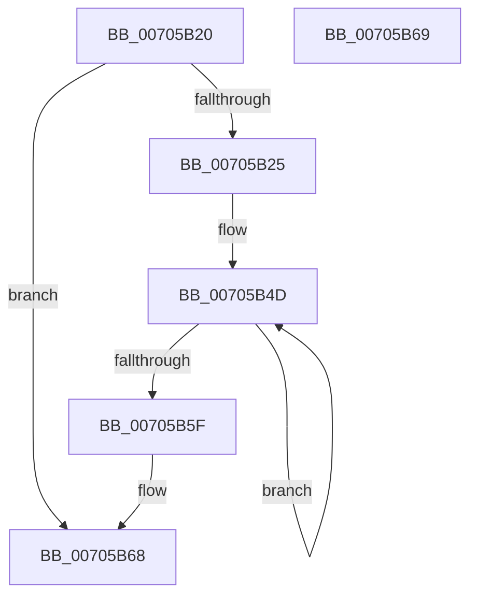

# RtlpFcAddUsageSubscriptionFromUpdate

- RVA: `0x00705B20`–`0x00705B6A` (길이 `74` bytes)
- VA: `0x0000000140705B20`
- 실행 섹션: `PAGE`
- PDB 이름 있음: `예`; PDB Function 태그: `아니요`
- unwind 정보 RVA: `0x000DB714`
- 디코드: `22`개 명령, `74/74` bytes 표시
- 미해석 바이트: `0` (있으면 어셈블리에 `.byte`로 보존)

> 이 문서는 커널 이미지의 기계어와 PDB 기호를 분석해 생성했습니다. 4번과 5번은 함수 원형과 자료형을 바이너리 사용 방식에서 추정한 C 해석이며 원본 소스 복구 결과는 아닙니다.

## 1. Dependencies

- 직접 호출 지점: **0**; 고유 호출 대상: **0**
- 직접 호출자로 확인된 함수: **1**
- RIP 상대 이미지 참조: **0**

### Outgoing calls
- 직접 디코드된 call 명령이 없습니다.

### Direct callers
- [RtlpFcUpdateUsageTriggers](../A4/RtlpFcUpdateUsageTriggers_function_00A44BB0.md) at `0x00A44CE3`
- [RtlpFcUpdateUsageTriggers](../A4/RtlpFcUpdateUsageTriggers_function_00A44BB0.md) at `0x00A44D82`

### Static image references
- 디코드된 RIP-relative 메모리 참조가 없습니다.

## 2. Other-region calls and transfers

- 다른 실행 섹션으로 향하는 call: **0**
- 별도 외부 분기/꼬리 이동을 확인하지 못했습니다.

## 3. Assembly (complete function range)

```asm
00705B20  83 39 00                        cmp dword ptr [rcx], 0
00705B23  75 43                           jne 0x140705b68
00705B25  4D 8B 10                        mov r10, qword ptr [r8]
00705B28  41 BB 02 00 00 00               mov r11d, 2
00705B2E  8B 41 04                        mov eax, dword ptr [rcx + 4]
00705B31  41 89 02                        mov dword ptr [r10], eax
00705B34  4D 8D 4A 08                     lea r9, [r10 + 8]
00705B38  0F B7 41 08                     movzx eax, word ptr [rcx + 8]
00705B3C  66 41 89 42 04                  mov word ptr [r10 + 4], ax
00705B41  0F B7 41 0A                     movzx eax, word ptr [rcx + 0xa]
00705B45  49 2B CA                        sub rcx, r10
00705B48  66 41 89 42 06                  mov word ptr [r10 + 6], ax
00705B4D  42 8B 44 09 04                  mov eax, dword ptr [rcx + r9 + 4]
00705B52  41 89 01                        mov dword ptr [r9], eax
00705B55  4D 8D 49 04                     lea r9, [r9 + 4]
00705B59  49 83 EB 01                     sub r11, 1
00705B5D  75 EE                           jne 0x140705b4d
00705B5F  FF 02                           inc dword ptr [rdx]
00705B61  49 8D 42 10                     lea rax, [r10 + 0x10]
00705B65  49 89 00                        mov qword ptr [r8], rax
00705B68  C3                              ret
00705B69  CC                              int3
```

## 4. C-style interpretation (structured pseudocode)

```c
__int64 __fastcall RtlpFcAddUsageSubscriptionFromUpdate(__int64 a1, __int64 a2, __int64 a3)
{
    __int64 v_r11;

    if ((*(unsigned int *)(a1)) != 0) goto loc_00705B68;
    *(unsigned int *)(*(unsigned __int64 *)(a3)) = (unsigned int)((unsigned int)(*(unsigned int *)(a1 + 4)));
    *(unsigned __int16 *)(*(unsigned __int64 *)(a3) + 4) = (unsigned __int16)(*(unsigned __int16 *)(a1 + 8));
    a1 = (a1) - (*(unsigned __int64 *)(a3));
    *(unsigned __int16 *)(*(unsigned __int64 *)(a3) + 6) = (unsigned __int16)(*(unsigned __int16 *)(a1 + 10));
loc_00705B4D:
    *(unsigned int *)(*(unsigned __int64 *)(a3) + 8) = (unsigned int)((unsigned int)(*(unsigned int *)(a1 + *(unsigned __int64 *)(a3) + 8 * 1 + 4)));
    v_r11 = (2) - (1);
    if (condition_is_not_equal) goto loc_00705B4D;
    *(unsigned __int64 *)(a3) = *(unsigned __int64 *)(a3) + 16;
loc_00705B68:
    return *(unsigned __int64 *)(a3) + 16;
}
```

## 5. (Beta) C Style

```c
int64_t RtlpFcAddUsageSubscriptionFromUpdate(void *Arg1, void *Arg2, void *Arg3)
{
    uint8_t *arg1 = (uint8_t *)Arg1;
    uint8_t *arg2 = (uint8_t *)Arg2;
    uint8_t *arg3 = (uint8_t *)Arg3;

    int64_t local_r11;

    if ((*(uint32_t *)(arg1)) != 0) goto loc_00705B68;
    *(uint32_t *)(*(uint64_t *)(arg3)) = (uint32_t)((uint32_t)(*(uint32_t *)(arg1 + 0x4)));
    *(uint16_t *)(*(uint64_t *)(arg3) + 0x4) = (uint16_t)(*(uint16_t *)(arg1 + 0x8));
    Arg1 = (Arg1) - (*(uint64_t *)(arg3));
    *(uint16_t *)(*(uint64_t *)(arg3) + 0x6) = (uint16_t)(*(uint16_t *)(arg1 + 0xA));
loc_00705B4D:
    *(uint32_t *)(*(uint64_t *)(arg3) + 0x8) = (uint32_t)((uint32_t)(*(uint32_t *)(arg1 + *(uint64_t *)(arg3) + 0x8 * 1 + 0x4)));
    local_r11 = (2) - (1);
    if (condition_is_not_equal) goto loc_00705B4D;
    *(uint64_t *)(arg3) = *(uint64_t *)(arg3) + 16;
loc_00705B68:
    return *(uint64_t *)(arg3) + 16;
}
```

### 관측된 메모리 오프셋

구조체 형식이 확인되지 않은 접근은 인자 기준의 오프셋으로만 기록했습니다.

| 기준 인자 | 오프셋 표현 | 폭 (bit) | 접근 |
|---|---:|---:|---|
| `Arg1` | `+ 0x0` | `32` | `R` |
| `Arg1` | `+ 0x4` | `32` | `R` |
| `Arg1` | `+ 0x4 + r9*1` | `32` | `R` |
| `Arg1` | `+ 0x8` | `16` | `R` |
| `Arg1` | `+ 0xA` | `16` | `R` |
| `Arg2` | `+ 0x0` | `32` | `R/W` |
| `Arg3` | `+ 0x0` | `64` | `R` |
| `Arg3` | `+ 0x0` | `64` | `W` |

## 6. Execution-region graph

[열기: 2D/3D 그래프와 함수 탐색 컨트롤 패널](../../../control-panel.html?section=page&rva=0x00705B20&view=graph)

- 2D 그래프는 위에서 아래로 흐르고, 3D 그래프는 빈 공간을 드래그해 회전합니다. Shift+드래그는 이동, 휠은 확대·축소, 함수 노드 선택은 대상 보고서 이동입니다.

### Static fallback


