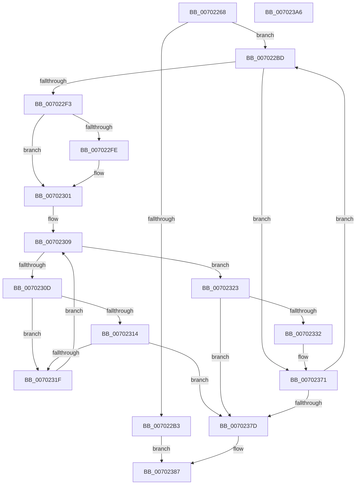

# RtlpFcNotifyFeatureUsageTarget

- RVA: `0x00702268`–`0x007023A7` (길이 `319` bytes)
- VA: `0x0000000140702268`
- 실행 섹션: `PAGE`
- PDB 이름 있음: `예`; PDB Function 태그: `아니요`
- unwind 정보 RVA: `0x000BF7C4`
- 디코드: `85`개 명령, `319/319` bytes 표시
- 미해석 바이트: `0` (있으면 어셈블리에 `.byte`로 보존)

> 이 문서는 커널 이미지의 기계어와 PDB 기호를 분석해 생성했습니다. 4번과 5번은 함수 원형과 자료형을 바이너리 사용 방식에서 추정한 C 해석이며 원본 소스 복구 결과는 아닙니다.

## 1. Dependencies

- 직접 호출 지점: **5**; 고유 호출 대상: **5**
- 직접 호출자로 확인된 함수: **1**
- RIP 상대 이미지 참조: **1**

### Outgoing calls
- `0x007022A6` → [ExAllocatePool2](../../poolcode/B8/ExAllocatePool2_function_00B820F0.md) (function, `0x00B820F0`)
- `0x007022E8` → [ZwQueryWnfStateData](../../text/6A/ZwQueryWnfStateData_function_006AFEF0.md) (function, `0x006AFEF0`)
- `0x0070236A` → [ZwUpdateWnfStateData](../../text/6B/ZwUpdateWnfStateData_function_006B0D10.md) (function, `0x006B0D10`)
- `0x00702382` → [ExFreePoolWithTag](../../poolcode/B8/ExFreePoolWithTag_function_00B82870.md) (function, `0x00B82870`)
- `0x00702391` → [_security_check_cookie](../../text/6A/_security_check_cookie_function_006AC640.md) (function, `0x006AC640`)

### Direct callers
- [RtlpFcSendFeatureUsageNotifications](../A4/RtlpFcSendFeatureUsageNotifications_function_00A45404.md) at `0x00A45492`

### Static image references
- `0x00702277` → RVA `0x00E0A740` (`.data`; read)

## 2. Other-region calls and transfers

- 다른 실행 섹션으로 향하는 call: **5**
  - `0x007022A6` → [ExAllocatePool2](../../poolcode/B8/ExAllocatePool2_function_00B820F0.md) (`PAGE` → `POOLCODE`)
  - `0x007022E8` → [ZwQueryWnfStateData](../../text/6A/ZwQueryWnfStateData_function_006AFEF0.md) (`PAGE` → `.text`)
  - `0x0070236A` → [ZwUpdateWnfStateData](../../text/6B/ZwUpdateWnfStateData_function_006B0D10.md) (`PAGE` → `.text`)
  - `0x00702382` → [ExFreePoolWithTag](../../poolcode/B8/ExFreePoolWithTag_function_00B82870.md) (`PAGE` → `POOLCODE`)
  - `0x00702391` → [_security_check_cookie](../../text/6A/_security_check_cookie_function_006AC640.md) (`PAGE` → `.text`)
- 별도 외부 분기/꼬리 이동을 확인하지 못했습니다.

## 3. Assembly (complete function range)

```asm
00702268  48 89 5C 24 08                  mov qword ptr [rsp + 8], rbx
0070226D  48 89 74 24 10                  mov qword ptr [rsp + 0x10], rsi
00702272  57                              push rdi
00702273  48 83 EC 60                     sub rsp, 0x60
00702277  48 8B 05 C2 84 70 00            mov rax, qword ptr [rip + 0x7084c2]
0070227E  48 33 C4                        xor rax, rsp
00702281  48 89 44 24 50                  mov qword ptr [rsp + 0x50], rax
00702286  8B 02                           mov eax, dword ptr [rdx]
00702288  48 8B F1                        mov rsi, rcx
0070228B  89 44 24 48                     mov dword ptr [rsp + 0x48], eax
0070228F  B9 00 01 00 00                  mov ecx, 0x100
00702294  8B 42 04                        mov eax, dword ptr [rdx + 4]
00702297  41 B8 46 63 6F 6E               mov r8d, 0x6e6f6346
0070229D  BA 00 10 00 00                  mov edx, 0x1000
007022A2  89 44 24 4C                     mov dword ptr [rsp + 0x4c], eax
007022A6  E8 45 FE 47 00                  call 0x140b820f0
007022AB  48 8B D8                        mov rbx, rax
007022AE  48 85 C0                        test rax, rax
007022B1  75 0A                           jne 0x1407022bd
007022B3  BF 17 00 00 C0                  mov edi, 0xc0000017
007022B8  E9 CA 00 00 00                  jmp 0x140702387
007022BD  83 64 24 44 00                  and dword ptr [rsp + 0x44], 0
007022C2  48 8D 44 24 40                  lea rax, [rsp + 0x40]
007022C7  48 89 44 24 28                  mov qword ptr [rsp + 0x28], rax
007022CC  4C 8D 4C 24 44                  lea r9, [rsp + 0x44]
007022D1  45 33 C0                        xor r8d, r8d
007022D4  48 89 5C 24 20                  mov qword ptr [rsp + 0x20], rbx
007022D9  33 D2                           xor edx, edx
007022DB  C7 44 24 40 00 10 00 00         mov dword ptr [rsp + 0x40], 0x1000
007022E3  48 8D 4C 24 48                  lea rcx, [rsp + 0x48]
007022E8  E8 03 DC FA FF                  call 0x1406afef0
007022ED  8B F8                           mov edi, eax
007022EF  85 C0                           test eax, eax
007022F1  78 7E                           js 0x140702371
007022F3  44 8B 44 24 40                  mov r8d, dword ptr [rsp + 0x40]
007022F8  41 F6 C0 07                     test r8b, 7
007022FC  74 03                           je 0x140702301
007022FE  45 33 C0                        xor r8d, r8d
00702301  41 8B D0                        mov edx, r8d
00702304  C1 EA 03                        shr edx, 3
00702307  33 C9                           xor ecx, ecx
00702309  3B CA                           cmp ecx, edx
0070230B  73 16                           jae 0x140702323
0070230D  8B 06                           mov eax, dword ptr [rsi]
0070230F  39 04 CB                        cmp dword ptr [rbx + rcx*8], eax
00702312  75 0B                           jne 0x14070231f
00702314  0F B7 46 04                     movzx eax, word ptr [rsi + 4]
00702318  66 39 44 CB 04                  cmp word ptr [rbx + rcx*8 + 4], ax
0070231D  74 5E                           je 0x14070237d
0070231F  FF C1                           inc ecx
00702321  EB E6                           jmp 0x140702309
00702323  41 8B C0                        mov eax, r8d
00702326  48 83 C0 08                     add rax, 8
0070232A  48 3D 00 10 00 00               cmp rax, 0x1000
00702330  77 4B                           ja 0x14070237d
00702332  8B 06                           mov eax, dword ptr [rsi]
00702334  48 8D 4C 24 48                  lea rcx, [rsp + 0x48]
00702339  89 04 D3                        mov dword ptr [rbx + rdx*8], eax
0070233C  41 83 C0 08                     add r8d, 8
00702340  0F B7 46 04                     movzx eax, word ptr [rsi + 4]
00702344  45 33 C9                        xor r9d, r9d
00702347  66 89 44 D3 04                  mov word ptr [rbx + rdx*8 + 4], ax
0070234C  48 8B D3                        mov rdx, rbx
0070234F  8B 44 24 44                     mov eax, dword ptr [rsp + 0x44]
00702353  C7 44 24 30 01 00 00 00         mov dword ptr [rsp + 0x30], 1
0070235B  89 44 24 28                     mov dword ptr [rsp + 0x28], eax
0070235F  48 83 64 24 20 00               and qword ptr [rsp + 0x20], 0
00702365  44 89 44 24 40                  mov dword ptr [rsp + 0x40], r8d
0070236A  E8 A1 E9 FA FF                  call 0x1406b0d10
0070236F  8B F8                           mov edi, eax
00702371  81 FF 01 00 00 C0               cmp edi, 0xc0000001
00702377  0F 84 40 FF FF FF               je 0x1407022bd
0070237D  33 D2                           xor edx, edx
0070237F  48 8B CB                        mov rcx, rbx
00702382  E8 E9 04 48 00                  call 0x140b82870
00702387  8B C7                           mov eax, edi
00702389  48 8B 4C 24 50                  mov rcx, qword ptr [rsp + 0x50]
0070238E  48 33 CC                        xor rcx, rsp
00702391  E8 AA A2 FA FF                  call 0x1406ac640
00702396  48 8B 5C 24 70                  mov rbx, qword ptr [rsp + 0x70]
0070239B  48 8B 74 24 78                  mov rsi, qword ptr [rsp + 0x78]
007023A0  48 83 C4 60                     add rsp, 0x60
007023A4  5F                              pop rdi
007023A5  C3                              ret
007023A6  CC                              int3
```

## 4. C-style interpretation (structured pseudocode)

```c
__int64 __fastcall RtlpFcNotifyFeatureUsageTarget(__int64 a1, __int64 a2)
{
    __int64 result;
    __int64 v_rsp;
    unsigned __int64 v_stack_m18;
    unsigned int v_stack_m1C;
    unsigned int v_stack_m20;
    unsigned int v_stack_m24;
    unsigned __int64 v_stack_m28;
    unsigned int v_stack_m38;
    unsigned __int64 v_stack_m40;
    unsigned __int64 v_stack_m48;
    unsigned __int64 v_stack_p10;
    unsigned __int64 v_stack_p8;

    v_stack_p8 = v_rbx;
    v_stack_p10 = v_rsi;
    v_rsp = (v_rsp) - (96);
    result = (*(unsigned __int64 *)(v_rip + 7374018)) ^ (v_rsp);
    v_stack_m18 = result;
    v_stack_m20 = (unsigned int)((unsigned int)(*(unsigned int *)(a2)));
    v_stack_m1C = (unsigned int)((unsigned int)(*(unsigned int *)(a2 + 4)));
    result = ExAllocatePool2(256, (unsigned int)(0x1000ULL), (unsigned int)(0x6E6F6346ULL), a4);
    if (result != 0) goto loc_007022BD;
    goto loc_00702387;
loc_007022BD:
    v_stack_m40 = v_stack_m28;
    a3 = 0;
    v_stack_m48 = result;
    a2 = 0;
    v_stack_m28 = 0x1000ULL;
    result = ZwQueryWnfStateData(v_stack_m20, a2, a3, v_stack_m24);
    if (sign_flag) goto loc_00702371;
    if ((((unsigned __int8)((unsigned int)(v_stack_m28))) & (7)) != 0) {
        a3 = 0;
    }
    a2 = (unsigned int)((0) >> (3));
    a1 = 0;
loc_00702309:
    if (0 >= ((unsigned int)(a2))) goto loc_00702323;
    if ((*(unsigned int *)(result + a1 * 8)) != ((unsigned int)((unsigned int)(*(unsigned int *)(a1))))) goto loc_0070231F;
    if ((*(unsigned __int16 *)(result + a1 * 8 + 4)) == ((unsigned __int16)(*(unsigned __int16 *)(a1 + 4)))) goto loc_0070237D;
loc_0070231F:
    a1 = (unsigned int)((a1) + 1);
    goto loc_00702309;
loc_00702323:
    result = (0) + (8);
    if (result > 0x1000ULL) goto loc_0070237D;
    *(unsigned int *)(result + a2 * 8) = (unsigned int)((unsigned int)(*(unsigned int *)(a1)));
    a3 = (unsigned int)((a3) + (8));
    a4 = 0;
    *(unsigned __int16 *)(result + a2 * 8 + 4) = (unsigned __int16)(*(unsigned __int16 *)(a1 + 4));
    v_stack_m38 = 1;
    v_stack_m40 = (unsigned int)((unsigned int)(v_stack_m24));
    v_stack_m28 = (unsigned int)(a3);
    result = ZwUpdateWnfStateData(v_stack_m20, result, a3, a4);
loc_00702371:
    if (((unsigned int)((unsigned int)((unsigned int)(result)))) == 0xC0000001ULL) goto loc_007022BD;
loc_0070237D:
    a2 = 0;
    result = ExFreePoolWithTag(result, a2, a3, a4);
loc_00702387:
    a1 = (v_stack_m18) ^ (v_rsp);
    result = _security_check_cookie(a1, a2, a3, a4);
    v_rsp = (v_rsp) + (96);
    return result;
}
```

## 5. (Beta) C Style

```c
int64_t RtlpFcNotifyFeatureUsageTarget(void *Arg1, void *Arg2)
{
    uint8_t *arg1 = (uint8_t *)Arg1;
    uint8_t *arg2 = (uint8_t *)Arg2;

    int64_t result;
    int64_t local_rsp;
    uint64_t v_stack_m18;
    uint32_t v_stack_m1C;
    uint32_t v_stack_m20;
    uint32_t v_stack_m24;
    uint64_t v_stack_m28;
    uint32_t v_stack_m38;
    uint64_t v_stack_m40;
    uint64_t v_stack_m48;
    uint64_t v_stack_p10;
    uint64_t v_stack_p8;

    v_stack_p8 = local_rbx;
    v_stack_p10 = local_rsi;
    local_rsp = (local_rsp) - (96);
    result = (*(uint64_t *)(v_rip + 0x7084C2)) ^ (local_rsp);
    v_stack_m18 = result;
    v_stack_m20 = (uint32_t)((uint32_t)(*(uint32_t *)(arg2)));
    v_stack_m1C = (uint32_t)((uint32_t)(*(uint32_t *)(arg2 + 0x4)));
    result = ExAllocatePool2(256, (uint32_t)(0x1000ULL), (uint32_t)(0x6E6F6346ULL), a4);
    if (result != 0) goto loc_007022BD;
    goto loc_00702387;
loc_007022BD:
    v_stack_m40 = v_stack_m28;
    a3 = 0;
    v_stack_m48 = result;
    Arg2 = 0;
    v_stack_m28 = 0x1000ULL;
    result = ZwQueryWnfStateData(v_stack_m20, Arg2, a3, v_stack_m24);
    if (sign_flag) goto loc_00702371;
    if ((((uint8_t)((uint32_t)(v_stack_m28))) & (7)) != 0) {
        a3 = 0;
    }
    Arg2 = (uint32_t)((0) >> (3));
    Arg1 = 0;
loc_00702309:
    if (0 >= ((uint32_t)(Arg2))) goto loc_00702323;
    if ((*(uint32_t *)(result + arg1 * 8)) != ((uint32_t)((uint32_t)(*(uint32_t *)(arg1))))) goto loc_0070231F;
    if ((*(uint16_t *)(result + arg1 * 8 + 0x4)) == ((uint16_t)(*(uint16_t *)(arg1 + 0x4)))) goto loc_0070237D;
loc_0070231F:
    Arg1 = (uint32_t)((Arg1) + 1);
    goto loc_00702309;
loc_00702323:
    result = (0) + (8);
    if (result > 0x1000ULL) goto loc_0070237D;
    *(uint32_t *)(result + arg2 * 8) = (uint32_t)((uint32_t)(*(uint32_t *)(arg1)));
    a3 = (uint32_t)((a3) + (8));
    a4 = 0;
    *(uint16_t *)(result + arg2 * 8 + 0x4) = (uint16_t)(*(uint16_t *)(arg1 + 0x4));
    v_stack_m38 = 1;
    v_stack_m40 = (uint32_t)((uint32_t)(v_stack_m24));
    v_stack_m28 = (uint32_t)(a3);
    result = ZwUpdateWnfStateData(v_stack_m20, result, a3, a4);
loc_00702371:
    if (((uint32_t)((uint32_t)((uint32_t)(result)))) == 0xC0000001ULL) goto loc_007022BD;
loc_0070237D:
    Arg2 = 0;
    result = ExFreePoolWithTag(result, Arg2, a3, a4);
loc_00702387:
    Arg1 = (v_stack_m18) ^ (local_rsp);
    result = _security_check_cookie(Arg1, Arg2, a3, a4);
    local_rsp = (local_rsp) + (96);
    return result;
}
```

### 관측된 메모리 오프셋

구조체 형식이 확인되지 않은 접근은 인자 기준의 오프셋으로만 기록했습니다.

| 기준 인자 | 오프셋 표현 | 폭 (bit) | 접근 |
|---|---:|---:|---|
| `Arg1` | `+ 0x0` | `32` | `R` |
| `Arg1` | `+ 0x4` | `16` | `R` |
| `Arg2` | `+ 0x0` | `32` | `R` |
| `Arg2` | `+ 0x4` | `32` | `R` |

## 6. Execution-region graph

[열기: 2D/3D 그래프와 함수 탐색 컨트롤 패널](../../../control-panel.html?section=page&rva=0x00702268&view=graph)

- 2D 그래프는 위에서 아래로 흐르고, 3D 그래프는 빈 공간을 드래그해 회전합니다. Shift+드래그는 이동, 휠은 확대·축소, 함수 노드 선택은 대상 보고서 이동입니다.

### Static fallback


