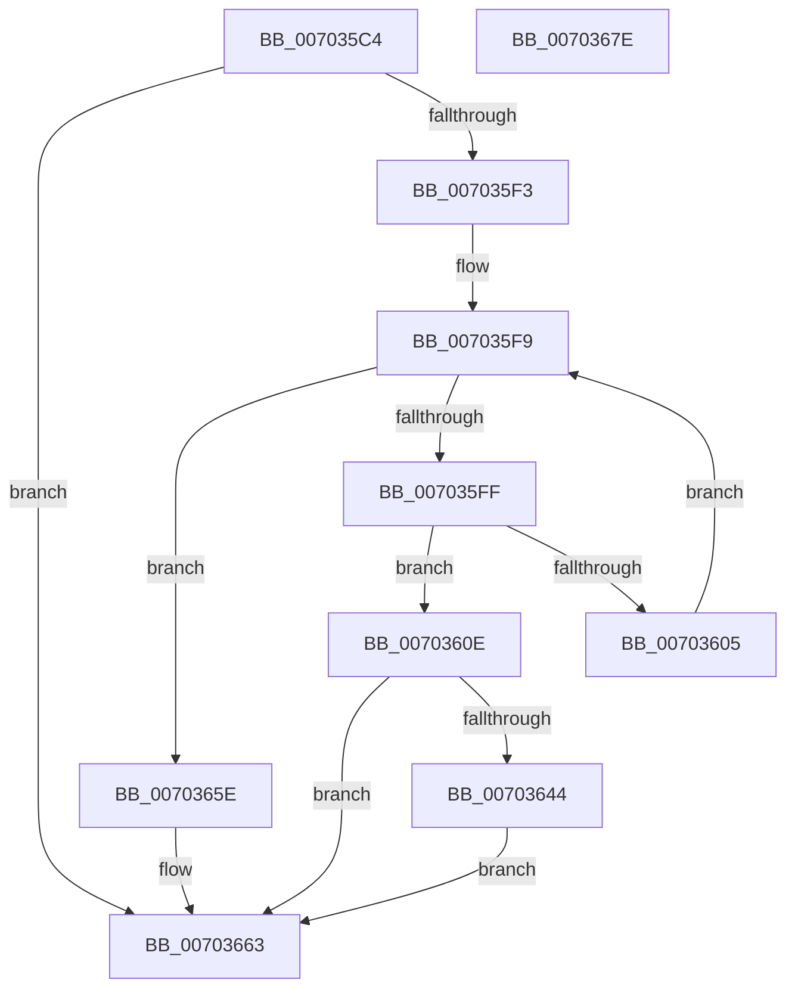

# RtlpFcQueryFeatureConfigurationFromBufferSet

- RVA: `0x007035C4`–`0x0070367F` (길이 `187` bytes)
- VA: `0x00000001407035C4`
- 실행 섹션: `PAGE`
- PDB 이름 있음: `예`; PDB Function 태그: `아니요`
- unwind 정보 RVA: `0x00093E28`
- 디코드: `56`개 명령, `187/187` bytes 표시
- 미해석 바이트: `0` (있으면 어셈블리에 `.byte`로 보존)

> 이 문서는 커널 이미지의 기계어와 PDB 기호를 분석해 생성했습니다. 4번과 5번은 함수 원형과 자료형을 바이너리 사용 방식에서 추정한 C 해석이며 원본 소스 복구 결과는 아닙니다.

## 1. Dependencies

- 직접 호출 지점: **3**; 고유 호출 대상: **3**
- 직접 호출자로 확인된 함수: **2**
- RIP 상대 이미지 참조: **0**

### Outgoing calls
- `0x007035E8` → [RtlpFcValidateFeatureConfigurationType](../../text/4C/RtlpFcValidateFeatureConfigurationType_function_004CBF10.md) (function, `0x004CBF10`)
- `0x0070363B` → [RtlpFcHasEffectiveStateInGovernedFeatureInfoTable](../79/RtlpFcHasEffectiveStateInGovernedFeatureInfoTable_function_0079A72C.md) (function, `0x0079A72C`)
- `0x00703655` → [RtlpFcQueryFeatureConfigurationFromBuffers](../9B/RtlpFcQueryFeatureConfigurationFromBuffers_function_009BC928.md) (function, `0x009BC928`)

### Direct callers
- [RtlQueryFeatureConfiguration](../../text/4B/RtlQueryFeatureConfiguration_function_004BDD10.md) at `0x004BDD9D`
- [RtlQueryInternalFeatureConfiguration](../../text/5E/RtlQueryInternalFeatureConfiguration_function_005E7500.md) at `0x005E7579`

### Static image references
- 디코드된 RIP-relative 메모리 참조가 없습니다.

## 2. Other-region calls and transfers

- 다른 실행 섹션으로 향하는 call: **1**
  - `0x007035E8` → [RtlpFcValidateFeatureConfigurationType](../../text/4C/RtlpFcValidateFeatureConfigurationType_function_004CBF10.md) (`PAGE` → `.text`)
- 별도 외부 분기/꼬리 이동을 확인하지 못했습니다.

## 3. Assembly (complete function range)

```asm
007035C4  48 89 5C 24 08                  mov qword ptr [rsp + 8], rbx
007035C9  48 89 6C 24 10                  mov qword ptr [rsp + 0x10], rbp
007035CE  48 89 74 24 18                  mov qword ptr [rsp + 0x18], rsi
007035D3  57                              push rdi
007035D4  41 56                           push r14
007035D6  41 57                           push r15
007035D8  48 83 EC 40                     sub rsp, 0x40
007035DC  48 8B F9                        mov rdi, rcx
007035DF  4D 8B F1                        mov r14, r9
007035E2  41 8B C8                        mov ecx, r8d
007035E5  44 8B FA                        mov r15d, edx
007035E8  E8 23 89 DC FF                  call 0x1404cbf10
007035ED  8B D8                           mov ebx, eax
007035EF  85 C0                           test eax, eax
007035F1  78 70                           js 0x140703663
007035F3  33 C0                           xor eax, eax
007035F5  4C 8D 57 08                     lea r10, [rdi + 8]
007035F9  48 83 F8 04                     cmp rax, 4
007035FD  7D 5F                           jge 0x14070365e
007035FF  49 83 3A 00                     cmp qword ptr [r10], 0
00703603  75 09                           jne 0x14070360e
00703605  48 FF C0                        inc rax
00703608  49 83 C2 18                     add r10, 0x18
0070360C  EB EB                           jmp 0x1407035f9
0070360E  83 64 24 30 00                  and dword ptr [rsp + 0x30], 0
00703613  48 8D 6F 30                     lea rbp, [rdi + 0x30]
00703617  48 8B 57 50                     mov rdx, qword ptr [rdi + 0x50]
0070361B  41 8B CF                        mov ecx, r15d
0070361E  49 63 C0                        movsxd rax, r8d
00703621  C7 44 24 34 01 00 00 00         mov dword ptr [rsp + 0x34], 1
00703629  4C 89 74 24 28                  mov qword ptr [rsp + 0x28], r14
0070362E  48 89 6C 24 20                  mov qword ptr [rsp + 0x20], rbp
00703633  48 63 74 84 30                  movsxd rsi, dword ptr [rsp + rax*4 + 0x30]
00703638  44 8B CE                        mov r9d, esi
0070363B  E8 EC 70 09 00                  call 0x14079a72c
00703640  84 C0                           test al, al
00703642  75 1F                           jne 0x140703663
00703644  48 8D 0C 76                     lea rcx, [rsi + rsi*2]
00703648  4D 8B CE                        mov r9, r14
0070364B  48 8D 14 CF                     lea rdx, [rdi + rcx*8]
0070364F  4C 8B C5                        mov r8, rbp
00703652  41 8B CF                        mov ecx, r15d
00703655  E8 CE 92 2B 00                  call 0x1409bc928
0070365A  8B D8                           mov ebx, eax
0070365C  EB 05                           jmp 0x140703663
0070365E  BB 22 00 00 80                  mov ebx, 0x80000022
00703663  48 8B 6C 24 68                  mov rbp, qword ptr [rsp + 0x68]
00703668  8B C3                           mov eax, ebx
0070366A  48 8B 5C 24 60                  mov rbx, qword ptr [rsp + 0x60]
0070366F  48 8B 74 24 70                  mov rsi, qword ptr [rsp + 0x70]
00703674  48 83 C4 40                     add rsp, 0x40
00703678  41 5F                           pop r15
0070367A  41 5E                           pop r14
0070367C  5F                              pop rdi
0070367D  C3                              ret
0070367E  CC                              int3
```

## 4. C-style interpretation (structured pseudocode)

```c
__int64 __fastcall RtlpFcQueryFeatureConfigurationFromBufferSet(__int64 a1, int a2, int a3, __int64 a4)
{
    __int64 result;
    __int64 v_r10;
    __int64 v_rsp;
    unsigned int v_stack_m24;
    unsigned int v_stack_m28;
    unsigned __int64 v_stack_m30;
    unsigned __int64 v_stack_m38;
    unsigned __int64 v_stack_p10;
    unsigned __int64 v_stack_p18;
    unsigned __int64 v_stack_p8;

    v_stack_p8 = v_rbx;
    v_stack_p10 = v_rbp;
    v_stack_p18 = v_rsi;
    v_rsp = (v_rsp) - (64);
    result = RtlpFcValidateFeatureConfigurationType((unsigned int)(a3), a2, a3, a4);
    if (sign_flag) goto loc_00703663;
    result = 0;
loc_007035F9:
    if (0 >= 4) goto loc_0070365E;
    if ((*(unsigned __int64 *)(a1 + 8)) != 0) goto loc_0070360E;
    result = (result) + 1;
    v_r10 = (a1 + 8) + (24);
    goto loc_007035F9;
loc_0070360E:
    v_stack_m24 = 1;
    v_stack_m30 = a4;
    v_stack_m38 = a1 + 48;
    result = RtlpFcHasEffectiveStateInGovernedFeatureInfoTable((unsigned int)((unsigned int)((unsigned int)(a2))), *(unsigned __int64 *)(a1 + 80), a3, (unsigned int)((unsigned int)((int)(*(unsigned int *)(v_rsp + (int)(a3) * 4 + 48)))));
    if ((unsigned __int8)(result) != 0) goto loc_00703663;
    result = RtlpFcQueryFeatureConfigurationFromBuffers((unsigned int)((unsigned int)((unsigned int)(a2))), a1 + (int)(*(unsigned int *)(v_rsp + (int)(a3) * 4 + 48)) + (int)(*(unsigned int *)(v_rsp + (int)(a3) * 4 + 48)) * 2 * 8, a1 + 48, a4);
    goto loc_00703663;
loc_0070365E:
loc_00703663:
    v_rsp = (v_rsp) + (64);
    return (unsigned int)((unsigned int)((unsigned int)(0x80000022ULL)));
}
```

## 5. (Beta) C Style

```c
int64_t RtlpFcQueryFeatureConfigurationFromBufferSet(void *Arg1, int32_t Arg2, int32_t Arg3, int64_t Arg4)
{
    uint8_t *arg1 = (uint8_t *)Arg1;

    int64_t result;
    int64_t local_r10;
    int64_t local_rsp;
    uint32_t v_stack_m24;
    uint32_t v_stack_m28;
    uint64_t v_stack_m30;
    uint64_t v_stack_m38;
    uint64_t v_stack_p10;
    uint64_t v_stack_p18;
    uint64_t v_stack_p8;

    v_stack_p8 = local_rbx;
    v_stack_p10 = local_rbp;
    v_stack_p18 = local_rsi;
    local_rsp = (local_rsp) - (64);
    result = RtlpFcValidateFeatureConfigurationType((uint32_t)(Arg3), Arg2, Arg3, Arg4);
    if (sign_flag) goto loc_00703663;
    result = 0;
loc_007035F9:
    if (0 >= 4) goto loc_0070365E;
    if ((*(uint64_t *)(arg1 + 0x8)) != 0) goto loc_0070360E;
    result = (result) + 1;
    local_r10 = (Arg1 + 8) + (24);
    goto loc_007035F9;
loc_0070360E:
    v_stack_m24 = 1;
    v_stack_m30 = Arg4;
    v_stack_m38 = Arg1 + 48;
    result = RtlpFcHasEffectiveStateInGovernedFeatureInfoTable((uint32_t)((uint32_t)((uint32_t)(Arg2))), *(uint64_t *)(arg1 + 0x50), Arg3, (uint32_t)((uint32_t)((int32_t)(*(uint32_t *)(local_rsp + (int32_t)(Arg3) * 4 + 0x30)))));
    if ((uint8_t)(result) != 0) goto loc_00703663;
    result = RtlpFcQueryFeatureConfigurationFromBuffers((uint32_t)((uint32_t)((uint32_t)(Arg2))), Arg1 + (int32_t)(*(uint32_t *)(local_rsp + (int32_t)(Arg3) * 4 + 0x30)) + (int32_t)(*(uint32_t *)(local_rsp + (int32_t)(Arg3) * 4 + 0x30)) * 2 * 8, Arg1 + 48, Arg4);
    goto loc_00703663;
loc_0070365E:
loc_00703663:
    local_rsp = (local_rsp) + (64);
    return (uint32_t)((uint32_t)((uint32_t)(0x80000022ULL)));
}
```

### 관측된 메모리 오프셋

구조체 형식이 확인되지 않은 접근은 인자 기준의 오프셋으로만 기록했습니다.

| 기준 인자 | 오프셋 표현 | 폭 (bit) | 접근 |
|---|---:|---:|---|
| `Arg1` | `+ 0x0` | `64` | `R` |
| `Arg1` | `+ 0x0 + rcx*8` | `64` | `R` |
| `Arg1` | `+ 0x8` | `64` | `R` |
| `Arg1` | `+ 0x30` | `64` | `R` |
| `Arg1` | `+ 0x50` | `64` | `R` |

## 6. Execution-region graph

[열기: 2D/3D 그래프와 함수 탐색 컨트롤 패널](../../../control-panel.html?section=page&rva=0x007035C4&view=graph)

- 2D 그래프는 위에서 아래로 흐르고, 3D 그래프는 빈 공간을 드래그해 회전합니다. Shift+드래그는 이동, 휠은 확대·축소, 함수 노드 선택은 대상 보고서 이동입니다.

### Static fallback


