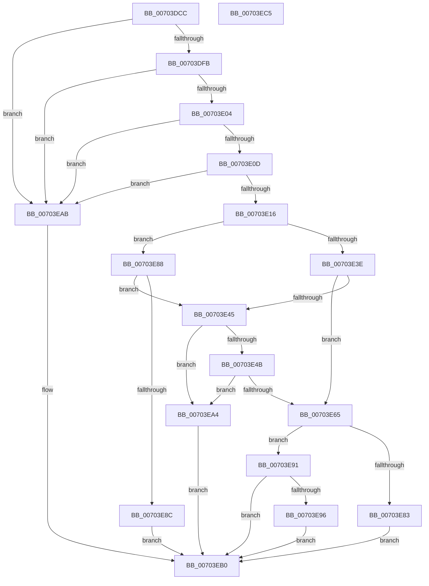

# RtlpGetWindowsPolicy

- RVA: `0x00703DCC`–`0x00703EC6` (길이 `250` bytes)
- VA: `0x0000000140703DCC`
- 실행 섹션: `PAGE`
- PDB 이름 있음: `예`; PDB Function 태그: `아니요`
- unwind 정보 RVA: `0x0007D3C0`
- 디코드: `75`개 명령, `250/250` bytes 표시
- 미해석 바이트: `0` (있으면 어셈블리에 `.byte`로 보존)

> 이 문서는 커널 이미지의 기계어와 PDB 기호를 분석해 생성했습니다. 4번과 5번은 함수 원형과 자료형을 바이너리 사용 방식에서 추정한 C 해석이며 원본 소스 복구 결과는 아닙니다.

## 1. Dependencies

- 직접 호출 지점: **5**; 고유 호출 대상: **4**
- 직접 호출자로 확인된 함수: **1**
- RIP 상대 이미지 참조: **0**

### Outgoing calls
- `0x00703E1D` → [RtlInitUnicodeString](../../text/42/RtlInitUnicodeString_function_0042A780.md) (function, `0x0042A780`)
- `0x00703E35` → [ZwQueryLicenseValue](../../text/6A/ZwQueryLicenseValue_function_006AFCF0.md) (function, `0x006AFCF0`)
- `0x00703E58` → [ExAllocatePool2](../../poolcode/B8/ExAllocatePool2_function_00B820F0.md) (function, `0x00B820F0`)
- `0x00703E78` → [ZwQueryLicenseValue](../../text/6A/ZwQueryLicenseValue_function_006AFCF0.md) (function, `0x006AFCF0`)
- `0x00703E9B` → [ExFreePoolWithTag](../../poolcode/B8/ExFreePoolWithTag_function_00B82870.md) (function, `0x00B82870`)

### Direct callers
- [RtlpMuiRegLoadLicInformation](../../text/4C/RtlpMuiRegLoadLicInformation_function_004CB26C.md) at `0x004CB2DC`
- [RtlpMuiRegLoadLicInformation](../../text/4C/RtlpMuiRegLoadLicInformation_function_004CB26C.md) at `0x004CB313`
- [RtlpMuiRegLoadLicInformation](../../text/4C/RtlpMuiRegLoadLicInformation_function_004CB26C.md) at `0x004CB343`
- [RtlpMuiRegLoadLicInformation](../../text/4C/RtlpMuiRegLoadLicInformation_function_004CB26C.md) at `0x004CB467`
- [RtlpMuiRegLoadLicInformation](../../text/4C/RtlpMuiRegLoadLicInformation_function_004CB26C.md) at `0x004CB59F`

### Static image references
- 디코드된 RIP-relative 메모리 참조가 없습니다.

## 2. Other-region calls and transfers

- 다른 실행 섹션으로 향하는 call: **5**
  - `0x00703E1D` → [RtlInitUnicodeString](../../text/42/RtlInitUnicodeString_function_0042A780.md) (`PAGE` → `.text`)
  - `0x00703E35` → [ZwQueryLicenseValue](../../text/6A/ZwQueryLicenseValue_function_006AFCF0.md) (`PAGE` → `.text`)
  - `0x00703E58` → [ExAllocatePool2](../../poolcode/B8/ExAllocatePool2_function_00B820F0.md) (`PAGE` → `POOLCODE`)
  - `0x00703E78` → [ZwQueryLicenseValue](../../text/6A/ZwQueryLicenseValue_function_006AFCF0.md) (`PAGE` → `.text`)
  - `0x00703E9B` → [ExFreePoolWithTag](../../poolcode/B8/ExFreePoolWithTag_function_00B82870.md) (`PAGE` → `POOLCODE`)
- 별도 외부 분기/꼬리 이동을 확인하지 못했습니다.

## 3. Assembly (complete function range)

```asm
00703DCC  48 8B C4                        mov rax, rsp
00703DCF  48 89 58 08                     mov qword ptr [rax + 8], rbx
00703DD3  48 89 68 10                     mov qword ptr [rax + 0x10], rbp
00703DD7  48 89 70 18                     mov qword ptr [rax + 0x18], rsi
00703DDB  57                              push rdi
00703DDC  48 83 EC 40                     sub rsp, 0x40
00703DE0  33 DB                           xor ebx, ebx
00703DE2  0F 57 C0                        xorps xmm0, xmm0
00703DE5  49 8B F1                        mov rsi, r9
00703DE8  49 8B F8                        mov rdi, r8
00703DEB  48 8B EA                        mov rbp, rdx
00703DEE  0F 11 40 E8                     movups xmmword ptr [rax - 0x18], xmm0
00703DF2  48 85 D2                        test rdx, rdx
00703DF5  0F 84 B0 00 00 00               je 0x140703eab
00703DFB  4D 85 C0                        test r8, r8
00703DFE  0F 84 A7 00 00 00               je 0x140703eab
00703E04  4D 85 C9                        test r9, r9
00703E07  0F 84 9E 00 00 00               je 0x140703eab
00703E0D  48 85 C9                        test rcx, rcx
00703E10  0F 84 95 00 00 00               je 0x140703eab
00703E16  48 8B D1                        mov rdx, rcx
00703E19  48 8D 48 E8                     lea rcx, [rax - 0x18]
00703E1D  E8 5E 69 D2 FF                  call 0x14042a780
00703E22  45 33 C9                        xor r9d, r9d
00703E25  48 89 7C 24 20                  mov qword ptr [rsp + 0x20], rdi
00703E2A  45 33 C0                        xor r8d, r8d
00703E2D  48 8D 4C 24 30                  lea rcx, [rsp + 0x30]
00703E32  48 8B D5                        mov rdx, rbp
00703E35  E8 B6 BE FA FF                  call 0x1406afcf0
00703E3A  85 C0                           test eax, eax
00703E3C  79 4A                           jns 0x140703e88
00703E3E  3D 23 00 00 C0                  cmp eax, 0xc0000023
00703E43  75 20                           jne 0x140703e65
00703E45  8B 07                           mov eax, dword ptr [rdi]
00703E47  85 C0                           test eax, eax
00703E49  74 59                           je 0x140703ea4
00703E4B  8B D0                           mov edx, eax
00703E4D  B9 00 01 00 00                  mov ecx, 0x100
00703E52  41 B8 6D 6C 74 72               mov r8d, 0x72746c6d
00703E58  E8 93 E2 47 00                  call 0x140b820f0
00703E5D  48 8B D8                        mov rbx, rax
00703E60  48 85 C0                        test rax, rax
00703E63  74 3F                           je 0x140703ea4
00703E65  44 8B 0F                        mov r9d, dword ptr [rdi]
00703E68  48 8D 4C 24 30                  lea rcx, [rsp + 0x30]
00703E6D  4C 8B C3                        mov r8, rbx
00703E70  48 89 7C 24 20                  mov qword ptr [rsp + 0x20], rdi
00703E75  48 8B D5                        mov rdx, rbp
00703E78  E8 73 BE FA FF                  call 0x1406afcf0
00703E7D  8B F8                           mov edi, eax
00703E7F  85 C0                           test eax, eax
00703E81  78 0E                           js 0x140703e91
00703E83  48 89 1E                        mov qword ptr [rsi], rbx
00703E86  EB 28                           jmp 0x140703eb0
00703E88  39 1F                           cmp dword ptr [rdi], ebx
00703E8A  75 B9                           jne 0x140703e45
00703E8C  48 21 1E                        and qword ptr [rsi], rbx
00703E8F  EB 1F                           jmp 0x140703eb0
00703E91  48 85 DB                        test rbx, rbx
00703E94  74 1A                           je 0x140703eb0
00703E96  33 D2                           xor edx, edx
00703E98  48 8B CB                        mov rcx, rbx
00703E9B  E8 D0 E9 47 00                  call 0x140b82870
00703EA0  8B C7                           mov eax, edi
00703EA2  EB 0C                           jmp 0x140703eb0
00703EA4  B8 17 00 00 C0                  mov eax, 0xc0000017
00703EA9  EB 05                           jmp 0x140703eb0
00703EAB  B8 0D 00 00 C0                  mov eax, 0xc000000d
00703EB0  48 8B 5C 24 50                  mov rbx, qword ptr [rsp + 0x50]
00703EB5  48 8B 6C 24 58                  mov rbp, qword ptr [rsp + 0x58]
00703EBA  48 8B 74 24 60                  mov rsi, qword ptr [rsp + 0x60]
00703EBF  48 83 C4 40                     add rsp, 0x40
00703EC3  5F                              pop rdi
00703EC4  C3                              ret
00703EC5  CC                              int3
```

## 4. C-style interpretation (structured pseudocode)

```c
__int64 __fastcall RtlpGetWindowsPolicy(__int64 a1, __int64 a2, __int64 a3, __int64 a4)
{
    __int64 result;
    __int64 v_rbx;
    __int64 v_rsp;
    unsigned __int64 v_stack_m18;
    unsigned __int64 v_stack_m28;
    unsigned __int64 v_stack_p10;
    unsigned __int64 v_stack_p18;
    unsigned __int64 v_stack_p8;

    *(unsigned __int64 *)(v_rsp + 8) = v_rbx;
    *(unsigned __int64 *)(v_rsp + 16) = v_rbp;
    *(unsigned __int64 *)(v_rsp + 24) = v_rsi;
    v_rsp = (v_rsp) - (64);
    v_rbx = 0;
    *(unsigned __int64 *)(v_rsp - 24) = v_xmm0;
    if (a2 == 0) goto loc_00703EAB;
    if (a3 == 0) goto loc_00703EAB;
    if (a4 == 0) goto loc_00703EAB;
    if (a1 == 0) goto loc_00703EAB;
    result = RtlInitUnicodeString(v_rsp - 24, a1, a3, a4);
    a4 = 0;
    v_stack_m28 = a3;
    a3 = 0;
    result = ZwQueryLicenseValue(v_stack_m18, a2, a3, a4);
    if (!sign_flag) goto loc_00703E88;
    if (((unsigned int)(result)) != 0xC0000023ULL) goto loc_00703E65;
loc_00703E45:
    if ((unsigned int)((unsigned int)(*(unsigned int *)(a3))) == 0) goto loc_00703EA4;
    result = ExAllocatePool2(256, (unsigned int)((unsigned int)((unsigned int)(*(unsigned int *)(a3)))), (unsigned int)(0x72746C6DULL), a4);
    if (result == 0) goto loc_00703EA4;
loc_00703E65:
    v_stack_m28 = 0;
    result = ZwQueryLicenseValue(v_stack_m18, a2, result, (unsigned int)(*(unsigned int *)(a3)));
    if (sign_flag) goto loc_00703E91;
    *(unsigned __int64 *)(a4) = result;
    goto loc_00703EB0;
loc_00703E88:
    if ((*(unsigned int *)((unsigned int)((unsigned int)(result)))) != ((unsigned int)(result))) goto loc_00703E45;
    goto loc_00703EB0;
loc_00703E91:
    if (result == 0) goto loc_00703EB0;
    a2 = 0;
    result = ExFreePoolWithTag(result, a2, result, (unsigned int)(*(unsigned int *)(a3)));
    goto loc_00703EB0;
loc_00703EA4:
    goto loc_00703EB0;
loc_00703EAB:
loc_00703EB0:
    v_rsp = (v_rsp) + (64);
    return (unsigned int)(0xC000000DULL);
}
```

## 5. (Beta) C Style

```c
int64_t RtlpGetWindowsPolicy(int64_t Arg1, int64_t Arg2, void *Arg3, void *Arg4)
{
    uint8_t *arg3 = (uint8_t *)Arg3;
    uint8_t *arg4 = (uint8_t *)Arg4;

    int64_t result;
    int64_t local_rbx;
    int64_t local_rsp;
    uint64_t v_stack_m18;
    uint64_t v_stack_m28;
    uint64_t v_stack_p10;
    uint64_t v_stack_p18;
    uint64_t v_stack_p8;

    *(uint64_t *)(local_rsp + 0x8) = local_rbx;
    *(uint64_t *)(local_rsp + 0x10) = local_rbp;
    *(uint64_t *)(local_rsp + 0x18) = local_rsi;
    local_rsp = (local_rsp) - (64);
    local_rbx = 0;
    *(uint64_t *)(local_rsp - 0x18) = v_xmm0;
    if (Arg2 == 0) goto loc_00703EAB;
    if (Arg3 == NULL) goto loc_00703EAB;
    if (Arg4 == NULL) goto loc_00703EAB;
    if (Arg1 == 0) goto loc_00703EAB;
    result = RtlInitUnicodeString(local_rsp - 24, Arg1, Arg3, Arg4);
    Arg4 = 0;
    v_stack_m28 = Arg3;
    Arg3 = 0;
    result = ZwQueryLicenseValue(v_stack_m18, Arg2, Arg3, Arg4);
    if (!sign_flag) goto loc_00703E88;
    if (((uint32_t)(result)) != 0xC0000023ULL) goto loc_00703E65;
loc_00703E45:
    if ((uint32_t)((uint32_t)(*(uint32_t *)(arg3))) == 0) goto loc_00703EA4;
    result = ExAllocatePool2(256, (uint32_t)((uint32_t)((uint32_t)(*(uint32_t *)(arg3)))), (uint32_t)(0x72746C6DULL), Arg4);
    if (result == 0) goto loc_00703EA4;
loc_00703E65:
    v_stack_m28 = 0;
    result = ZwQueryLicenseValue(v_stack_m18, Arg2, result, (uint32_t)(*(uint32_t *)(arg3)));
    if (sign_flag) goto loc_00703E91;
    *(uint64_t *)(arg4) = result;
    goto loc_00703EB0;
loc_00703E88:
    if ((*(uint32_t *)((uint32_t)((uint32_t)(result)))) != ((uint32_t)(result))) goto loc_00703E45;
    goto loc_00703EB0;
loc_00703E91:
    if (result == 0) goto loc_00703EB0;
    Arg2 = 0;
    result = ExFreePoolWithTag(result, Arg2, result, (uint32_t)(*(uint32_t *)(arg3)));
    goto loc_00703EB0;
loc_00703EA4:
    goto loc_00703EB0;
loc_00703EAB:
loc_00703EB0:
    local_rsp = (local_rsp) + (64);
    return (uint32_t)(0xC000000DULL);
}
```

### 관측된 메모리 오프셋

구조체 형식이 확인되지 않은 접근은 인자 기준의 오프셋으로만 기록했습니다.

| 기준 인자 | 오프셋 표현 | 폭 (bit) | 접근 |
|---|---:|---:|---|
| `Arg3` | `+ 0x0` | `32` | `R` |
| `Arg4` | `+ 0x0` | `64` | `R/W` |
| `Arg4` | `+ 0x0` | `64` | `W` |

## 6. Execution-region graph

[열기: 2D/3D 그래프와 함수 탐색 컨트롤 패널](../../../control-panel.html?section=page&rva=0x00703DCC&view=graph)

- 2D 그래프는 위에서 아래로 흐르고, 3D 그래프는 빈 공간을 드래그해 회전합니다. Shift+드래그는 이동, 휠은 확대·축소, 함수 노드 선택은 대상 보고서 이동입니다.

### Static fallback


