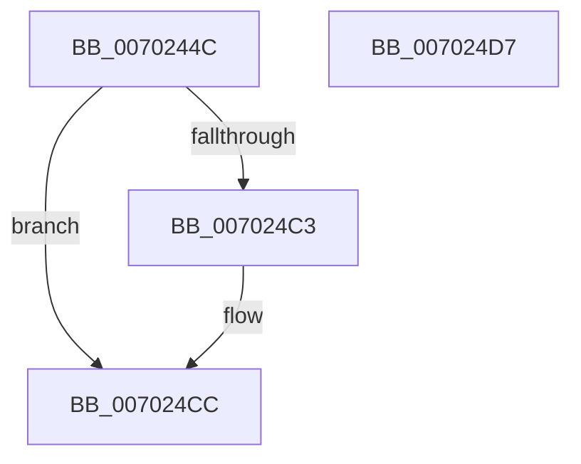

# RtlpOpenBaseImageFileOptionsKeyEx

- RVA: `0x0070244C`–`0x007024D8` (길이 `140` bytes)
- VA: `0x000000014070244C`
- 실행 섹션: `PAGE`
- PDB 이름 있음: `예`; PDB Function 태그: `아니요`
- unwind 정보 RVA: `0x000ACCDC`
- 디코드: `37`개 명령, `140/140` bytes 표시
- 미해석 바이트: `0` (있으면 어셈블리에 `.byte`로 보존)

> 이 문서는 커널 이미지의 기계어와 PDB 기호를 분석해 생성했습니다. 4번과 5번은 함수 원형과 자료형을 바이너리 사용 방식에서 추정한 C 해석이며 원본 소스 복구 결과는 아닙니다.

## 1. Dependencies

- 직접 호출 지점: **1**; 고유 호출 대상: **1**
- 직접 호출자로 확인된 함수: **1**
- RIP 상대 이미지 참조: **1**

### Outgoing calls
- `0x007024BA` → [ZwOpenKey](../../text/6A/ZwOpenKey_function_006AD310.md) (function, `0x006AD310`)

### Direct callers
- [RtlpOpenBaseImageFileOptionsKey](../A3/RtlpOpenBaseImageFileOptionsKey_function_00A3B9F4.md) at `0x00A3BA30`

### Static image references
- `0x007024AA` → RVA `0x000063F8` (`.rdata`; read)

## 2. Other-region calls and transfers

- 다른 실행 섹션으로 향하는 call: **1**
  - `0x007024BA` → [ZwOpenKey](../../text/6A/ZwOpenKey_function_006AD310.md) (`PAGE` → `.text`)
- 별도 외부 분기/꼬리 이동을 확인하지 못했습니다.

## 3. Assembly (complete function range)

```asm
0070244C  48 89 5C 24 08                  mov qword ptr [rsp + 8], rbx
00702451  55                              push rbp
00702452  48 8B EC                        mov rbp, rsp
00702455  48 83 EC 50                     sub rsp, 0x50
00702459  48 83 65 28 00                  and qword ptr [rbp + 0x28], 0
0070245E  4C 8D 45 D0                     lea r8, [rbp - 0x30]
00702462  33 C0                           xor eax, eax
00702464  48 8B D9                        mov rbx, rcx
00702467  21 45 EC                        and dword ptr [rbp - 0x14], eax
0070246A  B9 40 02 00 00                  mov ecx, 0x240
0070246F  89 45 D4                        mov dword ptr [rbp - 0x2c], eax
00702472  0F 57 C0                        xorps xmm0, xmm0
00702475  21 45 D4                        and dword ptr [rbp - 0x2c], eax
00702478  65 48 8B 04 25 88 01 00 00      mov rax, qword ptr gs:[0x188]
00702481  8A 90 32 02 00 00               mov dl, byte ptr [rax + 0x232]
00702487  B8 40 06 00 00                  mov eax, 0x640
0070248C  48 83 65 D8 00                  and qword ptr [rbp - 0x28], 0
00702491  80 FA 01                        cmp dl, 1
00702494  C7 45 D0 30 00 00 00            mov dword ptr [rbp - 0x30], 0x30
0070249B  BA 09 00 00 00                  mov edx, 9
007024A0  0F 45 C1                        cmovne eax, ecx
007024A3  48 8D 4D 28                     lea rcx, [rbp + 0x28]
007024A7  89 45 E8                        mov dword ptr [rbp - 0x18], eax
007024AA  48 8D 05 47 3F 90 FF            lea rax, [rip - 0x6fc0b9]
007024B1  48 89 45 E0                     mov qword ptr [rbp - 0x20], rax
007024B5  F3 0F 7F 45 F0                  movdqu xmmword ptr [rbp - 0x10], xmm0
007024BA  E8 51 AE FA FF                  call 0x1406ad310
007024BF  85 C0                           test eax, eax
007024C1  78 09                           js 0x1407024cc
007024C3  48 8B 45 28                     mov rax, qword ptr [rbp + 0x28]
007024C7  48 89 03                        mov qword ptr [rbx], rax
007024CA  33 C0                           xor eax, eax
007024CC  48 8B 5C 24 60                  mov rbx, qword ptr [rsp + 0x60]
007024D1  48 83 C4 50                     add rsp, 0x50
007024D5  5D                              pop rbp
007024D6  C3                              ret
007024D7  CC                              int3
```

## 4. C-style interpretation (structured pseudocode)

```c
__int64 __fastcall RtlpOpenBaseImageFileOptionsKeyEx(__int64 a1)
{
    __int64 result;
    __int64 v_rsp;
    unsigned __int64 v_stack_m18;
    unsigned int v_stack_m1C;
    unsigned int v_stack_m20;
    unsigned __int64 v_stack_m28;
    unsigned __int64 v_stack_m30;
    unsigned int v_stack_m34;
    unsigned __int64 v_stack_m38;
    unsigned __int64 v_stack_p20;
    unsigned __int64 v_stack_p8;

    v_stack_p8 = v_rbx;
    v_rsp = (v_rsp) - (80);
    result = 0;
    v_stack_m34 = 0;
    v_stack_m38 = 48;
    result = (unsigned int)(0x640ULL);
    if (((unsigned __int8)(*(unsigned __int8 *)(*(unsigned __int64 *)(gs_base + (0 + 392)) + 562))) != 1) { result = 576; }
    v_stack_m20 = (unsigned int)(result);
    v_stack_m28 = v_rip - 7323833;
    v_stack_m18 = v_xmm0;
    result = ZwOpenKey(v_stack_p20, 9, v_stack_m38, a4);
    if (!(sign_flag)) {
        result = v_stack_p20;
        *(unsigned __int64 *)(a1) = result;
        result = 0;
    }
    v_rsp = (v_rsp) + (80);
    return result;
}
```

## 5. (Beta) C Style

```c
int64_t RtlpOpenBaseImageFileOptionsKeyEx(void *Arg1)
{
    uint8_t *arg1 = (uint8_t *)Arg1;

    int64_t result;
    int64_t local_rsp;
    uint64_t v_stack_m18;
    uint32_t v_stack_m1C;
    uint32_t v_stack_m20;
    uint64_t v_stack_m28;
    uint64_t v_stack_m30;
    uint32_t v_stack_m34;
    uint64_t v_stack_m38;
    uint64_t v_stack_p20;
    uint64_t v_stack_p8;

    v_stack_p8 = local_rbx;
    local_rsp = (local_rsp) - (80);
    result = 0;
    v_stack_m34 = 0;
    v_stack_m38 = 48;
    result = (uint32_t)(0x640ULL);
    if (((uint8_t)(*(uint8_t *)(*(uint64_t *)(gs_base + (0 + 0x188)) + 0x232))) != 1) { result = 576; }
    v_stack_m20 = (uint32_t)(result);
    v_stack_m28 = v_rip - 7323833;
    v_stack_m18 = v_xmm0;
    result = ZwOpenKey(v_stack_p20, 9, v_stack_m38, a4);
    if (!(sign_flag)) {
        result = v_stack_p20;
        *(uint64_t *)(arg1) = result;
        result = 0;
    }
    local_rsp = (local_rsp) + (80);
    return result;
}
```

### 관측된 메모리 오프셋

구조체 형식이 확인되지 않은 접근은 인자 기준의 오프셋으로만 기록했습니다.

| 기준 인자 | 오프셋 표현 | 폭 (bit) | 접근 |
|---|---:|---:|---|
| `Arg1` | `+ 0x0` | `64` | `W` |

## 6. Execution-region graph

[열기: 2D/3D 그래프와 함수 탐색 컨트롤 패널](../../../control-panel.html?section=page&rva=0x0070244C&view=graph)

- 2D 그래프는 위에서 아래로 흐르고, 3D 그래프는 빈 공간을 드래그해 회전합니다. Shift+드래그는 이동, 휠은 확대·축소, 함수 노드 선택은 대상 보고서 이동입니다.

### Static fallback


