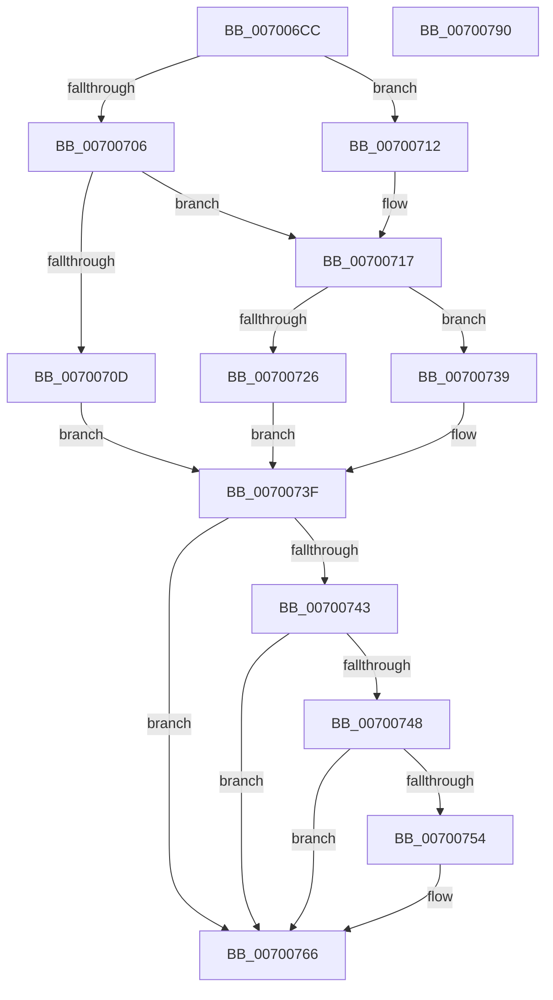

# SepCheckCreateAppContainer

- RVA: `0x007006CC`–`0x00700791` (길이 `197` bytes)
- VA: `0x00000001407006CC`
- 실행 섹션: `PAGE`
- PDB 이름 있음: `예`; PDB Function 태그: `아니요`
- unwind 정보 RVA: `0x0007D3C0`
- 디코드: `56`개 명령, `197/197` bytes 표시
- 미해석 바이트: `0` (있으면 어셈블리에 `.byte`로 보존)

> 이 문서는 커널 이미지의 기계어와 PDB 기호를 분석해 생성했습니다. 4번과 5번은 함수 원형과 자료형을 바이너리 사용 방식에서 추정한 C 해석이며 원본 소스 복구 결과는 아닙니다.

## 1. Dependencies

- 직접 호출 지점: **4**; 고유 호출 대상: **4**
- 직접 호출자로 확인된 함수: **2**
- RIP 상대 이미지 참조: **0**

### Outgoing calls
- `0x007006F7` → [SeCaptureSubjectContext](../86/SeCaptureSubjectContext_function_0086B820.md) (function, `0x0086B820`)
- `0x00700717` → [Feature_DecoupleAppContainerAndIntegrityLevel__private_IsEnabledDeviceUsageNoInline](../../text/4E/Feature_DecoupleAppContainerAndIntegrityLevel__private_IsEnabledDeviceUsageNoInline_function_004EF788.md) (function, `0x004EF788`)
- `0x0070075E` → [RtlIsParentOfChildAppContainer](RtlIsParentOfChildAppContainer_function_007047CC.md) (function, `0x007047CC`)
- `0x0070076B` → [SeReleaseSubjectContext](../86/SeReleaseSubjectContext_function_0086B710.md) (function, `0x0086B710`)

### Direct callers
- [SepCreateAppContainerToken](../../text/4F/SepCreateAppContainerToken_function_004F43AC.md) at `0x004F44EA`
- [NtCreateLowBoxToken](../AB/NtCreateLowBoxToken_function_00AB9880.md) at `0x00AB9CFA`

### Static image references
- 디코드된 RIP-relative 메모리 참조가 없습니다.

## 2. Other-region calls and transfers

- 다른 실행 섹션으로 향하는 call: **1**
  - `0x00700717` → [Feature_DecoupleAppContainerAndIntegrityLevel__private_IsEnabledDeviceUsageNoInline](../../text/4E/Feature_DecoupleAppContainerAndIntegrityLevel__private_IsEnabledDeviceUsageNoInline_function_004EF788.md) (`PAGE` → `.text`)
- 별도 외부 분기/꼬리 이동을 확인하지 못했습니다.

## 3. Assembly (complete function range)

```asm
007006CC  48 8B C4                        mov rax, rsp
007006CF  48 89 58 08                     mov qword ptr [rax + 8], rbx
007006D3  48 89 68 10                     mov qword ptr [rax + 0x10], rbp
007006D7  48 89 70 18                     mov qword ptr [rax + 0x18], rsi
007006DB  57                              push rdi
007006DC  48 83 EC 40                     sub rsp, 0x40
007006E0  0F 57 C0                        xorps xmm0, xmm0
007006E3  48 8B E9                        mov rbp, rcx
007006E6  48 8D 48 D8                     lea rcx, [rax - 0x28]
007006EA  33 DB                           xor ebx, ebx
007006EC  0F 11 40 D8                     movups xmmword ptr [rax - 0x28], xmm0
007006F0  40 B6 01                        mov sil, 1
007006F3  0F 11 40 E8                     movups xmmword ptr [rax - 0x18], xmm0
007006F7  E8 24 B1 16 00                  call 0x14086b820
007006FC  48 8B 7C 24 20                  mov rdi, qword ptr [rsp + 0x20]
00700701  48 85 FF                        test rdi, rdi
00700704  74 0C                           je 0x140700712
00700706  83 7C 24 28 02                  cmp dword ptr [rsp + 0x28], 2
0070070B  7D 0A                           jge 0x140700717
0070070D  40 32 F6                        xor sil, sil
00700710  EB 2D                           jmp 0x14070073f
00700712  48 8B 7C 24 30                  mov rdi, qword ptr [rsp + 0x30]
00700717  E8 6C F0 DE FF                  call 0x1404ef788
0070071C  8B 9F C8 00 00 00               mov ebx, dword ptr [rdi + 0xc8]
00700722  85 C0                           test eax, eax
00700724  74 13                           je 0x140700739
00700726  8B C3                           mov eax, ebx
00700728  33 DB                           xor ebx, ebx
0070072A  25 00 60 00 00                  and eax, 0x6000
0070072F  3D 00 20 00 00                  cmp eax, 0x2000
00700734  0F 94 C3                        sete bl
00700737  EB 06                           jmp 0x14070073f
00700739  81 E3 00 20 00 00               and ebx, 0x2000
0070073F  85 DB                           test ebx, ebx
00700741  75 23                           jne 0x140700766
00700743  40 84 F6                        test sil, sil
00700746  74 1E                           je 0x140700766
00700748  F7 87 C8 00 00 00 00 40 00 00   test dword ptr [rdi + 0xc8], 0x4000
00700752  74 12                           je 0x140700766
00700754  48 8B 8F 10 03 00 00            mov rcx, qword ptr [rdi + 0x310]
0070075B  48 8B D5                        mov rdx, rbp
0070075E  E8 69 40 00 00                  call 0x1407047cc
00700763  0F B6 D8                        movzx ebx, al
00700766  48 8D 4C 24 20                  lea rcx, [rsp + 0x20]
0070076B  E8 A0 AF 16 00                  call 0x14086b710
00700770  48 8B 6C 24 58                  mov rbp, qword ptr [rsp + 0x58]
00700775  F7 DB                           neg ebx
00700777  48 8B 5C 24 50                  mov rbx, qword ptr [rsp + 0x50]
0070077C  48 8B 74 24 60                  mov rsi, qword ptr [rsp + 0x60]
00700781  1B C0                           sbb eax, eax
00700783  F7 D0                           not eax
00700785  25 22 00 00 C0                  and eax, 0xc0000022
0070078A  48 83 C4 40                     add rsp, 0x40
0070078E  5F                              pop rdi
0070078F  C3                              ret
00700790  CC                              int3
```

## 4. C-style interpretation (structured pseudocode)

```c
__int64 __fastcall SepCheckCreateAppContainer(__int64 a1)
{
    __int64 result;
    __int64 v_rbx;
    __int64 v_rsi;
    __int64 v_rsp;
    unsigned __int64 v_stack_m18;
    unsigned int v_stack_m20;
    unsigned __int64 v_stack_m28;
    unsigned __int64 v_stack_p10;
    unsigned __int64 v_stack_p18;
    unsigned __int64 v_stack_p8;

    *(unsigned __int64 *)(v_rsp + 8) = v_rbx;
    *(unsigned __int64 *)(v_rsp + 16) = v_rbp;
    *(unsigned __int64 *)(v_rsp + 24) = v_rsi;
    v_rsp = (v_rsp) - (64);
    v_rbx = 0;
    *(unsigned __int64 *)(v_rsp - 40) = v_xmm0;
    *(unsigned __int64 *)(v_rsp - 24) = v_xmm0;
    result = SeCaptureSubjectContext(v_rsp - 40, a2, a3, a4);
    if (v_stack_m28 == 0) goto loc_00700712;
    if (v_stack_m20 >= 2) goto loc_00700717;
    v_rsi = 0;
    goto loc_0070073F;
loc_00700712:
loc_00700717:
    result = Feature_DecoupleAppContainerAndIntegrityLevel__private_IsEnabledDeviceUsageNoInline(v_rsp - 40, a2, a3, a4);
    if ((unsigned int)(result) == 0) goto loc_00700739;
    v_rbx = 0;
    result = (unsigned int)(((unsigned int)((unsigned int)((unsigned int)(*(unsigned int *)(v_stack_m18 + 200))))) & (0x6000ULL));
    v_rbx = (((unsigned int)(result)) == 0x2000ULL) ? 1 : 0;
    goto loc_0070073F;
loc_00700739:
    v_rbx = (unsigned int)((v_rbx) & (0x2000ULL));
loc_0070073F:
    if ((unsigned int)(v_rbx) != 0) goto loc_00700766;
    if (0 == 0) goto loc_00700766;
    if (((*(unsigned int *)(v_stack_m18 + 200)) & (0x4000ULL)) != 0) {
        a1 = *(unsigned __int64 *)(v_stack_m18 + 784);
        a2 = a1;
        result = RtlIsParentOfChildAppContainer(a1, a2, a3, a4);
        v_rbx = (unsigned __int8)(result);
    }
    result = SeReleaseSubjectContext(v_stack_m28, a2, a3, a4);
    v_rbx = (unsigned int)(-(v_rbx));
    result = (unsigned int)(~(result));
    result = (unsigned int)((result) & (0xC0000022ULL));
    v_rsp = (v_rsp) + (64);
    return result;
}
```

## 5. (Beta) C Style

```c
int64_t SepCheckCreateAppContainer(int64_t Arg1)
{
    int64_t result;
    int64_t local_rbx;
    int64_t local_rsi;
    int64_t local_rsp;
    uint64_t v_stack_m18;
    uint32_t v_stack_m20;
    uint64_t v_stack_m28;
    uint64_t v_stack_p10;
    uint64_t v_stack_p18;
    uint64_t v_stack_p8;

    *(uint64_t *)(local_rsp + 0x8) = local_rbx;
    *(uint64_t *)(local_rsp + 0x10) = local_rbp;
    *(uint64_t *)(local_rsp + 0x18) = local_rsi;
    local_rsp = (local_rsp) - (64);
    local_rbx = 0;
    *(uint64_t *)(local_rsp - 0x28) = v_xmm0;
    *(uint64_t *)(local_rsp - 0x18) = v_xmm0;
    result = SeCaptureSubjectContext(local_rsp - 40, a2, a3, a4);
    if (v_stack_m28 == 0) goto loc_00700712;
    if (v_stack_m20 >= 2) goto loc_00700717;
    local_rsi = 0;
    goto loc_0070073F;
loc_00700712:
loc_00700717:
    result = Feature_DecoupleAppContainerAndIntegrityLevel__private_IsEnabledDeviceUsageNoInline(local_rsp - 40, a2, a3, a4);
    if ((uint32_t)(result) == 0) goto loc_00700739;
    local_rbx = 0;
    result = (uint32_t)(((uint32_t)((uint32_t)((uint32_t)(*(uint32_t *)(v_stack_m18 + 0xC8))))) & (0x6000ULL));
    local_rbx = (((uint32_t)(result)) == 0x2000ULL) ? 1 : 0;
    goto loc_0070073F;
loc_00700739:
    local_rbx = (uint32_t)((local_rbx) & (0x2000ULL));
loc_0070073F:
    if ((uint32_t)(local_rbx) != 0) goto loc_00700766;
    if (0 == 0) goto loc_00700766;
    if (((*(uint32_t *)(v_stack_m18 + 0xC8)) & (0x4000ULL)) != 0) {
        Arg1 = *(uint64_t *)(v_stack_m18 + 0x310);
        a2 = Arg1;
        result = RtlIsParentOfChildAppContainer(Arg1, a2, a3, a4);
        local_rbx = (uint8_t)(result);
    }
    result = SeReleaseSubjectContext(v_stack_m28, a2, a3, a4);
    local_rbx = (uint32_t)(-(local_rbx));
    result = (uint32_t)(~(result));
    result = (uint32_t)((result) & (0xC0000022ULL));
    local_rsp = (local_rsp) + (64);
    return result;
}
```

## 6. Execution-region graph

[열기: 2D/3D 그래프와 함수 탐색 컨트롤 패널](../../../control-panel.html?section=page&rva=0x007006CC&view=graph)

- 2D 그래프는 위에서 아래로 흐르고, 3D 그래프는 빈 공간을 드래그해 회전합니다. Shift+드래그는 이동, 휠은 확대·축소, 함수 노드 선택은 대상 보고서 이동입니다.

### Static fallback


