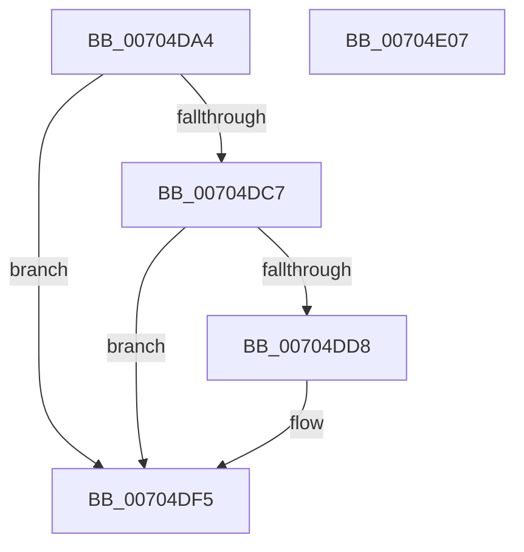

# SepLogonSystemManagedAdmin

- RVA: `0x00704DA4`–`0x00704E08` (길이 `100` bytes)
- VA: `0x0000000140704DA4`
- 실행 섹션: `PAGE`
- PDB 이름 있음: `예`; PDB Function 태그: `아니요`
- unwind 정보 RVA: `0x00060BC4`
- 디코드: `28`개 명령, `100/100` bytes 표시
- 미해석 바이트: `0` (있으면 어셈블리에 `.byte`로 보존)

> 이 문서는 커널 이미지의 기계어와 PDB 기호를 분석해 생성했습니다. 4번과 5번은 함수 원형과 자료형을 바이너리 사용 방식에서 추정한 C 해석이며 원본 소스 복구 결과는 아닙니다.

## 1. Dependencies

- 직접 호출 지점: **4**; 고유 호출 대상: **4**
- 직접 호출자로 확인된 함수: **1**
- RIP 상대 이미지 참조: **1**

### Outgoing calls
- `0x00704DBE` → [Feature_ShadowAdmin__private_IsEnabledDeviceUsageNoInline](../../text/4C/Feature_ShadowAdmin__private_IsEnabledDeviceUsageNoInline_function_004C78E8.md) (function, `0x004C78E8`)
- `0x00704DCE` → [ExGetExtensionTable](../../text/42/ExGetExtensionTable_function_00428814.md) (function, `0x00428814`)
- `0x00704DE2` → [guard_dispatch_icall](../../text/6B/guard_dispatch_icall_function_006BAAD0.md) (function, `0x006BAAD0`)
- `0x00704DF0` → [ExReleaseExtensionTable](../../text/45/ExReleaseExtensionTable_function_00456DC0.md) (function, `0x00456DC0`)

### Direct callers
- [NtQueryInformationToken](../AE/NtQueryInformationToken_function_00AECDD0.md) at `0x00AEE60D`

### Static image references
- `0x00704DC7` → RVA `0x00F04E28` (`.data`; read)

## 2. Other-region calls and transfers

- 다른 실행 섹션으로 향하는 call: **4**
  - `0x00704DBE` → [Feature_ShadowAdmin__private_IsEnabledDeviceUsageNoInline](../../text/4C/Feature_ShadowAdmin__private_IsEnabledDeviceUsageNoInline_function_004C78E8.md) (`PAGE` → `.text`)
  - `0x00704DCE` → [ExGetExtensionTable](../../text/42/ExGetExtensionTable_function_00428814.md) (`PAGE` → `.text`)
  - `0x00704DE2` → [guard_dispatch_icall](../../text/6B/guard_dispatch_icall_function_006BAAD0.md) (`PAGE` → `.text`)
  - `0x00704DF0` → [ExReleaseExtensionTable](../../text/45/ExReleaseExtensionTable_function_00456DC0.md) (`PAGE` → `.text`)
- 별도 외부 분기/꼬리 이동을 확인하지 못했습니다.

## 3. Assembly (complete function range)

```asm
00704DA4  48 89 5C 24 08                  mov qword ptr [rsp + 8], rbx
00704DA9  48 89 74 24 10                  mov qword ptr [rsp + 0x10], rsi
00704DAE  57                              push rdi
00704DAF  48 83 EC 20                     sub rsp, 0x20
00704DB3  48 8B F2                        mov rsi, rdx
00704DB6  48 8B D9                        mov rbx, rcx
00704DB9  BF 02 00 00 C0                  mov edi, 0xc0000002
00704DBE  E8 25 2B DC FF                  call 0x1404c78e8
00704DC3  85 C0                           test eax, eax
00704DC5  74 2E                           je 0x140704df5
00704DC7  48 8B 0D 5A 00 80 00            mov rcx, qword ptr [rip + 0x80005a]
00704DCE  E8 41 3A D2 FF                  call 0x140428814
00704DD3  48 85 C0                        test rax, rax
00704DD6  74 1D                           je 0x140704df5
00704DD8  48 8B 40 30                     mov rax, qword ptr [rax + 0x30]
00704DDC  48 8B D6                        mov rdx, rsi
00704DDF  48 8B CB                        mov rcx, rbx
00704DE2  E8 E9 5C FB FF                  call 0x1406baad0
00704DE7  48 8B 0D 3A 00 80 00            mov rcx, qword ptr [rip + 0x80003a]
00704DEE  8B F8                           mov edi, eax
00704DF0  E8 CB 1F D5 FF                  call 0x140456dc0
00704DF5  48 8B 5C 24 30                  mov rbx, qword ptr [rsp + 0x30]
00704DFA  8B C7                           mov eax, edi
00704DFC  48 8B 74 24 38                  mov rsi, qword ptr [rsp + 0x38]
00704E01  48 83 C4 20                     add rsp, 0x20
00704E05  5F                              pop rdi
00704E06  C3                              ret
00704E07  CC                              int3
```

## 4. C-style interpretation (structured pseudocode)

```c
__int64 __fastcall SepLogonSystemManagedAdmin(__int64 a1, __int64 a2)
{
    __int64 result;
    __int64 v_rdi;
    __int64 v_rsp;
    unsigned __int64 v_stack_p10;
    unsigned __int64 v_stack_p8;

    v_stack_p8 = v_rbx;
    v_stack_p10 = v_rsi;
    v_rsp = (v_rsp) - (32);
    result = Feature_ShadowAdmin__private_IsEnabledDeviceUsageNoInline(a1, a2, a3, a4);
    if ((unsigned int)(result) == 0) goto loc_00704DF5;
    result = ExGetExtensionTable(*(unsigned __int64 *)(v_rip + 8388698), a2, a3, a4);
    v_rdi = (unsigned int)(0xC0000002ULL);
    if (result != 0) {
        result = *(unsigned __int64 *)(result + 48);
        a2 = a2;
        a1 = a1;
        result = guard_dispatch_icall(a1, a2, a3, a4);
        a1 = *(unsigned __int64 *)(v_rip + 8388666);
        v_rdi = (unsigned int)(result);
        result = ExReleaseExtensionTable(a1, a2, a3, a4);
    }
    v_rsp = (v_rsp) + (32);
    return (unsigned int)((unsigned int)(v_rdi));
}
```

## 5. (Beta) C Style

```c
int64_t SepLogonSystemManagedAdmin(int64_t Arg1, int64_t Arg2)
{
    int64_t result;
    int64_t local_rdi;
    int64_t local_rsp;
    uint64_t v_stack_p10;
    uint64_t v_stack_p8;

    v_stack_p8 = local_rbx;
    v_stack_p10 = local_rsi;
    local_rsp = (local_rsp) - (32);
    result = Feature_ShadowAdmin__private_IsEnabledDeviceUsageNoInline(Arg1, Arg2, a3, a4);
    if ((uint32_t)(result) == 0) goto loc_00704DF5;
    result = ExGetExtensionTable(*(uint64_t *)(v_rip + 0x80005A), Arg2, a3, a4);
    local_rdi = (uint32_t)(0xC0000002ULL);
    if (result != 0) {
        result = *(uint64_t *)(result + 0x30);
        Arg2 = Arg2;
        Arg1 = Arg1;
        result = guard_dispatch_icall(Arg1, Arg2, a3, a4);
        Arg1 = *(uint64_t *)(v_rip + 0x80003A);
        local_rdi = (uint32_t)(result);
        result = ExReleaseExtensionTable(Arg1, Arg2, a3, a4);
    }
    local_rsp = (local_rsp) + (32);
    return (uint32_t)((uint32_t)(local_rdi));
}
```

## 6. Execution-region graph

[열기: 2D/3D 그래프와 함수 탐색 컨트롤 패널](../../../control-panel.html?section=page&rva=0x00704DA4&view=graph)

- 2D 그래프는 위에서 아래로 흐르고, 3D 그래프는 빈 공간을 드래그해 회전합니다. Shift+드래그는 이동, 휠은 확대·축소, 함수 노드 선택은 대상 보고서 이동입니다.

### Static fallback


