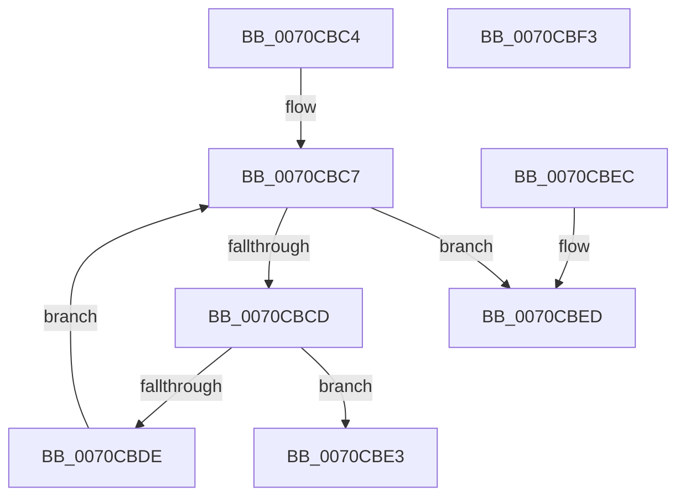

# TranslateGlobalVectorToIsaVector

- RVA: `0x0070CBC4`–`0x0070CBF4` (길이 `48` bytes)
- VA: `0x000000014070CBC4`
- 실행 섹션: `PAGE`
- PDB 이름 있음: `예`; PDB Function 태그: `아니요`
- unwind 정보 RVA: `0x000DB714`
- 디코드: `17`개 명령, `48/48` bytes 표시
- 미해석 바이트: `0` (있으면 어셈블리에 `.byte`로 보존)

> 이 문서는 커널 이미지의 기계어와 PDB 기호를 분석해 생성했습니다. 4번과 5번은 함수 원형과 자료형을 바이너리 사용 방식에서 추정한 C 해석이며 원본 소스 복구 결과는 아닙니다.

## 1. Dependencies

- 직접 호출 지점: **0**; 고유 호출 대상: **0**
- 직접 호출자로 확인된 함수: **1**
- RIP 상대 이미지 참조: **1**

### Outgoing calls
- 직접 디코드된 call 명령이 없습니다.

### Direct callers
- [HalacpiIrqTranslateResourcesIsa](HalacpiIrqTranslateResourcesIsa_function_0070CA20.md) at `0x0070CA91`
- [HalacpiIrqTranslateResourcesIsa](HalacpiIrqTranslateResourcesIsa_function_0070CA20.md) at `0x0070CAB0`

### Static image references
- `0x0070CBD1` → RVA `0x00025FC0` (`.rdata`; read)

## 2. Other-region calls and transfers

- 다른 실행 섹션으로 향하는 call: **0**
- 별도 외부 분기/꼬리 이동을 확인하지 못했습니다.

## 3. Assembly (complete function range)

```asm
0070CBC4  45 32 C0                        xor r8b, r8b
0070CBC7  41 80 F8 10                     cmp r8b, 0x10
0070CBCB  73 20                           jae 0x14070cbed
0070CBCD  41 0F B6 C0                     movzx eax, r8b
0070CBD1  4C 8D 0D E8 93 91 FF            lea r9, [rip - 0x6e6c18]
0070CBD8  41 39 0C 81                     cmp dword ptr [r9 + rax*4], ecx
0070CBDC  74 05                           je 0x14070cbe3
0070CBDE  41 FE C0                        inc r8b
0070CBE1  EB E4                           jmp 0x14070cbc7
0070CBE3  41 0F B6 C0                     movzx eax, r8b
0070CBE7  89 02                           mov dword ptr [rdx], eax
0070CBE9  33 C0                           xor eax, eax
0070CBEB  C3                              ret
0070CBEC  CC                              int3
0070CBED  B8 25 02 00 C0                  mov eax, 0xc0000225
0070CBF2  C3                              ret
0070CBF3  CC                              int3
```

## 4. C-style interpretation (structured pseudocode)

```c
__int64 __fastcall TranslateGlobalVectorToIsaVector(int a1, __int64 a2, unsigned __int8 a3)
{
    __int64 result;

    a3 = 0;
loc_0070CBC7:
    if (0 >= 16) goto loc_0070CBED;
    if ((*(unsigned int *)(v_rip - 7236632 + 0 * 4)) == a1) goto loc_0070CBE3;
    a3 = (unsigned __int8)((a3) + 1);
    goto loc_0070CBC7;
loc_0070CBE3:
    *(unsigned int *)(a2) = a3;
    result = 0;
    return result;
loc_0070CBED:
    return (unsigned int)(0xC0000225ULL);
}
```

## 5. (Beta) C Style

```c
int64_t TranslateGlobalVectorToIsaVector(int32_t Arg1, void *Arg2, uint8_t Arg3)
{
    uint8_t *arg2 = (uint8_t *)Arg2;

    int64_t result;

    Arg3 = 0;
loc_0070CBC7:
    if (0 >= 16) goto loc_0070CBED;
    if ((*(uint32_t *)(v_rip - 0x6E6C18 + 0x0 * 4)) == Arg1) goto loc_0070CBE3;
    Arg3 = (uint8_t)((Arg3) + 1);
    goto loc_0070CBC7;
loc_0070CBE3:
    *(uint32_t *)(arg2) = Arg3;
    result = 0;
    return result;
loc_0070CBED:
    return (uint32_t)(0xC0000225ULL);
}
```

### 관측된 메모리 오프셋

구조체 형식이 확인되지 않은 접근은 인자 기준의 오프셋으로만 기록했습니다.

| 기준 인자 | 오프셋 표현 | 폭 (bit) | 접근 |
|---|---:|---:|---|
| `Arg2` | `+ 0x0` | `32` | `W` |

## 6. Execution-region graph

[열기: 2D/3D 그래프와 함수 탐색 컨트롤 패널](../../../control-panel.html?section=page&rva=0x0070CBC4&view=graph)

- 2D 그래프는 위에서 아래로 흐르고, 3D 그래프는 빈 공간을 드래그해 회전합니다. Shift+드래그는 이동, 휠은 확대·축소, 함수 노드 선택은 대상 보고서 이동입니다.

### Static fallback


