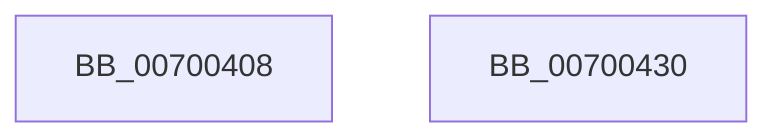

# TtmpAcquireSessionLock

- RVA: `0x00700408`–`0x00700431` (길이 `41` bytes)
- VA: `0x0000000140700408`
- 실행 섹션: `PAGE`
- PDB 이름 있음: `예`; PDB Function 태그: `아니요`
- unwind 정보 RVA: `0x0005C788`
- 디코드: `10`개 명령, `41/41` bytes 표시
- 미해석 바이트: `0` (있으면 어셈블리에 `.byte`로 보존)

> 이 문서는 커널 이미지의 기계어와 PDB 기호를 분석해 생성했습니다. 4번과 5번은 함수 원형과 자료형을 바이너리 사용 방식에서 추정한 C 해석이며 원본 소스 복구 결과는 아닙니다.

## 1. Dependencies

- 직접 호출 지점: **1**; 고유 호출 대상: **1**
- 직접 호출자로 확인된 함수: **12**
- RIP 상대 이미지 참조: **1**

### Outgoing calls
- `0x00700426` → [ExAcquireResourceExclusiveLite](../../text/21/ExAcquireResourceExclusiveLite_function_00214E20.md) (function, `0x00214E20`)

### Direct callers
- [TtmpStopCallout](../77/TtmpStopCallout_function_00776C24.md) at `0x00776CC6`
- [TtmpInitiateModernStandbyTransition](../77/TtmpInitiateModernStandbyTransition_function_00777A18.md) at `0x00777A60`
- [TtmpSessionPowerControl](../77/TtmpSessionPowerControl_function_00777ECC.md) at `0x00777F1D`
- [TtmpSessionWorker](../77/TtmpSessionWorker_function_00777F60.md) at `0x00777F7D`
- [TtmpTerminal0PowerSettingCallback](../77/TtmpTerminal0PowerSettingCallback_function_00778250.md) at `0x00778271`
- [TtmpAcquireSessionFromTerminalHandle](../77/TtmpAcquireSessionFromTerminalHandle_function_00778544.md) at `0x00778618`
- [TtmpCloseTerminalHandle](../77/TtmpCloseTerminalHandle_function_0077D390.md) at `0x0077D3C2`
- [TtmpScheduledEvaluationWorker](../77/TtmpScheduledEvaluationWorker_function_0077D560.md) at `0x0077D575`
- [TtmpDeleteQueue](../77/TtmpDeleteQueue_function_0077DFC0.md) at `0x0077DFCD`
- [TtmInitCurrentSession](../98/TtmInitCurrentSession_function_0098AA18.md) at `0x0098AA3E`
- [TtmpAcquireSessionById](../98/TtmpAcquireSessionById_function_0098B4F4.md) at `0x0098B535`
- [TtmCleanupCurrentSession](../AC/TtmCleanupCurrentSession_function_00AC54DC.md) at `0x00AC5502`

### Static image references
- `0x00700415` → RVA `0x00F06940` (`.data`; read)

## 2. Other-region calls and transfers

- 다른 실행 섹션으로 향하는 call: **1**
  - `0x00700426` → [ExAcquireResourceExclusiveLite](../../text/21/ExAcquireResourceExclusiveLite_function_00214E20.md) (`PAGE` → `.text`)
- 별도 외부 분기/꼬리 이동을 확인하지 못했습니다.

## 3. Assembly (complete function range)

```asm
00700408  48 83 EC 28                     sub rsp, 0x28
0070040C  65 48 8B 04 25 88 01 00 00      mov rax, qword ptr gs:[0x188]
00700415  48 8D 0D 24 65 80 00            lea rcx, [rip + 0x806524]
0070041C  B2 01                           mov dl, 1
0070041E  66 FF 88 E4 01 00 00            dec word ptr [rax + 0x1e4]
00700425  90                              nop
00700426  E8 F5 49 B1 FF                  call 0x140214e20
0070042B  48 83 C4 28                     add rsp, 0x28
0070042F  C3                              ret
00700430  CC                              int3
```

## 4. C-style interpretation (structured pseudocode)

```c
__int64 __fastcall TtmpAcquireSessionLock(void)
{
    __int64 result;
    __int64 v_rsp;

    v_rsp = (v_rsp) - (40);
    result = ExAcquireResourceExclusiveLite(v_rip + 8414500, 1, a3, a4);
    v_rsp = (v_rsp) + (40);
    return result;
}
```

## 5. (Beta) C Style

```c
void TtmpAcquireSessionLock(void)
{
    int64_t result;
    int64_t local_rsp;

    local_rsp = (local_rsp) - (40);
    result = ExAcquireResourceExclusiveLite(v_rip + 8414500, 1, a3, a4);
    local_rsp = (local_rsp) + (40);
    return result;
}
```

## 6. Execution-region graph

[열기: 2D/3D 그래프와 함수 탐색 컨트롤 패널](../../../control-panel.html?section=page&rva=0x00700408&view=graph)

- 2D 그래프는 위에서 아래로 흐르고, 3D 그래프는 빈 공간을 드래그해 회전합니다. Shift+드래그는 이동, 휠은 확대·축소, 함수 노드 선택은 대상 보고서 이동입니다.

### Static fallback


