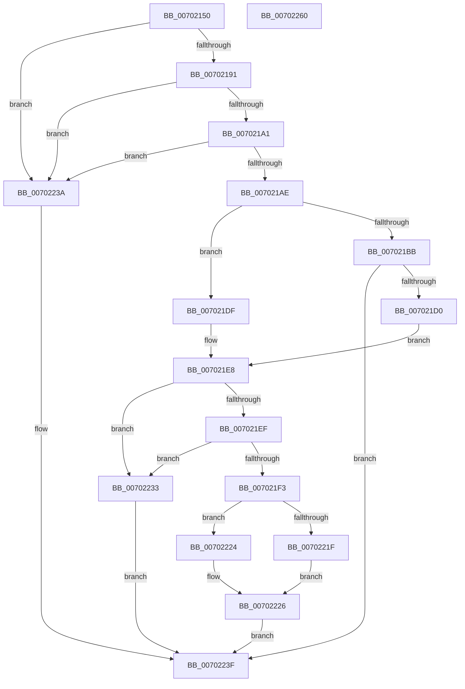

# sub_00702150

- RVA: `0x00702150`–`0x00702261` (길이 `273` bytes)
- VA: `0x0000000140702150`
- 실행 섹션: `PAGE`
- PDB 이름 있음: `아니요`; PDB Function 태그: `아니요`
- unwind 정보 RVA: `0x0005FEF8`
- 디코드: `87`개 명령, `273/273` bytes 표시
- 미해석 바이트: `0` (있으면 어셈블리에 `.byte`로 보존)

> 이 문서는 커널 이미지의 기계어와 PDB 기호를 분석해 생성했습니다. 4번과 5번은 함수 원형과 자료형을 바이너리 사용 방식에서 추정한 C 해석이며 원본 소스 복구 결과는 아닙니다.

## 1. Dependencies

- 직접 호출 지점: **3**; 고유 호출 대상: **3**
- 직접 호출자로 확인된 함수: **2**
- RIP 상대 이미지 참조: **0**

### Outgoing calls
- `0x007021C5` → [sub_00A7C49C](../A7/Unknown_function_00A7C49C.md) (function, `0x00A7C49C`)
- `0x00702211` → [memcpy](../../text/6C/memcpy_function_006C6840.md) (function, `0x006C6840`)
- `0x00702216` → [Feature_58333519__private_IsEnabledDeviceUsageNoInline](../../text/4F/Feature_58333519__private_IsEnabledDeviceUsageNoInline_function_004F5D4C.md) (function, `0x004F5D4C`)

### Direct callers
- [sub_008D0970](../8D/Unknown_function_008D0970.md) at `0x008D09B5`
- [sub_008D3CC4](../8D/Unknown_function_008D3CC4.md) at `0x008D3D69`

### Static image references
- 디코드된 RIP-relative 메모리 참조가 없습니다.

## 2. Other-region calls and transfers

- 다른 실행 섹션으로 향하는 call: **2**
  - `0x00702211` → [memcpy](../../text/6C/memcpy_function_006C6840.md) (`PAGE` → `.text`)
  - `0x00702216` → [Feature_58333519__private_IsEnabledDeviceUsageNoInline](../../text/4F/Feature_58333519__private_IsEnabledDeviceUsageNoInline_function_004F5D4C.md) (`PAGE` → `.text`)
- 별도 외부 분기/꼬리 이동을 확인하지 못했습니다.

## 3. Assembly (complete function range)

```asm
00702150  48 8B C4                        mov rax, rsp
00702153  48 89 58 08                     mov qword ptr [rax + 8], rbx
00702157  48 89 68 10                     mov qword ptr [rax + 0x10], rbp
0070215B  48 89 70 18                     mov qword ptr [rax + 0x18], rsi
0070215F  48 89 78 20                     mov qword ptr [rax + 0x20], rdi
00702163  41 54                           push r12
00702165  41 56                           push r14
00702167  41 57                           push r15
00702169  48 83 EC 20                     sub rsp, 0x20
0070216D  41 8B E9                        mov ebp, r9d
00702170  4C 8B E2                        mov r12, rdx
00702173  48 8B F9                        mov rdi, rcx
00702176  8B 49 08                        mov ecx, dword ptr [rcx + 8]
00702179  41 BA FF FF FF FF               mov r10d, 0xffffffff
0070217F  44 8B 0F                        mov r9d, dword ptr [rdi]
00702182  8B D1                           mov edx, ecx
00702184  49 0F AF D1                     imul rdx, r9
00702188  49 3B D2                        cmp rdx, r10
0070218B  0F 87 A9 00 00 00               ja 0x14070223a
00702191  44 8B 47 18                     mov r8d, dword ptr [rdi + 0x18]
00702195  44 03 C1                        add r8d, ecx
00702198  44 3B C1                        cmp r8d, ecx
0070219B  0F 82 99 00 00 00               jb 0x14070223a
007021A1  4D 0F AF C1                     imul r8, r9
007021A5  4D 3B C2                        cmp r8, r10
007021A8  0F 87 8C 00 00 00               ja 0x14070223a
007021AE  4C 8D 7F 04                     lea r15, [rdi + 4]
007021B2  41 8B 07                        mov eax, dword ptr [r15]
007021B5  FF C0                           inc eax
007021B7  3B C1                           cmp eax, ecx
007021B9  72 24                           jb 0x1407021df
007021BB  4C 8D 77 10                     lea r14, [rdi + 0x10]
007021BF  49 8B 0E                        mov rcx, qword ptr [r14]
007021C2  4D 8B CE                        mov r9, r14
007021C5  E8 D2 A2 37 00                  call 0x140a7c49c
007021CA  8B D8                           mov ebx, eax
007021CC  85 C0                           test eax, eax
007021CE  78 6F                           js 0x14070223f
007021D0  8B 4F 18                        mov ecx, dword ptr [rdi + 0x18]
007021D3  48 8D 77 04                     lea rsi, [rdi + 4]
007021D7  01 4F 08                        add dword ptr [rdi + 8], ecx
007021DA  8B 4F 08                        mov ecx, dword ptr [rdi + 8]
007021DD  EB 09                           jmp 0x1407021e8
007021DF  4C 8D 77 10                     lea r14, [rdi + 0x10]
007021E3  49 8B F7                        mov rsi, r15
007021E6  33 DB                           xor ebx, ebx
007021E8  41 8B 07                        mov eax, dword ptr [r15]
007021EB  3B E8                           cmp ebp, eax
007021ED  77 44                           ja 0x140702233
007021EF  85 C9                           test ecx, ecx
007021F1  74 40                           je 0x140702233
007021F3  8B 0F                           mov ecx, dword ptr [rdi]
007021F5  2B C5                           sub eax, ebp
007021F7  4D 8B 0E                        mov r9, qword ptr [r14]
007021FA  8B D1                           mov edx, ecx
007021FC  0F AF C1                        imul eax, ecx
007021FF  0F AF D5                        imul edx, ebp
00702202  44 8B C0                        mov r8d, eax
00702205  8D 45 01                        lea eax, [rbp + 1]
00702208  0F AF C8                        imul ecx, eax
0070220B  49 03 D1                        add rdx, r9
0070220E  49 03 C9                        add rcx, r9
00702211  E8 2A 46 FC FF                  call 0x1406c6840
00702216  E8 31 3B DF FF                  call 0x1404f5d4c
0070221B  85 C0                           test eax, eax
0070221D  74 05                           je 0x140702224
0070221F  F0 FF 06                        lock inc dword ptr [rsi]
00702222  EB 02                           jmp 0x140702226
00702224  FF 06                           inc dword ptr [rsi]
00702226  0F AF 2F                        imul ebp, dword ptr [rdi]
00702229  49 8B 06                        mov rax, qword ptr [r14]
0070222C  4C 89 64 05 00                  mov qword ptr [rbp + rax], r12
00702231  EB 0C                           jmp 0x14070223f
00702233  BB 0D 00 00 C0                  mov ebx, 0xc000000d
00702238  EB 05                           jmp 0x14070223f
0070223A  BB 95 00 00 C0                  mov ebx, 0xc0000095
0070223F  48 8B 6C 24 48                  mov rbp, qword ptr [rsp + 0x48]
00702244  8B C3                           mov eax, ebx
00702246  48 8B 5C 24 40                  mov rbx, qword ptr [rsp + 0x40]
0070224B  48 8B 74 24 50                  mov rsi, qword ptr [rsp + 0x50]
00702250  48 8B 7C 24 58                  mov rdi, qword ptr [rsp + 0x58]
00702255  48 83 C4 20                     add rsp, 0x20
00702259  41 5F                           pop r15
0070225B  41 5E                           pop r14
0070225D  41 5C                           pop r12
0070225F  C3                              ret
00702260  CC                              int3
```

## 4. C-style interpretation (structured pseudocode)

```c
__int64 __fastcall sub_00702150(__int64 a1, __int64 a2, __int64 a3, int a4)
{
    __int64 result;
    __int64 v_rbp;
    __int64 v_rbx;
    __int64 v_rsp;
    unsigned __int64 v_stack_p10;
    unsigned __int64 v_stack_p18;
    unsigned __int64 v_stack_p20;
    unsigned __int64 v_stack_p8;

    *(unsigned __int64 *)(v_rsp + 8) = v_rbx;
    *(unsigned __int64 *)(v_rsp + 16) = v_rbp;
    *(unsigned __int64 *)(v_rsp + 24) = v_rsi;
    *(unsigned __int64 *)(v_rsp + 32) = v_rdi;
    v_rsp = (v_rsp) - (32);
    a2 = ((unsigned int)((unsigned int)((unsigned int)(*(unsigned int *)(a1 + 8))))) * ((unsigned int)(*(unsigned int *)(a1)));
    if (a2 > ((unsigned int)(0xFFFFFFFFULL))) goto loc_0070223A;
    a3 = (unsigned int)(((unsigned int)(*(unsigned int *)(a1 + 24))) + ((unsigned int)((unsigned int)(*(unsigned int *)(a1 + 8)))));
    if (((unsigned int)(a3)) < ((unsigned int)((unsigned int)(*(unsigned int *)(a1 + 8))))) goto loc_0070223A;
    a3 = (a3) * ((unsigned int)(*(unsigned int *)(a1)));
    if (a3 > ((unsigned int)(0xFFFFFFFFULL))) goto loc_0070223A;
    result = (unsigned int)(((unsigned int)(*(unsigned int *)(a1 + 4))) + 1);
    if (((unsigned int)(result)) < ((unsigned int)((unsigned int)(*(unsigned int *)(a1 + 8))))) goto loc_007021DF;
    result = sub_00A7C49C(*(unsigned __int64 *)(a1 + 16), a2, a3, a1 + 16);
    if (sign_flag) goto loc_0070223F;
    goto loc_007021E8;
loc_007021DF:
    v_rbx = 0;
loc_007021E8:
    if (((unsigned int)((unsigned int)(a4))) > ((unsigned int)((unsigned int)(*(unsigned int *)(a1 + 4))))) goto loc_00702233;
    if ((unsigned int)((unsigned int)(*(unsigned int *)(a1 + 8))) == 0) goto loc_00702233;
    result = (unsigned int)(((unsigned int)(*(unsigned int *)(a1 + 4))) - ((unsigned int)((unsigned int)(a4))));
    result = (unsigned int)((result) * ((unsigned int)((unsigned int)(*(unsigned int *)(a1)))));
    a2 = (unsigned int)(((unsigned int)((unsigned int)((unsigned int)(*(unsigned int *)(a1))))) * ((unsigned int)((unsigned int)(a4))));
    a1 = (unsigned int)(((unsigned int)(*(unsigned int *)(a1))) * ((unsigned int)((unsigned int)(a4) + 1)));
    a2 = (a2) + (*(unsigned __int64 *)(a1 + 16));
    a1 = (a1) + (*(unsigned __int64 *)(a1 + 16));
    result = memcpy(a1, a2, (unsigned int)((unsigned int)(result)), *(unsigned __int64 *)(a1 + 16));
    result = Feature_58333519__private_IsEnabledDeviceUsageNoInline(a1, a2, (unsigned int)((unsigned int)(result)), *(unsigned __int64 *)(a1 + 16));
    if ((unsigned int)(result) == 0) goto loc_00702224;
    goto loc_00702226;
loc_00702224:
loc_00702226:
    v_rbp = (unsigned int)(((unsigned int)(a4)) * (*(unsigned int *)(a1)));
    *(unsigned __int64 *)(v_rbp + *(unsigned __int64 *)(a1 + 16) * 1) = a2;
    goto loc_0070223F;
loc_00702233:
    goto loc_0070223F;
loc_0070223A:
loc_0070223F:
    v_rsp = (v_rsp) + (32);
    return (unsigned int)((unsigned int)((unsigned int)(0xC0000095ULL)));
}
```

## 5. (Beta) C Style

```c
int64_t sub_00702150(void *Arg1, int64_t Arg2, int64_t Arg3, int32_t Arg4)
{
    uint8_t *arg1 = (uint8_t *)Arg1;

    int64_t result;
    int64_t local_rbp;
    int64_t local_rbx;
    int64_t local_rsp;
    uint64_t v_stack_p10;
    uint64_t v_stack_p18;
    uint64_t v_stack_p20;
    uint64_t v_stack_p8;

    *(uint64_t *)(local_rsp + 0x8) = local_rbx;
    *(uint64_t *)(local_rsp + 0x10) = local_rbp;
    *(uint64_t *)(local_rsp + 0x18) = local_rsi;
    *(uint64_t *)(local_rsp + 0x20) = local_rdi;
    local_rsp = (local_rsp) - (32);
    Arg2 = ((uint32_t)((uint32_t)((uint32_t)(*(uint32_t *)(arg1 + 0x8))))) * ((uint32_t)(*(uint32_t *)(arg1)));
    if (Arg2 > ((uint32_t)(0xFFFFFFFFULL))) goto loc_0070223A;
    Arg3 = (uint32_t)(((uint32_t)(*(uint32_t *)(arg1 + 0x18))) + ((uint32_t)((uint32_t)(*(uint32_t *)(arg1 + 0x8)))));
    if (((uint32_t)(Arg3)) < ((uint32_t)((uint32_t)(*(uint32_t *)(arg1 + 0x8))))) goto loc_0070223A;
    Arg3 = (Arg3) * ((uint32_t)(*(uint32_t *)(arg1)));
    if (Arg3 > ((uint32_t)(0xFFFFFFFFULL))) goto loc_0070223A;
    result = (uint32_t)(((uint32_t)(*(uint32_t *)(arg1 + 0x4))) + 1);
    if (((uint32_t)(result)) < ((uint32_t)((uint32_t)(*(uint32_t *)(arg1 + 0x8))))) goto loc_007021DF;
    result = sub_00A7C49C(*(uint64_t *)(arg1 + 0x10), Arg2, Arg3, Arg1 + 16);
    if (sign_flag) goto loc_0070223F;
    goto loc_007021E8;
loc_007021DF:
    local_rbx = 0;
loc_007021E8:
    if (((uint32_t)((uint32_t)(Arg4))) > ((uint32_t)((uint32_t)(*(uint32_t *)(arg1 + 0x4))))) goto loc_00702233;
    if ((uint32_t)((uint32_t)(*(uint32_t *)(arg1 + 0x8))) == 0) goto loc_00702233;
    result = (uint32_t)(((uint32_t)(*(uint32_t *)(arg1 + 0x4))) - ((uint32_t)((uint32_t)(Arg4))));
    result = (uint32_t)((result) * ((uint32_t)((uint32_t)(*(uint32_t *)(arg1)))));
    Arg2 = (uint32_t)(((uint32_t)((uint32_t)((uint32_t)(*(uint32_t *)(arg1))))) * ((uint32_t)((uint32_t)(Arg4))));
    Arg1 = (uint32_t)(((uint32_t)(*(uint32_t *)(arg1))) * ((uint32_t)((uint32_t)(Arg4) + 1)));
    Arg2 = (Arg2) + (*(uint64_t *)(arg1 + 0x10));
    Arg1 = (Arg1) + (*(uint64_t *)(arg1 + 0x10));
    result = memcpy(Arg1, Arg2, (uint32_t)((uint32_t)(result)), *(uint64_t *)(arg1 + 0x10));
    result = Feature_58333519__private_IsEnabledDeviceUsageNoInline(Arg1, Arg2, (uint32_t)((uint32_t)(result)), *(uint64_t *)(arg1 + 0x10));
    if ((uint32_t)(result) == 0) goto loc_00702224;
    goto loc_00702226;
loc_00702224:
loc_00702226:
    local_rbp = (uint32_t)(((uint32_t)(Arg4)) * (*(uint32_t *)(arg1)));
    *(uint64_t *)(local_rbp + *(uint64_t *)(arg1 + 0x10) * 1) = Arg2;
    goto loc_0070223F;
loc_00702233:
    goto loc_0070223F;
loc_0070223A:
loc_0070223F:
    local_rsp = (local_rsp) + (32);
    return (uint32_t)((uint32_t)((uint32_t)(0xC0000095ULL)));
}
```

### 관측된 메모리 오프셋

구조체 형식이 확인되지 않은 접근은 인자 기준의 오프셋으로만 기록했습니다.

| 기준 인자 | 오프셋 표현 | 폭 (bit) | 접근 |
|---|---:|---:|---|
| `Arg1` | `+ 0x0` | `32` | `R` |
| `Arg1` | `+ 0x0` | `32` | `R/W` |
| `Arg1` | `+ 0x0` | `64` | `R` |
| `Arg1` | `+ 0x4` | `64` | `R` |
| `Arg1` | `+ 0x8` | `32` | `R` |
| `Arg1` | `+ 0x8` | `32` | `R/W` |
| `Arg1` | `+ 0x10` | `64` | `R` |
| `Arg1` | `+ 0x18` | `32` | `R` |

## 6. Execution-region graph

[열기: 2D/3D 그래프와 함수 탐색 컨트롤 패널](../../../control-panel.html?section=page&rva=0x00702150&view=graph)

- 2D 그래프는 위에서 아래로 흐르고, 3D 그래프는 빈 공간을 드래그해 회전합니다. Shift+드래그는 이동, 휠은 확대·축소, 함수 노드 선택은 대상 보고서 이동입니다.

### Static fallback


