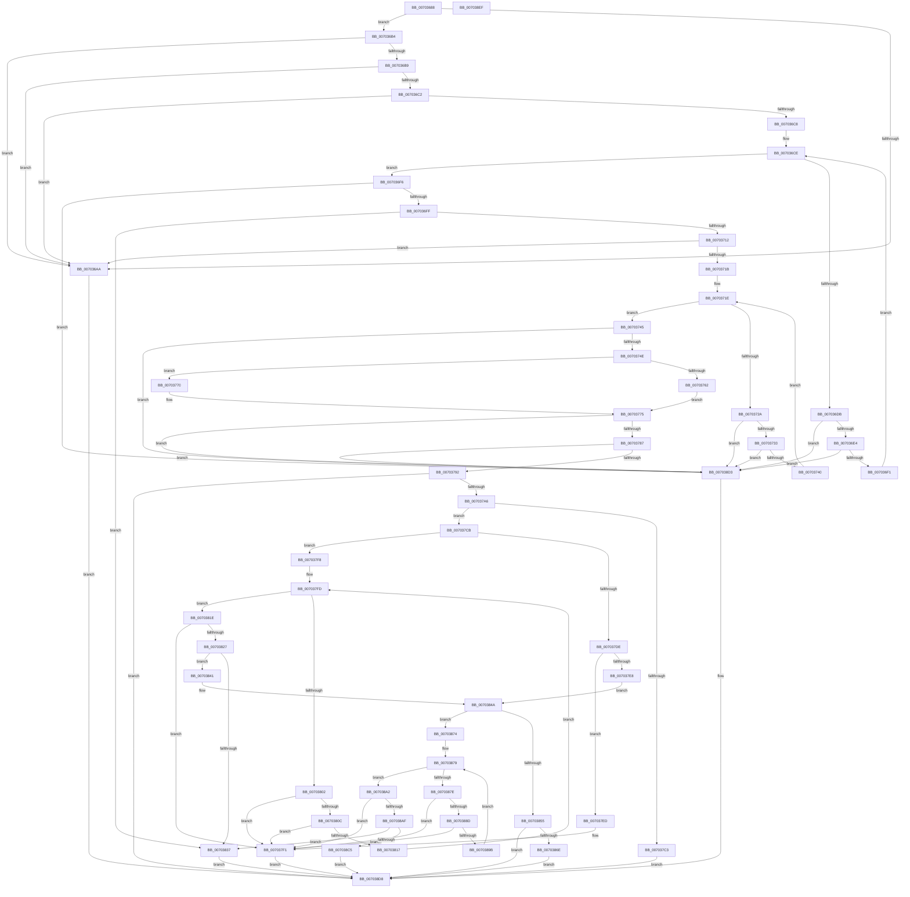

# sub_00703688

- RVA: `0x00703688`–`0x007038F0` (길이 `616` bytes)
- VA: `0x0000000140703688`
- 실행 섹션: `PAGE`
- PDB 이름 있음: `아니요`; PDB Function 태그: `아니요`
- unwind 정보 RVA: `0x0005C954`
- 디코드: `187`개 명령, `616/616` bytes 표시
- 미해석 바이트: `0` (있으면 어셈블리에 `.byte`로 보존)

> 이 문서는 커널 이미지의 기계어와 PDB 기호를 분석해 생성했습니다. 4번과 5번은 함수 원형과 자료형을 바이너리 사용 방식에서 추정한 C 해석이며 원본 소스 복구 결과는 아닙니다.

## 1. Dependencies

- 직접 호출 지점: **2**; 고유 호출 대상: **2**
- 직접 호출자로 확인된 함수: **1**
- RIP 상대 이미지 참조: **1**

### Outgoing calls
- `0x00703767` → [guard_dispatch_icall](../../text/6B/guard_dispatch_icall_function_006BAAD0.md) (function, `0x006BAAD0`)
- `0x007037B9` → [ExAllocatePool2](../../poolcode/B8/ExAllocatePool2_function_00B820F0.md) (function, `0x00B820F0`)

### Direct callers
- [sub_00968AF6](../96/Unknown_function_00968AF6.md) at `0x0096A766`

### Static image references
- `0x0070374E` → RVA `0x00FD8340` (`PAGEDATA`; read)

## 2. Other-region calls and transfers

- 다른 실행 섹션으로 향하는 call: **2**
  - `0x00703767` → [guard_dispatch_icall](../../text/6B/guard_dispatch_icall_function_006BAAD0.md) (`PAGE` → `.text`)
  - `0x007037B9` → [ExAllocatePool2](../../poolcode/B8/ExAllocatePool2_function_00B820F0.md) (`PAGE` → `POOLCODE`)
- 별도 외부 분기/꼬리 이동을 확인하지 못했습니다.

## 3. Assembly (complete function range)

```asm
00703688  48 89 5C 24 08                  mov qword ptr [rsp + 8], rbx
0070368D  48 89 6C 24 10                  mov qword ptr [rsp + 0x10], rbp
00703692  48 89 74 24 18                  mov qword ptr [rsp + 0x18], rsi
00703697  57                              push rdi
00703698  48 83 EC 20                     sub rsp, 0x20
0070369C  49 8B F9                        mov rdi, r9
0070369F  48 8B DA                        mov rbx, rdx
007036A2  4C 8B C1                        mov r8, rcx
007036A5  48 85 D2                        test rdx, rdx
007036A8  75 0A                           jne 0x1407036b4
007036AA  BA 0D 00 00 C0                  mov edx, 0xc000000d
007036AF  E9 24 02 00 00                  jmp 0x1407038d8
007036B4  48 85 FF                        test rdi, rdi
007036B7  74 F1                           je 0x1407036aa
007036B9  48 8B 49 08                     mov rcx, qword ptr [rcx + 8]
007036BD  48 85 C9                        test rcx, rcx
007036C0  74 E8                           je 0x1407036aa
007036C2  41 83 38 03                     cmp dword ptr [r8], 3
007036C6  76 E2                           jbe 0x1407036aa
007036C8  48 8B C1                        mov rax, rcx
007036CB  45 33 C9                        xor r9d, r9d
007036CE  44 8B 10                        mov r10d, dword ptr [rax]
007036D1  48 8D 50 04                     lea rdx, [rax + 4]
007036D5  41 83 F9 03                     cmp r9d, 3
007036D9  73 1B                           jae 0x1407036f6
007036DB  48 3B D0                        cmp rdx, rax
007036DE  0F 82 EF 01 00 00               jb 0x1407038d3
007036E4  4A 8D 04 12                     lea rax, [rdx + r10]
007036E8  48 3B C2                        cmp rax, rdx
007036EB  0F 82 E2 01 00 00               jb 0x1407038d3
007036F1  41 FF C1                        inc r9d
007036F4  EB D8                           jmp 0x1407036ce
007036F6  48 3B D0                        cmp rdx, rax
007036F9  0F 82 D4 01 00 00               jb 0x1407038d3
007036FF  33 F6                           xor esi, esi
00703701  45 85 D2                        test r10d, r10d
00703704  48 0F 45 F2                     cmovne rsi, rdx
00703708  41 83 FA 08                     cmp r10d, 8
0070370C  0F 85 25 01 00 00               jne 0x140703837
00703712  41 83 38 04                     cmp dword ptr [r8], 4
00703716  48 8B 36                        mov rsi, qword ptr [rsi]
00703719  76 8F                           jbe 0x1407036aa
0070371B  45 33 C0                        xor r8d, r8d
0070371E  8B 01                           mov eax, dword ptr [rcx]
00703720  48 8D 51 04                     lea rdx, [rcx + 4]
00703724  41 83 F8 04                     cmp r8d, 4
00703728  73 1B                           jae 0x140703745
0070372A  48 3B D1                        cmp rdx, rcx
0070372D  0F 82 A0 01 00 00               jb 0x1407038d3
00703733  48 8D 0C 02                     lea rcx, [rdx + rax]
00703737  48 3B CA                        cmp rcx, rdx
0070373A  0F 82 93 01 00 00               jb 0x1407038d3
00703740  41 FF C0                        inc r8d
00703743  EB D9                           jmp 0x14070371e
00703745  48 3B D1                        cmp rdx, rcx
00703748  0F 82 85 01 00 00               jb 0x1407038d3
0070374E  4C 8B 05 EB 4B 8D 00            mov r8, qword ptr [rip + 0x8d4beb]
00703755  33 C9                           xor ecx, ecx
00703757  85 C0                           test eax, eax
00703759  48 0F 45 CA                     cmovne rcx, rdx
0070375D  4D 85 C0                        test r8, r8
00703760  74 0E                           je 0x140703770
00703762  8B D0                           mov edx, eax
00703764  49 8B C0                        mov rax, r8
00703767  E8 64 73 FB FF                  call 0x1406baad0
0070376C  8B E8                           mov ebp, eax
0070376E  EB 05                           jmp 0x140703775
00703770  BD BB 00 00 C0                  mov ebp, 0xc00000bb
00703775  8B 43 10                        mov eax, dword ptr [rbx + 0x10]
00703778  8B 53 20                        mov edx, dword ptr [rbx + 0x20]
0070377B  83 C0 30                        add eax, 0x30
0070377E  83 F8 30                        cmp eax, 0x30
00703781  0F 82 4C 01 00 00               jb 0x1407038d3
00703787  8D 48 04                        lea ecx, [rax + 4]
0070378A  3B C8                           cmp ecx, eax
0070378C  0F 82 41 01 00 00               jb 0x1407038d3
00703792  8D 04 11                        lea eax, [rcx + rdx]
00703795  BB 95 00 00 C0                  mov ebx, 0xc0000095
0070379A  3B C1                           cmp eax, ecx
0070379C  1B D2                           sbb edx, edx
0070379E  23 D3                           and edx, ebx
007037A0  0F 8C 32 01 00 00               jl 0x1407038d8
007037A6  BA 14 00 00 00                  mov edx, 0x14
007037AB  B9 00 01 00 00                  mov ecx, 0x100
007037B0  41 B8 53 4C 53 20               mov r8d, 0x20534c53
007037B6  89 57 04                        mov dword ptr [rdi + 4], edx
007037B9  E8 32 E9 47 00                  call 0x140b820f0
007037BE  48 85 C0                        test rax, rax
007037C1  75 08                           jne 0x1407037cb
007037C3  8D 53 82                        lea edx, [rbx - 0x7e]
007037C6  E9 0D 01 00 00                  jmp 0x1407038d8
007037CB  48 89 47 08                     mov qword ptr [rdi + 8], rax
007037CF  83 27 00                        and dword ptr [rdi], 0
007037D2  0F BA ED 1C                     bts ebp, 0x1c
007037D6  48 8B D0                        mov rdx, rax
007037D9  48 85 C0                        test rax, rax
007037DC  75 1A                           jne 0x1407037f8
007037DE  8B 47 04                        mov eax, dword ptr [rdi + 4]
007037E1  8D 48 08                        lea ecx, [rax + 8]
007037E4  3B C8                           cmp ecx, eax
007037E6  72 05                           jb 0x1407037ed
007037E8  89 4F 04                        mov dword ptr [rdi + 4], ecx
007037EB  EB 5D                           jmp 0x14070384a
007037ED  83 4F 04 FF                     or dword ptr [rdi + 4], 0xffffffff
007037F1  8B D3                           mov edx, ebx
007037F3  E9 E0 00 00 00                  jmp 0x1407038d8
007037F8  44 8B 0F                        mov r9d, dword ptr [rdi]
007037FB  33 C9                           xor ecx, ecx
007037FD  41 3B C9                        cmp ecx, r9d
00703800  73 1C                           jae 0x14070381e
00703802  8B 02                           mov eax, dword ptr [rdx]
00703804  83 C0 04                        add eax, 4
00703807  83 F8 04                        cmp eax, 4
0070380A  72 E5                           jb 0x1407037f1
0070380C  44 8B C0                        mov r8d, eax
0070380F  4C 03 C2                        add r8, rdx
00703812  4C 3B C2                        cmp r8, rdx
00703815  72 DA                           jb 0x1407037f1
00703817  49 8B D0                        mov rdx, r8
0070381A  FF C1                           inc ecx
0070381C  EB DF                           jmp 0x1407037fd
0070381E  4C 8D 42 04                     lea r8, [rdx + 4]
00703822  4C 3B C2                        cmp r8, rdx
00703825  72 CA                           jb 0x1407037f1
00703827  8B 4F 04                        mov ecx, dword ptr [rdi + 4]
0070382A  48 8D 42 08                     lea rax, [rdx + 8]
0070382E  48 03 4F 08                     add rcx, qword ptr [rdi + 8]
00703832  48 3B C1                        cmp rax, rcx
00703835  76 0A                           jbe 0x140703841
00703837  BA 23 00 00 C0                  mov edx, 0xc0000023
0070383C  E9 97 00 00 00                  jmp 0x1407038d8
00703841  C7 02 04 00 00 00               mov dword ptr [rdx], 4
00703847  41 89 28                        mov dword ptr [r8], ebp
0070384A  FF 07                           inc dword ptr [rdi]
0070384C  4C 8B 47 08                     mov r8, qword ptr [rdi + 8]
00703850  4D 85 C0                        test r8, r8
00703853  75 1F                           jne 0x140703874
00703855  8B 4F 04                        mov ecx, dword ptr [rdi + 4]
00703858  83 CA FF                        or edx, 0xffffffff
0070385B  8D 41 0C                        lea eax, [rcx + 0xc]
0070385E  3B C1                           cmp eax, ecx
00703860  0F 43 D0                        cmovae edx, eax
00703863  89 57 04                        mov dword ptr [rdi + 4], edx
00703866  1B D2                           sbb edx, edx
00703868  23 D3                           and edx, ebx
0070386A  3B C1                           cmp eax, ecx
0070386C  72 6A                           jb 0x1407038d8
0070386E  FF 07                           inc dword ptr [rdi]
00703870  33 D2                           xor edx, edx
00703872  EB 64                           jmp 0x1407038d8
00703874  44 8B 0F                        mov r9d, dword ptr [rdi]
00703877  33 C9                           xor ecx, ecx
00703879  41 3B C9                        cmp ecx, r9d
0070387C  73 24                           jae 0x1407038a2
0070387E  41 8B 00                        mov eax, dword ptr [r8]
00703881  83 C0 04                        add eax, 4
00703884  83 F8 04                        cmp eax, 4
00703887  0F 82 64 FF FF FF               jb 0x1407037f1
0070388D  8B D0                           mov edx, eax
0070388F  49 03 D0                        add rdx, r8
00703892  49 3B D0                        cmp rdx, r8
00703895  0F 82 56 FF FF FF               jb 0x1407037f1
0070389B  4C 8B C2                        mov r8, rdx
0070389E  FF C1                           inc ecx
007038A0  EB D7                           jmp 0x140703879
007038A2  4D 8D 48 04                     lea r9, [r8 + 4]
007038A6  4D 3B C8                        cmp r9, r8
007038A9  0F 82 42 FF FF FF               jb 0x1407037f1
007038AF  8B 4F 04                        mov ecx, dword ptr [rdi + 4]
007038B2  49 8D 40 0C                     lea rax, [r8 + 0xc]
007038B6  48 03 4F 08                     add rcx, qword ptr [rdi + 8]
007038BA  33 D2                           xor edx, edx
007038BC  48 3B C1                        cmp rax, rcx
007038BF  0F 87 72 FF FF FF               ja 0x140703837
007038C5  41 C7 00 08 00 00 00            mov dword ptr [r8], 8
007038CC  49 89 31                        mov qword ptr [r9], rsi
007038CF  FF 07                           inc dword ptr [rdi]
007038D1  EB 05                           jmp 0x1407038d8
007038D3  BA 95 00 00 C0                  mov edx, 0xc0000095
007038D8  48 8B 5C 24 30                  mov rbx, qword ptr [rsp + 0x30]
007038DD  8B C2                           mov eax, edx
007038DF  48 8B 6C 24 38                  mov rbp, qword ptr [rsp + 0x38]
007038E4  48 8B 74 24 40                  mov rsi, qword ptr [rsp + 0x40]
007038E9  48 83 C4 20                     add rsp, 0x20
007038ED  5F                              pop rdi
007038EE  C3                              ret
007038EF  CC                              int3
```

## 4. C-style interpretation (structured pseudocode)

```c
__int64 __fastcall sub_00703688(__int64 a1, __int64 a2, __int64 a3, __int64 a4)
{
    __int64 result;
    __int64 v_rsi;
    __int64 v_rsp;
    unsigned __int64 v_stack_p10;
    unsigned __int64 v_stack_p18;
    unsigned __int64 v_stack_p8;

    v_stack_p8 = v_rbx;
    v_stack_p10 = v_rbp;
    v_stack_p18 = v_rsi;
    v_rsp = (v_rsp) - (32);
    if (a2 != 0) goto loc_007036B4;
loc_007036AA:
    goto loc_007038D8;
loc_007036B4:
    if (a4 == 0) goto loc_007036AA;
    if (*(unsigned __int64 *)(a1 + 8) == 0) goto loc_007036AA;
    if ((*(unsigned int *)(a1)) <= 3) goto loc_007036AA;
    a4 = 0;
loc_007036CE:
    if (0 >= 3) goto loc_007036F6;
    if ((*(unsigned __int64 *)(a1 + 8) + 4) < (*(unsigned __int64 *)(a1 + 8))) goto loc_007038D3;
    if ((*(unsigned __int64 *)(a1 + 8) + 4 + (unsigned int)(*(unsigned int *)(*(unsigned __int64 *)(a1 + 8))) * 1) < (*(unsigned __int64 *)(a1 + 8) + 4)) goto loc_007038D3;
    a4 = (unsigned int)((a4) + 1);
    goto loc_007036CE;
loc_007036F6:
    if ((*(unsigned __int64 *)(a1 + 8) + 4) < (*(unsigned __int64 *)(a1 + 8) + 4 + (unsigned int)(*(unsigned int *)(*(unsigned __int64 *)(a1 + 8))) * 1)) goto loc_007038D3;
    v_rsi = 0;
    if ((unsigned int)((unsigned int)(*(unsigned int *)(*(unsigned __int64 *)(a1 + 8)))) != 0) { v_rsi = *(unsigned __int64 *)(a1 + 8) + 4; }
    if (((unsigned int)((unsigned int)(*(unsigned int *)(*(unsigned __int64 *)(a1 + 8))))) != 8) goto loc_00703837;
    if ((*(unsigned int *)(a1)) <= 4) goto loc_007036AA;
    a3 = 0;
loc_0070371E:
    if (0 >= 4) goto loc_00703745;
    if ((*(unsigned __int64 *)(a1 + 8) + 4) < (*(unsigned __int64 *)(a1 + 8))) goto loc_007038D3;
    if ((*(unsigned __int64 *)(a1 + 8) + 4 + (unsigned int)(*(unsigned int *)(*(unsigned __int64 *)(a1 + 8))) * 1) < (*(unsigned __int64 *)(a1 + 8) + 4)) goto loc_007038D3;
    a3 = (unsigned int)((a3) + 1);
    goto loc_0070371E;
loc_00703745:
    if ((*(unsigned __int64 *)(a1 + 8) + 4) < (*(unsigned __int64 *)(a1 + 8) + 4 + (unsigned int)(*(unsigned int *)(*(unsigned __int64 *)(a1 + 8))) * 1)) goto loc_007038D3;
    a1 = 0;
    if ((unsigned int)((unsigned int)(*(unsigned int *)(*(unsigned __int64 *)(a1 + 8)))) != 0) { a1 = *(unsigned __int64 *)(a1 + 8) + 4; }
    if (*(unsigned __int64 *)(v_rip + 9260011) == 0) goto loc_00703770;
    result = guard_dispatch_icall(a1, (unsigned int)((unsigned int)((unsigned int)(*(unsigned int *)(*(unsigned __int64 *)(a1 + 8))))), *(unsigned __int64 *)(v_rip + 9260011), a4);
    goto loc_00703775;
loc_00703770:
loc_00703775:
    result = (unsigned int)(((unsigned int)(*(unsigned int *)(a2 + 16))) + (48));
    if (((unsigned int)(result)) < 48) goto loc_007038D3;
    if (((unsigned int)(result + 4)) < ((unsigned int)(result))) goto loc_007038D3;
    a2 = (unsigned int)(((unsigned int)(*(unsigned int *)(a2 + 32))) & ((unsigned int)((unsigned int)(0xC0000095ULL))));
    if (condition_is_less) goto loc_007038D8;
    *(unsigned int *)(a4 + 4) = 20;
    result = ExAllocatePool2(256, 20, (unsigned int)(0x20534C53ULL), a4);
    if (result != 0) goto loc_007037CB;
    goto loc_007038D8;
loc_007037CB:
    *(unsigned __int64 *)(a4 + 8) = result;
    if (result != 0) goto loc_007037F8;
    if (((unsigned int)((unsigned int)(*(unsigned int *)(a4 + 4)) + 8)) < ((unsigned int)((unsigned int)(*(unsigned int *)(a4 + 4))))) goto loc_007037ED;
    *(unsigned int *)(a4 + 4) = (unsigned int)((unsigned int)(*(unsigned int *)(a4 + 4)) + 8);
    goto loc_0070384A;
loc_007037ED:
loc_007037F1:
    goto loc_007038D8;
loc_007037F8:
    a1 = 0;
loc_007037FD:
    if (0 >= ((unsigned int)((unsigned int)(*(unsigned int *)(a4))))) goto loc_0070381E;
    result = (unsigned int)(((unsigned int)(*(unsigned int *)((unsigned int)((unsigned int)((unsigned int)(0xC0000095ULL)))))) + (4));
    if (((unsigned int)(result)) < 4) goto loc_007037F1;
    a3 = ((unsigned int)((unsigned int)(result))) + ((unsigned int)((unsigned int)((unsigned int)(0xC0000095ULL))));
    if (a3 < ((unsigned int)((unsigned int)((unsigned int)(0xC0000095ULL))))) goto loc_007037F1;
    a1 = (unsigned int)((a1) + 1);
    goto loc_007037FD;
loc_0070381E:
    if ((a3 + 4) < a3) goto loc_007037F1;
    a1 = ((unsigned int)(*(unsigned int *)(a4 + 4))) + (*(unsigned __int64 *)(a4 + 8));
    if ((a3 + 8) <= a1) goto loc_00703841;
loc_00703837:
    goto loc_007038D8;
loc_00703841:
    *(unsigned int *)((unsigned int)(0xC0000023ULL)) = 4;
    *(unsigned int *)(a3 + 4) = (unsigned int)((unsigned int)(0xC00000BBULL));
loc_0070384A:
    if (*(unsigned __int64 *)(a4 + 8) != 0) goto loc_00703874;
    a2 = (unsigned int)(((unsigned int)(0xC0000023ULL)) | (0xFFFFFFFFULL));
    if (((unsigned int)((unsigned int)(*(unsigned int *)(a4 + 4)) + 12)) >= ((unsigned int)((unsigned int)(*(unsigned int *)(a4 + 4))))) { a2 = (unsigned int)((unsigned int)(*(unsigned int *)(a4 + 4)) + 12); }
    *(unsigned int *)(a4 + 4) = (unsigned int)(a2);
    a2 = (unsigned int)((a2) & ((unsigned int)((unsigned int)(0xC0000095ULL))));
    if (((unsigned int)((unsigned int)(*(unsigned int *)(a4 + 4)) + 12)) < ((unsigned int)((unsigned int)(*(unsigned int *)(a4 + 4))))) goto loc_007038D8;
    a2 = 0;
    goto loc_007038D8;
loc_00703874:
    a1 = 0;
loc_00703879:
    if (0 >= ((unsigned int)((unsigned int)(*(unsigned int *)(a4))))) goto loc_007038A2;
    result = (unsigned int)(((unsigned int)(*(unsigned int *)(*(unsigned __int64 *)(a4 + 8)))) + (4));
    if (((unsigned int)(result)) < 4) goto loc_007037F1;
    a2 = ((unsigned int)((unsigned int)(result))) + (*(unsigned __int64 *)(a4 + 8));
    if (a2 < (*(unsigned __int64 *)(a4 + 8))) goto loc_007037F1;
    a1 = (unsigned int)((a1) + 1);
    goto loc_00703879;
loc_007038A2:
    if ((a2 + 4) < a2) goto loc_007037F1;
    a1 = ((unsigned int)(*(unsigned int *)(a4 + 4))) + (*(unsigned __int64 *)(a4 + 8));
    a2 = 0;
    if ((a2 + 12) > a1) goto loc_00703837;
    *(unsigned int *)(a2) = 8;
    *(unsigned __int64 *)(a2 + 4) = *(unsigned __int64 *)(v_rsi);
    goto loc_007038D8;
loc_007038D3:
loc_007038D8:
    v_rsp = (v_rsp) + (32);
    return (unsigned int)((unsigned int)((unsigned int)(0xC0000095ULL)));
}
```

## 5. (Beta) C Style

```c
int64_t sub_00703688(void *Arg1, void *Arg2, int64_t Arg3, int64_t Arg4)
{
    uint8_t *arg1 = (uint8_t *)Arg1;
    uint8_t *arg2 = (uint8_t *)Arg2;

    int64_t result;
    int64_t local_rsi;
    int64_t local_rsp;
    uint64_t v_stack_p10;
    uint64_t v_stack_p18;
    uint64_t v_stack_p8;

    v_stack_p8 = local_rbx;
    v_stack_p10 = local_rbp;
    v_stack_p18 = local_rsi;
    local_rsp = (local_rsp) - (32);
    if (Arg2 != NULL) goto loc_007036B4;
loc_007036AA:
    goto loc_007038D8;
loc_007036B4:
    if (Arg4 == 0) goto loc_007036AA;
    if (*(uint64_t *)(arg1 + 0x8) == 0) goto loc_007036AA;
    if ((*(uint32_t *)(arg1)) <= 3) goto loc_007036AA;
    Arg4 = 0;
loc_007036CE:
    if (0 >= 3) goto loc_007036F6;
    if ((*(uint64_t *)(arg1 + 0x8) + 4) < (*(uint64_t *)(arg1 + 0x8))) goto loc_007038D3;
    if ((*(uint64_t *)(arg1 + 0x8) + 4 + (uint32_t)(*(uint32_t *)(*(uint64_t *)(arg1 + 0x8))) * 1) < (*(uint64_t *)(arg1 + 0x8) + 4)) goto loc_007038D3;
    Arg4 = (uint32_t)((Arg4) + 1);
    goto loc_007036CE;
loc_007036F6:
    if ((*(uint64_t *)(arg1 + 0x8) + 4) < (*(uint64_t *)(arg1 + 0x8) + 4 + (uint32_t)(*(uint32_t *)(*(uint64_t *)(arg1 + 0x8))) * 1)) goto loc_007038D3;
    local_rsi = 0;
    if ((uint32_t)((uint32_t)(*(uint32_t *)(*(uint64_t *)(arg1 + 0x8)))) != 0) { local_rsi = *(uint64_t *)(arg1 + 0x8) + 4; }
    if (((uint32_t)((uint32_t)(*(uint32_t *)(*(uint64_t *)(arg1 + 0x8))))) != 8) goto loc_00703837;
    if ((*(uint32_t *)(arg1)) <= 4) goto loc_007036AA;
    Arg3 = 0;
loc_0070371E:
    if (0 >= 4) goto loc_00703745;
    if ((*(uint64_t *)(arg1 + 0x8) + 4) < (*(uint64_t *)(arg1 + 0x8))) goto loc_007038D3;
    if ((*(uint64_t *)(arg1 + 0x8) + 4 + (uint32_t)(*(uint32_t *)(*(uint64_t *)(arg1 + 0x8))) * 1) < (*(uint64_t *)(arg1 + 0x8) + 4)) goto loc_007038D3;
    Arg3 = (uint32_t)((Arg3) + 1);
    goto loc_0070371E;
loc_00703745:
    if ((*(uint64_t *)(arg1 + 0x8) + 4) < (*(uint64_t *)(arg1 + 0x8) + 4 + (uint32_t)(*(uint32_t *)(*(uint64_t *)(arg1 + 0x8))) * 1)) goto loc_007038D3;
    Arg1 = 0;
    if ((uint32_t)((uint32_t)(*(uint32_t *)(*(uint64_t *)(arg1 + 0x8)))) != 0) { Arg1 = *(uint64_t *)(arg1 + 0x8) + 4; }
    if (*(uint64_t *)(v_rip + 0x8D4BEB) == 0) goto loc_00703770;
    result = guard_dispatch_icall(Arg1, (uint32_t)((uint32_t)((uint32_t)(*(uint32_t *)(*(uint64_t *)(arg1 + 0x8))))), *(uint64_t *)(v_rip + 0x8D4BEB), Arg4);
    goto loc_00703775;
loc_00703770:
loc_00703775:
    result = (uint32_t)(((uint32_t)(*(uint32_t *)(arg2 + 0x10))) + (48));
    if (((uint32_t)(result)) < 48) goto loc_007038D3;
    if (((uint32_t)(result + 4)) < ((uint32_t)(result))) goto loc_007038D3;
    Arg2 = (uint32_t)(((uint32_t)(*(uint32_t *)(arg2 + 0x20))) & ((uint32_t)((uint32_t)(0xC0000095ULL))));
    if (condition_is_less) goto loc_007038D8;
    *(uint32_t *)(Arg4 + 0x4) = 20;
    result = ExAllocatePool2(256, 20, (uint32_t)(0x20534C53ULL), Arg4);
    if (result != 0) goto loc_007037CB;
    goto loc_007038D8;
loc_007037CB:
    *(uint64_t *)(Arg4 + 0x8) = result;
    if (result != 0) goto loc_007037F8;
    if (((uint32_t)((uint32_t)(*(uint32_t *)(Arg4 + 0x4)) + 8)) < ((uint32_t)((uint32_t)(*(uint32_t *)(Arg4 + 0x4))))) goto loc_007037ED;
    *(uint32_t *)(Arg4 + 0x4) = (uint32_t)((uint32_t)(*(uint32_t *)(Arg4 + 0x4)) + 8);
    goto loc_0070384A;
loc_007037ED:
loc_007037F1:
    goto loc_007038D8;
loc_007037F8:
    Arg1 = 0;
loc_007037FD:
    if (0 >= ((uint32_t)((uint32_t)(*(uint32_t *)(Arg4))))) goto loc_0070381E;
    result = (uint32_t)(((uint32_t)(*(uint32_t *)((uint32_t)((uint32_t)((uint32_t)(0xC0000095ULL)))))) + (4));
    if (((uint32_t)(result)) < 4) goto loc_007037F1;
    Arg3 = ((uint32_t)((uint32_t)(result))) + ((uint32_t)((uint32_t)((uint32_t)(0xC0000095ULL))));
    if (Arg3 < ((uint32_t)((uint32_t)((uint32_t)(0xC0000095ULL))))) goto loc_007037F1;
    Arg1 = (uint32_t)((Arg1) + 1);
    goto loc_007037FD;
loc_0070381E:
    if ((Arg3 + 4) < Arg3) goto loc_007037F1;
    Arg1 = ((uint32_t)(*(uint32_t *)(Arg4 + 0x4))) + (*(uint64_t *)(Arg4 + 0x8));
    if ((Arg3 + 8) <= Arg1) goto loc_00703841;
loc_00703837:
    goto loc_007038D8;
loc_00703841:
    *(uint32_t *)((uint32_t)(0xC0000023ULL)) = 4;
    *(uint32_t *)(Arg3 + 0x4) = (uint32_t)((uint32_t)(0xC00000BBULL));
loc_0070384A:
    if (*(uint64_t *)(Arg4 + 0x8) != 0) goto loc_00703874;
    Arg2 = (uint32_t)(((uint32_t)(0xC0000023ULL)) | (0xFFFFFFFFULL));
    if (((uint32_t)((uint32_t)(*(uint32_t *)(Arg4 + 0x4)) + 12)) >= ((uint32_t)((uint32_t)(*(uint32_t *)(Arg4 + 0x4))))) { Arg2 = (uint32_t)((uint32_t)(*(uint32_t *)(Arg4 + 0x4)) + 12); }
    *(uint32_t *)(Arg4 + 0x4) = (uint32_t)(Arg2);
    Arg2 = (uint32_t)((Arg2) & ((uint32_t)((uint32_t)(0xC0000095ULL))));
    if (((uint32_t)((uint32_t)(*(uint32_t *)(Arg4 + 0x4)) + 12)) < ((uint32_t)((uint32_t)(*(uint32_t *)(Arg4 + 0x4))))) goto loc_007038D8;
    Arg2 = 0;
    goto loc_007038D8;
loc_00703874:
    Arg1 = 0;
loc_00703879:
    if (0 >= ((uint32_t)((uint32_t)(*(uint32_t *)(Arg4))))) goto loc_007038A2;
    result = (uint32_t)(((uint32_t)(*(uint32_t *)(*(uint64_t *)(Arg4 + 0x8)))) + (4));
    if (((uint32_t)(result)) < 4) goto loc_007037F1;
    Arg2 = ((uint32_t)((uint32_t)(result))) + (*(uint64_t *)(Arg4 + 0x8));
    if (Arg2 < (*(uint64_t *)(Arg4 + 0x8))) goto loc_007037F1;
    Arg1 = (uint32_t)((Arg1) + 1);
    goto loc_00703879;
loc_007038A2:
    if ((Arg2 + 4) < Arg2) goto loc_007037F1;
    Arg1 = ((uint32_t)(*(uint32_t *)(Arg4 + 0x4))) + (*(uint64_t *)(Arg4 + 0x8));
    Arg2 = 0;
    if ((Arg2 + 12) > Arg1) goto loc_00703837;
    *(uint32_t *)(arg2) = 8;
    *(uint64_t *)(arg2 + 0x4) = *(uint64_t *)(local_rsi);
    goto loc_007038D8;
loc_007038D3:
loc_007038D8:
    local_rsp = (local_rsp) + (32);
    return (uint32_t)((uint32_t)((uint32_t)(0xC0000095ULL)));
}
```

### 관측된 메모리 오프셋

구조체 형식이 확인되지 않은 접근은 인자 기준의 오프셋으로만 기록했습니다.

| 기준 인자 | 오프셋 표현 | 폭 (bit) | 접근 |
|---|---:|---:|---|
| `Arg1` | `+ 0x0` | `32` | `R` |
| `Arg1` | `+ 0x8` | `64` | `R` |
| `Arg2` | `+ 0x10` | `32` | `R` |
| `Arg2` | `+ 0x20` | `32` | `R` |

## 6. Execution-region graph

[열기: 2D/3D 그래프와 함수 탐색 컨트롤 패널](../../../control-panel.html?section=page&rva=0x00703688&view=graph)

- 2D 그래프는 위에서 아래로 흐르고, 3D 그래프는 빈 공간을 드래그해 회전합니다. Shift+드래그는 이동, 휠은 확대·축소, 함수 노드 선택은 대상 보고서 이동입니다.

### Static fallback


