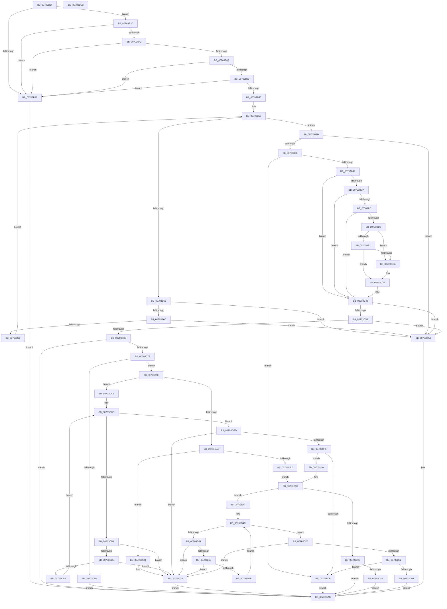

# sub_00703B14

- RVA: `0x00703B14`–`0x00703DC3` (길이 `687` bytes)
- VA: `0x0000000140703B14`
- 실행 섹션: `PAGE`
- PDB 이름 있음: `아니요`; PDB Function 태그: `아니요`
- unwind 정보 RVA: `0x000A118C`
- 디코드: `194`개 명령, `687/687` bytes 표시
- 미해석 바이트: `0` (있으면 어셈블리에 `.byte`로 보존)

> 이 문서는 커널 이미지의 기계어와 PDB 기호를 분석해 생성했습니다. 4번과 5번은 함수 원형과 자료형을 바이너리 사용 방식에서 추정한 C 해석이며 원본 소스 복구 결과는 아닙니다.

## 1. Dependencies

- 직접 호출 지점: **5**; 고유 호출 대상: **5**
- 직접 호출자로 확인된 함수: **1**
- RIP 상대 이미지 참조: **6**

### Outgoing calls
- `0x00703BC1` → [KeWaitForSingleObject](../../text/20/KeWaitForSingleObject_function_0020E6B0.md) (function, `0x0020E6B0`)
- `0x00703BF7` → [KeQueryTimeIncrement](../../text/44/KeQueryTimeIncrement_function_0044B4C0.md) (function, `0x0044B4C0`)
- `0x00703C35` → [KeResetEvent](../../text/24/KeResetEvent_function_00248350.md) (function, `0x00248350`)
- `0x00703C43` → [KeReleaseMutex](../../text/39/KeReleaseMutex_function_00396810.md) (function, `0x00396810`)
- `0x00703C8C` → [ExAllocatePool2](../../poolcode/B8/ExAllocatePool2_function_00B820F0.md) (function, `0x00B820F0`)

### Direct callers
- [sub_00968AF6](../96/Unknown_function_00968AF6.md) at `0x0096A3F0`

### Static image references
- `0x00703BB6` → RVA `0x00EF0DE0` (`.data`; read)
- `0x00703BD8` → RVA `0x00EF0DC4` (`.data`; read)
- `0x00703BE1` → RVA `0x00FD817C` (`PAGEDATA`; read)
- `0x00703C0C` → RVA `0x00FD817C` (`PAGEDATA`; write)
- `0x00703C19` → RVA `0x00EF0DC0` (`.data`; read)
- `0x00703C2E` → RVA `0x00FD8118` (`PAGEDATA`; write)

## 2. Other-region calls and transfers

- 다른 실행 섹션으로 향하는 call: **5**
  - `0x00703BC1` → [KeWaitForSingleObject](../../text/20/KeWaitForSingleObject_function_0020E6B0.md) (`PAGE` → `.text`)
  - `0x00703BF7` → [KeQueryTimeIncrement](../../text/44/KeQueryTimeIncrement_function_0044B4C0.md) (`PAGE` → `.text`)
  - `0x00703C35` → [KeResetEvent](../../text/24/KeResetEvent_function_00248350.md) (`PAGE` → `.text`)
  - `0x00703C43` → [KeReleaseMutex](../../text/39/KeReleaseMutex_function_00396810.md) (`PAGE` → `.text`)
  - `0x00703C8C` → [ExAllocatePool2](../../poolcode/B8/ExAllocatePool2_function_00B820F0.md) (`PAGE` → `POOLCODE`)
- 별도 외부 분기/꼬리 이동을 확인하지 못했습니다.

## 3. Assembly (complete function range)

```asm
00703B14  48 89 5C 24 10                  mov qword ptr [rsp + 0x10], rbx
00703B19  48 89 6C 24 18                  mov qword ptr [rsp + 0x18], rbp
00703B1E  48 89 74 24 20                  mov qword ptr [rsp + 0x20], rsi
00703B23  57                              push rdi
00703B24  48 83 EC 30                     sub rsp, 0x30
00703B28  49 8B F9                        mov rdi, r9
00703B2B  48 8B F2                        mov rsi, rdx
00703B2E  48 85 C9                        test rcx, rcx
00703B31  75 0A                           jne 0x140703b3d
00703B33  BA 0D 00 00 C0                  mov edx, 0xc000000d
00703B38  E9 6E 02 00 00                  jmp 0x140703dab
00703B3D  48 85 F6                        test rsi, rsi
00703B40  74 F1                           je 0x140703b33
00703B42  48 85 FF                        test rdi, rdi
00703B45  74 EC                           je 0x140703b33
00703B47  48 8B 41 08                     mov rax, qword ptr [rcx + 8]
00703B4B  48 85 C0                        test rax, rax
00703B4E  74 E3                           je 0x140703b33
00703B50  83 39 03                        cmp dword ptr [rcx], 3
00703B53  76 DE                           jbe 0x140703b33
00703B55  33 D2                           xor edx, edx
00703B57  44 8B 00                        mov r8d, dword ptr [rax]
00703B5A  48 8D 48 04                     lea rcx, [rax + 4]
00703B5E  83 FA 03                        cmp edx, 3
00703B61  73 1A                           jae 0x140703b7d
00703B63  48 3B C8                        cmp rcx, rax
00703B66  0F 82 3A 02 00 00               jb 0x140703da6
00703B6C  4A 8D 04 01                     lea rax, [rcx + r8]
00703B70  48 3B C1                        cmp rax, rcx
00703B73  0F 82 2D 02 00 00               jb 0x140703da6
00703B79  FF C2                           inc edx
00703B7B  EB DA                           jmp 0x140703b57
00703B7D  48 3B C8                        cmp rcx, rax
00703B80  0F 82 20 02 00 00               jb 0x140703da6
00703B86  33 ED                           xor ebp, ebp
00703B88  45 85 C0                        test r8d, r8d
00703B8B  48 0F 45 E9                     cmovne rbp, rcx
00703B8F  41 83 F8 08                     cmp r8d, 8
00703B93  0F 85 6D 01 00 00               jne 0x140703d06
00703B99  48 8B 6D 00                     mov rbp, qword ptr [rbp]
00703B9D  48 8D 44 24 40                  lea rax, [rsp + 0x40]
00703BA2  45 33 C9                        xor r9d, r9d
00703BA5  48 C7 44 24 40 80 20 E8 EF      mov qword ptr [rsp + 0x40], 0xffffffffefe82080
00703BAE  41 B0 01                        mov r8b, 1
00703BB1  48 89 44 24 20                  mov qword ptr [rsp + 0x20], rax
00703BB6  48 8D 0D 23 D2 7E 00            lea rcx, [rip + 0x7ed223]
00703BBD  41 8D 51 06                     lea edx, [r9 + 6]
00703BC1  E8 EA AA B0 FF                  call 0x14020e6b0
00703BC6  85 C0                           test eax, eax
00703BC8  78 7E                           js 0x140703c48
00703BCA  3D C0 00 00 00                  cmp eax, 0xc0
00703BCF  74 77                           je 0x140703c48
00703BD1  3D 02 01 00 00                  cmp eax, 0x102
00703BD6  74 70                           je 0x140703c48
00703BD8  83 3D E5 D1 7E 00 00            cmp dword ptr [rip + 0x7ed1e5], 0
00703BDF  75 09                           jne 0x140703bea
00703BE1  83 3D 94 45 8D 00 00            cmp dword ptr [rip + 0x8d4594], 0
00703BE8  75 50                           jne 0x140703c3a
00703BEA  48 BB 20 03 00 00 80 F7 FF FF   movabs rbx, 0xfffff78000000320
00703BF4  48 8B 1B                        mov rbx, qword ptr [rbx]
00703BF7  E8 C4 78 D4 FF                  call 0x14044b4c0
00703BFC  8B C8                           mov ecx, eax
00703BFE  48 B8 4B 59 86 38 D6 C5 6D 34   movabs rax, 0x346dc5d63886594b
00703C08  48 0F AF CB                     imul rcx, rbx
00703C0C  C7 05 66 45 8D 00 01 00 00 00   mov dword ptr [rip + 0x8d4566], 1
00703C16  48 F7 E9                        imul rcx
00703C19  48 8D 0D A0 D1 7E 00            lea rcx, [rip + 0x7ed1a0]
00703C20  48 C1 FA 0B                     sar rdx, 0xb
00703C24  48 8B C2                        mov rax, rdx
00703C27  48 C1 E8 3F                     shr rax, 0x3f
00703C2B  48 03 D0                        add rdx, rax
00703C2E  48 89 15 E3 44 8D 00            mov qword ptr [rip + 0x8d44e3], rdx
00703C35  E8 16 47 B4 FF                  call 0x140248350
00703C3A  33 D2                           xor edx, edx
00703C3C  48 8D 0D 9D D1 7E 00            lea rcx, [rip + 0x7ed19d]
00703C43  E8 C8 2B C9 FF                  call 0x140396810
00703C48  8B 46 10                        mov eax, dword ptr [rsi + 0x10]
00703C4B  8B 56 20                        mov edx, dword ptr [rsi + 0x20]
00703C4E  83 C0 30                        add eax, 0x30
00703C51  83 F8 30                        cmp eax, 0x30
00703C54  0F 82 4C 01 00 00               jb 0x140703da6
00703C5A  8D 48 04                        lea ecx, [rax + 4]
00703C5D  3B C8                           cmp ecx, eax
00703C5F  0F 82 41 01 00 00               jb 0x140703da6
00703C65  8D 04 11                        lea eax, [rcx + rdx]
00703C68  BB 95 00 00 C0                  mov ebx, 0xc0000095
00703C6D  3B C1                           cmp eax, ecx
00703C6F  1B D2                           sbb edx, edx
00703C71  23 D3                           and edx, ebx
00703C73  0F 8C 32 01 00 00               jl 0x140703dab
00703C79  BA 14 00 00 00                  mov edx, 0x14
00703C7E  B9 00 01 00 00                  mov ecx, 0x100
00703C83  41 B8 53 4C 53 20               mov r8d, 0x20534c53
00703C89  89 57 04                        mov dword ptr [rdi + 4], edx
00703C8C  E8 5F E4 47 00                  call 0x140b820f0
00703C91  48 85 C0                        test rax, rax
00703C94  75 08                           jne 0x140703c9e
00703C96  8D 53 82                        lea edx, [rbx - 0x7e]
00703C99  E9 0D 01 00 00                  jmp 0x140703dab
00703C9E  48 89 47 08                     mov qword ptr [rdi + 8], rax
00703CA2  83 27 00                        and dword ptr [rdi], 0
00703CA5  48 8B D0                        mov rdx, rax
00703CA8  48 85 C0                        test rax, rax
00703CAB  75 1A                           jne 0x140703cc7
00703CAD  8B 47 04                        mov eax, dword ptr [rdi + 4]
00703CB0  8D 48 08                        lea ecx, [rax + 8]
00703CB3  3B C8                           cmp ecx, eax
00703CB5  72 05                           jb 0x140703cbc
00703CB7  89 4F 04                        mov dword ptr [rdi + 4], ecx
00703CBA  EB 61                           jmp 0x140703d1d
00703CBC  83 4F 04 FF                     or dword ptr [rdi + 4], 0xffffffff
00703CC0  8B D3                           mov edx, ebx
00703CC2  E9 E4 00 00 00                  jmp 0x140703dab
00703CC7  44 8B 0F                        mov r9d, dword ptr [rdi]
00703CCA  33 C9                           xor ecx, ecx
00703CCC  41 3B C9                        cmp ecx, r9d
00703CCF  73 1C                           jae 0x140703ced
00703CD1  8B 02                           mov eax, dword ptr [rdx]
00703CD3  83 C0 04                        add eax, 4
00703CD6  83 F8 04                        cmp eax, 4
00703CD9  72 E5                           jb 0x140703cc0
00703CDB  44 8B C0                        mov r8d, eax
00703CDE  4C 03 C2                        add r8, rdx
00703CE1  4C 3B C2                        cmp r8, rdx
00703CE4  72 DA                           jb 0x140703cc0
00703CE6  49 8B D0                        mov rdx, r8
00703CE9  FF C1                           inc ecx
00703CEB  EB DF                           jmp 0x140703ccc
00703CED  4C 8D 42 04                     lea r8, [rdx + 4]
00703CF1  4C 3B C2                        cmp r8, rdx
00703CF4  72 CA                           jb 0x140703cc0
00703CF6  8B 4F 04                        mov ecx, dword ptr [rdi + 4]
00703CF9  48 8D 42 08                     lea rax, [rdx + 8]
00703CFD  48 03 4F 08                     add rcx, qword ptr [rdi + 8]
00703D01  48 3B C1                        cmp rax, rcx
00703D04  76 0A                           jbe 0x140703d10
00703D06  BA 23 00 00 C0                  mov edx, 0xc0000023
00703D0B  E9 9B 00 00 00                  jmp 0x140703dab
00703D10  C7 02 04 00 00 00               mov dword ptr [rdx], 4
00703D16  41 C7 00 00 00 00 10            mov dword ptr [r8], 0x10000000
00703D1D  FF 07                           inc dword ptr [rdi]
00703D1F  4C 8B 47 08                     mov r8, qword ptr [rdi + 8]
00703D23  4D 85 C0                        test r8, r8
00703D26  75 1F                           jne 0x140703d47
00703D28  8B 4F 04                        mov ecx, dword ptr [rdi + 4]
00703D2B  83 CA FF                        or edx, 0xffffffff
00703D2E  8D 41 0C                        lea eax, [rcx + 0xc]
00703D31  3B C1                           cmp eax, ecx
00703D33  0F 43 D0                        cmovae edx, eax
00703D36  89 57 04                        mov dword ptr [rdi + 4], edx
00703D39  1B D2                           sbb edx, edx
00703D3B  23 D3                           and edx, ebx
00703D3D  3B C1                           cmp eax, ecx
00703D3F  72 6A                           jb 0x140703dab
00703D41  FF 07                           inc dword ptr [rdi]
00703D43  33 D2                           xor edx, edx
00703D45  EB 64                           jmp 0x140703dab
00703D47  44 8B 0F                        mov r9d, dword ptr [rdi]
00703D4A  33 C9                           xor ecx, ecx
00703D4C  41 3B C9                        cmp ecx, r9d
00703D4F  73 24                           jae 0x140703d75
00703D51  41 8B 00                        mov eax, dword ptr [r8]
00703D54  83 C0 04                        add eax, 4
00703D57  83 F8 04                        cmp eax, 4
00703D5A  0F 82 60 FF FF FF               jb 0x140703cc0
00703D60  8B D0                           mov edx, eax
00703D62  49 03 D0                        add rdx, r8
00703D65  49 3B D0                        cmp rdx, r8
00703D68  0F 82 52 FF FF FF               jb 0x140703cc0
00703D6E  4C 8B C2                        mov r8, rdx
00703D71  FF C1                           inc ecx
00703D73  EB D7                           jmp 0x140703d4c
00703D75  4D 8D 48 04                     lea r9, [r8 + 4]
00703D79  4D 3B C8                        cmp r9, r8
00703D7C  0F 82 3E FF FF FF               jb 0x140703cc0
00703D82  8B 4F 04                        mov ecx, dword ptr [rdi + 4]
00703D85  49 8D 40 0C                     lea rax, [r8 + 0xc]
00703D89  48 03 4F 08                     add rcx, qword ptr [rdi + 8]
00703D8D  33 D2                           xor edx, edx
00703D8F  48 3B C1                        cmp rax, rcx
00703D92  0F 87 6E FF FF FF               ja 0x140703d06
00703D98  41 C7 00 08 00 00 00            mov dword ptr [r8], 8
00703D9F  49 89 29                        mov qword ptr [r9], rbp
00703DA2  FF 07                           inc dword ptr [rdi]
00703DA4  EB 05                           jmp 0x140703dab
00703DA6  BA 95 00 00 C0                  mov edx, 0xc0000095
00703DAB  48 8B 5C 24 48                  mov rbx, qword ptr [rsp + 0x48]
00703DB0  8B C2                           mov eax, edx
00703DB2  48 8B 6C 24 50                  mov rbp, qword ptr [rsp + 0x50]
00703DB7  48 8B 74 24 58                  mov rsi, qword ptr [rsp + 0x58]
00703DBC  48 83 C4 30                     add rsp, 0x30
00703DC0  5F                              pop rdi
00703DC1  C3                              ret
00703DC2  CC                              int3
```

## 4. C-style interpretation (structured pseudocode)

```c
__int64 __fastcall sub_00703B14(__int64 a1, __int64 a2, __int64 a3, __int64 a4)
{
    __int64 result;
    __int64 v_rbp;
    __int64 v_rbx;
    __int64 v_rsp;
    unsigned __int64 v_stack_m18;
    unsigned __int64 v_stack_p10;
    unsigned __int64 v_stack_p18;
    unsigned __int64 v_stack_p20;
    unsigned __int64 v_stack_p8;

    v_stack_p10 = v_rbx;
    v_stack_p18 = v_rbp;
    v_stack_p20 = v_rsi;
    v_rsp = (v_rsp) - (48);
    if (a1 != 0) goto loc_00703B3D;
loc_00703B33:
    goto loc_00703DAB;
loc_00703B3D:
    if (a2 == 0) goto loc_00703B33;
    if (a4 == 0) goto loc_00703B33;
    if (*(unsigned __int64 *)(a1 + 8) == 0) goto loc_00703B33;
    if ((*(unsigned int *)(a1)) <= 3) goto loc_00703B33;
    a2 = 0;
loc_00703B57:
    if (0 >= 3) goto loc_00703B7D;
    if ((*(unsigned __int64 *)(a1 + 8) + 4) < (*(unsigned __int64 *)(a1 + 8))) goto loc_00703DA6;
    if ((*(unsigned __int64 *)(a1 + 8) + 4 + (unsigned int)(*(unsigned int *)(*(unsigned __int64 *)(a1 + 8))) * 1) < (*(unsigned __int64 *)(a1 + 8) + 4)) goto loc_00703DA6;
    a2 = (unsigned int)((a2) + 1);
    goto loc_00703B57;
loc_00703B7D:
    if ((*(unsigned __int64 *)(a1 + 8) + 4) < (*(unsigned __int64 *)(a1 + 8) + 4 + (unsigned int)(*(unsigned int *)(*(unsigned __int64 *)(a1 + 8))) * 1)) goto loc_00703DA6;
    v_rbp = 0;
    if ((unsigned int)((unsigned int)(*(unsigned int *)(*(unsigned __int64 *)(a1 + 8)))) != 0) { v_rbp = *(unsigned __int64 *)(a1 + 8) + 4; }
    if (((unsigned int)((unsigned int)(*(unsigned int *)(*(unsigned __int64 *)(a1 + 8))))) != 8) goto loc_00703D06;
    a4 = 0;
    v_stack_p8 = 0xFFFFFFFFEFE82080ULL;
    v_stack_m18 = v_stack_p8;
    result = KeWaitForSingleObject(v_rip + 8311331, a4 + 6, 1, a4);
    if (sign_flag) goto loc_00703C48;
    if (((unsigned int)(result)) == 192) goto loc_00703C48;
    if (((unsigned int)(result)) == 258) goto loc_00703C48;
    if ((*(unsigned int *)(v_rip + 8311269)) != 0) goto loc_00703BEA;
    if ((*(unsigned int *)(v_rip + 9258388)) == 0) {
        v_rbx = *(unsigned __int64 *)(v_rbx);
        result = KeQueryTimeIncrement(v_rip + 8311331, a4 + 6, 1, a4);
        a1 = (unsigned int)(result);
        a1 = (a1) * (v_rbx);
        *(unsigned int *)(v_rip + 9258342) = 1;
        a1 = v_rip + 8311200;
        a2 = (a4 + 6) >> (11);
        result = a2;
        result = (result) >> (63);
        a2 = (a2) + (result);
        *(unsigned __int64 *)(v_rip + 9258211) = a2;
        result = KeResetEvent(a1, a2, 1, a4);
    }
    a2 = 0;
    result = KeReleaseMutex(v_rip + 8311197, a2, 1, a4);
loc_00703C48:
    result = (unsigned int)(((unsigned int)(*(unsigned int *)(a2 + 16))) + (48));
    if (((unsigned int)(result)) < 48) goto loc_00703DA6;
    if (((unsigned int)(result + 4)) < ((unsigned int)(result))) goto loc_00703DA6;
    a2 = (unsigned int)(((unsigned int)(*(unsigned int *)(a2 + 32))) & ((unsigned int)((unsigned int)(0xC0000095ULL))));
    if (condition_is_less) goto loc_00703DAB;
    *(unsigned int *)(a4 + 4) = 20;
    result = ExAllocatePool2(256, 20, (unsigned int)(0x20534C53ULL), a4);
    if (result != 0) goto loc_00703C9E;
    goto loc_00703DAB;
loc_00703C9E:
    *(unsigned __int64 *)(a4 + 8) = result;
    if (result != 0) goto loc_00703CC7;
    if (((unsigned int)((unsigned int)(*(unsigned int *)(a4 + 4)) + 8)) < ((unsigned int)((unsigned int)(*(unsigned int *)(a4 + 4))))) goto loc_00703CBC;
    *(unsigned int *)(a4 + 4) = (unsigned int)((unsigned int)(*(unsigned int *)(a4 + 4)) + 8);
    goto loc_00703D1D;
loc_00703CBC:
loc_00703CC0:
    goto loc_00703DAB;
loc_00703CC7:
    a1 = 0;
loc_00703CCC:
    if (0 >= ((unsigned int)((unsigned int)(*(unsigned int *)(a4))))) goto loc_00703CED;
    result = (unsigned int)(((unsigned int)(*(unsigned int *)((unsigned int)((unsigned int)((unsigned int)(0xC0000095ULL)))))) + (4));
    if (((unsigned int)(result)) < 4) goto loc_00703CC0;
    a3 = ((unsigned int)((unsigned int)(result))) + ((unsigned int)((unsigned int)((unsigned int)(0xC0000095ULL))));
    if (a3 < ((unsigned int)((unsigned int)((unsigned int)(0xC0000095ULL))))) goto loc_00703CC0;
    a1 = (unsigned int)((a1) + 1);
    goto loc_00703CCC;
loc_00703CED:
    if ((a3 + 4) < a3) goto loc_00703CC0;
    a1 = ((unsigned int)(*(unsigned int *)(a4 + 4))) + (*(unsigned __int64 *)(a4 + 8));
    if ((a3 + 8) <= a1) goto loc_00703D10;
loc_00703D06:
    goto loc_00703DAB;
loc_00703D10:
    *(unsigned int *)((unsigned int)(0xC0000023ULL)) = 4;
    *(unsigned int *)(a3 + 4) = 0x10000000ULL;
loc_00703D1D:
    if (*(unsigned __int64 *)(a4 + 8) != 0) goto loc_00703D47;
    a2 = (unsigned int)(((unsigned int)(0xC0000023ULL)) | (0xFFFFFFFFULL));
    if (((unsigned int)((unsigned int)(*(unsigned int *)(a4 + 4)) + 12)) >= ((unsigned int)((unsigned int)(*(unsigned int *)(a4 + 4))))) { a2 = (unsigned int)((unsigned int)(*(unsigned int *)(a4 + 4)) + 12); }
    *(unsigned int *)(a4 + 4) = (unsigned int)(a2);
    a2 = (unsigned int)((a2) & ((unsigned int)((unsigned int)(0xC0000095ULL))));
    if (((unsigned int)((unsigned int)(*(unsigned int *)(a4 + 4)) + 12)) < ((unsigned int)((unsigned int)(*(unsigned int *)(a4 + 4))))) goto loc_00703DAB;
    a2 = 0;
    goto loc_00703DAB;
loc_00703D47:
    a1 = 0;
loc_00703D4C:
    if (0 >= ((unsigned int)((unsigned int)(*(unsigned int *)(a4))))) goto loc_00703D75;
    result = (unsigned int)(((unsigned int)(*(unsigned int *)(*(unsigned __int64 *)(a4 + 8)))) + (4));
    if (((unsigned int)(result)) < 4) goto loc_00703CC0;
    a2 = ((unsigned int)((unsigned int)(result))) + (*(unsigned __int64 *)(a4 + 8));
    if (a2 < (*(unsigned __int64 *)(a4 + 8))) goto loc_00703CC0;
    a1 = (unsigned int)((a1) + 1);
    goto loc_00703D4C;
loc_00703D75:
    if ((a2 + 4) < a2) goto loc_00703CC0;
    a1 = ((unsigned int)(*(unsigned int *)(a4 + 4))) + (*(unsigned __int64 *)(a4 + 8));
    a2 = 0;
    if ((a2 + 12) > a1) goto loc_00703D06;
    *(unsigned int *)(a2) = 8;
    *(unsigned __int64 *)(a2 + 4) = *(unsigned __int64 *)(v_rbp);
    goto loc_00703DAB;
loc_00703DA6:
loc_00703DAB:
    v_rsp = (v_rsp) + (48);
    return (unsigned int)((unsigned int)((unsigned int)(0xC0000095ULL)));
}
```

## 5. (Beta) C Style

```c
int64_t sub_00703B14(int64_t Arg1, int64_t Arg2, int64_t Arg3, int64_t Arg4)
{
    int64_t result;
    int64_t local_rbp;
    int64_t local_rbx;
    int64_t local_rsp;
    uint64_t v_stack_m18;
    uint64_t v_stack_p10;
    uint64_t v_stack_p18;
    uint64_t v_stack_p20;
    uint64_t v_stack_p8;

    v_stack_p10 = local_rbx;
    v_stack_p18 = local_rbp;
    v_stack_p20 = local_rsi;
    local_rsp = (local_rsp) - (48);
    if (Arg1 != 0) goto loc_00703B3D;
loc_00703B33:
    goto loc_00703DAB;
loc_00703B3D:
    if (Arg2 == 0) goto loc_00703B33;
    if (Arg4 == 0) goto loc_00703B33;
    if (*(uint64_t *)(Arg1 + 0x8) == 0) goto loc_00703B33;
    if ((*(uint32_t *)(Arg1)) <= 3) goto loc_00703B33;
    Arg2 = 0;
loc_00703B57:
    if (0 >= 3) goto loc_00703B7D;
    if ((*(uint64_t *)(Arg1 + 0x8) + 4) < (*(uint64_t *)(Arg1 + 0x8))) goto loc_00703DA6;
    if ((*(uint64_t *)(Arg1 + 0x8) + 4 + (uint32_t)(*(uint32_t *)(*(uint64_t *)(Arg1 + 0x8))) * 1) < (*(uint64_t *)(Arg1 + 0x8) + 4)) goto loc_00703DA6;
    Arg2 = (uint32_t)((Arg2) + 1);
    goto loc_00703B57;
loc_00703B7D:
    if ((*(uint64_t *)(Arg1 + 0x8) + 4) < (*(uint64_t *)(Arg1 + 0x8) + 4 + (uint32_t)(*(uint32_t *)(*(uint64_t *)(Arg1 + 0x8))) * 1)) goto loc_00703DA6;
    local_rbp = 0;
    if ((uint32_t)((uint32_t)(*(uint32_t *)(*(uint64_t *)(Arg1 + 0x8)))) != 0) { local_rbp = *(uint64_t *)(Arg1 + 0x8) + 4; }
    if (((uint32_t)((uint32_t)(*(uint32_t *)(*(uint64_t *)(Arg1 + 0x8))))) != 8) goto loc_00703D06;
    Arg4 = 0;
    v_stack_p8 = 0xFFFFFFFFEFE82080ULL;
    v_stack_m18 = v_stack_p8;
    result = KeWaitForSingleObject(v_rip + 8311331, Arg4 + 6, 1, Arg4);
    if (sign_flag) goto loc_00703C48;
    if (((uint32_t)(result)) == 192) goto loc_00703C48;
    if (((uint32_t)(result)) == 258) goto loc_00703C48;
    if ((*(uint32_t *)(v_rip + 0x7ED1E5)) != 0) goto loc_00703BEA;
    if ((*(uint32_t *)(v_rip + 0x8D4594)) == 0) {
        local_rbx = *(uint64_t *)(local_rbx);
        result = KeQueryTimeIncrement(v_rip + 8311331, Arg4 + 6, 1, Arg4);
        Arg1 = (uint32_t)(result);
        Arg1 = (Arg1) * (local_rbx);
        *(uint32_t *)(v_rip + 0x8D4566) = 1;
        Arg1 = v_rip + 8311200;
        Arg2 = (Arg4 + 6) >> (11);
        result = Arg2;
        result = (result) >> (63);
        Arg2 = (Arg2) + (result);
        *(uint64_t *)(v_rip + 0x8D44E3) = Arg2;
        result = KeResetEvent(Arg1, Arg2, 1, Arg4);
    }
    Arg2 = 0;
    result = KeReleaseMutex(v_rip + 8311197, Arg2, 1, Arg4);
loc_00703C48:
    result = (uint32_t)(((uint32_t)(*(uint32_t *)(Arg2 + 0x10))) + (48));
    if (((uint32_t)(result)) < 48) goto loc_00703DA6;
    if (((uint32_t)(result + 4)) < ((uint32_t)(result))) goto loc_00703DA6;
    Arg2 = (uint32_t)(((uint32_t)(*(uint32_t *)(Arg2 + 0x20))) & ((uint32_t)((uint32_t)(0xC0000095ULL))));
    if (condition_is_less) goto loc_00703DAB;
    *(uint32_t *)(Arg4 + 0x4) = 20;
    result = ExAllocatePool2(256, 20, (uint32_t)(0x20534C53ULL), Arg4);
    if (result != 0) goto loc_00703C9E;
    goto loc_00703DAB;
loc_00703C9E:
    *(uint64_t *)(Arg4 + 0x8) = result;
    if (result != 0) goto loc_00703CC7;
    if (((uint32_t)((uint32_t)(*(uint32_t *)(Arg4 + 0x4)) + 8)) < ((uint32_t)((uint32_t)(*(uint32_t *)(Arg4 + 0x4))))) goto loc_00703CBC;
    *(uint32_t *)(Arg4 + 0x4) = (uint32_t)((uint32_t)(*(uint32_t *)(Arg4 + 0x4)) + 8);
    goto loc_00703D1D;
loc_00703CBC:
loc_00703CC0:
    goto loc_00703DAB;
loc_00703CC7:
    Arg1 = 0;
loc_00703CCC:
    if (0 >= ((uint32_t)((uint32_t)(*(uint32_t *)(Arg4))))) goto loc_00703CED;
    result = (uint32_t)(((uint32_t)(*(uint32_t *)((uint32_t)((uint32_t)((uint32_t)(0xC0000095ULL)))))) + (4));
    if (((uint32_t)(result)) < 4) goto loc_00703CC0;
    Arg3 = ((uint32_t)((uint32_t)(result))) + ((uint32_t)((uint32_t)((uint32_t)(0xC0000095ULL))));
    if (Arg3 < ((uint32_t)((uint32_t)((uint32_t)(0xC0000095ULL))))) goto loc_00703CC0;
    Arg1 = (uint32_t)((Arg1) + 1);
    goto loc_00703CCC;
loc_00703CED:
    if ((Arg3 + 4) < Arg3) goto loc_00703CC0;
    Arg1 = ((uint32_t)(*(uint32_t *)(Arg4 + 0x4))) + (*(uint64_t *)(Arg4 + 0x8));
    if ((Arg3 + 8) <= Arg1) goto loc_00703D10;
loc_00703D06:
    goto loc_00703DAB;
loc_00703D10:
    *(uint32_t *)((uint32_t)(0xC0000023ULL)) = 4;
    *(uint32_t *)(Arg3 + 0x4) = 0x10000000ULL;
loc_00703D1D:
    if (*(uint64_t *)(Arg4 + 0x8) != 0) goto loc_00703D47;
    Arg2 = (uint32_t)(((uint32_t)(0xC0000023ULL)) | (0xFFFFFFFFULL));
    if (((uint32_t)((uint32_t)(*(uint32_t *)(Arg4 + 0x4)) + 12)) >= ((uint32_t)((uint32_t)(*(uint32_t *)(Arg4 + 0x4))))) { Arg2 = (uint32_t)((uint32_t)(*(uint32_t *)(Arg4 + 0x4)) + 12); }
    *(uint32_t *)(Arg4 + 0x4) = (uint32_t)(Arg2);
    Arg2 = (uint32_t)((Arg2) & ((uint32_t)((uint32_t)(0xC0000095ULL))));
    if (((uint32_t)((uint32_t)(*(uint32_t *)(Arg4 + 0x4)) + 12)) < ((uint32_t)((uint32_t)(*(uint32_t *)(Arg4 + 0x4))))) goto loc_00703DAB;
    Arg2 = 0;
    goto loc_00703DAB;
loc_00703D47:
    Arg1 = 0;
loc_00703D4C:
    if (0 >= ((uint32_t)((uint32_t)(*(uint32_t *)(Arg4))))) goto loc_00703D75;
    result = (uint32_t)(((uint32_t)(*(uint32_t *)(*(uint64_t *)(Arg4 + 0x8)))) + (4));
    if (((uint32_t)(result)) < 4) goto loc_00703CC0;
    Arg2 = ((uint32_t)((uint32_t)(result))) + (*(uint64_t *)(Arg4 + 0x8));
    if (Arg2 < (*(uint64_t *)(Arg4 + 0x8))) goto loc_00703CC0;
    Arg1 = (uint32_t)((Arg1) + 1);
    goto loc_00703D4C;
loc_00703D75:
    if ((Arg2 + 4) < Arg2) goto loc_00703CC0;
    Arg1 = ((uint32_t)(*(uint32_t *)(Arg4 + 0x4))) + (*(uint64_t *)(Arg4 + 0x8));
    Arg2 = 0;
    if ((Arg2 + 12) > Arg1) goto loc_00703D06;
    *(uint32_t *)(Arg2) = 8;
    *(uint64_t *)(Arg2 + 0x4) = *(uint64_t *)(local_rbp);
    goto loc_00703DAB;
loc_00703DA6:
loc_00703DAB:
    local_rsp = (local_rsp) + (48);
    return (uint32_t)((uint32_t)((uint32_t)(0xC0000095ULL)));
}
```

## 6. Execution-region graph

[열기: 2D/3D 그래프와 함수 탐색 컨트롤 패널](../../../control-panel.html?section=page&rva=0x00703B14&view=graph)

- 2D 그래프는 위에서 아래로 흐르고, 3D 그래프는 빈 공간을 드래그해 회전합니다. Shift+드래그는 이동, 휠은 확대·축소, 함수 노드 선택은 대상 보고서 이동입니다.

### Static fallback


