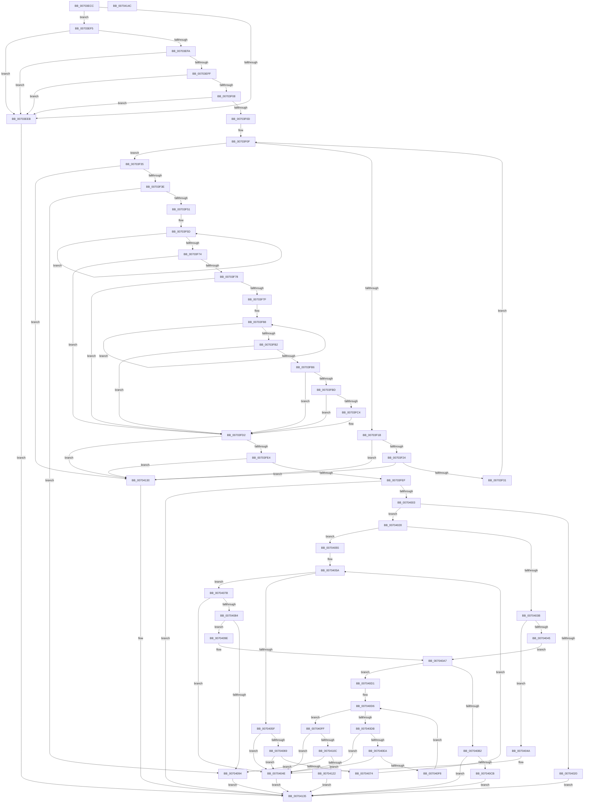

# sub_00703ECC

- RVA: `0x00703ECC`–`0x0070414D` (길이 `641` bytes)
- VA: `0x0000000140703ECC`
- 실행 섹션: `PAGE`
- PDB 이름 있음: `아니요`; PDB Function 태그: `아니요`
- unwind 정보 RVA: `0x000A118C`
- 디코드: `191`개 명령, `641/641` bytes 표시
- 미해석 바이트: `0` (있으면 어셈블리에 `.byte`로 보존)

> 이 문서는 커널 이미지의 기계어와 PDB 기호를 분석해 생성했습니다. 4번과 5번은 함수 원형과 자료형을 바이너리 사용 방식에서 추정한 C 해석이며 원본 소스 복구 결과는 아닙니다.

## 1. Dependencies

- 직접 호출 지점: **4**; 고유 호출 대상: **4**
- 직접 호출자로 확인된 함수: **1**
- RIP 상대 이미지 참조: **1**

### Outgoing calls
- `0x00703F66` → [KeDelayExecutionThread](../../text/20/KeDelayExecutionThread_function_00209550.md) (function, `0x00209550`)
- `0x00703FA4` → [KeWaitForSingleObject](../../text/20/KeWaitForSingleObject_function_0020E6B0.md) (function, `0x0020E6B0`)
- `0x00703FCD` → [KeReleaseMutex](../../text/39/KeReleaseMutex_function_00396810.md) (function, `0x00396810`)
- `0x00704016` → [ExAllocatePool2](../../poolcode/B8/ExAllocatePool2_function_00B820F0.md) (function, `0x00B820F0`)

### Direct callers
- [sub_00968AF6](../96/Unknown_function_00968AF6.md) at `0x0096A3C3`

### Static image references
- `0x00703F9D` → RVA `0x00EF0DE0` (`.data`; read)

## 2. Other-region calls and transfers

- 다른 실행 섹션으로 향하는 call: **4**
  - `0x00703F66` → [KeDelayExecutionThread](../../text/20/KeDelayExecutionThread_function_00209550.md) (`PAGE` → `.text`)
  - `0x00703FA4` → [KeWaitForSingleObject](../../text/20/KeWaitForSingleObject_function_0020E6B0.md) (`PAGE` → `.text`)
  - `0x00703FCD` → [KeReleaseMutex](../../text/39/KeReleaseMutex_function_00396810.md) (`PAGE` → `.text`)
  - `0x00704016` → [ExAllocatePool2](../../poolcode/B8/ExAllocatePool2_function_00B820F0.md) (`PAGE` → `POOLCODE`)
- 별도 외부 분기/꼬리 이동을 확인하지 못했습니다.

## 3. Assembly (complete function range)

```asm
00703ECC  48 89 5C 24 10                  mov qword ptr [rsp + 0x10], rbx
00703ED1  48 89 6C 24 18                  mov qword ptr [rsp + 0x18], rbp
00703ED6  48 89 74 24 20                  mov qword ptr [rsp + 0x20], rsi
00703EDB  57                              push rdi
00703EDC  48 83 EC 30                     sub rsp, 0x30
00703EE0  49 8B F9                        mov rdi, r9
00703EE3  48 8B DA                        mov rbx, rdx
00703EE6  48 85 C9                        test rcx, rcx
00703EE9  75 0A                           jne 0x140703ef5
00703EEB  BA 0D 00 00 C0                  mov edx, 0xc000000d
00703EF0  E9 40 02 00 00                  jmp 0x140704135
00703EF5  48 85 DB                        test rbx, rbx
00703EF8  74 F1                           je 0x140703eeb
00703EFA  48 85 FF                        test rdi, rdi
00703EFD  74 EC                           je 0x140703eeb
00703EFF  48 8B 41 08                     mov rax, qword ptr [rcx + 8]
00703F03  48 85 C0                        test rax, rax
00703F06  74 E3                           je 0x140703eeb
00703F08  83 39 03                        cmp dword ptr [rcx], 3
00703F0B  76 DE                           jbe 0x140703eeb
00703F0D  33 D2                           xor edx, edx
00703F0F  44 8B 00                        mov r8d, dword ptr [rax]
00703F12  48 8D 48 04                     lea rcx, [rax + 4]
00703F16  83 FA 03                        cmp edx, 3
00703F19  73 1A                           jae 0x140703f35
00703F1B  48 3B C8                        cmp rcx, rax
00703F1E  0F 82 0C 02 00 00               jb 0x140704130
00703F24  4A 8D 04 01                     lea rax, [rcx + r8]
00703F28  48 3B C1                        cmp rax, rcx
00703F2B  0F 82 FF 01 00 00               jb 0x140704130
00703F31  FF C2                           inc edx
00703F33  EB DA                           jmp 0x140703f0f
00703F35  48 3B C8                        cmp rcx, rax
00703F38  0F 82 F2 01 00 00               jb 0x140704130
00703F3E  33 C0                           xor eax, eax
00703F40  45 85 C0                        test r8d, r8d
00703F43  48 0F 45 C1                     cmovne rax, rcx
00703F47  41 83 F8 08                     cmp r8d, 8
00703F4B  0F 85 43 01 00 00               jne 0x140704094
00703F51  48 8B 28                        mov rbp, qword ptr [rax]
00703F54  48 C7 44 24 40 40 F1 E9 FD      mov qword ptr [rsp + 0x40], 0xfffffffffde9f140
00703F5D  B2 01                           mov dl, 1
00703F5F  4C 8D 44 24 40                  lea r8, [rsp + 0x40]
00703F64  8A CA                           mov cl, dl
00703F66  E8 E5 55 B0 FF                  call 0x140209550
00703F6B  8B F0                           mov esi, eax
00703F6D  3D 01 01 00 00                  cmp eax, 0x101
00703F72  74 E9                           je 0x140703f5d
00703F74  85 C0                           test eax, eax
00703F76  78 5A                           js 0x140703fd2
00703F78  3D C0 00 00 00                  cmp eax, 0xc0
00703F7D  74 53                           je 0x140703fd2
00703F7F  48 C7 44 24 40 80 20 E8 EF      mov qword ptr [rsp + 0x40], 0xffffffffefe82080
00703F88  41 B1 01                        mov r9b, 1
00703F8B  48 8D 44 24 40                  lea rax, [rsp + 0x40]
00703F90  45 8A C1                        mov r8b, r9b
00703F93  48 89 44 24 20                  mov qword ptr [rsp + 0x20], rax
00703F98  BA 06 00 00 00                  mov edx, 6
00703F9D  48 8D 0D 3C CE 7E 00            lea rcx, [rip + 0x7ece3c]
00703FA4  E8 07 A7 B0 FF                  call 0x14020e6b0
00703FA9  8B F0                           mov esi, eax
00703FAB  3D 01 01 00 00                  cmp eax, 0x101
00703FB0  74 D6                           je 0x140703f88
00703FB2  85 C0                           test eax, eax
00703FB4  78 1C                           js 0x140703fd2
00703FB6  3D C0 00 00 00                  cmp eax, 0xc0
00703FBB  74 15                           je 0x140703fd2
00703FBD  3D 02 01 00 00                  cmp eax, 0x102
00703FC2  74 0E                           je 0x140703fd2
00703FC4  33 D2                           xor edx, edx
00703FC6  48 8D 0D 13 CE 7E 00            lea rcx, [rip + 0x7ece13]
00703FCD  E8 3E 28 C9 FF                  call 0x140396810
00703FD2  8B 43 10                        mov eax, dword ptr [rbx + 0x10]
00703FD5  8B 53 20                        mov edx, dword ptr [rbx + 0x20]
00703FD8  83 C0 30                        add eax, 0x30
00703FDB  83 F8 30                        cmp eax, 0x30
00703FDE  0F 82 4C 01 00 00               jb 0x140704130
00703FE4  8D 48 04                        lea ecx, [rax + 4]
00703FE7  3B C8                           cmp ecx, eax
00703FE9  0F 82 41 01 00 00               jb 0x140704130
00703FEF  8D 04 11                        lea eax, [rcx + rdx]
00703FF2  BB 95 00 00 C0                  mov ebx, 0xc0000095
00703FF7  3B C1                           cmp eax, ecx
00703FF9  1B D2                           sbb edx, edx
00703FFB  23 D3                           and edx, ebx
00703FFD  0F 8C 32 01 00 00               jl 0x140704135
00704003  BA 14 00 00 00                  mov edx, 0x14
00704008  B9 00 01 00 00                  mov ecx, 0x100
0070400D  41 B8 53 4C 53 20               mov r8d, 0x20534c53
00704013  89 57 04                        mov dword ptr [rdi + 4], edx
00704016  E8 D5 E0 47 00                  call 0x140b820f0
0070401B  48 85 C0                        test rax, rax
0070401E  75 08                           jne 0x140704028
00704020  8D 53 82                        lea edx, [rbx - 0x7e]
00704023  E9 0D 01 00 00                  jmp 0x140704135
00704028  48 89 47 08                     mov qword ptr [rdi + 8], rax
0070402C  83 27 00                        and dword ptr [rdi], 0
0070402F  0F BA EE 1C                     bts esi, 0x1c
00704033  48 8B D0                        mov rdx, rax
00704036  48 85 C0                        test rax, rax
00704039  75 1A                           jne 0x140704055
0070403B  8B 47 04                        mov eax, dword ptr [rdi + 4]
0070403E  8D 48 08                        lea ecx, [rax + 8]
00704041  3B C8                           cmp ecx, eax
00704043  72 05                           jb 0x14070404a
00704045  89 4F 04                        mov dword ptr [rdi + 4], ecx
00704048  EB 5D                           jmp 0x1407040a7
0070404A  83 4F 04 FF                     or dword ptr [rdi + 4], 0xffffffff
0070404E  8B D3                           mov edx, ebx
00704050  E9 E0 00 00 00                  jmp 0x140704135
00704055  44 8B 0F                        mov r9d, dword ptr [rdi]
00704058  33 C9                           xor ecx, ecx
0070405A  41 3B C9                        cmp ecx, r9d
0070405D  73 1C                           jae 0x14070407b
0070405F  8B 02                           mov eax, dword ptr [rdx]
00704061  83 C0 04                        add eax, 4
00704064  83 F8 04                        cmp eax, 4
00704067  72 E5                           jb 0x14070404e
00704069  44 8B C0                        mov r8d, eax
0070406C  4C 03 C2                        add r8, rdx
0070406F  4C 3B C2                        cmp r8, rdx
00704072  72 DA                           jb 0x14070404e
00704074  49 8B D0                        mov rdx, r8
00704077  FF C1                           inc ecx
00704079  EB DF                           jmp 0x14070405a
0070407B  4C 8D 42 04                     lea r8, [rdx + 4]
0070407F  4C 3B C2                        cmp r8, rdx
00704082  72 CA                           jb 0x14070404e
00704084  8B 4F 04                        mov ecx, dword ptr [rdi + 4]
00704087  48 8D 42 08                     lea rax, [rdx + 8]
0070408B  48 03 4F 08                     add rcx, qword ptr [rdi + 8]
0070408F  48 3B C1                        cmp rax, rcx
00704092  76 0A                           jbe 0x14070409e
00704094  BA 23 00 00 C0                  mov edx, 0xc0000023
00704099  E9 97 00 00 00                  jmp 0x140704135
0070409E  C7 02 04 00 00 00               mov dword ptr [rdx], 4
007040A4  41 89 30                        mov dword ptr [r8], esi
007040A7  FF 07                           inc dword ptr [rdi]
007040A9  4C 8B 47 08                     mov r8, qword ptr [rdi + 8]
007040AD  4D 85 C0                        test r8, r8
007040B0  75 1F                           jne 0x1407040d1
007040B2  8B 4F 04                        mov ecx, dword ptr [rdi + 4]
007040B5  83 CA FF                        or edx, 0xffffffff
007040B8  8D 41 0C                        lea eax, [rcx + 0xc]
007040BB  3B C1                           cmp eax, ecx
007040BD  0F 43 D0                        cmovae edx, eax
007040C0  89 57 04                        mov dword ptr [rdi + 4], edx
007040C3  1B D2                           sbb edx, edx
007040C5  23 D3                           and edx, ebx
007040C7  3B C1                           cmp eax, ecx
007040C9  72 6A                           jb 0x140704135
007040CB  FF 07                           inc dword ptr [rdi]
007040CD  33 D2                           xor edx, edx
007040CF  EB 64                           jmp 0x140704135
007040D1  44 8B 0F                        mov r9d, dword ptr [rdi]
007040D4  33 C9                           xor ecx, ecx
007040D6  41 3B C9                        cmp ecx, r9d
007040D9  73 24                           jae 0x1407040ff
007040DB  41 8B 00                        mov eax, dword ptr [r8]
007040DE  83 C0 04                        add eax, 4
007040E1  83 F8 04                        cmp eax, 4
007040E4  0F 82 64 FF FF FF               jb 0x14070404e
007040EA  8B D0                           mov edx, eax
007040EC  49 03 D0                        add rdx, r8
007040EF  49 3B D0                        cmp rdx, r8
007040F2  0F 82 56 FF FF FF               jb 0x14070404e
007040F8  4C 8B C2                        mov r8, rdx
007040FB  FF C1                           inc ecx
007040FD  EB D7                           jmp 0x1407040d6
007040FF  4D 8D 48 04                     lea r9, [r8 + 4]
00704103  4D 3B C8                        cmp r9, r8
00704106  0F 82 42 FF FF FF               jb 0x14070404e
0070410C  8B 4F 04                        mov ecx, dword ptr [rdi + 4]
0070410F  49 8D 40 0C                     lea rax, [r8 + 0xc]
00704113  48 03 4F 08                     add rcx, qword ptr [rdi + 8]
00704117  33 D2                           xor edx, edx
00704119  48 3B C1                        cmp rax, rcx
0070411C  0F 87 72 FF FF FF               ja 0x140704094
00704122  41 C7 00 08 00 00 00            mov dword ptr [r8], 8
00704129  49 89 29                        mov qword ptr [r9], rbp
0070412C  FF 07                           inc dword ptr [rdi]
0070412E  EB 05                           jmp 0x140704135
00704130  BA 95 00 00 C0                  mov edx, 0xc0000095
00704135  48 8B 5C 24 48                  mov rbx, qword ptr [rsp + 0x48]
0070413A  8B C2                           mov eax, edx
0070413C  48 8B 6C 24 50                  mov rbp, qword ptr [rsp + 0x50]
00704141  48 8B 74 24 58                  mov rsi, qword ptr [rsp + 0x58]
00704146  48 83 C4 30                     add rsp, 0x30
0070414A  5F                              pop rdi
0070414B  C3                              ret
0070414C  CC                              int3
```

## 4. C-style interpretation (structured pseudocode)

```c
__int64 __fastcall sub_00703ECC(__int64 a1, __int64 a2, __int64 a3, __int64 a4)
{
    __int64 result;
    __int64 v_rsp;
    unsigned __int64 v_stack_m18;
    unsigned __int64 v_stack_p10;
    unsigned __int64 v_stack_p18;
    unsigned __int64 v_stack_p20;
    unsigned __int64 v_stack_p8;

    v_stack_p10 = v_rbx;
    v_stack_p18 = v_rbp;
    v_stack_p20 = v_rsi;
    v_rsp = (v_rsp) - (48);
    if (a1 != 0) goto loc_00703EF5;
loc_00703EEB:
    goto loc_00704135;
loc_00703EF5:
    if (a2 == 0) goto loc_00703EEB;
    if (a4 == 0) goto loc_00703EEB;
    if (*(unsigned __int64 *)(a1 + 8) == 0) goto loc_00703EEB;
    if ((*(unsigned int *)(a1)) <= 3) goto loc_00703EEB;
    a2 = 0;
loc_00703F0F:
    if (0 >= 3) goto loc_00703F35;
    if ((*(unsigned __int64 *)(a1 + 8) + 4) < (*(unsigned __int64 *)(a1 + 8))) goto loc_00704130;
    if ((*(unsigned __int64 *)(a1 + 8) + 4 + (unsigned int)(*(unsigned int *)(*(unsigned __int64 *)(a1 + 8))) * 1) < (*(unsigned __int64 *)(a1 + 8) + 4)) goto loc_00704130;
    a2 = (unsigned int)((a2) + 1);
    goto loc_00703F0F;
loc_00703F35:
    if ((*(unsigned __int64 *)(a1 + 8) + 4) < (*(unsigned __int64 *)(a1 + 8) + 4 + (unsigned int)(*(unsigned int *)(*(unsigned __int64 *)(a1 + 8))) * 1)) goto loc_00704130;
    result = 0;
    if ((unsigned int)((unsigned int)(*(unsigned int *)(*(unsigned __int64 *)(a1 + 8)))) != 0) { result = *(unsigned __int64 *)(a1 + 8) + 4; }
    if (((unsigned int)((unsigned int)(*(unsigned int *)(*(unsigned __int64 *)(a1 + 8))))) != 8) goto loc_00704094;
    v_stack_p8 = 0xFFFFFFFFFDE9F140ULL;
loc_00703F5D:
    result = KeDelayExecutionThread(1, 1, v_stack_p8, a4);
    if (((unsigned int)(result)) == 257) goto loc_00703F5D;
    if (sign_flag) goto loc_00703FD2;
    if (((unsigned int)(result)) == 192) goto loc_00703FD2;
    v_stack_p8 = 0xFFFFFFFFEFE82080ULL;
loc_00703F88:
    v_stack_m18 = v_stack_p8;
    result = KeWaitForSingleObject(v_rip + 8310332, 6, 1, 1);
    if (((unsigned int)(result)) == 257) goto loc_00703F88;
    if (sign_flag) goto loc_00703FD2;
    if (((unsigned int)(result)) == 192) goto loc_00703FD2;
    if (((unsigned int)(result)) != 258) {
        a2 = 0;
        a1 = v_rip + 8310291;
        result = KeReleaseMutex(a1, a2, 1, 1);
    }
    result = (unsigned int)(((unsigned int)(*(unsigned int *)(a2 + 16))) + (48));
    if (((unsigned int)(result)) < 48) goto loc_00704130;
    if (((unsigned int)(result + 4)) < ((unsigned int)(result))) goto loc_00704130;
    a2 = (unsigned int)(((unsigned int)(*(unsigned int *)(a2 + 32))) & ((unsigned int)((unsigned int)(0xC0000095ULL))));
    if (condition_is_less) goto loc_00704135;
    *(unsigned int *)(a4 + 4) = 20;
    result = ExAllocatePool2(256, 20, (unsigned int)(0x20534C53ULL), 1);
    if (result != 0) goto loc_00704028;
    goto loc_00704135;
loc_00704028:
    *(unsigned __int64 *)(a4 + 8) = result;
    if (result != 0) goto loc_00704055;
    if (((unsigned int)((unsigned int)(*(unsigned int *)(a4 + 4)) + 8)) < ((unsigned int)((unsigned int)(*(unsigned int *)(a4 + 4))))) goto loc_0070404A;
    *(unsigned int *)(a4 + 4) = (unsigned int)((unsigned int)(*(unsigned int *)(a4 + 4)) + 8);
    goto loc_007040A7;
loc_0070404A:
loc_0070404E:
    goto loc_00704135;
loc_00704055:
    a1 = 0;
loc_0070405A:
    if (0 >= ((unsigned int)((unsigned int)(*(unsigned int *)(a4))))) goto loc_0070407B;
    result = (unsigned int)(((unsigned int)(*(unsigned int *)((unsigned int)((unsigned int)((unsigned int)(0xC0000095ULL)))))) + (4));
    if (((unsigned int)(result)) < 4) goto loc_0070404E;
    a3 = ((unsigned int)((unsigned int)(result))) + ((unsigned int)((unsigned int)((unsigned int)(0xC0000095ULL))));
    if (a3 < ((unsigned int)((unsigned int)((unsigned int)(0xC0000095ULL))))) goto loc_0070404E;
    a1 = (unsigned int)((a1) + 1);
    goto loc_0070405A;
loc_0070407B:
    if ((a3 + 4) < a3) goto loc_0070404E;
    a1 = ((unsigned int)(*(unsigned int *)(a4 + 4))) + (*(unsigned __int64 *)(a4 + 8));
    if ((a3 + 8) <= a1) goto loc_0070409E;
loc_00704094:
    goto loc_00704135;
loc_0070409E:
    *(unsigned int *)((unsigned int)(0xC0000023ULL)) = 4;
    *(unsigned int *)(a3 + 4) = (unsigned int)((unsigned int)((unsigned int)(result)));
loc_007040A7:
    if (*(unsigned __int64 *)(a4 + 8) != 0) goto loc_007040D1;
    a2 = (unsigned int)(((unsigned int)(0xC0000023ULL)) | (0xFFFFFFFFULL));
    if (((unsigned int)((unsigned int)(*(unsigned int *)(a4 + 4)) + 12)) >= ((unsigned int)((unsigned int)(*(unsigned int *)(a4 + 4))))) { a2 = (unsigned int)((unsigned int)(*(unsigned int *)(a4 + 4)) + 12); }
    *(unsigned int *)(a4 + 4) = (unsigned int)(a2);
    a2 = (unsigned int)((a2) & ((unsigned int)((unsigned int)(0xC0000095ULL))));
    if (((unsigned int)((unsigned int)(*(unsigned int *)(a4 + 4)) + 12)) < ((unsigned int)((unsigned int)(*(unsigned int *)(a4 + 4))))) goto loc_00704135;
    a2 = 0;
    goto loc_00704135;
loc_007040D1:
    a1 = 0;
loc_007040D6:
    if (0 >= ((unsigned int)((unsigned int)(*(unsigned int *)(a4))))) goto loc_007040FF;
    result = (unsigned int)(((unsigned int)(*(unsigned int *)(*(unsigned __int64 *)(a4 + 8)))) + (4));
    if (((unsigned int)(result)) < 4) goto loc_0070404E;
    a2 = ((unsigned int)((unsigned int)(result))) + (*(unsigned __int64 *)(a4 + 8));
    if (a2 < (*(unsigned __int64 *)(a4 + 8))) goto loc_0070404E;
    a1 = (unsigned int)((a1) + 1);
    goto loc_007040D6;
loc_007040FF:
    if ((a2 + 4) < a2) goto loc_0070404E;
    a1 = ((unsigned int)(*(unsigned int *)(a4 + 4))) + (*(unsigned __int64 *)(a4 + 8));
    a2 = 0;
    if ((a2 + 12) > a1) goto loc_00704094;
    *(unsigned int *)(a2) = 8;
    *(unsigned __int64 *)(a2 + 4) = *(unsigned __int64 *)(result);
    goto loc_00704135;
loc_00704130:
loc_00704135:
    v_rsp = (v_rsp) + (48);
    return (unsigned int)((unsigned int)((unsigned int)(0xC0000095ULL)));
}
```

## 5. (Beta) C Style

```c
int64_t sub_00703ECC(int64_t Arg1, int64_t Arg2, int64_t Arg3, int64_t Arg4)
{
    int64_t result;
    int64_t local_rsp;
    uint64_t v_stack_m18;
    uint64_t v_stack_p10;
    uint64_t v_stack_p18;
    uint64_t v_stack_p20;
    uint64_t v_stack_p8;

    v_stack_p10 = local_rbx;
    v_stack_p18 = local_rbp;
    v_stack_p20 = local_rsi;
    local_rsp = (local_rsp) - (48);
    if (Arg1 != 0) goto loc_00703EF5;
loc_00703EEB:
    goto loc_00704135;
loc_00703EF5:
    if (Arg2 == 0) goto loc_00703EEB;
    if (Arg4 == 0) goto loc_00703EEB;
    if (*(uint64_t *)(Arg1 + 0x8) == 0) goto loc_00703EEB;
    if ((*(uint32_t *)(Arg1)) <= 3) goto loc_00703EEB;
    Arg2 = 0;
loc_00703F0F:
    if (0 >= 3) goto loc_00703F35;
    if ((*(uint64_t *)(Arg1 + 0x8) + 4) < (*(uint64_t *)(Arg1 + 0x8))) goto loc_00704130;
    if ((*(uint64_t *)(Arg1 + 0x8) + 4 + (uint32_t)(*(uint32_t *)(*(uint64_t *)(Arg1 + 0x8))) * 1) < (*(uint64_t *)(Arg1 + 0x8) + 4)) goto loc_00704130;
    Arg2 = (uint32_t)((Arg2) + 1);
    goto loc_00703F0F;
loc_00703F35:
    if ((*(uint64_t *)(Arg1 + 0x8) + 4) < (*(uint64_t *)(Arg1 + 0x8) + 4 + (uint32_t)(*(uint32_t *)(*(uint64_t *)(Arg1 + 0x8))) * 1)) goto loc_00704130;
    result = 0;
    if ((uint32_t)((uint32_t)(*(uint32_t *)(*(uint64_t *)(Arg1 + 0x8)))) != 0) { result = *(uint64_t *)(Arg1 + 0x8) + 4; }
    if (((uint32_t)((uint32_t)(*(uint32_t *)(*(uint64_t *)(Arg1 + 0x8))))) != 8) goto loc_00704094;
    v_stack_p8 = 0xFFFFFFFFFDE9F140ULL;
loc_00703F5D:
    result = KeDelayExecutionThread(1, 1, v_stack_p8, Arg4);
    if (((uint32_t)(result)) == 257) goto loc_00703F5D;
    if (sign_flag) goto loc_00703FD2;
    if (((uint32_t)(result)) == 192) goto loc_00703FD2;
    v_stack_p8 = 0xFFFFFFFFEFE82080ULL;
loc_00703F88:
    v_stack_m18 = v_stack_p8;
    result = KeWaitForSingleObject(v_rip + 8310332, 6, 1, 1);
    if (((uint32_t)(result)) == 257) goto loc_00703F88;
    if (sign_flag) goto loc_00703FD2;
    if (((uint32_t)(result)) == 192) goto loc_00703FD2;
    if (((uint32_t)(result)) != 258) {
        Arg2 = 0;
        Arg1 = v_rip + 8310291;
        result = KeReleaseMutex(Arg1, Arg2, 1, 1);
    }
    result = (uint32_t)(((uint32_t)(*(uint32_t *)(Arg2 + 0x10))) + (48));
    if (((uint32_t)(result)) < 48) goto loc_00704130;
    if (((uint32_t)(result + 4)) < ((uint32_t)(result))) goto loc_00704130;
    Arg2 = (uint32_t)(((uint32_t)(*(uint32_t *)(Arg2 + 0x20))) & ((uint32_t)((uint32_t)(0xC0000095ULL))));
    if (condition_is_less) goto loc_00704135;
    *(uint32_t *)(Arg4 + 0x4) = 20;
    result = ExAllocatePool2(256, 20, (uint32_t)(0x20534C53ULL), 1);
    if (result != 0) goto loc_00704028;
    goto loc_00704135;
loc_00704028:
    *(uint64_t *)(Arg4 + 0x8) = result;
    if (result != 0) goto loc_00704055;
    if (((uint32_t)((uint32_t)(*(uint32_t *)(Arg4 + 0x4)) + 8)) < ((uint32_t)((uint32_t)(*(uint32_t *)(Arg4 + 0x4))))) goto loc_0070404A;
    *(uint32_t *)(Arg4 + 0x4) = (uint32_t)((uint32_t)(*(uint32_t *)(Arg4 + 0x4)) + 8);
    goto loc_007040A7;
loc_0070404A:
loc_0070404E:
    goto loc_00704135;
loc_00704055:
    Arg1 = 0;
loc_0070405A:
    if (0 >= ((uint32_t)((uint32_t)(*(uint32_t *)(Arg4))))) goto loc_0070407B;
    result = (uint32_t)(((uint32_t)(*(uint32_t *)((uint32_t)((uint32_t)((uint32_t)(0xC0000095ULL)))))) + (4));
    if (((uint32_t)(result)) < 4) goto loc_0070404E;
    Arg3 = ((uint32_t)((uint32_t)(result))) + ((uint32_t)((uint32_t)((uint32_t)(0xC0000095ULL))));
    if (Arg3 < ((uint32_t)((uint32_t)((uint32_t)(0xC0000095ULL))))) goto loc_0070404E;
    Arg1 = (uint32_t)((Arg1) + 1);
    goto loc_0070405A;
loc_0070407B:
    if ((Arg3 + 4) < Arg3) goto loc_0070404E;
    Arg1 = ((uint32_t)(*(uint32_t *)(Arg4 + 0x4))) + (*(uint64_t *)(Arg4 + 0x8));
    if ((Arg3 + 8) <= Arg1) goto loc_0070409E;
loc_00704094:
    goto loc_00704135;
loc_0070409E:
    *(uint32_t *)((uint32_t)(0xC0000023ULL)) = 4;
    *(uint32_t *)(Arg3 + 0x4) = (uint32_t)((uint32_t)((uint32_t)(result)));
loc_007040A7:
    if (*(uint64_t *)(Arg4 + 0x8) != 0) goto loc_007040D1;
    Arg2 = (uint32_t)(((uint32_t)(0xC0000023ULL)) | (0xFFFFFFFFULL));
    if (((uint32_t)((uint32_t)(*(uint32_t *)(Arg4 + 0x4)) + 12)) >= ((uint32_t)((uint32_t)(*(uint32_t *)(Arg4 + 0x4))))) { Arg2 = (uint32_t)((uint32_t)(*(uint32_t *)(Arg4 + 0x4)) + 12); }
    *(uint32_t *)(Arg4 + 0x4) = (uint32_t)(Arg2);
    Arg2 = (uint32_t)((Arg2) & ((uint32_t)((uint32_t)(0xC0000095ULL))));
    if (((uint32_t)((uint32_t)(*(uint32_t *)(Arg4 + 0x4)) + 12)) < ((uint32_t)((uint32_t)(*(uint32_t *)(Arg4 + 0x4))))) goto loc_00704135;
    Arg2 = 0;
    goto loc_00704135;
loc_007040D1:
    Arg1 = 0;
loc_007040D6:
    if (0 >= ((uint32_t)((uint32_t)(*(uint32_t *)(Arg4))))) goto loc_007040FF;
    result = (uint32_t)(((uint32_t)(*(uint32_t *)(*(uint64_t *)(Arg4 + 0x8)))) + (4));
    if (((uint32_t)(result)) < 4) goto loc_0070404E;
    Arg2 = ((uint32_t)((uint32_t)(result))) + (*(uint64_t *)(Arg4 + 0x8));
    if (Arg2 < (*(uint64_t *)(Arg4 + 0x8))) goto loc_0070404E;
    Arg1 = (uint32_t)((Arg1) + 1);
    goto loc_007040D6;
loc_007040FF:
    if ((Arg2 + 4) < Arg2) goto loc_0070404E;
    Arg1 = ((uint32_t)(*(uint32_t *)(Arg4 + 0x4))) + (*(uint64_t *)(Arg4 + 0x8));
    Arg2 = 0;
    if ((Arg2 + 12) > Arg1) goto loc_00704094;
    *(uint32_t *)(Arg2) = 8;
    *(uint64_t *)(Arg2 + 0x4) = *(uint64_t *)(result);
    goto loc_00704135;
loc_00704130:
loc_00704135:
    local_rsp = (local_rsp) + (48);
    return (uint32_t)((uint32_t)((uint32_t)(0xC0000095ULL)));
}
```

## 6. Execution-region graph

[열기: 2D/3D 그래프와 함수 탐색 컨트롤 패널](../../../control-panel.html?section=page&rva=0x00703ECC&view=graph)

- 2D 그래프는 위에서 아래로 흐르고, 3D 그래프는 빈 공간을 드래그해 회전합니다. Shift+드래그는 이동, 휠은 확대·축소, 함수 노드 선택은 대상 보고서 이동입니다.

### Static fallback


