# sub_00705ED0

- RVA: `0x00705ED0`–`0x00706288` (길이 `952` bytes)
- VA: `0x0000000140705ED0`
- 실행 섹션: `PAGE`
- PDB 이름 있음: `아니요`; PDB Function 태그: `아니요`
- unwind 정보 RVA: `0x000C2D00`
- 디코드: `243`개 명령, `952/952` bytes 표시
- 미해석 바이트: `0` (있으면 어셈블리에 `.byte`로 보존)

> 이 문서는 커널 이미지의 기계어와 PDB 기호를 분석해 생성했습니다. 4번과 5번은 함수 원형과 자료형을 바이너리 사용 방식에서 추정한 C 해석이며 원본 소스 복구 결과는 아닙니다.

## 1. Dependencies

- 직접 호출 지점: **8**; 고유 호출 대상: **6**
- 직접 호출자로 확인된 함수: **0**
- RIP 상대 이미지 참조: **11**

### Outgoing calls
- `0x00705EE7` → [KeExitRetpoline](../../text/46/KeExitRetpoline_function_00468E7C.md) (function, `0x00468E7C`)
- `0x00706029` → [ExGenRandom](../../text/41/ExGenRandom_function_0041B010.md) (function, `0x0041B010`)
- `0x0070605A` → [ExGenRandom](../../text/41/ExGenRandom_function_0041B010.md) (function, `0x0041B010`)
- `0x00706085` → [KeSetCoalescableTimer](../../text/22/KeSetCoalescableTimer_function_0022FFD0.md) (function, `0x0022FFD0`)
- `0x007060EB` → [VslVerifyPage](../../text/58/VslVerifyPage_function_0058F900.md) (function, `0x0058F900`)
- `0x00706122` → [VslVerifyPage](../../text/58/VslVerifyPage_function_0058F900.md) (function, `0x0058F900`)
- `0x00706213` → [ExTryAcquireSpinLockExclusiveAtDpcLevel](../../text/2B/ExTryAcquireSpinLockExclusiveAtDpcLevel_function_002BB800.md) (function, `0x002BB800`)
- `0x00706282` → [CcAdjustBcbDepth](../../text/6B/CcAdjustBcbDepth_function_006BC740.md) (function, `0x006BC740`)

### Direct callers
- 이 함수 시작 RVA로 연결되는 직접 call은 확인되지 않았습니다. 간접 호출은 완전히 역산할 수 없습니다.

### Static image references
- `0x00706176` → RVA `0x00028A88` (`.rdata`; read)
- `0x00706181` → RVA `0x00028A90` (`.rdata`; read)
- `0x0070618C` → RVA `0x00028AA0` (`.rdata`; read)
- `0x007061A1` → RVA `0x00FC507C` (`ALMOSTRO`; read)
- `0x007061B7` → RVA `0x00028A98` (`.rdata`; read)
- `0x007061CE` → RVA `0x00FC51D4` (`ALMOSTRO`; read)
- `0x007061E9` → RVA `0x00028AD0` (`.rdata`; read)
- `0x007061F4` → RVA `0x00028AE8` (`.rdata`; read)
- `0x007061FB` → RVA `0x00FCF200` (`CACHEALI`; read)
- `0x00706207` → RVA `0x00028AF8` (`.rdata`; read)
- `0x00706251` → RVA `0x004FD660` (`KeBugCheckEx`; read)

## 2. Other-region calls and transfers

- 다른 실행 섹션으로 향하는 call: **8**
  - `0x00705EE7` → [KeExitRetpoline](../../text/46/KeExitRetpoline_function_00468E7C.md) (`PAGE` → `.text`)
  - `0x00706029` → [ExGenRandom](../../text/41/ExGenRandom_function_0041B010.md) (`PAGE` → `.text`)
  - `0x0070605A` → [ExGenRandom](../../text/41/ExGenRandom_function_0041B010.md) (`PAGE` → `.text`)
  - `0x00706085` → [KeSetCoalescableTimer](../../text/22/KeSetCoalescableTimer_function_0022FFD0.md) (`PAGE` → `.text`)
  - `0x007060EB` → [VslVerifyPage](../../text/58/VslVerifyPage_function_0058F900.md) (`PAGE` → `.text`)
  - `0x00706122` → [VslVerifyPage](../../text/58/VslVerifyPage_function_0058F900.md) (`PAGE` → `.text`)
  - `0x00706213` → [ExTryAcquireSpinLockExclusiveAtDpcLevel](../../text/2B/ExTryAcquireSpinLockExclusiveAtDpcLevel_function_002BB800.md) (`PAGE` → `.text`)
  - `0x00706282` → [CcAdjustBcbDepth](../../text/6B/CcAdjustBcbDepth_function_006BC740.md) (`PAGE` → `.text`)
- 별도 외부 분기/꼬리 이동을 확인하지 못했습니다.

## 3. Assembly (complete function range)

```asm
00705ED0  48 89 5C 24 18                  mov qword ptr [rsp + 0x18], rbx
00705ED5  55                              push rbp
00705ED6  56                              push rsi
00705ED7  57                              push rdi
00705ED8  41 54                           push r12
00705EDA  41 55                           push r13
00705EDC  41 56                           push r14
00705EDE  41 57                           push r15
00705EE0  48 83 EC 50                     sub rsp, 0x50
00705EE4  48 8B F1                        mov rsi, rcx
00705EE7  E8 90 2F D6 FF                  call 0x140468e7c
00705EEC  44 8B 86 90 00 00 00            mov r8d, dword ptr [rsi + 0x90]
00705EF3  4C 8B 96 80 00 00 00            mov r10, qword ptr [rsi + 0x80]
00705EFA  44 0F B6 B6 A8 00 00 00         movzx r14d, byte ptr [rsi + 0xa8]
00705F02  4C 8B BE A0 00 00 00            mov r15, qword ptr [rsi + 0xa0]
00705F09  41 8B DE                        mov ebx, r14d
00705F0C  4C 89 84 24 90 00 00 00         mov qword ptr [rsp + 0x90], r8
00705F14  41 8B 2A                        mov ebp, dword ptr [r10]
00705F17  48 03 AE 88 00 00 00            add rbp, qword ptr [rsi + 0x88]
00705F1E  4C 8B CD                        mov r9, rbp
00705F21  48 8B C5                        mov rax, rbp
00705F24  4D 8D 2C 28                     lea r13, [r8 + rbp]
00705F28  49 3B ED                        cmp rbp, r13
00705F2B  73 0C                           jae 0x140705f39
00705F2D  0F 18 00                        prefetchnta byte ptr [rax]
00705F30  48 83 C0 40                     add rax, 0x40
00705F34  49 3B C5                        cmp rax, r13
00705F37  72 F4                           jb 0x140705f2d
00705F39  45 8B D8                        mov r11d, r8d
00705F3C  BA 01 00 00 00                  mov edx, 1
00705F41  41 C1 EB 07                     shr r11d, 7
00705F45  49 8B FF                        mov rdi, r15
00705F48  44 8D 62 07                     lea r12d, [rdx + 7]
00705F4C  45 85 DB                        test r11d, r11d
00705F4F  74 59                           je 0x140705faa
00705F51  49 8B C4                        mov rax, r12
00705F54  49 33 39                        xor rdi, qword ptr [r9]
00705F57  8B CB                           mov ecx, ebx
00705F59  4D 03 CC                        add r9, r12
00705F5C  48 D3 C7                        rol rdi, cl
00705F5F  49 33 39                        xor rdi, qword ptr [r9]
00705F62  4D 03 CC                        add r9, r12
00705F65  48 D3 C7                        rol rdi, cl
00705F68  48 2B C2                        sub rax, rdx
00705F6B  75 E7                           jne 0x140705f54
00705F6D  49 8B C9                        mov rcx, r9
00705F70  48 2B CD                        sub rcx, rbp
00705F73  49 33 CF                        xor rcx, r15
00705F76  48 8B C1                        mov rax, rcx
00705F79  48 C1 C0 11                     rol rax, 0x11
00705F7D  48 33 C8                        xor rcx, rax
00705F80  48 B8 01 20 00 04 80 00 10 70   movabs rax, 0x7010008004002001
00705F8A  48 F7 E1                        mul rcx
00705F8D  33 C2                           xor eax, edx
00705F8F  48 89 94 24 98 00 00 00         mov qword ptr [rsp + 0x98], rdx
00705F97  33 D8                           xor ebx, eax
00705F99  BA 01 00 00 00                  mov edx, 1
00705F9E  83 E3 3F                        and ebx, 0x3f
00705FA1  0F 44 DA                        cmove ebx, edx
00705FA4  41 83 C3 FF                     add r11d, -1
00705FA8  75 A7                           jne 0x140705f51
00705FAA  41 83 E0 7F                     and r8d, 0x7f
00705FAE  45 3B C4                        cmp r8d, r12d
00705FB1  72 1B                           jb 0x140705fce
00705FB3  41 8B C0                        mov eax, r8d
00705FB6  48 C1 E8 03                     shr rax, 3
00705FBA  49 33 39                        xor rdi, qword ptr [r9]
00705FBD  8B CB                           mov ecx, ebx
00705FBF  48 D3 C7                        rol rdi, cl
00705FC2  4D 03 CC                        add r9, r12
00705FC5  41 83 C0 F8                     add r8d, -8
00705FC9  48 2B C2                        sub rax, rdx
00705FCC  75 EC                           jne 0x140705fba
00705FCE  45 85 C0                        test r8d, r8d
00705FD1  74 15                           je 0x140705fe8
00705FD3  41 0F B6 01                     movzx eax, byte ptr [r9]
00705FD7  8B CB                           mov ecx, ebx
00705FD9  48 33 F8                        xor rdi, rax
00705FDC  4C 03 CA                        add r9, rdx
00705FDF  48 D3 C7                        rol rdi, cl
00705FE2  41 83 C0 FF                     add r8d, -1
00705FE6  75 EB                           jne 0x140705fd3
00705FE8  49 8D 4A 0C                     lea rcx, [r10 + 0xc]
00705FEC  49 8B C2                        mov rax, r10
00705FEF  4C 3B D1                        cmp r10, rcx
00705FF2  73 0C                           jae 0x140706000
00705FF4  0F 18 00                        prefetchnta byte ptr [rax]
00705FF7  48 83 C0 40                     add rax, 0x40
00705FFB  48 3B C1                        cmp rax, rcx
00705FFE  72 F4                           jb 0x140705ff4
00706000  49 33 3A                        xor rdi, qword ptr [r10]
00706003  41 8B CE                        mov ecx, r14d
00706006  48 D3 C7                        rol rdi, cl
00706009  BA 04 00 00 00                  mov edx, 4
0070600E  4D 03 D4                        add r10, r12
00706011  41 0F B6 02                     movzx eax, byte ptr [r10]
00706015  41 8B CE                        mov ecx, r14d
00706018  48 33 F8                        xor rdi, rax
0070601B  49 FF C2                        inc r10
0070601E  48 D3 C7                        rol rdi, cl
00706021  83 C2 FF                        add edx, -1
00706024  75 EB                           jne 0x140706011
00706026  8D 4A 01                        lea ecx, [rdx + 1]
00706029  E8 E2 4F D1 FF                  call 0x14041b010
0070602E  8B C8                           mov ecx, eax
00706030  48 C7 C3 00 74 79 B8            mov rbx, 0xffffffffb8797400
00706037  48 B8 FD CE 61 84 11 77 CC AB   movabs rax, 0xabcc77118461cefd
00706041  48 F7 E1                        mul rcx
00706044  48 C1 EA 1A                     shr rdx, 0x1a
00706048  48 69 C2 00 E1 F5 05            imul rax, rdx, 0x5f5e100
0070604F  48 2B C8                        sub rcx, rax
00706052  48 2B D9                        sub rbx, rcx
00706055  B9 01 00 00 00                  mov ecx, 1
0070605A  E8 B1 4F D1 FF                  call 0x14041b010
0070605F  44 8B C8                        mov r9d, eax
00706062  48 89 74 24 20                  mov qword ptr [rsp + 0x20], rsi
00706067  B8 59 17 B7 D1                  mov eax, 0xd1b71759
0070606C  48 8D 4E 40                     lea rcx, [rsi + 0x40]
00706070  41 F7 E1                        mul r9d
00706073  45 33 C0                        xor r8d, r8d
00706076  C1 EA 0D                        shr edx, 0xd
00706079  69 C2 10 27 00 00               imul eax, edx, 0x2710
0070607F  48 8B D3                        mov rdx, rbx
00706082  44 2B C8                        sub r9d, eax
00706085  E8 46 9F B2 FF                  call 0x14022ffd0
0070608A  48 3B BE 98 00 00 00            cmp rdi, qword ptr [rsi + 0x98]
00706091  0F 84 AE 00 00 00               je 0x140706145
00706097  83 BE B0 00 00 00 00            cmp dword ptr [rsi + 0xb0], 0
0070609E  0F 84 C8 00 00 00               je 0x14070616c
007060A4  48 83 BC 24 90 00 00 00 00      cmp qword ptr [rsp + 0x90], 0
007060AD  44 8B A6 AC 00 00 00            mov r12d, dword ptr [rsi + 0xac]
007060B4  0F 84 B2 00 00 00               je 0x14070616c
007060BA  44 0F 20 C7                     mov rdi, cr8
007060BE  B8 02 00 00 00                  mov eax, 2
007060C3  44 0F 22 C0                     mov cr8, rax
007060C7  4D 8D 7D FF                     lea r15, [r13 - 1]
007060CB  48 8B DD                        mov rbx, rbp
007060CE  48 81 E3 00 F0 FF FF            and rbx, 0xfffffffffffff000
007060D5  41 BD 00 10 00 00               mov r13d, 0x1000
007060DB  49 81 CF FF 0F 00 00            or r15, 0xfff
007060E2  4C 8D 73 FF                     lea r14, [rbx - 1]
007060E6  33 D2                           xor edx, edx
007060E8  48 8B CB                        mov rcx, rbx
007060EB  E8 10 98 E8 FF                  call 0x14058f900
007060F0  3D 2D 02 00 C0                  cmp eax, 0xc000022d
007060F5  75 37                           jne 0x14070612e
007060F7  40 0F B6 F7                     movzx esi, dil
007060FB  45 85 E4                        test r12d, r12d
007060FE  74 5E                           je 0x14070615e
00706100  40 80 FF 01                     cmp dil, 1
00706104  77 2C                           ja 0x140706132
00706106  40 0F B6 F7                     movzx esi, dil
0070610A  44 0F 22 C6                     mov cr8, rsi
0070610E  8A 03                           mov al, byte ptr [rbx]
00706110  44 0F 20 C0                     mov rax, cr8
00706114  B8 02 00 00 00                  mov eax, 2
00706119  44 0F 22 C0                     mov cr8, rax
0070611D  33 D2                           xor edx, edx
0070611F  48 8B CB                        mov rcx, rbx
00706122  E8 D9 97 E8 FF                  call 0x14058f900
00706127  3D 2D 02 00 C0                  cmp eax, 0xc000022d
0070612C  74 CD                           je 0x1407060fb
0070612E  85 C0                           test eax, eax
00706130  78 32                           js 0x140706164
00706132  49 03 DD                        add rbx, r13
00706135  4D 03 F5                        add r14, r13
00706138  4D 3B F7                        cmp r14, r15
0070613B  75 A9                           jne 0x1407060e6
0070613D  40 0F B6 C7                     movzx eax, dil
00706141  44 0F 22 C0                     mov cr8, rax
00706145  48 8B 9C 24 A0 00 00 00         mov rbx, qword ptr [rsp + 0xa0]
0070614D  48 83 C4 50                     add rsp, 0x50
00706151  41 5F                           pop r15
00706153  41 5E                           pop r14
00706155  41 5D                           pop r13
00706157  41 5C                           pop r12
00706159  5F                              pop rdi
0070615A  5E                              pop rsi
0070615B  5D                              pop rbp
0070615C  C3                              ret
0070615D  CC                              int3
0070615E  44 0F 22 C6                     mov cr8, rsi
00706162  EB 08                           jmp 0x14070616c
00706164  40 0F B6 C7                     movzx eax, dil
00706168  44 0F 22 C0                     mov cr8, rax
0070616C  FA                              cli
0070616D  65 48 8B 14 25 20 00 00 00      mov rdx, qword ptr gs:[0x20]
00706176  48 8B 05 0B 29 92 FF            mov rax, qword ptr [rip - 0x6dd6f5]
0070617D  48 8B 1C 10                     mov rbx, qword ptr [rax + rdx]
00706181  48 8B 05 08 29 92 FF            mov rax, qword ptr [rip - 0x6dd6f8]
00706188  4C 8B 04 10                     mov r8, qword ptr [rax + rdx]
0070618C  48 8B 05 0D 29 92 FF            mov rax, qword ptr [rip - 0x6dd6f3]
00706193  4C 8B 0C 10                     mov r9, qword ptr [rax + rdx]
00706197  48 8D 44 24 40                  lea rax, [rsp + 0x40]
0070619C  48 3B C3                        cmp rax, rbx
0070619F  77 16                           ja 0x1407061b7
007061A1  8B 05 D5 EE 8B 00               mov eax, dword ptr [rip + 0x8beed5]
007061A7  48 8B CB                        mov rcx, rbx
007061AA  48 2B C8                        sub rcx, rax
007061AD  48 8D 44 24 40                  lea rax, [rsp + 0x40]
007061B2  48 3B C1                        cmp rax, rcx
007061B5  73 3D                           jae 0x1407061f4
007061B7  48 8B 05 DA 28 92 FF            mov rax, qword ptr [rip - 0x6dd726]
007061BE  80 3C 10 00                     cmp byte ptr [rax + rdx], 0
007061C2  74 25                           je 0x1407061e9
007061C4  48 8D 44 24 40                  lea rax, [rsp + 0x40]
007061C9  49 3B C0                        cmp rax, r8
007061CC  77 1B                           ja 0x1407061e9
007061CE  8B 05 00 F0 8B 00               mov eax, dword ptr [rip + 0x8bf000]
007061D4  49 8B C8                        mov rcx, r8
007061D7  48 2B C8                        sub rcx, rax
007061DA  48 8D 44 24 40                  lea rax, [rsp + 0x40]
007061DF  48 3B C1                        cmp rax, rcx
007061E2  72 05                           jb 0x1407061e9
007061E4  49 8B D8                        mov rbx, r8
007061E7  EB 0B                           jmp 0x1407061f4
007061E9  48 8B 05 E0 28 92 FF            mov rax, qword ptr [rip - 0x6dd720]
007061F0  4A 8B 1C 08                     mov rbx, qword ptr [rax + r9]
007061F4  48 8B 05 ED 28 92 FF            mov rax, qword ptr [rip - 0x6dd713]
007061FB  48 8D 0D FE 8F 8C 00            lea rcx, [rip + 0x8c8ffe]
00706202  4A 83 24 08 00                  and qword ptr [rax + r9], 0
00706207  48 8B 05 EA 28 92 FF            mov rax, qword ptr [rip - 0x6dd716]
0070620E  4A 83 24 08 00                  and qword ptr [rax + r9], 0
00706213  E8 E8 55 BB FF                  call 0x1402bb800
00706218  C7 84 24 90 00 00 00 00 00 06 01  mov dword ptr [rsp + 0x90], 0x1060000
00706223  48 B8 74 14 9D 16 39 12 EB 07   movabs rax, 0x7eb1239169d1474
0070622D  44 8B 84 24 90 00 00 00         mov r8d, dword ptr [rsp + 0x90]
00706235  4C 8B CD                        mov r9, rbp
00706238  48 89 84 24 90 00 00 00         mov qword ptr [rsp + 0x90], rax
00706240  48 8D 43 F8                     lea rax, [rbx - 8]
00706244  48 8B 94 24 90 00 00 00         mov rdx, qword ptr [rsp + 0x90]
0070624C  48 89 44 24 30                  mov qword ptr [rsp + 0x30], rax
00706251  48 8D 05 08 74 DF FF            lea rax, [rip - 0x208bf8]
00706258  41 C1 C8 90                     ror r8d, 0x90
0070625C  48 89 44 24 28                  mov qword ptr [rsp + 0x28], rax
00706261  4C 89 44 24 20                  mov qword ptr [rsp + 0x20], r8
00706266  45 33 C0                        xor r8d, r8d
00706269  C7 84 24 90 00 00 00 00 00 90 10  mov dword ptr [rsp + 0x90], 0x10900000
00706274  8B 8C 24 90 00 00 00            mov ecx, dword ptr [rsp + 0x90]
0070627B  48 C1 CA 8D                     ror rdx, 0x8d
0070627F  C1 C1 8C                        rol ecx, 0x8c
00706282  E8 B9 64 FB FF                  call 0x1406bc740
00706287  CC                              int3
```

## 4. C-style interpretation (structured pseudocode)

```c
__int64 __fastcall sub_00705ED0(__int64 a1)
{
    __int64 result;
    __int64 v_r10;
    __int64 v_r11;
    __int64 v_r14;
    __int64 v_r15;
    __int64 v_rbp;
    __int64 v_rbx;
    __int64 v_rdi;
    __int64 v_rsp;
    unsigned __int64 v_stack_m68;
    unsigned __int64 v_stack_p10;
    unsigned __int64 v_stack_p18;
    unsigned __int64 v_stack_p20;
    unsigned __int64 v_stack_p28;
    unsigned __int64 v_stack_p30;
    unsigned __int64 v_stack_p40;
    unsigned __int64 v_stack_p8;
    unsigned int v_stack_p90;

    v_stack_p18 = v_rbx;
    v_rsp = (v_rsp) - (80);
    result = KeExitRetpoline(a1, a2, a3, a4);
    v_stack_p8 = (unsigned int)(*(unsigned int *)(a1 + 144));
    v_rbp = ((unsigned int)(*(unsigned int *)(*(unsigned __int64 *)(a1 + 128)))) + (*(unsigned __int64 *)(a1 + 136));
    if (v_rbp >= ((unsigned int)(*(unsigned int *)(a1 + 144)) + v_rbp * 1)) goto loc_00705F39;
loc_00705F2D:
    result = (v_rbp) + (64);
    if (result < ((unsigned int)(*(unsigned int *)(a1 + 144)) + v_rbp * 1)) goto loc_00705F2D;
loc_00705F39:
    v_r11 = (unsigned int)(((unsigned int)((unsigned int)((unsigned int)(*(unsigned int *)(a1 + 144))))) >> (7));
    if ((unsigned int)(v_r11) == 0) goto loc_00705FAA;
loc_00705F51:
loc_00705F54:
    v_rdi = (*(unsigned __int64 *)(a1 + 160)) ^ (*(unsigned __int64 *)(v_rbp));
    a4 = (v_rbp) + (1 + 7);
    v_rdi = (v_rdi) ^ (*(unsigned __int64 *)(a4));
    a4 = (a4) + (1 + 7);
    result = (1 + 7) - (1);
    if (condition_is_not_equal) goto loc_00705F54;
    a1 = (a4) - (v_rbp);
    a1 = (a1) ^ (*(unsigned __int64 *)(a1 + 160));
    a1 = (a1) ^ (a1);
    result = (unsigned int)((a1) ^ (1));
    v_stack_p10 = 1;
    v_rbx = (unsigned int)(((unsigned int)((unsigned int)(*(unsigned __int8 *)(a1 + 168)))) ^ ((unsigned int)(result)));
    v_rbx = (unsigned int)((v_rbx) & (63));
    if (condition_is_equal) { v_rbx = 1; }
    v_r11 = (unsigned int)((v_r11) + (-1));
    if (condition_is_not_equal) goto loc_00705F51;
loc_00705FAA:
    a3 = (unsigned int)(((unsigned int)(*(unsigned int *)(a1 + 144))) & (127));
    if (((unsigned int)(a3)) < ((unsigned int)(1 + 7))) goto loc_00705FCE;
    result = ((unsigned int)((unsigned int)(a3))) >> (3);
loc_00705FBA:
    v_rdi = (v_rdi) ^ (*(unsigned __int64 *)(a4));
    a4 = (a4) + (1 + 7);
    a3 = (unsigned int)((a3) + (-8));
    result = (result) - (1);
    if (condition_is_not_equal) goto loc_00705FBA;
loc_00705FCE:
    if ((unsigned int)(a3) == 0) goto loc_00705FE8;
loc_00705FD3:
    v_rdi = (v_rdi) ^ (*(unsigned __int8 *)(a4));
    a4 = (a4) + (1);
    a3 = (unsigned int)((a3) + (-1));
    if (condition_is_not_equal) goto loc_00705FD3;
loc_00705FE8:
    if ((*(unsigned __int64 *)(a1 + 128)) >= (*(unsigned __int64 *)(a1 + 128) + 12)) goto loc_00706000;
loc_00705FF4:
    result = (*(unsigned __int64 *)(a1 + 128)) + (64);
    if (result < (*(unsigned __int64 *)(a1 + 128) + 12)) goto loc_00705FF4;
loc_00706000:
    v_rdi = (v_rdi) ^ (*(unsigned __int64 *)(*(unsigned __int64 *)(a1 + 128)));
    v_r10 = (*(unsigned __int64 *)(a1 + 128)) + (1 + 7);
loc_00706011:
    v_rdi = (v_rdi) ^ (*(unsigned __int8 *)(v_r10));
    v_r10 = (v_r10) + 1;
    a2 = (unsigned int)((4) + (-1));
    if (condition_is_not_equal) goto loc_00706011;
    result = ExGenRandom(a2 + 1, a2, a3, a4);
    a2 = (a2) >> (26);
    result = (result) * (a2);
    a1 = ((unsigned int)((unsigned int)(result))) - (result);
    v_rbx = (0xFFFFFFFFB8797400ULL) - (a1);
    result = ExGenRandom(1, a2, a3, a4);
    v_stack_m68 = a1;
    a3 = 0;
    a2 = (unsigned int)((a2) >> (13));
    result = (unsigned int)(((unsigned int)(0xD1B71759ULL)) * ((unsigned int)(a2)));
    a4 = (unsigned int)(((unsigned int)((unsigned int)(result))) - ((unsigned int)(result)));
    result = KeSetCoalescableTimer(a1 + 64, v_rbx, a3, a4);
    if (v_rdi == (*(unsigned __int64 *)(a1 + 152))) goto loc_00706145;
    if ((*(unsigned int *)(a1 + 176)) == 0) goto loc_0070616C;
    if (v_stack_p8 == 0) goto loc_0070616C;
    v_rbx = (v_rbp) & (0xFFFFFFFFFFFFF000ULL);
    v_r15 = ((unsigned int)(*(unsigned int *)(a1 + 144)) + v_rbp * 1 - 1) | (0xFFFULL);
loc_007060E6:
    a2 = 0;
    result = VslVerifyPage(v_rbx, a2, a3, a4);
    if (((unsigned int)(result)) != 0xC000022DULL) goto loc_0070612E;
loc_007060FB:
    if ((unsigned int)((unsigned int)(*(unsigned int *)(a1 + 172))) == 0) goto loc_0070615E;
    if (((unsigned __int8)(v_cr8)) > 1) goto loc_00706132;
    a2 = 0;
    result = VslVerifyPage(v_rbx, a2, a3, a4);
    if (((unsigned int)(result)) == 0xC000022DULL) goto loc_007060FB;
loc_0070612E:
    if (sign_flag) goto loc_00706164;
loc_00706132:
    v_rbx = (v_rbx) + ((unsigned int)(0x1000ULL));
    v_r14 = (v_rbx - 1) + ((unsigned int)(0x1000ULL));
    if (v_r14 != v_r15) goto loc_007060E6;
loc_00706145:
    v_rsp = (v_rsp) + (80);
    return (unsigned __int8)(v_cr8);
loc_0070615E:
    goto loc_0070616C;
loc_00706164:
loc_0070616C:
    if (v_stack_p40 > (*(unsigned __int64 *)(*(unsigned __int64 *)(v_rip - 7198453) + *(unsigned __int64 *)(gs_base + (0 + 32)) * 1))) goto loc_007061B7;
    a1 = (*(unsigned __int64 *)(*(unsigned __int64 *)(v_rip - 7198453) + *(unsigned __int64 *)(gs_base + (0 + 32)) * 1)) - ((unsigned int)(*(unsigned int *)(v_rip + 9170645)));
    if (v_stack_p40 >= a1) goto loc_007061F4;
loc_007061B7:
    if ((*(unsigned __int8 *)(*(unsigned __int64 *)(v_rip - 7198502) + *(unsigned __int64 *)(gs_base + (0 + 32)) * 1)) == 0) goto loc_007061E9;
    if (v_stack_p40 > (*(unsigned __int64 *)(*(unsigned __int64 *)(v_rip - 7198456) + *(unsigned __int64 *)(gs_base + (0 + 32)) * 1))) goto loc_007061E9;
    a1 = (*(unsigned __int64 *)(*(unsigned __int64 *)(v_rip - 7198456) + *(unsigned __int64 *)(gs_base + (0 + 32)) * 1)) - ((unsigned int)(*(unsigned int *)(v_rip + 9170944)));
    if (v_stack_p40 < a1) goto loc_007061E9;
    goto loc_007061F4;
loc_007061E9:
loc_007061F4:
    result = ExTryAcquireSpinLockExclusiveAtDpcLevel(v_rip + 9211902, *(unsigned __int64 *)(gs_base + (0 + 32)), *(unsigned __int64 *)(*(unsigned __int64 *)(v_rip - 7198456) + *(unsigned __int64 *)(gs_base + (0 + 32)) * 1), *(unsigned __int64 *)(*(unsigned __int64 *)(v_rip - 7198451) + *(unsigned __int64 *)(gs_base + (0 + 32)) * 1));
    v_stack_p90 = 0x1060000ULL;
    v_stack_p90 = result;
    v_stack_p30 = *(unsigned __int64 *)(*(unsigned __int64 *)(v_rip - 7198496) + *(unsigned __int64 *)(*(unsigned __int64 *)(v_rip - 7198451) + *(unsigned __int64 *)(gs_base + (0 + 32)) * 1) * 1) - 8;
    v_stack_p28 = v_rip - 2132984;
    v_stack_p20 = (unsigned int)(v_stack_p90);
    a3 = 0;
    v_stack_p90 = 0x10900000ULL;
    result = CcAdjustBcbDepth((unsigned int)(v_stack_p90), v_stack_p90, a3, v_rbp);
    return result;
}
```

## 5. (Beta) C Style

```c
int64_t sub_00705ED0(void *Arg1)
{
    uint8_t *arg1 = (uint8_t *)Arg1;

    int64_t result;
    int64_t local_r10;
    int64_t local_r11;
    int64_t local_r14;
    int64_t local_r15;
    int64_t local_rbp;
    int64_t local_rbx;
    int64_t local_rdi;
    int64_t local_rsp;
    uint64_t v_stack_m68;
    uint64_t v_stack_p10;
    uint64_t v_stack_p18;
    uint64_t v_stack_p20;
    uint64_t v_stack_p28;
    uint64_t v_stack_p30;
    uint64_t v_stack_p40;
    uint64_t v_stack_p8;
    uint32_t v_stack_p90;

    v_stack_p18 = local_rbx;
    local_rsp = (local_rsp) - (80);
    result = KeExitRetpoline(Arg1, a2, a3, a4);
    v_stack_p8 = (uint32_t)(*(uint32_t *)(arg1 + 0x90));
    local_rbp = ((uint32_t)(*(uint32_t *)(*(uint64_t *)(arg1 + 0x80)))) + (*(uint64_t *)(arg1 + 0x88));
    if (local_rbp >= ((uint32_t)(*(uint32_t *)(arg1 + 0x90)) + local_rbp * 1)) goto loc_00705F39;
loc_00705F2D:
    result = (local_rbp) + (64);
    if (result < ((uint32_t)(*(uint32_t *)(arg1 + 0x90)) + local_rbp * 1)) goto loc_00705F2D;
loc_00705F39:
    local_r11 = (uint32_t)(((uint32_t)((uint32_t)((uint32_t)(*(uint32_t *)(arg1 + 0x90))))) >> (7));
    if ((uint32_t)(local_r11) == 0) goto loc_00705FAA;
loc_00705F51:
loc_00705F54:
    local_rdi = (*(uint64_t *)(arg1 + 0xA0)) ^ (*(uint64_t *)(local_rbp));
    a4 = (local_rbp) + (1 + 7);
    local_rdi = (local_rdi) ^ (*(uint64_t *)(a4));
    a4 = (a4) + (1 + 7);
    result = (1 + 7) - (1);
    if (condition_is_not_equal) goto loc_00705F54;
    Arg1 = (a4) - (local_rbp);
    Arg1 = (Arg1) ^ (*(uint64_t *)(arg1 + 0xA0));
    Arg1 = (Arg1) ^ (Arg1);
    result = (uint32_t)((Arg1) ^ (1));
    v_stack_p10 = 1;
    local_rbx = (uint32_t)(((uint32_t)((uint32_t)(*(uint8_t *)(arg1 + 0xA8)))) ^ ((uint32_t)(result)));
    local_rbx = (uint32_t)((local_rbx) & (63));
    if (condition_is_equal) { local_rbx = 1; }
    local_r11 = (uint32_t)((local_r11) + (-1));
    if (condition_is_not_equal) goto loc_00705F51;
loc_00705FAA:
    a3 = (uint32_t)(((uint32_t)(*(uint32_t *)(arg1 + 0x90))) & (127));
    if (((uint32_t)(a3)) < ((uint32_t)(1 + 7))) goto loc_00705FCE;
    result = ((uint32_t)((uint32_t)(a3))) >> (3);
loc_00705FBA:
    local_rdi = (local_rdi) ^ (*(uint64_t *)(a4));
    a4 = (a4) + (1 + 7);
    a3 = (uint32_t)((a3) + (-8));
    result = (result) - (1);
    if (condition_is_not_equal) goto loc_00705FBA;
loc_00705FCE:
    if ((uint32_t)(a3) == 0) goto loc_00705FE8;
loc_00705FD3:
    local_rdi = (local_rdi) ^ (*(uint8_t *)(a4));
    a4 = (a4) + (1);
    a3 = (uint32_t)((a3) + (-1));
    if (condition_is_not_equal) goto loc_00705FD3;
loc_00705FE8:
    if ((*(uint64_t *)(arg1 + 0x80)) >= (*(uint64_t *)(arg1 + 0x80) + 12)) goto loc_00706000;
loc_00705FF4:
    result = (*(uint64_t *)(arg1 + 0x80)) + (64);
    if (result < (*(uint64_t *)(arg1 + 0x80) + 12)) goto loc_00705FF4;
loc_00706000:
    local_rdi = (local_rdi) ^ (*(uint64_t *)(*(uint64_t *)(arg1 + 0x80)));
    local_r10 = (*(uint64_t *)(arg1 + 0x80)) + (1 + 7);
loc_00706011:
    local_rdi = (local_rdi) ^ (*(uint8_t *)(local_r10));
    local_r10 = (local_r10) + 1;
    a2 = (uint32_t)((4) + (-1));
    if (condition_is_not_equal) goto loc_00706011;
    result = ExGenRandom(a2 + 1, a2, a3, a4);
    a2 = (a2) >> (26);
    result = (result) * (a2);
    Arg1 = ((uint32_t)((uint32_t)(result))) - (result);
    local_rbx = (0xFFFFFFFFB8797400ULL) - (Arg1);
    result = ExGenRandom(1, a2, a3, a4);
    v_stack_m68 = Arg1;
    a3 = 0;
    a2 = (uint32_t)((a2) >> (13));
    result = (uint32_t)(((uint32_t)(0xD1B71759ULL)) * ((uint32_t)(a2)));
    a4 = (uint32_t)(((uint32_t)((uint32_t)(result))) - ((uint32_t)(result)));
    result = KeSetCoalescableTimer(Arg1 + 64, local_rbx, a3, a4);
    if (local_rdi == (*(uint64_t *)(arg1 + 0x98))) goto loc_00706145;
    if ((*(uint32_t *)(arg1 + 0xB0)) == 0) goto loc_0070616C;
    if (v_stack_p8 == 0) goto loc_0070616C;
    local_rbx = (local_rbp) & (0xFFFFFFFFFFFFF000ULL);
    local_r15 = ((uint32_t)(*(uint32_t *)(arg1 + 0x90)) + local_rbp * 1 - 1) | (0xFFFULL);
loc_007060E6:
    a2 = 0;
    result = VslVerifyPage(local_rbx, a2, a3, a4);
    if (((uint32_t)(result)) != 0xC000022DULL) goto loc_0070612E;
loc_007060FB:
    if ((uint32_t)((uint32_t)(*(uint32_t *)(arg1 + 0xAC))) == 0) goto loc_0070615E;
    if (((uint8_t)(v_cr8)) > 1) goto loc_00706132;
    a2 = 0;
    result = VslVerifyPage(local_rbx, a2, a3, a4);
    if (((uint32_t)(result)) == 0xC000022DULL) goto loc_007060FB;
loc_0070612E:
    if (sign_flag) goto loc_00706164;
loc_00706132:
    local_rbx = (local_rbx) + ((uint32_t)(0x1000ULL));
    local_r14 = (local_rbx - 1) + ((uint32_t)(0x1000ULL));
    if (local_r14 != local_r15) goto loc_007060E6;
loc_00706145:
    local_rsp = (local_rsp) + (80);
    return (uint8_t)(v_cr8);
loc_0070615E:
    goto loc_0070616C;
loc_00706164:
loc_0070616C:
    if (v_stack_p40 > (*(uint64_t *)(*(uint64_t *)(v_rip - 0x6DD6F5) + *(uint64_t *)(gs_base + (0 + 0x20)) * 1))) goto loc_007061B7;
    Arg1 = (*(uint64_t *)(*(uint64_t *)(v_rip - 0x6DD6F5) + *(uint64_t *)(gs_base + (0 + 0x20)) * 1)) - ((uint32_t)(*(uint32_t *)(v_rip + 0x8BEED5)));
    if (v_stack_p40 >= Arg1) goto loc_007061F4;
loc_007061B7:
    if ((*(uint8_t *)(*(uint64_t *)(v_rip - 0x6DD726) + *(uint64_t *)(gs_base + (0 + 0x20)) * 1)) == 0) goto loc_007061E9;
    if (v_stack_p40 > (*(uint64_t *)(*(uint64_t *)(v_rip - 0x6DD6F8) + *(uint64_t *)(gs_base + (0 + 0x20)) * 1))) goto loc_007061E9;
    Arg1 = (*(uint64_t *)(*(uint64_t *)(v_rip - 0x6DD6F8) + *(uint64_t *)(gs_base + (0 + 0x20)) * 1)) - ((uint32_t)(*(uint32_t *)(v_rip + 0x8BF000)));
    if (v_stack_p40 < Arg1) goto loc_007061E9;
    goto loc_007061F4;
loc_007061E9:
loc_007061F4:
    result = ExTryAcquireSpinLockExclusiveAtDpcLevel(v_rip + 9211902, *(uint64_t *)(gs_base + (0 + 0x20)), *(uint64_t *)(*(uint64_t *)(v_rip - 0x6DD6F8) + *(uint64_t *)(gs_base + (0 + 0x20)) * 1), *(uint64_t *)(*(uint64_t *)(v_rip - 0x6DD6F3) + *(uint64_t *)(gs_base + (0 + 0x20)) * 1));
    v_stack_p90 = 0x1060000ULL;
    v_stack_p90 = result;
    v_stack_p30 = *(uint64_t *)(*(uint64_t *)(v_rip - 0x6DD720) + *(uint64_t *)(*(uint64_t *)(v_rip - 0x6DD6F3) + *(uint64_t *)(gs_base + (0 + 0x20)) * 1) * 1) - 8;
    v_stack_p28 = v_rip - 2132984;
    v_stack_p20 = (uint32_t)(v_stack_p90);
    a3 = 0;
    v_stack_p90 = 0x10900000ULL;
    result = CcAdjustBcbDepth((uint32_t)(v_stack_p90), v_stack_p90, a3, local_rbp);
    return result;
}
```

### 관측된 메모리 오프셋

구조체 형식이 확인되지 않은 접근은 인자 기준의 오프셋으로만 기록했습니다.

| 기준 인자 | 오프셋 표현 | 폭 (bit) | 접근 |
|---|---:|---:|---|
| `Arg1` | `+ 0x40` | `64` | `R` |
| `Arg1` | `+ 0x80` | `64` | `R` |
| `Arg1` | `+ 0x88` | `64` | `R` |
| `Arg1` | `+ 0x90` | `32` | `R` |
| `Arg1` | `+ 0x98` | `64` | `R` |
| `Arg1` | `+ 0xA0` | `64` | `R` |
| `Arg1` | `+ 0xA8` | `8` | `R` |
| `Arg1` | `+ 0xAC` | `32` | `R` |
| `Arg1` | `+ 0xB0` | `32` | `R` |

## 6. Execution-region graph

[열기: 2D/3D 그래프와 함수 탐색 컨트롤 패널](../../../control-panel.html?section=page&rva=0x00705ED0&view=graph)

- 2D 그래프는 위에서 아래로 흐르고, 3D 그래프는 빈 공간을 드래그해 회전합니다. Shift+드래그는 이동, 휠은 확대·축소, 함수 노드 선택은 대상 보고서 이동입니다.

### Static fallback

```mermaid
flowchart TD
  bb_00705ED0[BB_00705ED0]
  bb_00705F2D[BB_00705F2D]
  bb_00705F39[BB_00705F39]
  bb_00705F51[BB_00705F51]
  bb_00705F54[BB_00705F54]
  bb_00705F6D[BB_00705F6D]
  bb_00705FAA[BB_00705FAA]
  bb_00705FB3[BB_00705FB3]
  bb_00705FBA[BB_00705FBA]
  bb_00705FCE[BB_00705FCE]
  bb_00705FD3[BB_00705FD3]
  bb_00705FE8[BB_00705FE8]
  bb_00705FF4[BB_00705FF4]
  bb_00706000[BB_00706000]
  bb_00706011[BB_00706011]
  bb_00706026[BB_00706026]
  bb_00706097[BB_00706097]
  bb_007060A4[BB_007060A4]
  bb_007060BA[BB_007060BA]
  bb_007060E6[BB_007060E6]
  bb_007060F7[BB_007060F7]
  bb_007060FB[BB_007060FB]
  bb_00706100[BB_00706100]
  bb_00706106[BB_00706106]
  bb_0070612E[BB_0070612E]
  bb_00706132[BB_00706132]
  bb_0070613D[BB_0070613D]
  bb_00706145[BB_00706145]
  bb_0070615D[BB_0070615D]
  bb_0070615E[BB_0070615E]
  bb_00706164[BB_00706164]
  bb_0070616C[BB_0070616C]
  bb_007061A1[BB_007061A1]
  bb_007061B7[BB_007061B7]
  bb_007061C4[BB_007061C4]
  bb_007061CE[BB_007061CE]
  bb_007061E4[BB_007061E4]
  bb_007061E9[BB_007061E9]
  bb_007061F4[BB_007061F4]
  bb_00705ED0 -->|branch| bb_00705F39
  bb_00705ED0 -->|fallthrough| bb_00705F2D
  bb_00705F2D -->|branch| bb_00705F2D
  bb_00705F2D -->|fallthrough| bb_00705F39
  bb_00705F39 -->|branch| bb_00705FAA
  bb_00705F39 -->|fallthrough| bb_00705F51
  bb_00705F51 -->|flow| bb_00705F54
  bb_00705F54 -->|branch| bb_00705F54
  bb_00705F54 -->|fallthrough| bb_00705F6D
  bb_00705F6D -->|branch| bb_00705F51
  bb_00705F6D -->|fallthrough| bb_00705FAA
  bb_00705FAA -->|branch| bb_00705FCE
  bb_00705FAA -->|fallthrough| bb_00705FB3
  bb_00705FB3 -->|flow| bb_00705FBA
  bb_00705FBA -->|branch| bb_00705FBA
  bb_00705FBA -->|fallthrough| bb_00705FCE
  bb_00705FCE -->|branch| bb_00705FE8
  bb_00705FCE -->|fallthrough| bb_00705FD3
  bb_00705FD3 -->|branch| bb_00705FD3
  bb_00705FD3 -->|fallthrough| bb_00705FE8
  bb_00705FE8 -->|branch| bb_00706000
  bb_00705FE8 -->|fallthrough| bb_00705FF4
  bb_00705FF4 -->|branch| bb_00705FF4
  bb_00705FF4 -->|fallthrough| bb_00706000
  bb_00706000 -->|flow| bb_00706011
  bb_00706011 -->|branch| bb_00706011
  bb_00706011 -->|fallthrough| bb_00706026
  bb_00706026 -->|branch| bb_00706145
  bb_00706026 -->|fallthrough| bb_00706097
  bb_00706097 -->|branch| bb_0070616C
  bb_00706097 -->|fallthrough| bb_007060A4
  bb_007060A4 -->|branch| bb_0070616C
  bb_007060A4 -->|fallthrough| bb_007060BA
  bb_007060BA -->|flow| bb_007060E6
  bb_007060E6 -->|branch| bb_0070612E
  bb_007060E6 -->|fallthrough| bb_007060F7
  bb_007060F7 -->|flow| bb_007060FB
  bb_007060FB -->|branch| bb_0070615E
  bb_007060FB -->|fallthrough| bb_00706100
  bb_00706100 -->|branch| bb_00706132
  bb_00706100 -->|fallthrough| bb_00706106
  bb_00706106 -->|branch| bb_007060FB
  bb_00706106 -->|fallthrough| bb_0070612E
  bb_0070612E -->|branch| bb_00706164
  bb_0070612E -->|fallthrough| bb_00706132
  bb_00706132 -->|branch| bb_007060E6
  bb_00706132 -->|fallthrough| bb_0070613D
  bb_0070613D -->|flow| bb_00706145
  bb_0070615D -->|flow| bb_0070615E
  bb_0070615E -->|branch| bb_0070616C
  bb_00706164 -->|flow| bb_0070616C
  bb_0070616C -->|branch| bb_007061B7
  bb_0070616C -->|fallthrough| bb_007061A1
  bb_007061A1 -->|branch| bb_007061F4
  bb_007061A1 -->|fallthrough| bb_007061B7
  bb_007061B7 -->|branch| bb_007061E9
  bb_007061B7 -->|fallthrough| bb_007061C4
  bb_007061C4 -->|branch| bb_007061E9
  bb_007061C4 -->|fallthrough| bb_007061CE
  bb_007061CE -->|branch| bb_007061E9
  bb_007061CE -->|fallthrough| bb_007061E4
  bb_007061E4 -->|branch| bb_007061F4
  bb_007061E9 -->|flow| bb_007061F4
```


