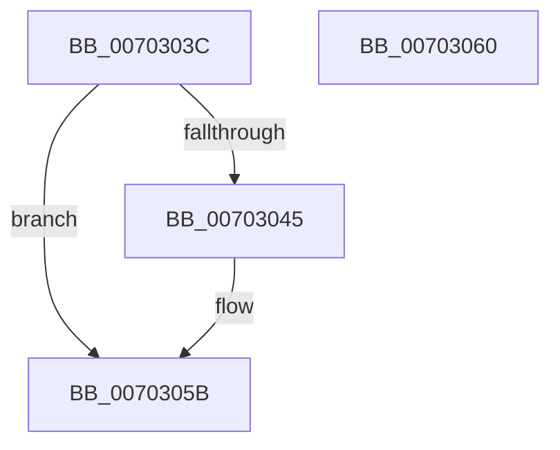

# WdipSemFastFree

- RVA: `0x0070303C`–`0x00703061` (길이 `37` bytes)
- VA: `0x000000014070303C`
- 실행 섹션: `PAGE`
- PDB 이름 있음: `예`; PDB Function 태그: `아니요`
- unwind 정보 RVA: `0x0005C788`
- 디코드: `11`개 명령, `37/37` bytes 표시
- 미해석 바이트: `0` (있으면 어셈블리에 `.byte`로 보존)

> 이 문서는 커널 이미지의 기계어와 PDB 기호를 분석해 생성했습니다. 4번과 5번은 함수 원형과 자료형을 바이너리 사용 방식에서 추정한 C 해석이며 원본 소스 복구 결과는 아닙니다.

## 1. Dependencies

- 직접 호출 지점: **1**; 고유 호출 대상: **1**
- 직접 호출자로 확인된 함수: **7**
- RIP 상대 이미지 참조: **1**

### Outgoing calls
- `0x00703056` → [ExpInterlockedPushEntrySList](../../text/6B/ExpInterlockedPushEntrySList_function_006BA5B0.md) (function, `0x006BA5B0`)

### Direct callers
- [WdipSemLoadNextScenario](../7A/WdipSemLoadNextScenario_function_007AFDE0.md) at `0x007AFF8E`
- [WdipSemRollBackProviderTable](../7B/WdipSemRollBackProviderTable_function_007B08E8.md) at `0x007B091B`
- [WdipSemLogInflightLimitExceededInformation](../7B/WdipSemLogInflightLimitExceededInformation_function_007B0B38.md) at `0x007B0C4E`
- [WdipSemFreeScenario](../7B/WdipSemFreeScenario_function_007B1060.md) at `0x007B108E`
- [WdipSemFreeScenario](../7B/WdipSemFreeScenario_function_007B1060.md) at `0x007B10BA`
- [WdipSemFreeScenario](../7B/WdipSemFreeScenario_function_007B1060.md) at `0x007B10DB`
- [WdipSemFreeFrequentScenarioTable](../A5/WdipSemFreeFrequentScenarioTable_function_00A5BBA0.md) at `0x00A5BBE1`
- [WdipSemDeleteTransitionalInstance](../A5/WdipSemDeleteTransitionalInstance_function_00A5BE28.md) at `0x00A5BEF0`
- [WdipSemWriteSemActionsEvent](../AB/WdipSemWriteSemActionsEvent_function_00ABC618.md) at `0x00ABC7BD`

### Static image references
- `0x00703048` → RVA `0x00E28C90` (`.data`; read)

## 2. Other-region calls and transfers

- 다른 실행 섹션으로 향하는 call: **1**
  - `0x00703056` → [ExpInterlockedPushEntrySList](../../text/6B/ExpInterlockedPushEntrySList_function_006BA5B0.md) (`PAGE` → `.text`)
- 별도 외부 분기/꼬리 이동을 확인하지 못했습니다.

## 3. Assembly (complete function range)

```asm
0070303C  48 83 EC 28                     sub rsp, 0x28
00703040  48 85 D2                        test rdx, rdx
00703043  74 16                           je 0x14070305b
00703045  48 63 C9                        movsxd rcx, ecx
00703048  48 8D 05 41 5C 72 00            lea rax, [rip + 0x725c41]
0070304F  48 C1 E1 04                     shl rcx, 4
00703053  48 03 C8                        add rcx, rax
00703056  E8 55 75 FB FF                  call 0x1406ba5b0
0070305B  48 83 C4 28                     add rsp, 0x28
0070305F  C3                              ret
00703060  CC                              int3
```

## 4. C-style interpretation (structured pseudocode)

```c
__int64 __fastcall WdipSemFastFree(int a1, __int64 a2)
{
    __int64 result;
    __int64 v_rsp;

    v_rsp = (v_rsp) - (40);
    if (a2 != 0) {
        a1 = (int)(a1);
        result = v_rip + 7494721;
        a1 = (a1) << (4);
        a1 = (a1) + (result);
        result = ExpInterlockedPushEntrySList(a1, a2, a3, a4);
    }
    v_rsp = (v_rsp) + (40);
    return result;
}
```

## 5. (Beta) C Style

```c
int64_t WdipSemFastFree(int32_t Arg1, int64_t Arg2)
{
    int64_t result;
    int64_t local_rsp;

    local_rsp = (local_rsp) - (40);
    if (Arg2 != 0) {
        Arg1 = (int32_t)(Arg1);
        result = v_rip + 7494721;
        Arg1 = (Arg1) << (4);
        Arg1 = (Arg1) + (result);
        result = ExpInterlockedPushEntrySList(Arg1, Arg2, a3, a4);
    }
    local_rsp = (local_rsp) + (40);
    return result;
}
```

## 6. Execution-region graph

[열기: 2D/3D 그래프와 함수 탐색 컨트롤 패널](../../../control-panel.html?section=page&rva=0x0070303C&view=graph)

- 2D 그래프는 위에서 아래로 흐르고, 3D 그래프는 빈 공간을 드래그해 회전합니다. Shift+드래그는 이동, 휠은 확대·축소, 함수 노드 선택은 대상 보고서 이동입니다.

### Static fallback


