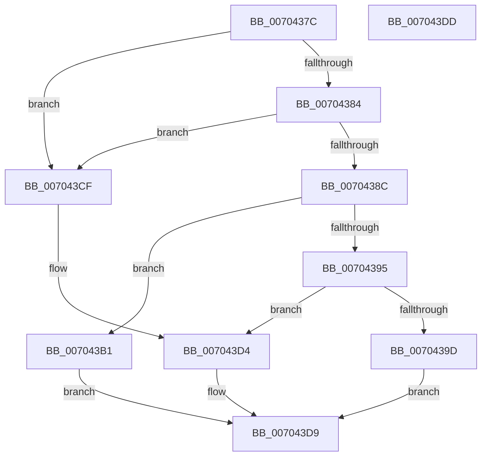

# wil_details_BuildFeatureStateCacheFromQueryResults

- RVA: `0x0070437C`–`0x007043DE` (길이 `98` bytes)
- VA: `0x000000014070437C`
- 실행 섹션: `PAGE`
- PDB 이름 있음: `예`; PDB Function 태그: `아니요`
- unwind 정보 RVA: `0x000DB714`
- 디코드: `32`개 명령, `98/98` bytes 표시
- 미해석 바이트: `0` (있으면 어셈블리에 `.byte`로 보존)

> 이 문서는 커널 이미지의 기계어와 PDB 기호를 분석해 생성했습니다. 4번과 5번은 함수 원형과 자료형을 바이너리 사용 방식에서 추정한 C 해석이며 원본 소스 복구 결과는 아닙니다.

## 1. Dependencies

- 직접 호출 지점: **0**; 고유 호출 대상: **0**
- 직접 호출자로 확인된 함수: **1**
- RIP 상대 이미지 참조: **0**

### Outgoing calls
- 직접 디코드된 call 명령이 없습니다.

### Direct callers
- [wil_details_PopulateInitialConfiguredFeatureStatesFromBuffers](../../init/C5/wil_details_PopulateInitialConfiguredFeatureStatesFromBuffers_function_00C5ADC8.md) at `0x00C5AE69`

### Static image references
- 디코드된 RIP-relative 메모리 참조가 없습니다.

## 2. Other-region calls and transfers

- 다른 실행 섹션으로 향하는 call: **0**
- 별도 외부 분기/꼬리 이동을 확인하지 못했습니다.

## 3. Assembly (complete function range)

```asm
0070437C  81 F9 22 00 00 80               cmp ecx, 0x80000022
00704382  74 4B                           je 0x1407043cf
00704384  81 F9 25 02 00 C0               cmp ecx, 0xc0000225
0070438A  74 43                           je 0x1407043cf
0070438C  33 C0                           xor eax, eax
0070438E  49 89 00                        mov qword ptr [r8], rax
00704391  85 C9                           test ecx, ecx
00704393  74 1C                           je 0x1407043b1
00704395  81 F9 17 01 00 00               cmp ecx, 0x117
0070439B  75 37                           jne 0x1407043d4
0070439D  8B 42 04                        mov eax, dword ptr [rdx + 4]
007043A0  BA 06 02 00 00                  mov edx, 0x206
007043A5  25 80 00 00 00                  and eax, 0x80
007043AA  C1 E0 03                        shl eax, 3
007043AD  0B D0                           or edx, eax
007043AF  EB 28                           jmp 0x1407043d9
007043B1  8B 42 04                        mov eax, dword ptr [rdx + 4]
007043B4  8B C8                           mov ecx, eax
007043B6  83 E1 40                        and ecx, 0x40
007043B9  25 B0 00 00 00                  and eax, 0xb0
007043BE  C1 E1 02                        shl ecx, 2
007043C1  BA 06 02 00 00                  mov edx, 0x206
007043C6  0B C8                           or ecx, eax
007043C8  C1 E1 03                        shl ecx, 3
007043CB  0B D1                           or edx, ecx
007043CD  EB 0A                           jmp 0x1407043d9
007043CF  33 C0                           xor eax, eax
007043D1  49 89 00                        mov qword ptr [r8], rax
007043D4  BA 06 02 00 00                  mov edx, 0x206
007043D9  41 89 10                        mov dword ptr [r8], edx
007043DC  C3                              ret
007043DD  CC                              int3
```

## 4. C-style interpretation (structured pseudocode)

```c
__int64 __fastcall wil_details_BuildFeatureStateCacheFromQueryResults(int a1, __int64 a2, __int64 a3)
{
    __int64 result;

    if (a1 == 0x80000022ULL) goto loc_007043CF;
    if (a1 == 0xC0000225ULL) goto loc_007043CF;
    result = 0;
    *(unsigned __int64 *)(a3) = 0;
    if (a1 == 0) goto loc_007043B1;
    if (a1 != 279) goto loc_007043D4;
    result = (unsigned int)(((unsigned int)(*(unsigned int *)(a2 + 4))) & (128));
    result = (unsigned int)((result) << (3));
    a2 = (unsigned int)((518) | ((unsigned int)(result)));
    goto loc_007043D9;
loc_007043B1:
    a1 = (unsigned int)(((unsigned int)((unsigned int)((unsigned int)(*(unsigned int *)(a2 + 4))))) & (64));
    result = (unsigned int)(((unsigned int)(*(unsigned int *)(a2 + 4))) & (176));
    a1 = (unsigned int)((a1) << (2));
    a1 = (unsigned int)((a1) | ((unsigned int)(result)));
    a1 = (unsigned int)((a1) << (3));
    a2 = (unsigned int)((518) | (a1));
    goto loc_007043D9;
loc_007043CF:
    result = 0;
    *(unsigned __int64 *)(a3) = 0;
loc_007043D4:
loc_007043D9:
    *(unsigned int *)(a3) = 518;
    return result;
}
```

## 5. (Beta) C Style

```c
int64_t wil_details_BuildFeatureStateCacheFromQueryResults(int32_t Arg1, void *Arg2, void *Arg3)
{
    uint8_t *arg2 = (uint8_t *)Arg2;
    uint8_t *arg3 = (uint8_t *)Arg3;

    int64_t result;

    if (Arg1 == 0x80000022ULL) goto loc_007043CF;
    if (Arg1 == 0xC0000225ULL) goto loc_007043CF;
    result = 0;
    *(uint64_t *)(arg3) = 0;
    if (Arg1 == 0) goto loc_007043B1;
    if (Arg1 != 279) goto loc_007043D4;
    result = (uint32_t)(((uint32_t)(*(uint32_t *)(arg2 + 0x4))) & (128));
    result = (uint32_t)((result) << (3));
    Arg2 = (uint32_t)((518) | ((uint32_t)(result)));
    goto loc_007043D9;
loc_007043B1:
    Arg1 = (uint32_t)(((uint32_t)((uint32_t)((uint32_t)(*(uint32_t *)(arg2 + 0x4))))) & (64));
    result = (uint32_t)(((uint32_t)(*(uint32_t *)(arg2 + 0x4))) & (176));
    Arg1 = (uint32_t)((Arg1) << (2));
    Arg1 = (uint32_t)((Arg1) | ((uint32_t)(result)));
    Arg1 = (uint32_t)((Arg1) << (3));
    Arg2 = (uint32_t)((518) | (Arg1));
    goto loc_007043D9;
loc_007043CF:
    result = 0;
    *(uint64_t *)(arg3) = 0;
loc_007043D4:
loc_007043D9:
    *(uint32_t *)(arg3) = 518;
    return result;
}
```

### 관측된 메모리 오프셋

구조체 형식이 확인되지 않은 접근은 인자 기준의 오프셋으로만 기록했습니다.

| 기준 인자 | 오프셋 표현 | 폭 (bit) | 접근 |
|---|---:|---:|---|
| `Arg2` | `+ 0x4` | `32` | `R` |
| `Arg3` | `+ 0x0` | `32` | `W` |
| `Arg3` | `+ 0x0` | `64` | `W` |

## 6. Execution-region graph

[열기: 2D/3D 그래프와 함수 탐색 컨트롤 패널](../../../control-panel.html?section=page&rva=0x0070437C&view=graph)

- 2D 그래프는 위에서 아래로 흐르고, 3D 그래프는 빈 공간을 드래그해 회전합니다. Shift+드래그는 이동, 휠은 확대·축소, 함수 노드 선택은 대상 보고서 이동입니다.

### Static fallback


