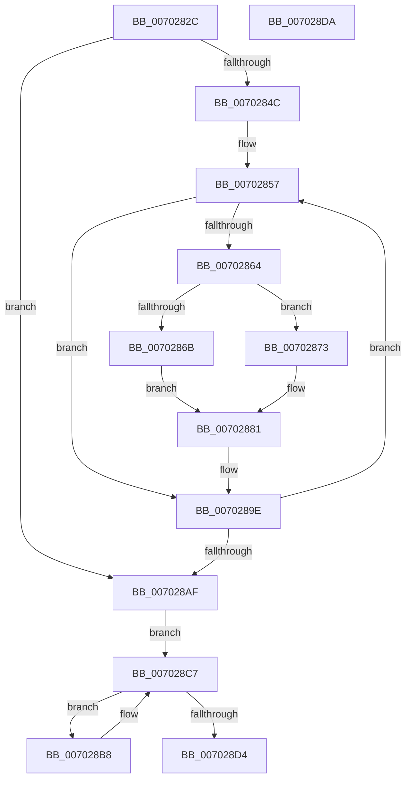

# wil_details_EvaluateFeatureDependencies

- RVA: `0x0070282C`–`0x007028DB` (길이 `175` bytes)
- VA: `0x000000014070282C`
- 실행 섹션: `PAGE`
- PDB 이름 있음: `예`; PDB Function 태그: `아니요`
- unwind 정보 RVA: `0x0005CF00`
- 디코드: `52`개 명령, `175/175` bytes 표시
- 미해석 바이트: `0` (있으면 어셈블리에 `.byte`로 보존)

> 이 문서는 커널 이미지의 기계어와 PDB 기호를 분석해 생성했습니다. 4번과 5번은 함수 원형과 자료형을 바이너리 사용 방식에서 추정한 C 해석이며 원본 소스 복구 결과는 아닙니다.

## 1. Dependencies

- 직접 호출 지점: **4**; 고유 호출 대상: **2**
- 직접 호출자로 확인된 함수: **2**
- RIP 상대 이미지 참조: **1**

### Outgoing calls
- `0x0070283F` → [wil_details_FeatureDescriptors_SkipPadding](../../text/4C/wil_details_FeatureDescriptors_SkipPadding_function_004C9934.md) (function, `0x004C9934`)
- `0x007028A2` → [wil_details_FeatureDescriptors_SkipPadding](../../text/4C/wil_details_FeatureDescriptors_SkipPadding_function_004C9934.md) (function, `0x004C9934`)
- `0x007028BE` → [wil_details_EvaluateFeatureDependencies_GetCachedFeatureEnabledState](../AC/wil_details_EvaluateFeatureDependencies_GetCachedFeatureEnabledState_function_00AC8844.md) (function, `0x00AC8844`)
- `0x007028C7` → [wil_details_FeatureDescriptors_SkipPadding](../../text/4C/wil_details_FeatureDescriptors_SkipPadding_function_004C9934.md) (function, `0x004C9934`)

### Direct callers
- [wil_details_ReevaluateOnFeatureConfigurationChange](../7E/wil_details_ReevaluateOnFeatureConfigurationChange_function_007E6030.md) at `0x007E6039`
- [CmFcInitSystem0](../../init/C5/CmFcInitSystem0_function_00C5AC60.md) at `0x00C5AC9B`

### Static image references
- `0x00702838` → RVA `0x000DC0C0` (`.rdata`; read)

## 2. Other-region calls and transfers

- 다른 실행 섹션으로 향하는 call: **3**
  - `0x0070283F` → [wil_details_FeatureDescriptors_SkipPadding](../../text/4C/wil_details_FeatureDescriptors_SkipPadding_function_004C9934.md) (`PAGE` → `.text`)
  - `0x007028A2` → [wil_details_FeatureDescriptors_SkipPadding](../../text/4C/wil_details_FeatureDescriptors_SkipPadding_function_004C9934.md) (`PAGE` → `.text`)
  - `0x007028C7` → [wil_details_FeatureDescriptors_SkipPadding](../../text/4C/wil_details_FeatureDescriptors_SkipPadding_function_004C9934.md) (`PAGE` → `.text`)
- 별도 외부 분기/꼬리 이동을 확인하지 못했습니다.

## 3. Assembly (complete function range)

```asm
0070282C  40 53                           push rbx
0070282E  48 83 EC 20                     sub rsp, 0x20
00702832  48 83 64 24 30 00               and qword ptr [rsp + 0x30], 0
00702838  48 8D 0D 81 98 9D FF            lea rcx, [rip - 0x62677f]
0070283F  E8 F0 70 DC FF                  call 0x1404c9934
00702844  48 8B D0                        mov rdx, rax
00702847  48 85 C0                        test rax, rax
0070284A  74 63                           je 0x1407028af
0070284C  44 8B 4C 24 30                  mov r9d, dword ptr [rsp + 0x30]
00702851  41 BA 80 01 00 00               mov r10d, 0x180
00702857  48 8B 0A                        mov rcx, qword ptr [rdx]
0070285A  44 8B 01                        mov r8d, dword ptr [rcx]
0070285D  41 0F BA E0 09                  bt r8d, 9
00702862  73 3A                           jae 0x14070289e
00702864  33 C9                           xor ecx, ecx
00702866  45 85 C2                        test r10d, r8d
00702869  75 08                           jne 0x140702873
0070286B  38 4A 1F                        cmp byte ptr [rdx + 0x1f], cl
0070286E  0F 95 C1                        setne cl
00702871  EB 0E                           jmp 0x140702881
00702873  41 8B C0                        mov eax, r8d
00702876  41 23 C2                        and eax, r10d
00702879  3D 00 01 00 00                  cmp eax, 0x100
0070287E  0F 94 C1                        sete cl
00702881  41 8B C1                        mov eax, r9d
00702884  C1 E1 06                        shl ecx, 6
00702887  41 83 E0 40                     and r8d, 0x40
0070288B  83 E0 BF                        and eax, 0xffffffbf
0070288E  44 33 C1                        xor r8d, ecx
00702891  45 8B C8                        mov r9d, r8d
00702894  44 0B C8                        or r9d, eax
00702897  48 8B 02                        mov rax, qword ptr [rdx]
0070289A  F0 44 31 08                     lock xor dword ptr [rax], r9d
0070289E  48 8D 4A 38                     lea rcx, [rdx + 0x38]
007028A2  E8 8D 70 DC FF                  call 0x1404c9934
007028A7  48 8B D0                        mov rdx, rax
007028AA  48 85 C0                        test rax, rax
007028AD  75 A8                           jne 0x140702857
007028AF  48 8D 0D 0A 98 9D FF            lea rcx, [rip - 0x6267f6]
007028B6  EB 0F                           jmp 0x1407028c7
007028B8  48 8B 0B                        mov rcx, qword ptr [rbx]
007028BB  48 8B D3                        mov rdx, rbx
007028BE  E8 81 5F 3C 00                  call 0x140ac8844
007028C3  48 8D 4B 38                     lea rcx, [rbx + 0x38]
007028C7  E8 68 70 DC FF                  call 0x1404c9934
007028CC  48 8B D8                        mov rbx, rax
007028CF  48 85 C0                        test rax, rax
007028D2  75 E4                           jne 0x1407028b8
007028D4  48 83 C4 20                     add rsp, 0x20
007028D8  5B                              pop rbx
007028D9  C3                              ret
007028DA  CC                              int3
```

## 4. C-style interpretation (structured pseudocode)

```c
__int64 __fastcall wil_details_EvaluateFeatureDependencies(void)
{
    __int64 result;
    __int64 v_rsp;
    unsigned __int64 v_stack_p8;

    v_rsp = (v_rsp) - (32);
    result = wil_details_FeatureDescriptors_SkipPadding(v_rip - 6449023, a2, a3, a4);
    if (result == 0) goto loc_007028AF;
loc_00702857:
    if (condition_is_above_or_equal) goto loc_0070289E;
    a1 = 0;
    if (((384) & ((unsigned int)((unsigned int)(*(unsigned int *)(*(unsigned __int64 *)(result)))))) != 0) goto loc_00702873;
    a1 = ((*(unsigned __int8 *)(result + 31)) != 0) ? 1 : 0;
    goto loc_00702881;
loc_00702873:
    result = (unsigned int)(((unsigned int)((unsigned int)((unsigned int)(*(unsigned int *)(*(unsigned __int64 *)(result)))))) & (384));
    a1 = (((unsigned int)(result)) == 256) ? 1 : 0;
loc_00702881:
    a1 = (unsigned int)((a1) << (6));
    a3 = (unsigned int)(((unsigned int)(*(unsigned int *)(*(unsigned __int64 *)(result)))) & (64));
    result = (unsigned int)(((unsigned int)((unsigned int)((unsigned int)(v_stack_p8)))) & (0xFFFFFFBFULL));
    a3 = (unsigned int)((a3) ^ ((unsigned int)(a1)));
    a4 = (unsigned int)(((unsigned int)((unsigned int)(a3))) | ((unsigned int)(result)));
loc_0070289E:
    result = wil_details_FeatureDescriptors_SkipPadding(result + 56, result, a3, a4);
    if (result != 0) goto loc_00702857;
loc_007028AF:
    goto loc_007028C7;
loc_007028B8:
    result = wil_details_EvaluateFeatureDependencies_GetCachedFeatureEnabledState(*(unsigned __int64 *)(v_rbx), v_rbx, a3, a4);
loc_007028C7:
    result = wil_details_FeatureDescriptors_SkipPadding(v_rbx + 56, v_rbx, a3, a4);
    if (result != 0) goto loc_007028B8;
    v_rsp = (v_rsp) + (32);
    return result;
}
```

## 5. (Beta) C Style

```c
void wil_details_EvaluateFeatureDependencies(void)
{
    int64_t result;
    int64_t local_rsp;
    uint64_t v_stack_p8;

    local_rsp = (local_rsp) - (32);
    result = wil_details_FeatureDescriptors_SkipPadding(v_rip - 6449023, a2, a3, a4);
    if (result == 0) goto loc_007028AF;
loc_00702857:
    if (condition_is_above_or_equal) goto loc_0070289E;
    a1 = 0;
    if (((384) & ((uint32_t)((uint32_t)(*(uint32_t *)(*(uint64_t *)(result)))))) != 0) goto loc_00702873;
    a1 = ((*(uint8_t *)(result + 0x1F)) != 0) ? 1 : 0;
    goto loc_00702881;
loc_00702873:
    result = (uint32_t)(((uint32_t)((uint32_t)((uint32_t)(*(uint32_t *)(*(uint64_t *)(result)))))) & (384));
    a1 = (((uint32_t)(result)) == 256) ? 1 : 0;
loc_00702881:
    a1 = (uint32_t)((a1) << (6));
    a3 = (uint32_t)(((uint32_t)(*(uint32_t *)(*(uint64_t *)(result)))) & (64));
    result = (uint32_t)(((uint32_t)((uint32_t)((uint32_t)(v_stack_p8)))) & (0xFFFFFFBFULL));
    a3 = (uint32_t)((a3) ^ ((uint32_t)(a1)));
    a4 = (uint32_t)(((uint32_t)((uint32_t)(a3))) | ((uint32_t)(result)));
loc_0070289E:
    result = wil_details_FeatureDescriptors_SkipPadding(result + 56, result, a3, a4);
    if (result != 0) goto loc_00702857;
loc_007028AF:
    goto loc_007028C7;
loc_007028B8:
    result = wil_details_EvaluateFeatureDependencies_GetCachedFeatureEnabledState(*(uint64_t *)(local_rbx), local_rbx, a3, a4);
loc_007028C7:
    result = wil_details_FeatureDescriptors_SkipPadding(local_rbx + 56, local_rbx, a3, a4);
    if (result != 0) goto loc_007028B8;
    local_rsp = (local_rsp) + (32);
    return result;
}
```

## 6. Execution-region graph

[열기: 2D/3D 그래프와 함수 탐색 컨트롤 패널](../../../control-panel.html?section=page&rva=0x0070282C&view=graph)

- 2D 그래프는 위에서 아래로 흐르고, 3D 그래프는 빈 공간을 드래그해 회전합니다. Shift+드래그는 이동, 휠은 확대·축소, 함수 노드 선택은 대상 보고서 이동입니다.

### Static fallback


