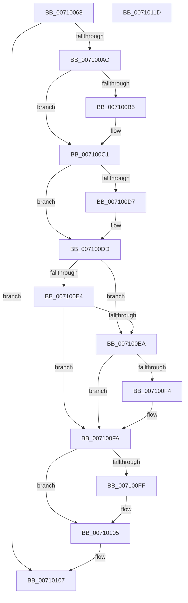

# ArbpBuildAlternative

- RVA: `0x00710068`–`0x0071011E` (길이 `182` bytes)
- VA: `0x0000000140710068`
- 실행 섹션: `PAGE`
- PDB 이름 있음: `예`; PDB Function 태그: `아니요`
- unwind 정보 RVA: `0x0009B270`
- 디코드: `57`개 명령, `182/182` bytes 표시
- 미해석 바이트: `0` (있으면 어셈블리에 `.byte`로 보존)

> 이 문서는 커널 이미지의 기계어와 PDB 기호를 분석해 생성했습니다. 4번과 5번은 함수 원형과 자료형을 바이너리 사용 방식에서 추정한 C 해석이며 원본 소스 복구 결과는 아닙니다.

## 1. Dependencies

- 직접 호출 지점: **1**; 고유 호출 대상: **1**
- 직접 호출자로 확인된 함수: **4**
- RIP 상대 이미지 참조: **0**

### Outgoing calls
- `0x007100A1` → [guard_dispatch_icall](../../text/6B/guard_dispatch_icall_function_006BAAD0.md) (function, `0x006BAAD0`)

### Direct callers
- [ArbBootAllocation](../70/ArbBootAllocation_function_0070E290.md) at `0x0070E32B`
- [ArbQueryConflict](../70/ArbQueryConflict_function_0070F410.md) at `0x0070F4D6`
- [ArbRetestAllocation](../70/ArbRetestAllocation_function_0070F940.md) at `0x0070FA38`
- [ArbpBuildAllocationStack](../70/ArbpBuildAllocationStack_function_0070FF10.md) at `0x00710018`

### Static image references
- 디코드된 RIP-relative 메모리 참조가 없습니다.

## 2. Other-region calls and transfers

- 다른 실행 섹션으로 향하는 call: **1**
  - `0x007100A1` → [guard_dispatch_icall](../../text/6B/guard_dispatch_icall_function_006BAAD0.md) (`PAGE` → `.text`)
- 별도 외부 분기/꼬리 이동을 확인하지 못했습니다.

## 3. Assembly (complete function range)

```asm
00710068  4C 8B DC                        mov r11, rsp
0071006B  49 89 5B 08                     mov qword ptr [r11 + 8], rbx
0071006F  49 89 73 10                     mov qword ptr [r11 + 0x10], rsi
00710073  49 89 7B 18                     mov qword ptr [r11 + 0x18], rdi
00710077  41 56                           push r14
00710079  48 83 EC 30                     sub rsp, 0x30
0071007D  4D 8D 48 18                     lea r9, [r8 + 0x18]
00710081  49 89 50 28                     mov qword ptr [r8 + 0x28], rdx
00710085  48 8B 41 78                     mov rax, qword ptr [rcx + 0x78]
00710089  49 8B D8                        mov rbx, r8
0071008C  48 8B FA                        mov rdi, rdx
0071008F  4D 89 4B E8                     mov qword ptr [r11 - 0x18], r9
00710093  4D 8D 48 10                     lea r9, [r8 + 0x10]
00710097  48 8B D3                        mov rdx, rbx
0071009A  49 83 C0 08                     add r8, 8
0071009E  48 8B CF                        mov rcx, rdi
007100A1  E8 2A AA FA FF                  call 0x1406baad0
007100A6  33 D2                           xor edx, edx
007100A8  85 C0                           test eax, eax
007100AA  78 5B                           js 0x140710107
007100AC  89 53 24                        mov dword ptr [rbx + 0x24], edx
007100AF  80 7F 02 03                     cmp byte ptr [rdi + 2], 3
007100B3  75 0C                           jne 0x1407100c1
007100B5  C7 43 24 01 00 00 00            mov dword ptr [rbx + 0x24], 1
007100BC  BA 01 00 00 00                  mov edx, 1
007100C1  4C 8B 43 08                     mov r8, qword ptr [rbx + 8]
007100C5  4C 8B 0B                        mov r9, qword ptr [rbx]
007100C8  49 8B C0                        mov rax, r8
007100CB  49 2B C1                        sub rax, r9
007100CE  48 FF C0                        inc rax
007100D1  48 3B 43 10                     cmp rax, qword ptr [rbx + 0x10]
007100D5  75 06                           jne 0x1407100dd
007100D7  83 CA 02                        or edx, 2
007100DA  89 53 24                        mov dword ptr [rbx + 0x24], edx
007100DD  8A 47 01                        mov al, byte ptr [rdi + 1]
007100E0  3C 03                           cmp al, 3
007100E2  74 06                           je 0x1407100ea
007100E4  8B CA                           mov ecx, edx
007100E6  3C 07                           cmp al, 7
007100E8  75 10                           jne 0x1407100fa
007100EA  66 0F BA 67 04 08               bt word ptr [rdi + 4], 8
007100F0  8B CA                           mov ecx, edx
007100F2  73 06                           jae 0x1407100fa
007100F4  83 C9 08                        or ecx, 8
007100F7  89 4B 24                        mov dword ptr [rbx + 0x24], ecx
007100FA  4D 3B C1                        cmp r8, r9
007100FD  73 06                           jae 0x140710105
007100FF  83 C9 04                        or ecx, 4
00710102  89 4B 24                        mov dword ptr [rbx + 0x24], ecx
00710105  33 C0                           xor eax, eax
00710107  48 8B 5C 24 40                  mov rbx, qword ptr [rsp + 0x40]
0071010C  48 8B 74 24 48                  mov rsi, qword ptr [rsp + 0x48]
00710111  48 8B 7C 24 50                  mov rdi, qword ptr [rsp + 0x50]
00710116  48 83 C4 30                     add rsp, 0x30
0071011A  41 5E                           pop r14
0071011C  C3                              ret
0071011D  CC                              int3
```

## 4. C-style interpretation (structured pseudocode)

```c
__int64 __fastcall ArbpBuildAlternative(__int64 a1, __int64 a2, __int64 a3)
{
    __int64 result;
    __int64 v_rsp;
    unsigned __int64 v_stack_p10;
    unsigned __int64 v_stack_p18;
    unsigned __int64 v_stack_p8;

    *(unsigned __int64 *)(v_rsp + 8) = v_rbx;
    *(unsigned __int64 *)(v_rsp + 16) = v_rsi;
    *(unsigned __int64 *)(v_rsp + 24) = v_rdi;
    v_rsp = (v_rsp) - (48);
    *(unsigned __int64 *)(a3 + 40) = a2;
    *(unsigned __int64 *)(v_rsp - 24) = a3 + 24;
    a3 = (a3) + (8);
    result = guard_dispatch_icall(a2, a3, a3, a3 + 16);
    a2 = 0;
    if (sign_flag) goto loc_00710107;
    *(unsigned int *)(a3 + 36) = 0;
    if ((*(unsigned __int8 *)(a2 + 2)) == 3) {
        *(unsigned int *)(a3 + 36) = 1;
        a2 = 1;
    }
    result = (*(unsigned __int64 *)(a3 + 8)) - (*(unsigned __int64 *)(a3));
    result = (result) + 1;
    if (result == (*(unsigned __int64 *)(a3 + 16))) {
        a2 = (unsigned int)((a2) | (2));
        *(unsigned int *)(a3 + 36) = (unsigned int)(a2);
    }
    if (((unsigned __int8)(*(unsigned __int8 *)(a2 + 1))) == 3) goto loc_007100EA;
    if (((unsigned __int8)(*(unsigned __int8 *)(a2 + 1))) != 7) goto loc_007100FA;
loc_007100EA:
    if (((unsigned __int8)(*(unsigned __int8 *)(a2 + 1))) < 7) {
        a1 = (unsigned int)(((unsigned int)((unsigned int)(a2))) | (8));
        *(unsigned int *)(a3 + 36) = (unsigned int)(a1);
    }
    if ((*(unsigned __int64 *)(a3 + 8)) < (*(unsigned __int64 *)(a3))) {
        a1 = (unsigned int)((a1) | (4));
        *(unsigned int *)(a3 + 36) = (unsigned int)(a1);
    }
    result = 0;
loc_00710107:
    v_rsp = (v_rsp) + (48);
    return result;
}
```

## 5. (Beta) C Style

```c
int64_t ArbpBuildAlternative(void *Arg1, void *Arg2, void *Arg3)
{
    uint8_t *arg1 = (uint8_t *)Arg1;
    uint8_t *arg2 = (uint8_t *)Arg2;
    uint8_t *arg3 = (uint8_t *)Arg3;

    int64_t result;
    int64_t local_rsp;
    uint64_t v_stack_p10;
    uint64_t v_stack_p18;
    uint64_t v_stack_p8;

    *(uint64_t *)(local_rsp + 0x8) = local_rbx;
    *(uint64_t *)(local_rsp + 0x10) = local_rsi;
    *(uint64_t *)(local_rsp + 0x18) = local_rdi;
    local_rsp = (local_rsp) - (48);
    *(void **)(arg3 + 0x28) = Arg2;
    *(void **)(local_rsp - 0x18) = Arg3 + 24;
    Arg3 = (Arg3) + (8);
    result = guard_dispatch_icall(Arg2, Arg3, Arg3, Arg3 + 16);
    Arg2 = 0;
    if (sign_flag) goto loc_00710107;
    *(uint32_t *)(arg3 + 0x24) = 0;
    if ((*(uint8_t *)(arg2 + 0x2)) == 3) {
        *(uint32_t *)(arg3 + 0x24) = 1;
        Arg2 = 1;
    }
    result = (*(uint64_t *)(arg3 + 0x8)) - (*(uint64_t *)(arg3));
    result = (result) + 1;
    if (result == (*(uint64_t *)(arg3 + 0x10))) {
        Arg2 = (uint32_t)((Arg2) | (2));
        *(uint32_t *)(arg3 + 0x24) = (uint32_t)(Arg2);
    }
    if (((uint8_t)(*(uint8_t *)(arg2 + 0x1))) == 3) goto loc_007100EA;
    if (((uint8_t)(*(uint8_t *)(arg2 + 0x1))) != 7) goto loc_007100FA;
loc_007100EA:
    if (((uint8_t)(*(uint8_t *)(arg2 + 0x1))) < 7) {
        Arg1 = (uint32_t)(((uint32_t)((uint32_t)(Arg2))) | (8));
        *(uint32_t *)(arg3 + 0x24) = (uint32_t)(Arg1);
    }
    if ((*(uint64_t *)(arg3 + 0x8)) < (*(uint64_t *)(arg3))) {
        Arg1 = (uint32_t)((Arg1) | (4));
        *(uint32_t *)(arg3 + 0x24) = (uint32_t)(Arg1);
    }
    result = 0;
loc_00710107:
    local_rsp = (local_rsp) + (48);
    return result;
}
```

### 관측된 메모리 오프셋

구조체 형식이 확인되지 않은 접근은 인자 기준의 오프셋으로만 기록했습니다.

| 기준 인자 | 오프셋 표현 | 폭 (bit) | 접근 |
|---|---:|---:|---|
| `Arg1` | `+ 0x78` | `64` | `R` |
| `Arg2` | `+ 0x1` | `8` | `R` |
| `Arg2` | `+ 0x2` | `8` | `R` |
| `Arg2` | `+ 0x4` | `16` | `R` |
| `Arg3` | `+ 0x0` | `64` | `R` |
| `Arg3` | `+ 0x8` | `64` | `R` |
| `Arg3` | `+ 0x10` | `64` | `R` |
| `Arg3` | `+ 0x18` | `64` | `R` |
| `Arg3` | `+ 0x24` | `32` | `W` |
| `Arg3` | `+ 0x28` | `64` | `W` |

## 6. Execution-region graph

[열기: 2D/3D 그래프와 함수 탐색 컨트롤 패널](../../../control-panel.html?section=page&rva=0x00710068&view=graph)

- 2D 그래프는 위에서 아래로 흐르고, 3D 그래프는 빈 공간을 드래그해 회전합니다. Shift+드래그는 이동, 휠은 확대·축소, 함수 노드 선택은 대상 보고서 이동입니다.

### Static fallback


