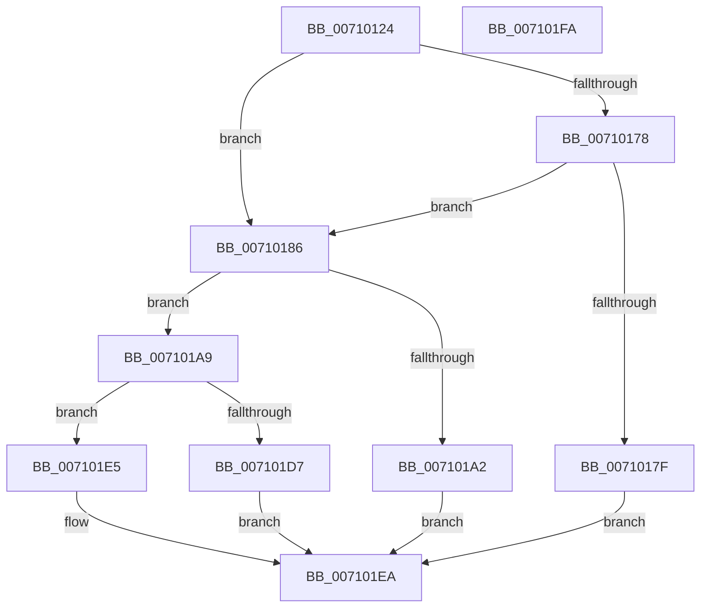

# ArbpGetRegistryValue

- RVA: `0x00710124`–`0x007101FB` (길이 `215` bytes)
- VA: `0x0000000140710124`
- 실행 섹션: `PAGE`
- PDB 이름 있음: `예`; PDB Function 태그: `아니요`
- unwind 정보 RVA: `0x000718AC`
- 디코드: `60`개 명령, `215/215` bytes 표시
- 미해석 바이트: `0` (있으면 어셈블리에 `.byte`로 보존)

> 이 문서는 커널 이미지의 기계어와 PDB 기호를 분석해 생성했습니다. 4번과 5번은 함수 원형과 자료형을 바이너리 사용 방식에서 추정한 C 해석이며 원본 소스 복구 결과는 아닙니다.

## 1. Dependencies

- 직접 호출 지점: **5**; 고유 호출 대상: **4**
- 직접 호출자로 확인된 함수: **3**
- RIP 상대 이미지 참조: **0**

### Outgoing calls
- `0x00710149` → [RtlInitUnicodeString](../../text/42/RtlInitUnicodeString_function_0042A780.md) (function, `0x0042A780`)
- `0x0071016C` → [ZwQueryValueKey](../../text/6A/ZwQueryValueKey_function_006AD3B0.md) (function, `0x006AD3B0`)
- `0x00710195` → [ExAllocatePool2](../../poolcode/B8/ExAllocatePool2_function_00B820F0.md) (function, `0x00B820F0`)
- `0x007101CC` → [ZwQueryValueKey](../../text/6A/ZwQueryValueKey_function_006AD3B0.md) (function, `0x006AD3B0`)
- `0x007101DC` → [ExFreePoolWithTag](../../poolcode/B8/ExFreePoolWithTag_function_00B82870.md) (function, `0x00B82870`)

### Direct callers
- [ArbAddInaccessibleAllocationRange](../70/ArbAddInaccessibleAllocationRange_function_0070DEB0.md) at `0x0070DF9B`
- [ArbAddInaccessibleAllocationRange](../70/ArbAddInaccessibleAllocationRange_function_0070DEB0.md) at `0x0070DFE9`
- [ArbBuildAssignmentOrdering](../70/ArbBuildAssignmentOrdering_function_0070E43C.md) at `0x0070E5B5`
- [ArbBuildAssignmentOrdering](../70/ArbBuildAssignmentOrdering_function_0070E43C.md) at `0x0070E600`
- [ArbBuildAssignmentOrdering](../70/ArbBuildAssignmentOrdering_function_0070E43C.md) at `0x0070E77A`
- [ArbBuildAssignmentOrdering](../70/ArbBuildAssignmentOrdering_function_0070E43C.md) at `0x0070E7B6`
- [ArbRegReadMmConfigRanges](../70/ArbRegReadMmConfigRanges_function_0070F7AC.md) at `0x0070F887`

### Static image references
- 디코드된 RIP-relative 메모리 참조가 없습니다.

## 2. Other-region calls and transfers

- 다른 실행 섹션으로 향하는 call: **5**
  - `0x00710149` → [RtlInitUnicodeString](../../text/42/RtlInitUnicodeString_function_0042A780.md) (`PAGE` → `.text`)
  - `0x0071016C` → [ZwQueryValueKey](../../text/6A/ZwQueryValueKey_function_006AD3B0.md) (`PAGE` → `.text`)
  - `0x00710195` → [ExAllocatePool2](../../poolcode/B8/ExAllocatePool2_function_00B820F0.md) (`PAGE` → `POOLCODE`)
  - `0x007101CC` → [ZwQueryValueKey](../../text/6A/ZwQueryValueKey_function_006AD3B0.md) (`PAGE` → `.text`)
  - `0x007101DC` → [ExFreePoolWithTag](../../poolcode/B8/ExFreePoolWithTag_function_00B82870.md) (`PAGE` → `POOLCODE`)
- 별도 외부 분기/꼬리 이동을 확인하지 못했습니다.

## 3. Assembly (complete function range)

```asm
00710124  48 8B C4                        mov rax, rsp
00710127  48 89 58 08                     mov qword ptr [rax + 8], rbx
0071012B  48 89 70 10                     mov qword ptr [rax + 0x10], rsi
0071012F  57                              push rdi
00710130  48 83 EC 40                     sub rsp, 0x40
00710134  83 60 20 00                     and dword ptr [rax + 0x20], 0
00710138  48 8B F9                        mov rdi, rcx
0071013B  0F 57 C0                        xorps xmm0, xmm0
0071013E  48 8D 48 E8                     lea rcx, [rax - 0x18]
00710142  0F 11 40 E8                     movups xmmword ptr [rax - 0x18], xmm0
00710146  49 8B F0                        mov rsi, r8
00710149  E8 32 A6 D1 FF                  call 0x14042a780
0071014E  45 33 C9                        xor r9d, r9d
00710151  48 8D 44 24 68                  lea rax, [rsp + 0x68]
00710156  48 89 44 24 28                  mov qword ptr [rsp + 0x28], rax
0071015B  48 8D 54 24 30                  lea rdx, [rsp + 0x30]
00710160  83 64 24 20 00                  and dword ptr [rsp + 0x20], 0
00710165  48 8B CF                        mov rcx, rdi
00710168  45 8D 41 03                     lea r8d, [r9 + 3]
0071016C  E8 3F D2 F9 FF                  call 0x1406ad3b0
00710171  3D 05 00 00 80                  cmp eax, 0x80000005
00710176  74 0E                           je 0x140710186
00710178  3D 23 00 00 C0                  cmp eax, 0xc0000023
0071017D  74 07                           je 0x140710186
0071017F  B8 01 00 00 C0                  mov eax, 0xc0000001
00710184  EB 64                           jmp 0x1407101ea
00710186  8B 54 24 68                     mov edx, dword ptr [rsp + 0x68]
0071018A  B9 00 01 00 00                  mov ecx, 0x100
0071018F  41 B8 41 72 62 4D               mov r8d, 0x4d627241
00710195  E8 56 1F 47 00                  call 0x140b820f0
0071019A  48 8B D8                        mov rbx, rax
0071019D  48 85 C0                        test rax, rax
007101A0  75 07                           jne 0x1407101a9
007101A2  B8 9A 00 00 C0                  mov eax, 0xc000009a
007101A7  EB 41                           jmp 0x1407101ea
007101A9  48 8D 44 24 68                  lea rax, [rsp + 0x68]
007101AE  4C 8B CB                        mov r9, rbx
007101B1  48 89 44 24 28                  mov qword ptr [rsp + 0x28], rax
007101B6  48 8D 54 24 30                  lea rdx, [rsp + 0x30]
007101BB  8B 44 24 68                     mov eax, dword ptr [rsp + 0x68]
007101BF  41 B8 03 00 00 00               mov r8d, 3
007101C5  48 8B CF                        mov rcx, rdi
007101C8  89 44 24 20                     mov dword ptr [rsp + 0x20], eax
007101CC  E8 DF D1 F9 FF                  call 0x1406ad3b0
007101D1  8B F8                           mov edi, eax
007101D3  85 C0                           test eax, eax
007101D5  79 0E                           jns 0x1407101e5
007101D7  33 D2                           xor edx, edx
007101D9  48 8B CB                        mov rcx, rbx
007101DC  E8 8F 26 47 00                  call 0x140b82870
007101E1  8B C7                           mov eax, edi
007101E3  EB 05                           jmp 0x1407101ea
007101E5  48 89 1E                        mov qword ptr [rsi], rbx
007101E8  33 C0                           xor eax, eax
007101EA  48 8B 5C 24 50                  mov rbx, qword ptr [rsp + 0x50]
007101EF  48 8B 74 24 58                  mov rsi, qword ptr [rsp + 0x58]
007101F4  48 83 C4 40                     add rsp, 0x40
007101F8  5F                              pop rdi
007101F9  C3                              ret
007101FA  CC                              int3
```

## 4. C-style interpretation (structured pseudocode)

```c
__int64 __fastcall ArbpGetRegistryValue(__int64 a1, __int64 a2, __int64 a3, int a4)
{
    __int64 result;
    __int64 v_rsp;
    unsigned __int64 v_stack_m18;
    unsigned __int64 v_stack_m20;
    unsigned int v_stack_m28;
    unsigned __int64 v_stack_p10;
    unsigned __int64 v_stack_p20;
    unsigned __int64 v_stack_p8;

    *(unsigned __int64 *)(v_rsp + 8) = v_rbx;
    *(unsigned __int64 *)(v_rsp + 16) = v_rsi;
    v_rsp = (v_rsp) - (64);
    *(unsigned __int64 *)(v_rsp - 24) = v_xmm0;
    result = RtlInitUnicodeString(v_rsp - 24, a2, a3, a4);
    a4 = 0;
    v_stack_m20 = v_stack_p20;
    result = ZwQueryValueKey(a1, v_stack_m18, a4 + 3, a4);
    if (((unsigned int)(result)) == 0x80000005ULL) goto loc_00710186;
    if (((unsigned int)(result)) == 0xC0000023ULL) goto loc_00710186;
    goto loc_007101EA;
loc_00710186:
    result = ExAllocatePool2(256, (unsigned int)(v_stack_p20), (unsigned int)(0x4D627241ULL), a4);
    if (result != 0) goto loc_007101A9;
    goto loc_007101EA;
loc_007101A9:
    v_stack_m20 = v_stack_p20;
    v_stack_m28 = (unsigned int)((unsigned int)(v_stack_p20));
    result = ZwQueryValueKey(a1, v_stack_m18, 3, result);
    if (!sign_flag) goto loc_007101E5;
    a2 = 0;
    result = ExFreePoolWithTag(result, a2, 3, result);
    goto loc_007101EA;
loc_007101E5:
    *(unsigned __int64 *)(a3) = result;
    result = 0;
loc_007101EA:
    v_rsp = (v_rsp) + (64);
    return result;
}
```

## 5. (Beta) C Style

```c
int64_t ArbpGetRegistryValue(int64_t Arg1, int64_t Arg2, void *Arg3, int32_t Arg4)
{
    uint8_t *arg3 = (uint8_t *)Arg3;

    int64_t result;
    int64_t local_rsp;
    uint64_t v_stack_m18;
    uint64_t v_stack_m20;
    uint32_t v_stack_m28;
    uint64_t v_stack_p10;
    uint64_t v_stack_p20;
    uint64_t v_stack_p8;

    *(uint64_t *)(local_rsp + 0x8) = local_rbx;
    *(uint64_t *)(local_rsp + 0x10) = local_rsi;
    local_rsp = (local_rsp) - (64);
    *(uint64_t *)(local_rsp - 0x18) = v_xmm0;
    result = RtlInitUnicodeString(local_rsp - 24, Arg2, Arg3, Arg4);
    Arg4 = 0;
    v_stack_m20 = v_stack_p20;
    result = ZwQueryValueKey(Arg1, v_stack_m18, Arg4 + 3, Arg4);
    if (((uint32_t)(result)) == 0x80000005ULL) goto loc_00710186;
    if (((uint32_t)(result)) == 0xC0000023ULL) goto loc_00710186;
    goto loc_007101EA;
loc_00710186:
    result = ExAllocatePool2(256, (uint32_t)(v_stack_p20), (uint32_t)(0x4D627241ULL), Arg4);
    if (result != 0) goto loc_007101A9;
    goto loc_007101EA;
loc_007101A9:
    v_stack_m20 = v_stack_p20;
    v_stack_m28 = (uint32_t)((uint32_t)(v_stack_p20));
    result = ZwQueryValueKey(Arg1, v_stack_m18, 3, result);
    if (!sign_flag) goto loc_007101E5;
    Arg2 = 0;
    result = ExFreePoolWithTag(result, Arg2, 3, result);
    goto loc_007101EA;
loc_007101E5:
    *(uint64_t *)(arg3) = result;
    result = 0;
loc_007101EA:
    local_rsp = (local_rsp) + (64);
    return result;
}
```

### 관측된 메모리 오프셋

구조체 형식이 확인되지 않은 접근은 인자 기준의 오프셋으로만 기록했습니다.

| 기준 인자 | 오프셋 표현 | 폭 (bit) | 접근 |
|---|---:|---:|---|
| `Arg3` | `+ 0x0` | `64` | `W` |

## 6. Execution-region graph

[열기: 2D/3D 그래프와 함수 탐색 컨트롤 패널](../../../control-panel.html?section=page&rva=0x00710124&view=graph)

- 2D 그래프는 위에서 아래로 흐르고, 3D 그래프는 빈 공간을 드래그해 회전합니다. Shift+드래그는 이동, 휠은 확대·축소, 함수 노드 선택은 대상 보고서 이동입니다.

### Static fallback


