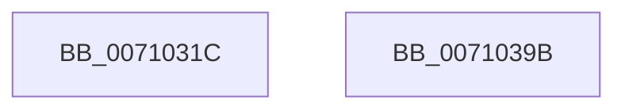

# CcAllocateObcb

- RVA: `0x0071031C`–`0x0071039C` (길이 `128` bytes)
- VA: `0x000000014071031C`
- 실행 섹션: `PAGE`
- PDB 이름 있음: `예`; PDB Function 태그: `아니요`
- unwind 정보 RVA: `0x0005C954`
- 디코드: `34`개 명령, `128/128` bytes 표시
- 미해석 바이트: `0` (있으면 어셈블리에 `.byte`로 보존)

> 이 문서는 커널 이미지의 기계어와 PDB 기호를 분석해 생성했습니다. 4번과 5번은 함수 원형과 자료형을 바이너리 사용 방식에서 추정한 C 해석이며 원본 소스 복구 결과는 아닙니다.

## 1. Dependencies

- 직접 호출 지점: **1**; 고유 호출 대상: **1**
- 직접 호출자로 확인된 함수: **3**
- RIP 상대 이미지 참조: **0**

### Outgoing calls
- `0x0071036A` → [ExAllocatePoolWithTag](../../poolcode/B8/ExAllocatePoolWithTag_function_00B82010.md) (function, `0x00B82010`)

### Direct callers
- [CcPinMappedData](../9D/CcPinMappedData_function_009D5B50.md) at `0x009D5C8E`
- [CcPreparePinWrite](../A4/CcPreparePinWrite_function_00A4C1C0.md) at `0x00A4C32E`
- [CcPinRead](../A7/CcPinRead_function_00A703B0.md) at `0x00A704F9`

### Static image references
- 디코드된 RIP-relative 메모리 참조가 없습니다.

## 2. Other-region calls and transfers

- 다른 실행 섹션으로 향하는 call: **1**
  - `0x0071036A` → [ExAllocatePoolWithTag](../../poolcode/B8/ExAllocatePoolWithTag_function_00B82010.md) (`PAGE` → `POOLCODE`)
- 별도 외부 분기/꼬리 이동을 확인하지 못했습니다.

## 3. Assembly (complete function range)

```asm
0071031C  48 89 5C 24 08                  mov qword ptr [rsp + 8], rbx
00710321  48 89 6C 24 10                  mov qword ptr [rsp + 0x10], rbp
00710326  48 89 74 24 18                  mov qword ptr [rsp + 0x18], rsi
0071032B  57                              push rdi
0071032C  48 83 EC 20                     sub rsp, 0x20
00710330  44 8B 09                        mov r9d, dword ptr [rcx]
00710333  8D 82 FF 0F 00 00               lea eax, [rdx + 0xfff]
00710339  4D 8B D0                        mov r10, r8
0071033C  49 8B E8                        mov rbp, r8
0071033F  49 83 E2 FE                     and r10, 0xfffffffffffffffe
00710343  8B FA                           mov edi, edx
00710345  48 8B F1                        mov rsi, rcx
00710348  41 B8 43 63 4F 62               mov r8d, 0x624f6343
0071034E  B9 10 06 00 00                  mov ecx, 0x610
00710353  45 2B 4A 08                     sub r9d, dword ptr [r10 + 8]
00710357  45 2B 4A 04                     sub r9d, dword ptr [r10 + 4]
0071035B  41 03 C1                        add eax, r9d
0071035E  C1 E8 0C                        shr eax, 0xc
00710361  8D 1C C5 20 00 00 00            lea ebx, [rax*8 + 0x20]
00710368  8B D3                           mov edx, ebx
0071036A  E8 A1 1C 47 00                  call 0x140b82010
0071036F  66 89 58 02                     mov word ptr [rax + 2], bx
00710373  48 8B 5C 24 30                  mov rbx, qword ptr [rsp + 0x30]
00710378  66 C7 00 FA 02                  mov word ptr [rax], 0x2fa
0071037D  89 78 04                        mov dword ptr [rax + 4], edi
00710380  48 8B 0E                        mov rcx, qword ptr [rsi]
00710383  48 8B 74 24 40                  mov rsi, qword ptr [rsp + 0x40]
00710388  48 89 48 08                     mov qword ptr [rax + 8], rcx
0071038C  48 89 68 10                     mov qword ptr [rax + 0x10], rbp
00710390  48 8B 6C 24 38                  mov rbp, qword ptr [rsp + 0x38]
00710395  48 83 C4 20                     add rsp, 0x20
00710399  5F                              pop rdi
0071039A  C3                              ret
0071039B  CC                              int3
```

## 4. C-style interpretation (structured pseudocode)

```c
__int64 __fastcall CcAllocateObcb(__int64 a1, __int64 a2, __int64 a3)
{
    __int64 result;
    __int64 v_r10;
    __int64 v_rsp;
    unsigned __int64 v_stack_p10;
    unsigned __int64 v_stack_p18;
    unsigned __int64 v_stack_p8;

    v_stack_p8 = v_rbx;
    v_stack_p10 = v_rbp;
    v_stack_p18 = v_rsi;
    v_rsp = (v_rsp) - (32);
    v_r10 = (a3) & (-2);
    a4 = (unsigned int)(((unsigned int)(*(unsigned int *)(a1))) - (*(unsigned int *)(v_r10 + 8)));
    a4 = (unsigned int)((a4) - (*(unsigned int *)(v_r10 + 4)));
    result = (unsigned int)((a2 + 4095) + ((unsigned int)(a4)));
    result = (unsigned int)((result) >> (12));
    result = ExAllocatePoolWithTag((unsigned int)(0x610ULL), (unsigned int)((unsigned int)(result * 8 + 32)), (unsigned int)(0x624F6343ULL), a4);
    *(unsigned __int16 *)(result + 2) = (unsigned __int16)(result * 8 + 32);
    *(unsigned __int16 *)(result) = 762;
    *(unsigned int *)(result + 4) = (unsigned int)((unsigned int)((unsigned int)(a2)));
    *(unsigned __int64 *)(result + 8) = *(unsigned __int64 *)(a1);
    *(unsigned __int64 *)(result + 16) = a3;
    v_rsp = (v_rsp) + (32);
    return result;
}
```

## 5. (Beta) C Style

```c
int64_t CcAllocateObcb(void *Arg1, void *Arg2, void *Arg3)
{
    uint8_t *arg1 = (uint8_t *)Arg1;
    uint8_t *arg2 = (uint8_t *)Arg2;
    uint8_t *arg3 = (uint8_t *)Arg3;

    int64_t result;
    int64_t local_r10;
    int64_t local_rsp;
    uint64_t v_stack_p10;
    uint64_t v_stack_p18;
    uint64_t v_stack_p8;

    v_stack_p8 = local_rbx;
    v_stack_p10 = local_rbp;
    v_stack_p18 = local_rsi;
    local_rsp = (local_rsp) - (32);
    local_r10 = (Arg3) & (-2);
    a4 = (uint32_t)(((uint32_t)(*(uint32_t *)(arg1))) - (*(uint32_t *)(local_r10 + 0x8)));
    a4 = (uint32_t)((a4) - (*(uint32_t *)(local_r10 + 0x4)));
    result = (uint32_t)((Arg2 + 4095) + ((uint32_t)(a4)));
    result = (uint32_t)((result) >> (12));
    result = ExAllocatePoolWithTag((uint32_t)(0x610ULL), (uint32_t)((uint32_t)(result * 8 + 32)), (uint32_t)(0x624F6343ULL), a4);
    *(uint16_t *)(result + 0x2) = (uint16_t)(result * 8 + 32);
    *(uint16_t *)(result) = 762;
    *(uint32_t *)(result + 0x4) = (uint32_t)((uint32_t)((uint32_t)(Arg2)));
    *(uint64_t *)(result + 0x8) = *(uint64_t *)(arg1);
    *(void **)(result + 0x10) = Arg3;
    local_rsp = (local_rsp) + (32);
    return result;
}
```

### 관측된 메모리 오프셋

구조체 형식이 확인되지 않은 접근은 인자 기준의 오프셋으로만 기록했습니다.

| 기준 인자 | 오프셋 표현 | 폭 (bit) | 접근 |
|---|---:|---:|---|
| `Arg1` | `+ 0x0` | `32` | `R` |
| `Arg1` | `+ 0x0` | `64` | `R` |
| `Arg2` | `+ 0xFFF` | `32` | `R` |
| `Arg3` | `+ 0x4` | `32` | `R` |
| `Arg3` | `+ 0x8` | `32` | `R` |

## 6. Execution-region graph

[열기: 2D/3D 그래프와 함수 탐색 컨트롤 패널](../../../control-panel.html?section=page&rva=0x0071031C&view=graph)

- 2D 그래프는 위에서 아래로 흐르고, 3D 그래프는 빈 공간을 드래그해 회전합니다. Shift+드래그는 이동, 휠은 확대·축소, 함수 노드 선택은 대상 보고서 이동입니다.

### Static fallback


