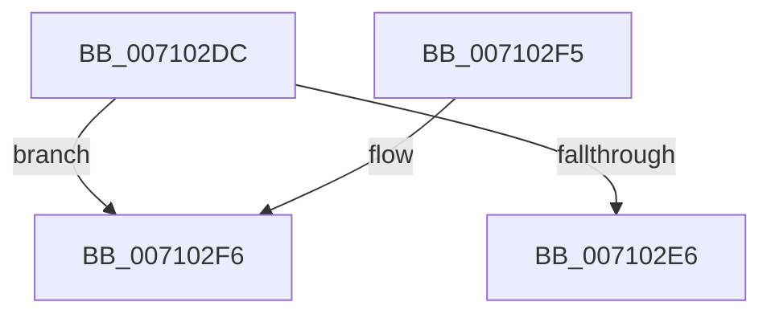

# CcFreeVacbArray

- RVA: `0x007102DC`–`0x00710315` (길이 `57` bytes)
- VA: `0x00000001407102DC`
- 실행 섹션: `PAGE`
- PDB 이름 있음: `예`; PDB Function 태그: `아니요`
- unwind 정보 RVA: `0x0007D698`
- 디코드: `15`개 명령, `57/57` bytes 표시
- 미해석 바이트: `0` (있으면 어셈블리에 `.byte`로 보존)

> 이 문서는 커널 이미지의 기계어와 PDB 기호를 분석해 생성했습니다. 4번과 5번은 함수 원형과 자료형을 바이너리 사용 방식에서 추정한 C 해석이며 원본 소스 복구 결과는 아닙니다.

## 1. Dependencies

- 직접 호출 지점: **2**; 고유 호출 대상: **2**
- 직접 호출자로 확인된 함수: **1**
- RIP 상대 이미지 참조: **0**

### Outgoing calls
- `0x007102EB` → [ExFreePoolWithTag](../../poolcode/B8/ExFreePoolWithTag_function_00B82870.md) (function, `0x00B82870`)
- `0x0071030F` → [KeBugCheckEx](../../text/4F/KeBugCheckEx_function_004FD660.md) (function, `0x004FD660`)

### Direct callers
- [CcDereferenceVacbArray](../../text/44/CcDereferenceVacbArray_function_004427B0.md) at `0x0044284A`

### Static image references
- 디코드된 RIP-relative 메모리 참조가 없습니다.

## 2. Other-region calls and transfers

- 다른 실행 섹션으로 향하는 call: **2**
  - `0x007102EB` → [ExFreePoolWithTag](../../poolcode/B8/ExFreePoolWithTag_function_00B82870.md) (`PAGE` → `POOLCODE`)
  - `0x0071030F` → [KeBugCheckEx](../../text/4F/KeBugCheckEx_function_004FD660.md) (`PAGE` → `.text`)
- 별도 외부 분기/꼬리 이동을 확인하지 못했습니다.

## 3. Assembly (complete function range)

```asm
007102DC  48 83 EC 38                     sub rsp, 0x38
007102E0  83 79 04 00                     cmp dword ptr [rcx + 4], 0
007102E4  75 10                           jne 0x1407102f6
007102E6  BA 56 63 56 61                  mov edx, 0x61566356
007102EB  E8 80 25 47 00                  call 0x140b82870
007102F0  48 83 C4 38                     add rsp, 0x38
007102F4  C3                              ret
007102F5  CC                              int3
007102F6  48 83 64 24 20 00               and qword ptr [rsp + 0x20], 0
007102FC  45 33 C9                        xor r9d, r9d
007102FF  BA 95 02 00 00                  mov edx, 0x295
00710304  49 C7 C0 20 04 00 C0            mov r8, 0xffffffffc0000420
0071030B  41 8D 49 34                     lea ecx, [r9 + 0x34]
0071030F  E8 4C D3 DE FF                  call 0x1404fd660
00710314  CC                              int3
```

## 4. C-style interpretation (structured pseudocode)

```c
__int64 __fastcall CcFreeVacbArray(__int64 a1, __int64 a2, __int64 a3, int a4)
{
    __int64 result;
    __int64 v_rsp;
    unsigned __int64 v_stack_p20;

    v_rsp = (v_rsp) - (56);
    if ((*(unsigned int *)(a1 + 4)) != 0) goto loc_007102F6;
    result = ExFreePoolWithTag(a1, (unsigned int)(0x61566356ULL), a3, a4);
    v_rsp = (v_rsp) + (56);
    return result;
loc_007102F6:
    a4 = 0;
    result = KeBugCheckEx(a4 + 52, 661, 0xFFFFFFFFC0000420ULL, a4);
    return result;
}
```

## 5. (Beta) C Style

```c
int64_t CcFreeVacbArray(void *Arg1, int64_t Arg2, int64_t Arg3, int32_t Arg4)
{
    uint8_t *arg1 = (uint8_t *)Arg1;

    int64_t result;
    int64_t local_rsp;
    uint64_t v_stack_p20;

    local_rsp = (local_rsp) - (56);
    if ((*(uint32_t *)(arg1 + 0x4)) != 0) goto loc_007102F6;
    result = ExFreePoolWithTag(Arg1, (uint32_t)(0x61566356ULL), Arg3, Arg4);
    local_rsp = (local_rsp) + (56);
    return result;
loc_007102F6:
    Arg4 = 0;
    result = KeBugCheckEx(Arg4 + 52, 661, 0xFFFFFFFFC0000420ULL, Arg4);
    return result;
}
```

### 관측된 메모리 오프셋

구조체 형식이 확인되지 않은 접근은 인자 기준의 오프셋으로만 기록했습니다.

| 기준 인자 | 오프셋 표현 | 폭 (bit) | 접근 |
|---|---:|---:|---|
| `Arg1` | `+ 0x4` | `32` | `R` |

## 6. Execution-region graph

[열기: 2D/3D 그래프와 함수 탐색 컨트롤 패널](../../../control-panel.html?section=page&rva=0x007102DC&view=graph)

- 2D 그래프는 위에서 아래로 흐르고, 3D 그래프는 빈 공간을 드래그해 회전합니다. Shift+드래그는 이동, 휠은 확대·축소, 함수 노드 선택은 대상 보고서 이동입니다.

### Static fallback


