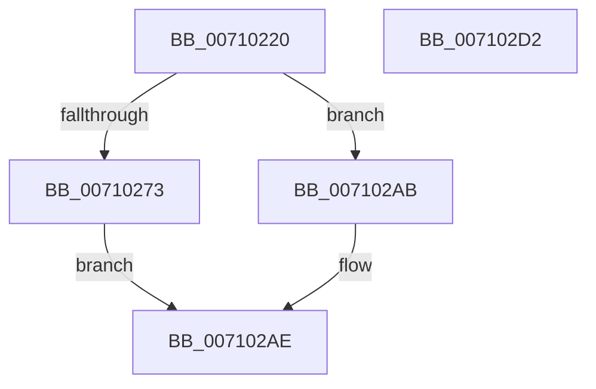

# CcInitializeProcessor

- RVA: `0x00710220`–`0x007102D3` (길이 `179` bytes)
- VA: `0x0000000140710220`
- 실행 섹션: `PAGE`
- PDB 이름 있음: `예`; PDB Function 태그: `아니요`
- unwind 정보 RVA: `0x0005D7BC`
- 디코드: `44`개 명령, `179/179` bytes 표시
- 미해석 바이트: `0` (있으면 어셈블리에 `.byte`로 보존)

> 이 문서는 커널 이미지의 기계어와 PDB 기호를 분석해 생성했습니다. 4번과 5번은 함수 원형과 자료형을 바이너리 사용 방식에서 추정한 C 해석이며 원본 소스 복구 결과는 아닙니다.

## 1. Dependencies

- 직접 호출 지점: **3**; 고유 호출 대상: **3**
- 직접 호출자로 확인된 함수: **2**
- RIP 상대 이미지 참조: **2**

### Outgoing calls
- `0x0071023C` → [MmIsThisAnNtAsSystem](../../text/4B/MmIsThisAnNtAsSystem_function_004B2860.md) (function, `0x004B2860`)
- `0x00710266` → [ExAllocatePoolWithTag](../../poolcode/B8/ExAllocatePoolWithTag_function_00B82010.md) (function, `0x00B82010`)
- `0x007102A4` → [ExInitializeSystemLookasideList](../../pagelk/B7/ExInitializeSystemLookasideList_function_00B7E57C.md) (function, `0x00B7E57C`)

### Direct callers
- [KiStartDynamicProcessor](../74/KiStartDynamicProcessor_function_007456C8.md) at `0x00745922`
- [CcInitializeCacheManager](../../init/BE/CcInitializeCacheManager_function_00BEE2E8.md) at `0x00BEE5F4`

### Static image references
- `0x00710247` → RVA `0x00E11B00` (`.data`; read)
- `0x00710276` → RVA `0x00EFAC00` (`.data`; read)

## 2. Other-region calls and transfers

- 다른 실행 섹션으로 향하는 call: **3**
  - `0x0071023C` → [MmIsThisAnNtAsSystem](../../text/4B/MmIsThisAnNtAsSystem_function_004B2860.md) (`PAGE` → `.text`)
  - `0x00710266` → [ExAllocatePoolWithTag](../../poolcode/B8/ExAllocatePoolWithTag_function_00B82010.md) (`PAGE` → `POOLCODE`)
  - `0x007102A4` → [ExInitializeSystemLookasideList](../../pagelk/B7/ExInitializeSystemLookasideList_function_00B7E57C.md) (`PAGE` → `PAGELK`)
- 별도 외부 분기/꼬리 이동을 확인하지 못했습니다.

## 3. Assembly (complete function range)

```asm
00710220  48 8B C4                        mov rax, rsp
00710223  48 89 58 08                     mov qword ptr [rax + 8], rbx
00710227  48 89 68 10                     mov qword ptr [rax + 0x10], rbp
0071022B  48 89 70 18                     mov qword ptr [rax + 0x18], rsi
0071022F  48 89 78 20                     mov qword ptr [rax + 0x20], rdi
00710233  41 56                           push r14
00710235  48 83 EC 30                     sub rsp, 0x30
00710239  48 8B F9                        mov rdi, rcx
0071023C  E8 1F 26 DA FF                  call 0x1404b2860
00710241  41 BE 80 00 00 00               mov r14d, 0x80
00710247  48 8D 2D B2 18 70 00            lea rbp, [rip + 0x7018b2]
0071024E  41 8B D6                        mov edx, r14d
00710251  48 89 AF 68 08 00 00            mov qword ptr [rdi + 0x868], rbp
00710258  41 B8 43 63 57 4B               mov r8d, 0x4b576343
0071025E  B9 00 02 00 00                  mov ecx, 0x200
00710263  40 8A F0                        mov sil, al
00710266  E8 A5 1D 47 00                  call 0x140b82010
0071026B  48 8B D8                        mov rbx, rax
0071026E  48 85 C0                        test rax, rax
00710271  74 38                           je 0x1407102ab
00710273  40 F6 DE                        neg sil
00710276  48 8D 05 83 A9 7E 00            lea rax, [rip + 0x7ea983]
0071027D  48 89 44 24 28                  mov qword ptr [rsp + 0x28], rax
00710282  45 8D 46 20                     lea r8d, [r14 + 0x20]
00710286  66 1B C9                        sbb cx, cx
00710289  BA 00 02 00 00                  mov edx, 0x200
0071028E  66 41 23 CE                     and cx, r14w
00710292  41 B9 43 63 57 4B               mov r9d, 0x4b576343
00710298  66 41 03 CE                     add cx, r14w
0071029C  66 89 4C 24 20                  mov word ptr [rsp + 0x20], cx
007102A1  48 8B CB                        mov rcx, rbx
007102A4  E8 D3 E2 46 00                  call 0x140b7e57c
007102A9  EB 03                           jmp 0x1407102ae
007102AB  48 8B DD                        mov rbx, rbp
007102AE  48 8B 6C 24 48                  mov rbp, qword ptr [rsp + 0x48]
007102B3  33 C0                           xor eax, eax
007102B5  48 8B 74 24 50                  mov rsi, qword ptr [rsp + 0x50]
007102BA  48 89 9F 60 08 00 00            mov qword ptr [rdi + 0x860], rbx
007102C1  48 8B 5C 24 40                  mov rbx, qword ptr [rsp + 0x40]
007102C6  48 8B 7C 24 58                  mov rdi, qword ptr [rsp + 0x58]
007102CB  48 83 C4 30                     add rsp, 0x30
007102CF  41 5E                           pop r14
007102D1  C3                              ret
007102D2  CC                              int3
```

## 4. C-style interpretation (structured pseudocode)

```c
__int64 __fastcall CcInitializeProcessor(__int64 a1)
{
    __int64 result;
    __int64 v_rsi;
    __int64 v_rsp;
    unsigned __int64 v_stack_m10;
    unsigned __int16 v_stack_m18;
    unsigned __int64 v_stack_p10;
    unsigned __int64 v_stack_p18;
    unsigned __int64 v_stack_p20;
    unsigned __int64 v_stack_p8;

    *(unsigned __int64 *)(v_rsp + 8) = v_rbx;
    *(unsigned __int64 *)(v_rsp + 16) = v_rbp;
    *(unsigned __int64 *)(v_rsp + 24) = v_rsi;
    *(unsigned __int64 *)(v_rsp + 32) = v_rdi;
    v_rsp = (v_rsp) - (48);
    result = MmIsThisAnNtAsSystem(a1, a2, a3, a4);
    *(unsigned __int64 *)(a1 + 2152) = v_rip + 7346354;
    result = ExAllocatePoolWithTag(512, 128, (unsigned int)(0x4B576343ULL), a4);
    if (result == 0) goto loc_007102AB;
    v_rsi = (unsigned __int8)(-((unsigned __int8)(result)));
    v_stack_m10 = v_rip + 8300931;
    a1 = (unsigned __int16)((512) & (128));
    a1 = (unsigned __int16)((a1) + (128));
    v_stack_m18 = (unsigned __int16)(a1);
    result = ExInitializeSystemLookasideList(result, 512, 128 + 32, (unsigned int)(0x4B576343ULL));
    goto loc_007102AE;
loc_007102AB:
loc_007102AE:
    result = 0;
    *(unsigned __int64 *)(a1 + 2144) = v_rip + 7346354;
    v_rsp = (v_rsp) + (48);
    return result;
}
```

## 5. (Beta) C Style

```c
int64_t CcInitializeProcessor(void *Arg1)
{
    uint8_t *arg1 = (uint8_t *)Arg1;

    int64_t result;
    int64_t local_rsi;
    int64_t local_rsp;
    uint64_t v_stack_m10;
    uint16_t v_stack_m18;
    uint64_t v_stack_p10;
    uint64_t v_stack_p18;
    uint64_t v_stack_p20;
    uint64_t v_stack_p8;

    *(uint64_t *)(local_rsp + 0x8) = local_rbx;
    *(uint64_t *)(local_rsp + 0x10) = local_rbp;
    *(uint64_t *)(local_rsp + 0x18) = local_rsi;
    *(uint64_t *)(local_rsp + 0x20) = local_rdi;
    local_rsp = (local_rsp) - (48);
    result = MmIsThisAnNtAsSystem(Arg1, a2, a3, a4);
    *(uint64_t *)(arg1 + 0x868) = v_rip + 7346354;
    result = ExAllocatePoolWithTag(512, 128, (uint32_t)(0x4B576343ULL), a4);
    if (result == 0) goto loc_007102AB;
    local_rsi = (uint8_t)(-((uint8_t)(result)));
    v_stack_m10 = v_rip + 8300931;
    Arg1 = (uint16_t)((512) & (128));
    Arg1 = (uint16_t)((Arg1) + (128));
    v_stack_m18 = (uint16_t)(Arg1);
    result = ExInitializeSystemLookasideList(result, 512, 128 + 32, (uint32_t)(0x4B576343ULL));
    goto loc_007102AE;
loc_007102AB:
loc_007102AE:
    result = 0;
    *(uint64_t *)(arg1 + 0x860) = v_rip + 7346354;
    local_rsp = (local_rsp) + (48);
    return result;
}
```

### 관측된 메모리 오프셋

구조체 형식이 확인되지 않은 접근은 인자 기준의 오프셋으로만 기록했습니다.

| 기준 인자 | 오프셋 표현 | 폭 (bit) | 접근 |
|---|---:|---:|---|
| `Arg1` | `+ 0x860` | `64` | `W` |
| `Arg1` | `+ 0x868` | `64` | `W` |

## 6. Execution-region graph

[열기: 2D/3D 그래프와 함수 탐색 컨트롤 패널](../../../control-panel.html?section=page&rva=0x00710220&view=graph)

- 2D 그래프는 위에서 아래로 흐르고, 3D 그래프는 빈 공간을 드래그해 회전합니다. Shift+드래그는 이동, 휠은 확대·축소, 함수 노드 선택은 대상 보고서 이동입니다.

### Static fallback


