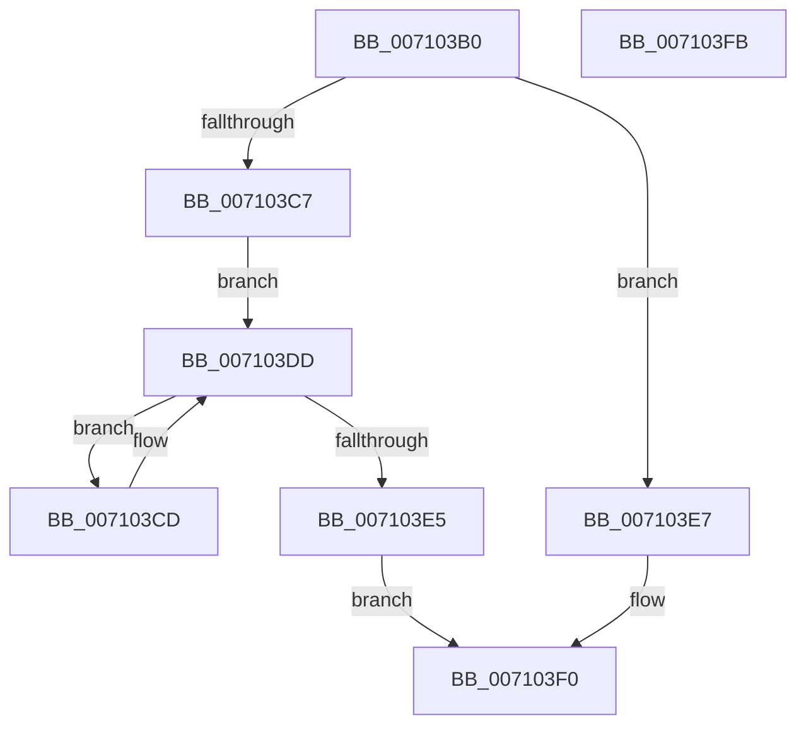

# CcSetBcbOwnerPointer

- RVA: `0x007103B0`–`0x007103FC` (길이 `76` bytes)
- VA: `0x00000001407103B0`
- 실행 섹션: `PAGE`
- PDB 이름 있음: `예`; PDB Function 태그: `아니요`
- unwind 정보 RVA: `0x0005CAAC`
- 디코드: `24`개 명령, `76/76` bytes 표시
- 미해석 바이트: `0` (있으면 어셈블리에 `.byte`로 보존)

> 이 문서는 커널 이미지의 기계어와 PDB 기호를 분석해 생성했습니다. 4번과 5번은 함수 원형과 자료형을 바이너리 사용 방식에서 추정한 C 해석이며 원본 소스 복구 결과는 아닙니다.

## 1. Dependencies

- 직접 호출 지점: **2**; 고유 호출 대상: **1**
- 직접 호출자로 확인된 함수: **0**
- RIP 상대 이미지 참조: **0**

### Outgoing calls
- `0x007103D4` → [ExSetResourceOwnerPointer](../../text/46/ExSetResourceOwnerPointer_function_004663D0.md) (function, `0x004663D0`)
- `0x007103EB` → [ExSetResourceOwnerPointer](../../text/46/ExSetResourceOwnerPointer_function_004663D0.md) (function, `0x004663D0`)

### Direct callers
- 이 함수 시작 RVA로 연결되는 직접 call은 확인되지 않았습니다. 간접 호출은 완전히 역산할 수 없습니다.

### Static image references
- 디코드된 RIP-relative 메모리 참조가 없습니다.

## 2. Other-region calls and transfers

- 다른 실행 섹션으로 향하는 call: **2**
  - `0x007103D4` → [ExSetResourceOwnerPointer](../../text/46/ExSetResourceOwnerPointer_function_004663D0.md) (`PAGE` → `.text`)
  - `0x007103EB` → [ExSetResourceOwnerPointer](../../text/46/ExSetResourceOwnerPointer_function_004663D0.md) (`PAGE` → `.text`)
- 별도 외부 분기/꼬리 이동을 확인하지 못했습니다.

## 3. Assembly (complete function range)

```asm
007103B0  48 89 5C 24 08                  mov qword ptr [rsp + 8], rbx
007103B5  57                              push rdi
007103B6  48 83 EC 20                     sub rsp, 0x20
007103BA  B8 FA 02 00 00                  mov eax, 0x2fa
007103BF  48 8B FA                        mov rdi, rdx
007103C2  66 39 01                        cmp word ptr [rcx], ax
007103C5  75 20                           jne 0x1407103e7
007103C7  48 8D 59 10                     lea rbx, [rcx + 0x10]
007103CB  EB 10                           jmp 0x1407103dd
007103CD  48 8D 48 48                     lea rcx, [rax + 0x48]
007103D1  48 8B D7                        mov rdx, rdi
007103D4  E8 F7 5F D5 FF                  call 0x1404663d0
007103D9  48 8D 5B 08                     lea rbx, [rbx + 8]
007103DD  48 8B 03                        mov rax, qword ptr [rbx]
007103E0  48 85 C0                        test rax, rax
007103E3  75 E8                           jne 0x1407103cd
007103E5  EB 09                           jmp 0x1407103f0
007103E7  48 83 C1 48                     add rcx, 0x48
007103EB  E8 E0 5F D5 FF                  call 0x1404663d0
007103F0  48 8B 5C 24 30                  mov rbx, qword ptr [rsp + 0x30]
007103F5  48 83 C4 20                     add rsp, 0x20
007103F9  5F                              pop rdi
007103FA  C3                              ret
007103FB  CC                              int3
```

## 4. C-style interpretation (structured pseudocode)

```c
__int64 __fastcall CcSetBcbOwnerPointer(__int64 a1, __int64 a2)
{
    __int64 result;
    __int64 v_rsp;
    unsigned __int64 v_stack_p8;

    v_stack_p8 = v_rbx;
    v_rsp = (v_rsp) - (32);
    if ((*(unsigned __int16 *)(a1)) != 762) goto loc_007103E7;
    goto loc_007103DD;
loc_007103CD:
    result = ExSetResourceOwnerPointer(762 + 72, a2, a3, a4);
loc_007103DD:
    if (*(unsigned __int64 *)(a1 + 16 + 8) != 0) goto loc_007103CD;
    goto loc_007103F0;
loc_007103E7:
    a1 = (762 + 72) + (72);
    result = ExSetResourceOwnerPointer(a1, a2, a3, a4);
loc_007103F0:
    v_rsp = (v_rsp) + (32);
    return result;
}
```

## 5. (Beta) C Style

```c
int64_t CcSetBcbOwnerPointer(void *Arg1, int64_t Arg2)
{
    uint8_t *arg1 = (uint8_t *)Arg1;

    int64_t result;
    int64_t local_rsp;
    uint64_t v_stack_p8;

    v_stack_p8 = local_rbx;
    local_rsp = (local_rsp) - (32);
    if ((*(uint16_t *)(arg1)) != 762) goto loc_007103E7;
    goto loc_007103DD;
loc_007103CD:
    result = ExSetResourceOwnerPointer(762 + 72, Arg2, a3, a4);
loc_007103DD:
    if (*(uint64_t *)(arg1 + 0x10 + 0x8) != 0) goto loc_007103CD;
    goto loc_007103F0;
loc_007103E7:
    Arg1 = (762 + 72) + (72);
    result = ExSetResourceOwnerPointer(Arg1, Arg2, a3, a4);
loc_007103F0:
    local_rsp = (local_rsp) + (32);
    return result;
}
```

### 관측된 메모리 오프셋

구조체 형식이 확인되지 않은 접근은 인자 기준의 오프셋으로만 기록했습니다.

| 기준 인자 | 오프셋 표현 | 폭 (bit) | 접근 |
|---|---:|---:|---|
| `Arg1` | `+ 0x0` | `16` | `R` |
| `Arg1` | `+ 0x0` | `64` | `R` |
| `Arg1` | `+ 0x8` | `64` | `R` |
| `Arg1` | `+ 0x10` | `64` | `R` |

## 6. Execution-region graph

[열기: 2D/3D 그래프와 함수 탐색 컨트롤 패널](../../../control-panel.html?section=page&rva=0x007103B0&view=graph)

- 2D 그래프는 위에서 아래로 흐르고, 3D 그래프는 빈 공간을 드래그해 회전합니다. Shift+드래그는 이동, 휠은 확대·축소, 함수 노드 선택은 대상 보고서 이동입니다.

### Static fallback


