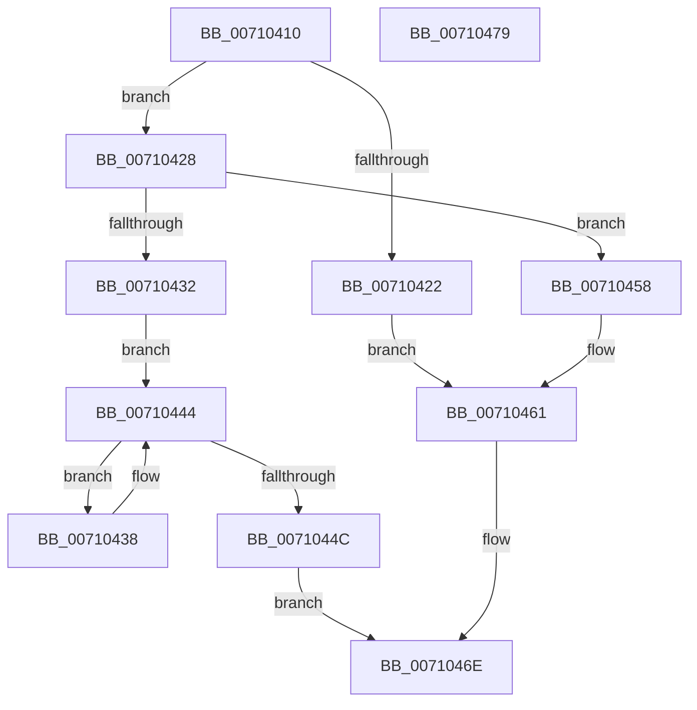

# CcUnpinDataForThread

- RVA: `0x00710410`–`0x0071047A` (길이 `106` bytes)
- VA: `0x0000000140710410`
- 실행 섹션: `PAGE`
- PDB 이름 있음: `예`; PDB Function 태그: `아니요`
- unwind 정보 RVA: `0x0005CAAC`
- 디코드: `34`개 명령, `106/106` bytes 표시
- 미해석 바이트: `0` (있으면 어셈블리에 `.byte`로 보존)

> 이 문서는 커널 이미지의 기계어와 PDB 기호를 분석해 생성했습니다. 4번과 5번은 함수 원형과 자료형을 바이너리 사용 방식에서 추정한 C 해석이며 원본 소스 복구 결과는 아닙니다.

## 1. Dependencies

- 직접 호출 지점: **4**; 고유 호출 대상: **4**
- 직접 호출자로 확인된 함수: **0**
- RIP 상대 이미지 참조: **0**

### Outgoing calls
- `0x0071043B` → [CcUnpinData](../9A/CcUnpinData_function_009A7A80.md) (function, `0x009A7A80`)
- `0x00710451` → [ExFreePoolWithTag](../../poolcode/B8/ExFreePoolWithTag_function_00B82870.md) (function, `0x00B82870`)
- `0x0071045C` → [ExReleaseResourceForThreadLite](../../text/27/ExReleaseResourceForThreadLite_function_00273C10.md) (function, `0x00273C10`)
- `0x00710469` → [CcUnpinFileDataEx](../../text/35/CcUnpinFileDataEx_function_00359DEC.md) (function, `0x00359DEC`)

### Direct callers
- 이 함수 시작 RVA로 연결되는 직접 call은 확인되지 않았습니다. 간접 호출은 완전히 역산할 수 없습니다.

### Static image references
- 디코드된 RIP-relative 메모리 참조가 없습니다.

## 2. Other-region calls and transfers

- 다른 실행 섹션으로 향하는 call: **3**
  - `0x00710451` → [ExFreePoolWithTag](../../poolcode/B8/ExFreePoolWithTag_function_00B82870.md) (`PAGE` → `POOLCODE`)
  - `0x0071045C` → [ExReleaseResourceForThreadLite](../../text/27/ExReleaseResourceForThreadLite_function_00273C10.md) (`PAGE` → `.text`)
  - `0x00710469` → [CcUnpinFileDataEx](../../text/35/CcUnpinFileDataEx_function_00359DEC.md) (`PAGE` → `.text`)
- 별도 외부 분기/꼬리 이동을 확인하지 못했습니다.

## 3. Assembly (complete function range)

```asm
00710410  48 89 5C 24 08                  mov qword ptr [rsp + 8], rbx
00710415  57                              push rdi
00710416  48 83 EC 20                     sub rsp, 0x20
0071041A  48 8B D9                        mov rbx, rcx
0071041D  F6 C1 01                        test cl, 1
00710420  74 06                           je 0x140710428
00710422  48 83 E3 FE                     and rbx, 0xfffffffffffffffe
00710426  EB 39                           jmp 0x140710461
00710428  B8 FA 02 00 00                  mov eax, 0x2fa
0071042D  66 39 01                        cmp word ptr [rcx], ax
00710430  75 26                           jne 0x140710458
00710432  48 8D 79 10                     lea rdi, [rcx + 0x10]
00710436  EB 0C                           jmp 0x140710444
00710438  48 8B C8                        mov rcx, rax
0071043B  E8 40 76 29 00                  call 0x1409a7a80
00710440  48 8D 7F 08                     lea rdi, [rdi + 8]
00710444  48 8B 07                        mov rax, qword ptr [rdi]
00710447  48 85 C0                        test rax, rax
0071044A  75 EC                           jne 0x140710438
0071044C  33 D2                           xor edx, edx
0071044E  48 8B CB                        mov rcx, rbx
00710451  E8 1A 24 47 00                  call 0x140b82870
00710456  EB 16                           jmp 0x14071046e
00710458  48 83 C1 48                     add rcx, 0x48
0071045C  E8 AF 37 B6 FF                  call 0x140273c10
00710461  45 33 C0                        xor r8d, r8d
00710464  B2 01                           mov dl, 1
00710466  48 8B CB                        mov rcx, rbx
00710469  E8 7E 99 C4 FF                  call 0x140359dec
0071046E  48 8B 5C 24 30                  mov rbx, qword ptr [rsp + 0x30]
00710473  48 83 C4 20                     add rsp, 0x20
00710477  5F                              pop rdi
00710478  C3                              ret
00710479  CC                              int3
```

## 4. C-style interpretation (structured pseudocode)

```c
__int64 __fastcall CcUnpinDataForThread(__int64 a1, int a2, int a3)
{
    __int64 result;
    __int64 v_rbx;
    __int64 v_rsp;
    unsigned __int64 v_stack_p8;

    v_stack_p8 = v_rbx;
    v_rsp = (v_rsp) - (32);
    if ((((unsigned __int8)(a1)) & (1)) == 0) goto loc_00710428;
    v_rbx = (a1) & (-2);
    goto loc_00710461;
loc_00710428:
    if ((*(unsigned __int16 *)(a1)) != 762) goto loc_00710458;
    goto loc_00710444;
loc_00710438:
    result = CcUnpinData(762, a2, a3, a4);
loc_00710444:
    if (*(unsigned __int64 *)(a1 + 16 + 8) != 0) goto loc_00710438;
    a2 = 0;
    result = ExFreePoolWithTag(v_rbx, a2, a3, a4);
    goto loc_0071046E;
loc_00710458:
    a1 = (v_rbx) + (72);
    result = ExReleaseResourceForThreadLite(a1, a2, a3, a4);
loc_00710461:
    a3 = 0;
    result = CcUnpinFileDataEx(v_rbx, 1, a3, a4);
loc_0071046E:
    v_rsp = (v_rsp) + (32);
    return result;
}
```

## 5. (Beta) C Style

```c
int64_t CcUnpinDataForThread(int64_t Arg1, int32_t Arg2, int32_t Arg3)
{
    int64_t result;
    int64_t local_rbx;
    int64_t local_rsp;
    uint64_t v_stack_p8;

    v_stack_p8 = local_rbx;
    local_rsp = (local_rsp) - (32);
    if ((((uint8_t)(Arg1)) & (1)) == 0) goto loc_00710428;
    local_rbx = (Arg1) & (-2);
    goto loc_00710461;
loc_00710428:
    if ((*(uint16_t *)(Arg1)) != 762) goto loc_00710458;
    goto loc_00710444;
loc_00710438:
    result = CcUnpinData(762, Arg2, Arg3, a4);
loc_00710444:
    if (*(uint64_t *)(Arg1 + 0x10 + 0x8) != 0) goto loc_00710438;
    Arg2 = 0;
    result = ExFreePoolWithTag(local_rbx, Arg2, Arg3, a4);
    goto loc_0071046E;
loc_00710458:
    Arg1 = (local_rbx) + (72);
    result = ExReleaseResourceForThreadLite(Arg1, Arg2, Arg3, a4);
loc_00710461:
    Arg3 = 0;
    result = CcUnpinFileDataEx(local_rbx, 1, Arg3, a4);
loc_0071046E:
    local_rsp = (local_rsp) + (32);
    return result;
}
```

## 6. Execution-region graph

[열기: 2D/3D 그래프와 함수 탐색 컨트롤 패널](../../../control-panel.html?section=page&rva=0x00710410&view=graph)

- 2D 그래프는 위에서 아래로 흐르고, 3D 그래프는 빈 공간을 드래그해 회전합니다. Shift+드래그는 이동, 휠은 확대·축소, 함수 노드 선택은 대상 보고서 이동입니다.

### Static fallback


