# DbgkCaptureLiveDump

- RVA: `0x0071113C`–`0x0071155D` (길이 `1,057` bytes)
- VA: `0x000000014071113C`
- 실행 섹션: `PAGE`
- PDB 이름 있음: `예`; PDB Function 태그: `아니요`
- unwind 정보 RVA: `0x000C5998`
- 디코드: `279`개 명령, `1,057/1,057` bytes 표시
- 미해석 바이트: `0` (있으면 어셈블리에 `.byte`로 보존)

> 이 문서는 커널 이미지의 기계어와 PDB 기호를 분석해 생성했습니다. 4번과 5번은 함수 원형과 자료형을 바이너리 사용 방식에서 추정한 C 해석이며 원본 소스 복구 결과는 아닙니다.

## 1. Dependencies

- 직접 호출 지점: **29**; 고유 호출 대상: **20**
- 직접 호출자로 확인된 함수: **1**
- RIP 상대 이미지 참조: **4**

### Outgoing calls
- `0x007111C9` → [DbgkpLkmdSqmIsOptedIn](DbgkpLkmdSqmIsOptedIn_function_00711C4C.md) (function, `0x00711C4C`)
- `0x007111E2` → [EtwRegister](../92/EtwRegister_function_00920960.md) (function, `0x00920960`)
- `0x007111F8` → [DbgkpLkmdSqmIncrementDword](../../text/58/DbgkpLkmdSqmIncrementDword_function_005801D8.md) (function, `0x005801D8`)
- `0x0071120D` → [ExAllocatePoolWithTag](../../poolcode/B8/ExAllocatePoolWithTag_function_00B82010.md) (function, `0x00B82010`)
- `0x0071123A` → [DbgkpTriageDumpInitialize](DbgkpTriageDumpInitialize_function_00712A74.md) (function, `0x00712A74`)
- `0x00711275` → [guard_dispatch_icall](../../text/6B/guard_dispatch_icall_function_006BAAD0.md) (function, `0x006BAAD0`)
- `0x00711288` → [DbgkpLkmdSnapGlobals](../../text/57/DbgkpLkmdSnapGlobals_function_0057FE0C.md) (function, `0x0057FE0C`)
- `0x007112A7` → [ExAllocatePoolWithTag](../../poolcode/B8/ExAllocatePoolWithTag_function_00B82010.md) (function, `0x00B82010`)
- `0x0071132A` → [ObReferenceObjectByHandle](../86/ObReferenceObjectByHandle_function_00868DB0.md) (function, `0x00868DB0`)
- `0x00711369` → [DbgkpLkmdSqmStatus](DbgkpLkmdSqmStatus_function_00711DEC.md) (function, `0x00711DEC`)
- `0x0071137B` → [IoThreadToProcess](../../text/44/IoThreadToProcess_function_00448540.md) (function, `0x00448540`)
- `0x00711390` → [ObfReferenceObjectWithTag](../../text/21/ObfReferenceObjectWithTag_function_00210710.md) (function, `0x00210710`)
- `0x007113B3` → [DbgkpLkmdSnapDataEx](../../text/57/DbgkpLkmdSnapDataEx_function_0057FDD4.md) (function, `0x0057FDD4`)
- `0x007113C5` → [DbgkpLkmdSnapThread](../../text/58/DbgkpLkmdSnapThread_function_00580174.md) (function, `0x00580174`)
- `0x007113E6` → [DbgkpLkmdFireCallbacks](DbgkpLkmdFireCallbacks_function_00711708.md) (function, `0x00711708`)
- `0x007113F7` → [DbgkpLkmdSqmStatus](DbgkpLkmdSqmStatus_function_00711DEC.md) (function, `0x00711DEC`)
- `0x007113FF` → [ObfDereferenceObject](../../text/2F/ObfDereferenceObject_function_002F9350.md) (function, `0x002F9350`)
- `0x00711441` → [DbgkpLkmdFireCallbacks](DbgkpLkmdFireCallbacks_function_00711708.md) (function, `0x00711708`)
- `0x0071145D` → [DbgkpLkmdSnapData](../../text/57/DbgkpLkmdSnapData_function_0057FDB0.md) (function, `0x0057FDB0`)
- `0x00711471` → [DbgkpLkmdSnapData](../../text/57/DbgkpLkmdSnapData_function_0057FDB0.md) (function, `0x0057FDB0`)
- `0x00711496` → [DbgkpLkmdSnapDataEx](../../text/57/DbgkpLkmdSnapDataEx_function_0057FDD4.md) (function, `0x0057FDD4`)
- `0x007114BC` → [guard_dispatch_icall](../../text/6B/guard_dispatch_icall_function_006BAAD0.md) (function, `0x006BAAD0`)
- `0x007114D9` → [ObfDereferenceObjectWithTag](../../text/2F/ObfDereferenceObjectWithTag_function_002F78E0.md) (function, `0x002F78E0`)
- `0x007114E6` → [ObfDereferenceObject](../../text/2F/ObfDereferenceObject_function_002F9350.md) (function, `0x002F9350`)
- `0x007114FC` → [ExFreePoolWithTag](../../poolcode/B8/ExFreePoolWithTag_function_00B82870.md) (function, `0x00B82870`)
- `0x0071150E` → [ExFreePoolWithTag](../../poolcode/B8/ExFreePoolWithTag_function_00B82870.md) (function, `0x00B82870`)
- `0x0071151B` → [EtwUnregister](../A7/EtwUnregister_function_00A723D0.md) (function, `0x00A723D0`)
- `0x0071152D` → [ExFreePoolWithTag](../../poolcode/B8/ExFreePoolWithTag_function_00B82870.md) (function, `0x00B82870`)
- `0x00711543` → [_security_check_cookie](../../text/6A/_security_check_cookie_function_006AC640.md) (function, `0x006AC640`)

### Direct callers
- [sub_00B3F842](../B3/Unknown_function_00B3F842.md) at `0x00B3FC4D`

### Static image references
- `0x00711155` → RVA `0x00E0A740` (`.data`; read)
- `0x007111DB` → RVA `0x00026340` (`.rdata`; read)
- `0x00711300` → RVA `0x00FC6AC8` (`ALMOSTRO`; read)
- `0x00711482` → RVA `0x00E65BC8` (`.data`; read)

## 2. Other-region calls and transfers

- 다른 실행 섹션으로 향하는 call: **20**
  - `0x007111F8` → [DbgkpLkmdSqmIncrementDword](../../text/58/DbgkpLkmdSqmIncrementDword_function_005801D8.md) (`PAGE` → `.text`)
  - `0x0071120D` → [ExAllocatePoolWithTag](../../poolcode/B8/ExAllocatePoolWithTag_function_00B82010.md) (`PAGE` → `POOLCODE`)
  - `0x00711275` → [guard_dispatch_icall](../../text/6B/guard_dispatch_icall_function_006BAAD0.md) (`PAGE` → `.text`)
  - `0x00711288` → [DbgkpLkmdSnapGlobals](../../text/57/DbgkpLkmdSnapGlobals_function_0057FE0C.md) (`PAGE` → `.text`)
  - `0x007112A7` → [ExAllocatePoolWithTag](../../poolcode/B8/ExAllocatePoolWithTag_function_00B82010.md) (`PAGE` → `POOLCODE`)
  - `0x0071137B` → [IoThreadToProcess](../../text/44/IoThreadToProcess_function_00448540.md) (`PAGE` → `.text`)
  - `0x00711390` → [ObfReferenceObjectWithTag](../../text/21/ObfReferenceObjectWithTag_function_00210710.md) (`PAGE` → `.text`)
  - `0x007113B3` → [DbgkpLkmdSnapDataEx](../../text/57/DbgkpLkmdSnapDataEx_function_0057FDD4.md) (`PAGE` → `.text`)
  - `0x007113C5` → [DbgkpLkmdSnapThread](../../text/58/DbgkpLkmdSnapThread_function_00580174.md) (`PAGE` → `.text`)
  - `0x007113FF` → [ObfDereferenceObject](../../text/2F/ObfDereferenceObject_function_002F9350.md) (`PAGE` → `.text`)
  - `0x0071145D` → [DbgkpLkmdSnapData](../../text/57/DbgkpLkmdSnapData_function_0057FDB0.md) (`PAGE` → `.text`)
  - `0x00711471` → [DbgkpLkmdSnapData](../../text/57/DbgkpLkmdSnapData_function_0057FDB0.md) (`PAGE` → `.text`)
  - `0x00711496` → [DbgkpLkmdSnapDataEx](../../text/57/DbgkpLkmdSnapDataEx_function_0057FDD4.md) (`PAGE` → `.text`)
  - `0x007114BC` → [guard_dispatch_icall](../../text/6B/guard_dispatch_icall_function_006BAAD0.md) (`PAGE` → `.text`)
  - `0x007114D9` → [ObfDereferenceObjectWithTag](../../text/2F/ObfDereferenceObjectWithTag_function_002F78E0.md) (`PAGE` → `.text`)
  - `0x007114E6` → [ObfDereferenceObject](../../text/2F/ObfDereferenceObject_function_002F9350.md) (`PAGE` → `.text`)
  - `0x007114FC` → [ExFreePoolWithTag](../../poolcode/B8/ExFreePoolWithTag_function_00B82870.md) (`PAGE` → `POOLCODE`)
  - `0x0071150E` → [ExFreePoolWithTag](../../poolcode/B8/ExFreePoolWithTag_function_00B82870.md) (`PAGE` → `POOLCODE`)
  - `0x0071152D` → [ExFreePoolWithTag](../../poolcode/B8/ExFreePoolWithTag_function_00B82870.md) (`PAGE` → `POOLCODE`)
  - `0x00711543` → [_security_check_cookie](../../text/6A/_security_check_cookie_function_006AC640.md) (`PAGE` → `.text`)
- 별도 외부 분기/꼬리 이동을 확인하지 못했습니다.

## 3. Assembly (complete function range)

```asm
0071113C  40 55                           push rbp
0071113E  53                              push rbx
0071113F  56                              push rsi
00711140  57                              push rdi
00711141  41 54                           push r12
00711143  41 55                           push r13
00711145  41 56                           push r14
00711147  41 57                           push r15
00711149  48 8D 6C 24 E1                  lea rbp, [rsp - 0x1f]
0071114E  48 81 EC 98 00 00 00            sub rsp, 0x98
00711155  48 8B 05 E4 95 6F 00            mov rax, qword ptr [rip + 0x6f95e4]
0071115C  48 33 C4                        xor rax, rsp
0071115F  48 89 45 0F                     mov qword ptr [rbp + 0xf], rax
00711163  65 48 8B 04 25 88 01 00 00      mov rax, qword ptr gs:[0x188]
0071116C  45 33 FF                        xor r15d, r15d
0071116F  45 33 ED                        xor r13d, r13d
00711172  4C 89 4D F7                     mov qword ptr [rbp - 9], r9
00711176  45 33 E4                        xor r12d, r12d
00711179  48 89 55 D7                     mov qword ptr [rbp - 0x29], rdx
0071117D  33 F6                           xor esi, esi
0071117F  4C 89 7D CF                     mov qword ptr [rbp - 0x31], r15
00711183  8A 80 32 02 00 00               mov al, byte ptr [rax + 0x232]
00711189  0F 57 C0                        xorps xmm0, xmm0
0071118C  88 45 C8                        mov byte ptr [rbp - 0x38], al
0071118F  45 8B F0                        mov r14d, r8d
00711192  33 C0                           xor eax, eax
00711194  48 8B F9                        mov rdi, rcx
00711197  48 21 45 EF                     and qword ptr [rbp - 0x11], rax
0071119B  48 89 45 E3                     mov qword ptr [rbp - 0x1d], rax
0071119F  0F 11 45 FF                     movups xmmword ptr [rbp - 1], xmm0
007111A3  48 89 45 DF                     mov qword ptr [rbp - 0x21], rax
007111A7  39 41 2C                        cmp dword ptr [rcx + 0x2c], eax
007111AA  0F 84 87 03 00 00               je 0x140711537
007111B0  41 81 F8 00 00 04 00            cmp r8d, 0x40000
007111B7  0F 82 7A 03 00 00               jb 0x140711537
007111BD  F7 01 FE FF FF FF               test dword ptr [rcx], 0xfffffffe
007111C3  0F 85 6E 03 00 00               jne 0x140711537
007111C9  E8 7E 0A 00 00                  call 0x140711c4c
007111CE  84 C0                           test al, al
007111D0  74 2B                           je 0x1407111fd
007111D2  4C 8D 4D CF                     lea r9, [rbp - 0x31]
007111D6  45 33 C0                        xor r8d, r8d
007111D9  33 D2                           xor edx, edx
007111DB  48 8D 0D 5E 51 91 FF            lea rcx, [rip - 0x6eaea2]
007111E2  E8 79 F7 20 00                  call 0x140920960
007111E7  4C 8B 7D CF                     mov r15, qword ptr [rbp - 0x31]
007111EB  4D 85 FF                        test r15, r15
007111EE  74 0D                           je 0x1407111fd
007111F0  BA DC 0C 00 00                  mov edx, 0xcdc
007111F5  49 8B CF                        mov rcx, r15
007111F8  E8 DB EF E6 FF                  call 0x1405801d8
007111FD  BA 60 40 00 00                  mov edx, 0x4060
00711202  B9 00 06 00 00                  mov ecx, 0x600
00711207  41 B8 4C 44 4D 50               mov r8d, 0x504d444c
0071120D  E8 FE 0D 47 00                  call 0x140b82010
00711212  48 8B D8                        mov rbx, rax
00711215  48 85 C0                        test rax, rax
00711218  75 0B                           jne 0x140711225
0071121A  41 BE 9A 00 00 C0               mov r14d, 0xc000009a
00711220  E9 EE 02 00 00                  jmp 0x140711513
00711225  48 8B 55 D7                     mov rdx, qword ptr [rbp - 0x29]
00711229  4C 8D 88 30 40 00 00            lea r9, [rax + 0x4030]
00711230  48 8D 88 00 40 00 00            lea rcx, [rax + 0x4000]
00711237  45 8B C6                        mov r8d, r14d
0071123A  E8 35 18 00 00                  call 0x140712a74
0071123F  44 8B F0                        mov r14d, eax
00711242  85 C0                           test eax, eax
00711244  0F 88 A1 02 00 00               js 0x1407114eb
0071124A  48 8B 47 20                     mov rax, qword ptr [rdi + 0x20]
0071124E  48 8D 8B 00 40 00 00            lea rcx, [rbx + 0x4000]
00711255  4C 8B 4F 10                     mov r9, qword ptr [rdi + 0x10]
00711259  4C 8B 47 08                     mov r8, qword ptr [rdi + 8]
0071125D  8B 57 04                        mov edx, dword ptr [rdi + 4]
00711260  48 89 44 24 28                  mov qword ptr [rsp + 0x28], rax
00711265  48 8B 47 18                     mov rax, qword ptr [rdi + 0x18]
00711269  48 89 44 24 20                  mov qword ptr [rsp + 0x20], rax
0071126E  48 8B 83 30 40 00 00            mov rax, qword ptr [rbx + 0x4030]
00711275  E8 56 98 FA FF                  call 0x1406baad0
0071127A  44 8B F0                        mov r14d, eax
0071127D  85 C0                           test eax, eax
0071127F  0F 88 66 02 00 00               js 0x1407114eb
00711285  48 8B CB                        mov rcx, rbx
00711288  E8 7F EB E6 FF                  call 0x14057fe0c
0071128D  8B 47 2C                        mov eax, dword ptr [rdi + 0x2c]
00711290  B9 01 04 00 00                  mov ecx, 0x401
00711295  41 B8 4B 53 4E 70               mov r8d, 0x704e534b
0071129B  8D 04 85 04 00 00 00            lea eax, [rax*4 + 4]
007112A2  8B D0                           mov edx, eax
007112A4  89 45 CF                        mov dword ptr [rbp - 0x31], eax
007112A7  E8 64 0D 47 00                  call 0x140b82010
007112AC  48 8B F0                        mov rsi, rax
007112AF  48 85 C0                        test rax, rax
007112B2  74 1C                           je 0x1407112d0
007112B4  33 C9                           xor ecx, ecx
007112B6  39 4F 2C                        cmp dword ptr [rdi + 0x2c], ecx
007112B9  76 0E                           jbe 0x1407112c9
007112BB  C7 04 88 01 00 00 C0            mov dword ptr [rax + rcx*4], 0xc0000001
007112C2  FF C1                           inc ecx
007112C4  3B 4F 2C                        cmp ecx, dword ptr [rdi + 0x2c]
007112C7  72 F2                           jb 0x1407112bb
007112C9  C7 04 88 54 43 53 42            mov dword ptr [rax + rcx*4], 0x42534354
007112D0  33 C9                           xor ecx, ecx
007112D2  C6 45 C7 01                     mov byte ptr [rbp - 0x39], 1
007112D6  89 4D CB                        mov dword ptr [rbp - 0x35], ecx
007112D9  39 4F 2C                        cmp dword ptr [rdi + 0x2c], ecx
007112DC  0F 86 E4 01 00 00               jbe 0x1407114c6
007112E2  41 BE 9A 00 00 C0               mov r14d, 0xc000009a
007112E8  48 8B 47 30                     mov rax, qword ptr [rdi + 0x30]
007112EC  BA FF FF 1F 00                  mov edx, 0x1fffff
007112F1  03 4F 28                        add ecx, dword ptr [rdi + 0x28]
007112F4  83 65 07 00                     and dword ptr [rbp + 7], 0
007112F8  83 65 0B 00                     and dword ptr [rbp + 0xb], 0
007112FC  83 65 03 00                     and dword ptr [rbp + 3], 0
00711300  4C 8B 05 C1 57 8B 00            mov r8, qword ptr [rip + 0x8b57c1]
00711307  48 83 64 24 28 00               and qword ptr [rsp + 0x28], 0
0071130D  44 8A 4D C8                     mov r9b, byte ptr [rbp - 0x38]
00711311  48 83 65 D7 00                  and qword ptr [rbp - 0x29], 0
00711316  C7 45 FF 01 00 00 C0            mov dword ptr [rbp - 1], 0xc0000001
0071131D  48 8B 0C C8                     mov rcx, qword ptr [rax + rcx*8]
00711321  48 8D 45 D7                     lea rax, [rbp - 0x29]
00711325  48 89 44 24 20                  mov qword ptr [rsp + 0x20], rax
0071132A  E8 81 7A 15 00                  call 0x140868db0
0071132F  4C 8B 6D D7                     mov r13, qword ptr [rbp - 0x29]
00711333  8B D0                           mov edx, eax
00711335  0F B6 45 C7                     movzx eax, byte ptr [rbp - 0x39]
00711339  33 C9                           xor ecx, ecx
0071133B  81 FA 22 00 00 C0               cmp edx, 0xc0000022
00711341  0F 44 C8                        cmove ecx, eax
00711344  88 4D C7                        mov byte ptr [rbp - 0x39], cl
00711347  85 D2                           test edx, edx
00711349  79 28                           jns 0x140711373
0071134B  48 85 F6                        test rsi, rsi
0071134E  74 06                           je 0x140711356
00711350  8B 45 CB                        mov eax, dword ptr [rbp - 0x35]
00711353  89 14 86                        mov dword ptr [rsi + rax*4], edx
00711356  4D 85 FF                        test r15, r15
00711359  0F 84 AE 00 00 00               je 0x14071140d
0071135F  89 55 FF                        mov dword ptr [rbp - 1], edx
00711362  49 8B CF                        mov rcx, r15
00711365  48 8D 55 FF                     lea rdx, [rbp - 1]
00711369  E8 7E 0A 00 00                  call 0x140711dec
0071136E  E9 9A 00 00 00                  jmp 0x14071140d
00711373  4D 85 E4                        test r12, r12
00711376  75 40                           jne 0x1407113b8
00711378  49 8B CD                        mov rcx, r13
0071137B  E8 C0 71 D3 FF                  call 0x140448540
00711380  4C 8B E0                        mov r12, rax
00711383  48 85 C0                        test rax, rax
00711386  74 30                           je 0x1407113b8
00711388  BA 44 62 67 4C                  mov edx, 0x4c676244
0071138D  48 8B C8                        mov rcx, rax
00711390  E8 7B F3 AF FF                  call 0x140210710
00711395  48 83 64 24 28 00               and qword ptr [rsp + 0x28], 0
0071139B  41 B9 04 00 00 00               mov r9d, 4
007113A1  48 83 64 24 20 00               and qword ptr [rsp + 0x20], 0
007113A7  41 B8 40 08 00 00               mov r8d, 0x840
007113AD  49 8B D4                        mov rdx, r12
007113B0  48 8B CB                        mov rcx, rbx
007113B3  E8 1C EA E6 FF                  call 0x14057fdd4
007113B8  4C 8D 4D FF                     lea r9, [rbp - 1]
007113BC  4D 8B C5                        mov r8, r13
007113BF  48 8B D7                        mov rdx, rdi
007113C2  48 8B CB                        mov rcx, rbx
007113C5  E8 AA ED E6 FF                  call 0x140580174
007113CA  85 C0                           test eax, eax
007113CC  0F 44 45 FF                     cmove eax, dword ptr [rbp - 1]
007113D0  48 85 F6                        test rsi, rsi
007113D3  74 06                           je 0x1407113db
007113D5  8B 4D CB                        mov ecx, dword ptr [rbp - 0x35]
007113D8  89 04 8E                        mov dword ptr [rsi + rcx*4], eax
007113DB  4D 8B C5                        mov r8, r13
007113DE  BA 02 00 00 00                  mov edx, 2
007113E3  48 8B CB                        mov rcx, rbx
007113E6  E8 1D 03 00 00                  call 0x140711708
007113EB  4D 85 FF                        test r15, r15
007113EE  74 0C                           je 0x1407113fc
007113F0  48 8D 55 FF                     lea rdx, [rbp - 1]
007113F4  49 8B CF                        mov rcx, r15
007113F7  E8 F0 09 00 00                  call 0x140711dec
007113FC  49 8B CD                        mov rcx, r13
007113FF  E8 4C 7F BE FF                  call 0x1402f9350
00711404  45 33 ED                        xor r13d, r13d
00711407  44 39 75 FF                     cmp dword ptr [rbp - 1], r14d
0071140B  74 19                           je 0x140711426
0071140D  8B 4D CB                        mov ecx, dword ptr [rbp - 0x35]
00711410  8A 45 C7                        mov al, byte ptr [rbp - 0x39]
00711413  FF C1                           inc ecx
00711415  89 4D CB                        mov dword ptr [rbp - 0x35], ecx
00711418  88 45 C7                        mov byte ptr [rbp - 0x39], al
0071141B  3B 4F 2C                        cmp ecx, dword ptr [rdi + 0x2c]
0071141E  0F 82 C4 FE FF FF               jb 0x1407112e8
00711424  EB 03                           jmp 0x140711429
00711426  8A 45 C7                        mov al, byte ptr [rbp - 0x39]
00711429  84 C0                           test al, al
0071142B  0F 85 95 00 00 00               jne 0x1407114c6
00711431  4D 85 E4                        test r12, r12
00711434  74 10                           je 0x140711446
00711436  4D 8B C4                        mov r8, r12
00711439  BA 01 00 00 00                  mov edx, 1
0071143E  48 8B CB                        mov rcx, rbx
00711441  E8 C2 02 00 00                  call 0x140711708
00711446  8B 47 2C                        mov eax, dword ptr [rdi + 0x2c]
00711449  48 8D 55 DF                     lea rdx, [rbp - 0x21]
0071144D  41 B8 10 00 00 00               mov r8d, 0x10
00711453  89 45 DF                        mov dword ptr [rbp - 0x21], eax
00711456  48 8B CB                        mov rcx, rbx
00711459  48 89 75 E7                     mov qword ptr [rbp - 0x19], rsi
0071145D  E8 4E E9 E6 FF                  call 0x14057fdb0
00711462  48 85 F6                        test rsi, rsi
00711465  74 0F                           je 0x140711476
00711467  44 8B 45 CF                     mov r8d, dword ptr [rbp - 0x31]
0071146B  48 8B D6                        mov rdx, rsi
0071146E  48 8B CB                        mov rcx, rbx
00711471  E8 3A E9 E6 FF                  call 0x14057fdb0
00711476  45 33 C9                        xor r9d, r9d
00711479  48 8D 45 EF                     lea rax, [rbp - 0x11]
0071147D  48 89 44 24 28                  mov qword ptr [rsp + 0x28], rax
00711482  48 8D 15 3F 47 75 00            lea rdx, [rip + 0x75473f]
00711489  48 83 64 24 20 00               and qword ptr [rsp + 0x20], 0
0071148F  48 8B CB                        mov rcx, rbx
00711492  45 8D 41 08                     lea r8d, [r9 + 8]
00711496  E8 39 E9 E6 FF                  call 0x14057fdd4
0071149B  85 C0                           test eax, eax
0071149D  78 0B                           js 0x1407114aa
0071149F  48 8B 45 EF                     mov rax, qword ptr [rbp - 0x11]
007114A3  48 8D 4D DF                     lea rcx, [rbp - 0x21]
007114A7  48 89 08                        mov qword ptr [rax], rcx
007114AA  48 8B 83 58 40 00 00            mov rax, qword ptr [rbx + 0x4058]
007114B1  48 8D 8B 00 40 00 00            lea rcx, [rbx + 0x4000]
007114B8  48 8B 55 F7                     mov rdx, qword ptr [rbp - 9]
007114BC  E8 0F 96 FA FF                  call 0x1406baad0
007114C1  44 8B F0                        mov r14d, eax
007114C4  EB 06                           jmp 0x1407114cc
007114C6  41 BE 22 00 00 C0               mov r14d, 0xc0000022
007114CC  4D 85 E4                        test r12, r12
007114CF  74 0D                           je 0x1407114de
007114D1  BA 44 62 67 4C                  mov edx, 0x4c676244
007114D6  49 8B CC                        mov rcx, r12
007114D9  E8 02 64 BE FF                  call 0x1402f78e0
007114DE  4D 85 ED                        test r13, r13
007114E1  74 08                           je 0x1407114eb
007114E3  49 8B CD                        mov rcx, r13
007114E6  E8 65 7E BE FF                  call 0x1402f9350
007114EB  48 8B 8B 20 40 00 00            mov rcx, qword ptr [rbx + 0x4020]
007114F2  48 85 C9                        test rcx, rcx
007114F5  74 0A                           je 0x140711501
007114F7  BA 54 44 57 4D                  mov edx, 0x4d574454
007114FC  E8 6F 13 47 00                  call 0x140b82870
00711501  48 85 F6                        test rsi, rsi
00711504  74 0D                           je 0x140711513
00711506  BA 4B 53 4E 70                  mov edx, 0x704e534b
0071150B  48 8B CE                        mov rcx, rsi
0071150E  E8 5D 13 47 00                  call 0x140b82870
00711513  4D 85 FF                        test r15, r15
00711516  74 08                           je 0x140711520
00711518  49 8B CF                        mov rcx, r15
0071151B  E8 B0 0E 36 00                  call 0x140a723d0
00711520  48 85 DB                        test rbx, rbx
00711523  74 0D                           je 0x140711532
00711525  BA 4C 44 4D 50                  mov edx, 0x504d444c
0071152A  48 8B CB                        mov rcx, rbx
0071152D  E8 3E 13 47 00                  call 0x140b82870
00711532  41 8B C6                        mov eax, r14d
00711535  EB 05                           jmp 0x14071153c
00711537  B8 0D 00 00 C0                  mov eax, 0xc000000d
0071153C  48 8B 4D 0F                     mov rcx, qword ptr [rbp + 0xf]
00711540  48 33 CC                        xor rcx, rsp
00711543  E8 F8 B0 F9 FF                  call 0x1406ac640
00711548  48 81 C4 98 00 00 00            add rsp, 0x98
0071154F  41 5F                           pop r15
00711551  41 5E                           pop r14
00711553  41 5D                           pop r13
00711555  41 5C                           pop r12
00711557  5F                              pop rdi
00711558  5E                              pop rsi
00711559  5B                              pop rbx
0071155A  5D                              pop rbp
0071155B  C3                              ret
0071155C  CC                              int3
```

## 4. C-style interpretation (structured pseudocode)

```c
__int64 __fastcall DbgkCaptureLiveDump(__int64 a1, __int64 a2, int a3, __int64 a4)
{
    __int64 result;
    __int64 v_r12;
    __int64 v_r13;
    __int64 v_r15;
    __int64 v_rsi;
    __int64 v_rsp;
    unsigned __int64 v_stack_m50;
    unsigned int v_stack_m54;
    unsigned int v_stack_m58;
    unsigned int v_stack_m5C;
    unsigned __int64 v_stack_m5F;
    unsigned __int64 v_stack_m60;
    unsigned __int64 v_stack_m68;
    unsigned __int64 v_stack_m70;
    unsigned __int64 v_stack_m78;
    unsigned __int64 v_stack_m7C;
    unsigned __int64 v_stack_m80;
    unsigned __int64 v_stack_m88;
    unsigned __int64 v_stack_m90;
    unsigned int v_stack_m94;
    unsigned __int8 v_stack_m97;
    unsigned __int8 v_stack_m98;
    unsigned __int64 v_stack_mB0;
    unsigned __int64 v_stack_mB8;

    v_rsp = (v_rsp) - (152);
    result = (*(unsigned __int64 *)(v_rip + 7312868)) ^ (v_rsp);
    v_stack_m50 = result;
    v_r15 = 0;
    v_r13 = 0;
    v_stack_m68 = a4;
    v_r12 = 0;
    v_stack_m88 = a2;
    v_rsi = 0;
    v_stack_m90 = 0;
    v_stack_m97 = (unsigned __int8)(*(unsigned __int8 *)(*(unsigned __int64 *)(gs_base + (0 + 392)) + 562));
    result = 0;
    v_stack_m7C = 0;
    v_stack_m60 = v_xmm0;
    v_stack_m80 = 0;
    if ((*(unsigned int *)(a1 + 44)) == 0) goto loc_00711537;
    if (a3 < 0x40000ULL) goto loc_00711537;
    if (((*(unsigned int *)(a1)) & (0xFFFFFFFEULL)) != 0) goto loc_00711537;
    result = DbgkpLkmdSqmIsOptedIn(a1, a2, a3, a4);
    if ((unsigned __int8)(result) == 0) goto loc_007111FD;
    a3 = 0;
    a2 = 0;
    result = EtwRegister(v_rip - 7253666, a2, a3, v_stack_m90);
    if (v_stack_m90 != 0) {
        a2 = 0xCDCULL;
        a1 = v_stack_m90;
        result = DbgkpLkmdSqmIncrementDword(a1, a2, a3, v_stack_m90);
    }
    result = ExAllocatePoolWithTag((unsigned int)(0x600ULL), (unsigned int)(0x4060ULL), (unsigned int)(0x504D444CULL), v_stack_m90);
    if (result != 0) goto loc_00711225;
    goto loc_00711513;
loc_00711225:
    result = DbgkpTriageDumpInitialize(result + 16384, v_stack_m88, (unsigned int)((unsigned int)((unsigned int)(0xC000009AULL))), result + 16432);
    if (sign_flag) goto loc_007114EB;
    v_stack_mB0 = *(unsigned __int64 *)(a1 + 32);
    v_stack_mB8 = *(unsigned __int64 *)(a1 + 24);
    result = guard_dispatch_icall(result + 16384, (unsigned int)(*(unsigned int *)(a1 + 4)), *(unsigned __int64 *)(a1 + 8), *(unsigned __int64 *)(a1 + 16));
    if (sign_flag) goto loc_007114EB;
    result = DbgkpLkmdSnapGlobals(result, (unsigned int)(*(unsigned int *)(a1 + 4)), *(unsigned __int64 *)(a1 + 8), *(unsigned __int64 *)(a1 + 16));
    v_stack_m90 = (unsigned int)((unsigned int)(*(unsigned int *)(a1 + 44)) * 4 + 4);
    result = ExAllocatePoolWithTag((unsigned int)(0x401ULL), (unsigned int)((unsigned int)((unsigned int)(*(unsigned int *)(a1 + 44)) * 4 + 4)), (unsigned int)(0x704E534BULL), *(unsigned __int64 *)(a1 + 16));
    if (result == 0) goto loc_007112D0;
    a1 = 0;
    if ((*(unsigned int *)(a1 + 44)) <= 0) goto loc_007112C9;
loc_007112BB:
    *(unsigned int *)(result + a1 * 4) = 0xC0000001ULL;
    a1 = (unsigned int)((a1) + 1);
    if (((unsigned int)(a1)) < (*(unsigned int *)(a1 + 44))) goto loc_007112BB;
loc_007112C9:
    *(unsigned int *)(result + a1 * 4) = 0x42534354ULL;
loc_007112D0:
    a1 = 0;
    v_stack_m98 = 1;
    v_stack_m94 = 0;
    if ((*(unsigned int *)(a1 + 44)) <= 0) goto loc_007114C6;
loc_007112E8:
    a1 = (unsigned int)((a1) + (*(unsigned int *)(a1 + 40)));
    v_stack_m60 = 0xC0000001ULL;
    v_stack_mB8 = v_stack_m88;
    result = ObReferenceObjectByHandle(*(unsigned __int64 *)(*(unsigned __int64 *)(a1 + 48) + a1 * 8), (unsigned int)(0x1FFFFFULL), *(unsigned __int64 *)(v_rip + 9131969), v_stack_m97);
    a1 = 0;
    if (((unsigned int)((unsigned int)((unsigned int)(result)))) == 0xC0000022ULL) { a1 = (unsigned int)(v_stack_m98); }
    v_stack_m98 = (unsigned __int8)(a1);
    if (!sign_flag) goto loc_00711373;
    result = v_stack_m98;
    if (result != 0) {
        result = v_stack_m94;
        *(unsigned int *)(result + result * 4) = (unsigned int)((unsigned int)((unsigned int)(result)));
    }
    if (v_stack_m90 == 0) goto loc_0071140D;
    v_stack_m60 = (unsigned int)((unsigned int)((unsigned int)(result)));
    result = DbgkpLkmdSqmStatus(v_stack_m90, v_stack_m60, *(unsigned __int64 *)(v_rip + 9131969), v_stack_m97);
    goto loc_0071140D;
loc_00711373:
    if (0 != 0) goto loc_007113B8;
    result = IoThreadToProcess(v_stack_m88, v_stack_m60, *(unsigned __int64 *)(v_rip + 9131969), v_stack_m97);
    if (result != 0) {
        a2 = 0x4C676244ULL;
        a1 = result;
        result = ObfReferenceObjectWithTag(a1, a2, *(unsigned __int64 *)(v_rip + 9131969), v_stack_m97);
        a4 = 4;
        a3 = 0x840ULL;
        a2 = result;
        a1 = result;
        result = DbgkpLkmdSnapDataEx(a1, a2, a3, a4);
    }
    result = DbgkpLkmdSnapThread(result, a1, v_stack_m88, v_stack_m60);
    if ((unsigned int)(result) == 0) { result = v_stack_m60; }
    if (result != 0) {
        a1 = v_stack_m94;
        *(unsigned int *)(result + a1 * 4) = (unsigned int)(result);
    }
    result = DbgkpLkmdFireCallbacks(result, 2, v_stack_m88, v_stack_m60);
    if (v_stack_m90 != 0) {
        a2 = v_stack_m60;
        a1 = v_stack_m90;
        result = DbgkpLkmdSqmStatus(a1, a2, v_stack_m88, v_stack_m60);
    }
    result = ObfDereferenceObject(v_stack_m88, a2, v_stack_m88, v_stack_m60);
    v_r13 = 0;
    if (v_stack_m60 == ((unsigned int)((unsigned int)(0xC000009AULL)))) goto loc_00711426;
loc_0071140D:
    a1 = (unsigned int)(((unsigned int)(v_stack_m94)) + 1);
    v_stack_m94 = (unsigned int)(a1);
    v_stack_m98 = (unsigned __int8)(v_stack_m98);
    if (((unsigned int)(a1)) < (*(unsigned int *)(a1 + 44))) goto loc_007112E8;
    goto loc_00711429;
loc_00711426:
loc_00711429:
    if ((unsigned __int8)(v_stack_m98) != 0) goto loc_007114C6;
    result = v_stack_m98;
    if (result != 0) {
        a3 = result;
        a2 = 1;
        a1 = result;
        result = DbgkpLkmdFireCallbacks(a1, a2, a3, v_stack_m60);
    }
    v_stack_m80 = (unsigned int)((unsigned int)(*(unsigned int *)(a1 + 44)));
    v_stack_m78 = result;
    result = DbgkpLkmdSnapData(result, v_stack_m80, 16, v_stack_m60);
    if (result != 0) {
        a3 = v_stack_m90;
        a2 = result;
        a1 = result;
        result = DbgkpLkmdSnapData(a1, a2, a3, v_stack_m60);
    }
    a4 = 0;
    v_stack_mB0 = v_stack_m70;
    result = DbgkpLkmdSnapDataEx(result, v_rip + 7685951, a4 + 8, a4);
    if (!(sign_flag)) {
        result = v_stack_m70;
        a1 = v_stack_m80;
        *(unsigned __int64 *)(result) = a1;
    }
    result = guard_dispatch_icall(result + 16384, v_stack_m68, a4 + 8, a4);
    goto loc_007114CC;
loc_007114C6:
loc_007114CC:
    if (result != 0) {
        a2 = 0x4C676244ULL;
        a1 = result;
        result = ObfDereferenceObjectWithTag(a1, a2, a4 + 8, a4);
    }
    if (0 != 0) {
        a1 = 0;
        result = ObfDereferenceObject(a1, a2, a4 + 8, a4);
    }
    if (*(unsigned __int64 *)(result + 16416) != 0) {
        a2 = 0x4D574454ULL;
        result = ExFreePoolWithTag(*(unsigned __int64 *)(result + 16416), a2, a4 + 8, a4);
    }
    if (result != 0) {
        a2 = 0x704E534BULL;
        a1 = result;
        result = ExFreePoolWithTag(a1, a2, a4 + 8, a4);
    }
    if (v_stack_m90 != 0) {
        a1 = v_stack_m90;
        result = EtwUnregister(a1, a2, a4 + 8, a4);
    }
    if (result != 0) {
        a2 = 0x504D444CULL;
        a1 = result;
        result = ExFreePoolWithTag(a1, a2, a4 + 8, a4);
    }
    goto loc_0071153C;
loc_00711537:
loc_0071153C:
    a1 = (v_stack_m50) ^ (v_rsp);
    result = _security_check_cookie(a1, a2, a4 + 8, a4);
    v_rsp = (v_rsp) + (152);
    return result;
}
```

## 5. (Beta) C Style

```c
int64_t DbgkCaptureLiveDump(void *Arg1, int64_t Arg2, int32_t Arg3, int64_t Arg4)
{
    uint8_t *arg1 = (uint8_t *)Arg1;

    int64_t result;
    int64_t local_r12;
    int64_t local_r13;
    int64_t local_r15;
    int64_t local_rsi;
    int64_t local_rsp;
    uint64_t v_stack_m50;
    uint32_t v_stack_m54;
    uint32_t v_stack_m58;
    uint32_t v_stack_m5C;
    uint64_t v_stack_m5F;
    uint64_t v_stack_m60;
    uint64_t v_stack_m68;
    uint64_t v_stack_m70;
    uint64_t v_stack_m78;
    uint64_t v_stack_m7C;
    uint64_t v_stack_m80;
    uint64_t v_stack_m88;
    uint64_t v_stack_m90;
    uint32_t v_stack_m94;
    uint8_t v_stack_m97;
    uint8_t v_stack_m98;
    uint64_t v_stack_mB0;
    uint64_t v_stack_mB8;

    local_rsp = (local_rsp) - (152);
    result = (*(uint64_t *)(v_rip + 0x6F95E4)) ^ (local_rsp);
    v_stack_m50 = result;
    local_r15 = 0;
    local_r13 = 0;
    v_stack_m68 = Arg4;
    local_r12 = 0;
    v_stack_m88 = Arg2;
    local_rsi = 0;
    v_stack_m90 = 0;
    v_stack_m97 = (uint8_t)(*(uint8_t *)(*(uint64_t *)(gs_base + (0 + 0x188)) + 0x232));
    result = 0;
    v_stack_m7C = 0;
    v_stack_m60 = v_xmm0;
    v_stack_m80 = 0;
    if ((*(uint32_t *)(arg1 + 0x2C)) == 0) goto loc_00711537;
    if (Arg3 < 0x40000ULL) goto loc_00711537;
    if (((*(uint32_t *)(arg1)) & (0xFFFFFFFEULL)) != 0) goto loc_00711537;
    result = DbgkpLkmdSqmIsOptedIn(Arg1, Arg2, Arg3, Arg4);
    if ((uint8_t)(result) == 0) goto loc_007111FD;
    Arg3 = 0;
    Arg2 = 0;
    result = EtwRegister(v_rip - 7253666, Arg2, Arg3, v_stack_m90);
    if (v_stack_m90 != 0) {
        Arg2 = 0xCDCULL;
        Arg1 = v_stack_m90;
        result = DbgkpLkmdSqmIncrementDword(Arg1, Arg2, Arg3, v_stack_m90);
    }
    result = ExAllocatePoolWithTag((uint32_t)(0x600ULL), (uint32_t)(0x4060ULL), (uint32_t)(0x504D444CULL), v_stack_m90);
    if (result != 0) goto loc_00711225;
    goto loc_00711513;
loc_00711225:
    result = DbgkpTriageDumpInitialize(result + 16384, v_stack_m88, (uint32_t)((uint32_t)((uint32_t)(0xC000009AULL))), result + 16432);
    if (sign_flag) goto loc_007114EB;
    v_stack_mB0 = *(uint64_t *)(arg1 + 0x20);
    v_stack_mB8 = *(uint64_t *)(arg1 + 0x18);
    result = guard_dispatch_icall(result + 16384, (uint32_t)(*(uint32_t *)(arg1 + 0x4)), *(uint64_t *)(arg1 + 0x8), *(uint64_t *)(arg1 + 0x10));
    if (sign_flag) goto loc_007114EB;
    result = DbgkpLkmdSnapGlobals(result, (uint32_t)(*(uint32_t *)(arg1 + 0x4)), *(uint64_t *)(arg1 + 0x8), *(uint64_t *)(arg1 + 0x10));
    v_stack_m90 = (uint32_t)((uint32_t)(*(uint32_t *)(arg1 + 0x2C)) * 4 + 4);
    result = ExAllocatePoolWithTag((uint32_t)(0x401ULL), (uint32_t)((uint32_t)((uint32_t)(*(uint32_t *)(arg1 + 0x2C)) * 4 + 4)), (uint32_t)(0x704E534BULL), *(uint64_t *)(arg1 + 0x10));
    if (result == 0) goto loc_007112D0;
    Arg1 = 0;
    if ((*(uint32_t *)(arg1 + 0x2C)) <= 0) goto loc_007112C9;
loc_007112BB:
    *(uint32_t *)(result + arg1 * 4) = 0xC0000001ULL;
    Arg1 = (uint32_t)((Arg1) + 1);
    if (((uint32_t)(Arg1)) < (*(uint32_t *)(arg1 + 0x2C))) goto loc_007112BB;
loc_007112C9:
    *(uint32_t *)(result + arg1 * 4) = 0x42534354ULL;
loc_007112D0:
    Arg1 = 0;
    v_stack_m98 = 1;
    v_stack_m94 = 0;
    if ((*(uint32_t *)(arg1 + 0x2C)) <= 0) goto loc_007114C6;
loc_007112E8:
    Arg1 = (uint32_t)((Arg1) + (*(uint32_t *)(arg1 + 0x28)));
    v_stack_m60 = 0xC0000001ULL;
    v_stack_mB8 = v_stack_m88;
    result = ObReferenceObjectByHandle(*(uint64_t *)(*(uint64_t *)(arg1 + 0x30) + arg1 * 8), (uint32_t)(0x1FFFFFULL), *(uint64_t *)(v_rip + 0x8B57C1), v_stack_m97);
    Arg1 = 0;
    if (((uint32_t)((uint32_t)((uint32_t)(result)))) == 0xC0000022ULL) { Arg1 = (uint32_t)(v_stack_m98); }
    v_stack_m98 = (uint8_t)(Arg1);
    if (!sign_flag) goto loc_00711373;
    result = v_stack_m98;
    if (result != 0) {
        result = v_stack_m94;
        *(uint32_t *)(result + result * 4) = (uint32_t)((uint32_t)((uint32_t)(result)));
    }
    if (v_stack_m90 == 0) goto loc_0071140D;
    v_stack_m60 = (uint32_t)((uint32_t)((uint32_t)(result)));
    result = DbgkpLkmdSqmStatus(v_stack_m90, v_stack_m60, *(uint64_t *)(v_rip + 0x8B57C1), v_stack_m97);
    goto loc_0071140D;
loc_00711373:
    if (0 != 0) goto loc_007113B8;
    result = IoThreadToProcess(v_stack_m88, v_stack_m60, *(uint64_t *)(v_rip + 0x8B57C1), v_stack_m97);
    if (result != 0) {
        Arg2 = 0x4C676244ULL;
        Arg1 = result;
        result = ObfReferenceObjectWithTag(Arg1, Arg2, *(uint64_t *)(v_rip + 0x8B57C1), v_stack_m97);
        Arg4 = 4;
        Arg3 = 0x840ULL;
        Arg2 = result;
        Arg1 = result;
        result = DbgkpLkmdSnapDataEx(Arg1, Arg2, Arg3, Arg4);
    }
    result = DbgkpLkmdSnapThread(result, Arg1, v_stack_m88, v_stack_m60);
    if ((uint32_t)(result) == 0) { result = v_stack_m60; }
    if (result != 0) {
        Arg1 = v_stack_m94;
        *(uint32_t *)(result + arg1 * 4) = (uint32_t)(result);
    }
    result = DbgkpLkmdFireCallbacks(result, 2, v_stack_m88, v_stack_m60);
    if (v_stack_m90 != 0) {
        Arg2 = v_stack_m60;
        Arg1 = v_stack_m90;
        result = DbgkpLkmdSqmStatus(Arg1, Arg2, v_stack_m88, v_stack_m60);
    }
    result = ObfDereferenceObject(v_stack_m88, Arg2, v_stack_m88, v_stack_m60);
    local_r13 = 0;
    if (v_stack_m60 == ((uint32_t)((uint32_t)(0xC000009AULL)))) goto loc_00711426;
loc_0071140D:
    Arg1 = (uint32_t)(((uint32_t)(v_stack_m94)) + 1);
    v_stack_m94 = (uint32_t)(Arg1);
    v_stack_m98 = (uint8_t)(v_stack_m98);
    if (((uint32_t)(Arg1)) < (*(uint32_t *)(arg1 + 0x2C))) goto loc_007112E8;
    goto loc_00711429;
loc_00711426:
loc_00711429:
    if ((uint8_t)(v_stack_m98) != 0) goto loc_007114C6;
    result = v_stack_m98;
    if (result != 0) {
        Arg3 = result;
        Arg2 = 1;
        Arg1 = result;
        result = DbgkpLkmdFireCallbacks(Arg1, Arg2, Arg3, v_stack_m60);
    }
    v_stack_m80 = (uint32_t)((uint32_t)(*(uint32_t *)(arg1 + 0x2C)));
    v_stack_m78 = result;
    result = DbgkpLkmdSnapData(result, v_stack_m80, 16, v_stack_m60);
    if (result != 0) {
        Arg3 = v_stack_m90;
        Arg2 = result;
        Arg1 = result;
        result = DbgkpLkmdSnapData(Arg1, Arg2, Arg3, v_stack_m60);
    }
    Arg4 = 0;
    v_stack_mB0 = v_stack_m70;
    result = DbgkpLkmdSnapDataEx(result, v_rip + 7685951, Arg4 + 8, Arg4);
    if (!(sign_flag)) {
        result = v_stack_m70;
        Arg1 = v_stack_m80;
        *(void **)(result) = Arg1;
    }
    result = guard_dispatch_icall(result + 16384, v_stack_m68, Arg4 + 8, Arg4);
    goto loc_007114CC;
loc_007114C6:
loc_007114CC:
    if (result != 0) {
        Arg2 = 0x4C676244ULL;
        Arg1 = result;
        result = ObfDereferenceObjectWithTag(Arg1, Arg2, Arg4 + 8, Arg4);
    }
    if (0 != 0) {
        Arg1 = 0;
        result = ObfDereferenceObject(Arg1, Arg2, Arg4 + 8, Arg4);
    }
    if (*(uint64_t *)(result + 0x4020) != 0) {
        Arg2 = 0x4D574454ULL;
        result = ExFreePoolWithTag(*(uint64_t *)(result + 0x4020), Arg2, Arg4 + 8, Arg4);
    }
    if (result != 0) {
        Arg2 = 0x704E534BULL;
        Arg1 = result;
        result = ExFreePoolWithTag(Arg1, Arg2, Arg4 + 8, Arg4);
    }
    if (v_stack_m90 != 0) {
        Arg1 = v_stack_m90;
        result = EtwUnregister(Arg1, Arg2, Arg4 + 8, Arg4);
    }
    if (result != 0) {
        Arg2 = 0x504D444CULL;
        Arg1 = result;
        result = ExFreePoolWithTag(Arg1, Arg2, Arg4 + 8, Arg4);
    }
    goto loc_0071153C;
loc_00711537:
loc_0071153C:
    Arg1 = (v_stack_m50) ^ (local_rsp);
    result = _security_check_cookie(Arg1, Arg2, Arg4 + 8, Arg4);
    local_rsp = (local_rsp) + (152);
    return result;
}
```

### 관측된 메모리 오프셋

구조체 형식이 확인되지 않은 접근은 인자 기준의 오프셋으로만 기록했습니다.

| 기준 인자 | 오프셋 표현 | 폭 (bit) | 접근 |
|---|---:|---:|---|
| `Arg1` | `+ 0x0` | `32` | `R` |
| `Arg1` | `+ 0x4` | `32` | `R` |
| `Arg1` | `+ 0x8` | `64` | `R` |
| `Arg1` | `+ 0x10` | `64` | `R` |
| `Arg1` | `+ 0x18` | `64` | `R` |
| `Arg1` | `+ 0x20` | `64` | `R` |
| `Arg1` | `+ 0x28` | `32` | `R` |
| `Arg1` | `+ 0x2C` | `32` | `R` |
| `Arg1` | `+ 0x30` | `64` | `R` |

## 6. Execution-region graph

[열기: 2D/3D 그래프와 함수 탐색 컨트롤 패널](../../../control-panel.html?section=page&rva=0x0071113C&view=graph)

- 2D 그래프는 위에서 아래로 흐르고, 3D 그래프는 빈 공간을 드래그해 회전합니다. Shift+드래그는 이동, 휠은 확대·축소, 함수 노드 선택은 대상 보고서 이동입니다.

### Static fallback

```mermaid
flowchart TD
  bb_0071113C[BB_0071113C]
  bb_007111B0[BB_007111B0]
  bb_007111BD[BB_007111BD]
  bb_007111C9[BB_007111C9]
  bb_007111D2[BB_007111D2]
  bb_007111F0[BB_007111F0]
  bb_007111FD[BB_007111FD]
  bb_0071121A[BB_0071121A]
  bb_00711225[BB_00711225]
  bb_0071124A[BB_0071124A]
  bb_00711285[BB_00711285]
  bb_007112B4[BB_007112B4]
  bb_007112BB[BB_007112BB]
  bb_007112C9[BB_007112C9]
  bb_007112D0[BB_007112D0]
  bb_007112E2[BB_007112E2]
  bb_007112E8[BB_007112E8]
  bb_0071134B[BB_0071134B]
  bb_00711350[BB_00711350]
  bb_00711356[BB_00711356]
  bb_0071135F[BB_0071135F]
  bb_00711373[BB_00711373]
  bb_00711378[BB_00711378]
  bb_00711388[BB_00711388]
  bb_007113B8[BB_007113B8]
  bb_007113D5[BB_007113D5]
  bb_007113DB[BB_007113DB]
  bb_007113F0[BB_007113F0]
  bb_007113FC[BB_007113FC]
  bb_0071140D[BB_0071140D]
  bb_00711424[BB_00711424]
  bb_00711426[BB_00711426]
  bb_00711429[BB_00711429]
  bb_00711431[BB_00711431]
  bb_00711436[BB_00711436]
  bb_00711446[BB_00711446]
  bb_00711467[BB_00711467]
  bb_00711476[BB_00711476]
  bb_0071149F[BB_0071149F]
  bb_007114AA[BB_007114AA]
  bb_007114C6[BB_007114C6]
  bb_007114CC[BB_007114CC]
  bb_007114D1[BB_007114D1]
  bb_007114DE[BB_007114DE]
  bb_007114E3[BB_007114E3]
  bb_007114EB[BB_007114EB]
  bb_007114F7[BB_007114F7]
  bb_00711501[BB_00711501]
  bb_00711506[BB_00711506]
  bb_00711513[BB_00711513]
  bb_00711518[BB_00711518]
  bb_00711520[BB_00711520]
  bb_00711525[BB_00711525]
  bb_00711532[BB_00711532]
  bb_00711537[BB_00711537]
  bb_0071153C[BB_0071153C]
  bb_0071155C[BB_0071155C]
  bb_0071113C -->|branch| bb_00711537
  bb_0071113C -->|fallthrough| bb_007111B0
  bb_007111B0 -->|branch| bb_00711537
  bb_007111B0 -->|fallthrough| bb_007111BD
  bb_007111BD -->|branch| bb_00711537
  bb_007111BD -->|fallthrough| bb_007111C9
  bb_007111C9 -->|branch| bb_007111FD
  bb_007111C9 -->|fallthrough| bb_007111D2
  bb_007111D2 -->|branch| bb_007111FD
  bb_007111D2 -->|fallthrough| bb_007111F0
  bb_007111F0 -->|flow| bb_007111FD
  bb_007111FD -->|branch| bb_00711225
  bb_007111FD -->|fallthrough| bb_0071121A
  bb_0071121A -->|branch| bb_00711513
  bb_00711225 -->|branch| bb_007114EB
  bb_00711225 -->|fallthrough| bb_0071124A
  bb_0071124A -->|branch| bb_007114EB
  bb_0071124A -->|fallthrough| bb_00711285
  bb_00711285 -->|branch| bb_007112D0
  bb_00711285 -->|fallthrough| bb_007112B4
  bb_007112B4 -->|branch| bb_007112C9
  bb_007112B4 -->|fallthrough| bb_007112BB
  bb_007112BB -->|branch| bb_007112BB
  bb_007112BB -->|fallthrough| bb_007112C9
  bb_007112C9 -->|flow| bb_007112D0
  bb_007112D0 -->|branch| bb_007114C6
  bb_007112D0 -->|fallthrough| bb_007112E2
  bb_007112E2 -->|flow| bb_007112E8
  bb_007112E8 -->|branch| bb_00711373
  bb_007112E8 -->|fallthrough| bb_0071134B
  bb_0071134B -->|branch| bb_00711356
  bb_0071134B -->|fallthrough| bb_00711350
  bb_00711350 -->|flow| bb_00711356
  bb_00711356 -->|branch| bb_0071140D
  bb_00711356 -->|fallthrough| bb_0071135F
  bb_0071135F -->|branch| bb_0071140D
  bb_00711373 -->|branch| bb_007113B8
  bb_00711373 -->|fallthrough| bb_00711378
  bb_00711378 -->|branch| bb_007113B8
  bb_00711378 -->|fallthrough| bb_00711388
  bb_00711388 -->|flow| bb_007113B8
  bb_007113B8 -->|branch| bb_007113DB
  bb_007113B8 -->|fallthrough| bb_007113D5
  bb_007113D5 -->|flow| bb_007113DB
  bb_007113DB -->|branch| bb_007113FC
  bb_007113DB -->|fallthrough| bb_007113F0
  bb_007113F0 -->|flow| bb_007113FC
  bb_007113FC -->|branch| bb_00711426
  bb_007113FC -->|fallthrough| bb_0071140D
  bb_0071140D -->|branch| bb_007112E8
  bb_0071140D -->|fallthrough| bb_00711424
  bb_00711424 -->|branch| bb_00711429
  bb_00711426 -->|flow| bb_00711429
  bb_00711429 -->|branch| bb_007114C6
  bb_00711429 -->|fallthrough| bb_00711431
  bb_00711431 -->|branch| bb_00711446
  bb_00711431 -->|fallthrough| bb_00711436
  bb_00711436 -->|flow| bb_00711446
  bb_00711446 -->|branch| bb_00711476
  bb_00711446 -->|fallthrough| bb_00711467
  bb_00711467 -->|flow| bb_00711476
  bb_00711476 -->|branch| bb_007114AA
  bb_00711476 -->|fallthrough| bb_0071149F
  bb_0071149F -->|flow| bb_007114AA
  bb_007114AA -->|branch| bb_007114CC
  bb_007114C6 -->|flow| bb_007114CC
  bb_007114CC -->|branch| bb_007114DE
  bb_007114CC -->|fallthrough| bb_007114D1
  bb_007114D1 -->|flow| bb_007114DE
  bb_007114DE -->|branch| bb_007114EB
  bb_007114DE -->|fallthrough| bb_007114E3
  bb_007114E3 -->|flow| bb_007114EB
  bb_007114EB -->|branch| bb_00711501
  bb_007114EB -->|fallthrough| bb_007114F7
  bb_007114F7 -->|flow| bb_00711501
  bb_00711501 -->|branch| bb_00711513
  bb_00711501 -->|fallthrough| bb_00711506
  bb_00711506 -->|flow| bb_00711513
  bb_00711513 -->|branch| bb_00711520
  bb_00711513 -->|fallthrough| bb_00711518
  bb_00711518 -->|flow| bb_00711520
  bb_00711520 -->|branch| bb_00711532
  bb_00711520 -->|fallthrough| bb_00711525
  bb_00711525 -->|flow| bb_00711532
  bb_00711532 -->|branch| bb_0071153C
  bb_00711537 -->|flow| bb_0071153C
```


