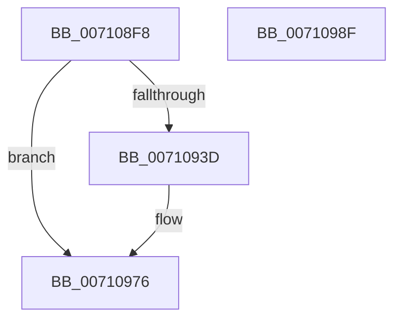

# DbgkCreateMinimalProcess

- RVA: `0x007108F8`–`0x00710990` (길이 `152` bytes)
- VA: `0x00000001407108F8`
- 실행 섹션: `PAGE`
- PDB 이름 있음: `예`; PDB Function 태그: `아니요`
- unwind 정보 RVA: `0x000C5950`
- 디코드: `31`개 명령, `152/152` bytes 표시
- 미해석 바이트: `0` (있으면 어셈블리에 `.byte`로 보존)

> 이 문서는 커널 이미지의 기계어와 PDB 기호를 분석해 생성했습니다. 4번과 5번은 함수 원형과 자료형을 바이너리 사용 방식에서 추정한 C 해석이며 원본 소스 복구 결과는 아닙니다.

## 1. Dependencies

- 직접 호출 지점: **3**; 고유 호출 대상: **3**
- 직접 호출자로 확인된 함수: **1**
- RIP 상대 이미지 참조: **1**

### Outgoing calls
- `0x00710923` → [memset](../../text/6C/memset_function_006C6C40.md) (function, `0x006C6C40`)
- `0x00710971` → [DbgkpSendApiMessage](../A7/DbgkpSendApiMessage_function_00A79458.md) (function, `0x00A79458`)
- `0x00710981` → [_security_check_cookie](../../text/6A/_security_check_cookie_function_006AC640.md) (function, `0x006AC640`)

### Direct callers
- [PsCreateMinimalProcess](../78/PsCreateMinimalProcess_function_00786D14.md) at `0x00787037`

### Static image references
- `0x00710901` → RVA `0x00E0A740` (`.data`; read)

## 2. Other-region calls and transfers

- 다른 실행 섹션으로 향하는 call: **2**
  - `0x00710923` → [memset](../../text/6C/memset_function_006C6C40.md) (`PAGE` → `.text`)
  - `0x00710981` → [_security_check_cookie](../../text/6A/_security_check_cookie_function_006AC640.md) (`PAGE` → `.text`)
- 별도 외부 분기/꼬리 이동을 확인하지 못했습니다.

## 3. Assembly (complete function range)

```asm
007108F8  40 53                           push rbx
007108FA  48 81 EC 40 01 00 00            sub rsp, 0x140
00710901  48 8B 05 38 9E 6F 00            mov rax, qword ptr [rip + 0x6f9e38]
00710908  48 33 C4                        xor rax, rsp
0071090B  48 89 84 24 30 01 00 00         mov qword ptr [rsp + 0x130], rax
00710913  48 8B D9                        mov rbx, rcx
00710916  33 D2                           xor edx, edx
00710918  48 8D 4C 24 20                  lea rcx, [rsp + 0x20]
0071091D  41 B8 10 01 00 00               mov r8d, 0x110
00710923  E8 18 63 FB FF                  call 0x1406c6c40
00710928  F0 81 8B F4 01 00 00 01 00 40 00  lock or dword ptr [rbx + 0x1f4], 0x400001
00710933  48 83 BB 08 03 00 00 00         cmp qword ptr [rbx + 0x308], 0
0071093B  74 39                           je 0x140710976
0071093D  0F 57 C0                        xorps xmm0, xmm0
00710940  C7 44 24 20 38 00 60 00         mov dword ptr [rsp + 0x20], 0x600038
00710948  4C 8D 44 24 20                  lea r8, [rsp + 0x20]
0071094D  C7 44 24 24 08 00 00 00         mov dword ptr [rsp + 0x24], 8
00710955  33 D2                           xor edx, edx
00710957  C7 44 24 48 02 00 00 00         mov dword ptr [rsp + 0x48], 2
0071095F  48 8B CB                        mov rcx, rbx
00710962  0F 11 44 24 50                  movups xmmword ptr [rsp + 0x50], xmm0
00710967  0F 11 44 24 60                  movups xmmword ptr [rsp + 0x60], xmm0
0071096C  0F 11 44 24 70                  movups xmmword ptr [rsp + 0x70], xmm0
00710971  E8 E2 8A 36 00                  call 0x140a79458
00710976  48 8B 8C 24 30 01 00 00         mov rcx, qword ptr [rsp + 0x130]
0071097E  48 33 CC                        xor rcx, rsp
00710981  E8 BA BC F9 FF                  call 0x1406ac640
00710986  48 81 C4 40 01 00 00            add rsp, 0x140
0071098D  5B                              pop rbx
0071098E  C3                              ret
0071098F  CC                              int3
```

## 4. C-style interpretation (structured pseudocode)

```c
__int64 __fastcall DbgkCreateMinimalProcess(__int64 a1, int a2)
{
    __int64 result;
    __int64 v_rsp;
    unsigned int v_stack_m100;
    unsigned int v_stack_m124;
    unsigned __int64 v_stack_m128;
    unsigned __int64 v_stack_m18;
    unsigned __int64 v_stack_mD8;
    unsigned __int64 v_stack_mE8;
    unsigned __int64 v_stack_mF8;

    v_rsp = (v_rsp) - (320);
    result = (*(unsigned __int64 *)(v_rip + 7315000)) ^ (v_rsp);
    v_stack_m18 = result;
    a2 = 0;
    result = memset(v_stack_m128, a2, 272, a4);
    if ((*(unsigned __int64 *)(a1 + 776)) != 0) {
        v_stack_m128 = 0x600038ULL;
        a3 = v_stack_m128;
        v_stack_m124 = 8;
        a2 = 0;
        v_stack_m100 = 2;
        a1 = a1;
        v_stack_mF8 = v_xmm0;
        v_stack_mE8 = v_xmm0;
        v_stack_mD8 = v_xmm0;
        result = DbgkpSendApiMessage(a1, a2, a3, a4);
    }
    a1 = (v_stack_m18) ^ (v_rsp);
    result = _security_check_cookie(a1, a2, a3, a4);
    v_rsp = (v_rsp) + (320);
    return result;
}
```

## 5. (Beta) C Style

```c
int64_t DbgkCreateMinimalProcess(void *Arg1, int32_t Arg2)
{
    uint8_t *arg1 = (uint8_t *)Arg1;

    int64_t result;
    int64_t local_rsp;
    uint32_t v_stack_m100;
    uint32_t v_stack_m124;
    uint64_t v_stack_m128;
    uint64_t v_stack_m18;
    uint64_t v_stack_mD8;
    uint64_t v_stack_mE8;
    uint64_t v_stack_mF8;

    local_rsp = (local_rsp) - (320);
    result = (*(uint64_t *)(v_rip + 0x6F9E38)) ^ (local_rsp);
    v_stack_m18 = result;
    Arg2 = 0;
    result = memset(v_stack_m128, Arg2, 272, a4);
    if ((*(uint64_t *)(arg1 + 0x308)) != 0) {
        v_stack_m128 = 0x600038ULL;
        a3 = v_stack_m128;
        v_stack_m124 = 8;
        Arg2 = 0;
        v_stack_m100 = 2;
        Arg1 = Arg1;
        v_stack_mF8 = v_xmm0;
        v_stack_mE8 = v_xmm0;
        v_stack_mD8 = v_xmm0;
        result = DbgkpSendApiMessage(Arg1, Arg2, a3, a4);
    }
    Arg1 = (v_stack_m18) ^ (local_rsp);
    result = _security_check_cookie(Arg1, Arg2, a3, a4);
    local_rsp = (local_rsp) + (320);
    return result;
}
```

### 관측된 메모리 오프셋

구조체 형식이 확인되지 않은 접근은 인자 기준의 오프셋으로만 기록했습니다.

| 기준 인자 | 오프셋 표현 | 폭 (bit) | 접근 |
|---|---:|---:|---|
| `Arg1` | `+ 0x1F4` | `32` | `R/W` |
| `Arg1` | `+ 0x308` | `64` | `R` |

## 6. Execution-region graph

[열기: 2D/3D 그래프와 함수 탐색 컨트롤 패널](../../../control-panel.html?section=page&rva=0x007108F8&view=graph)

- 2D 그래프는 위에서 아래로 흐르고, 3D 그래프는 빈 공간을 드래그해 회전합니다. Shift+드래그는 이동, 휠은 확대·축소, 함수 노드 선택은 대상 보고서 이동입니다.

### Static fallback


