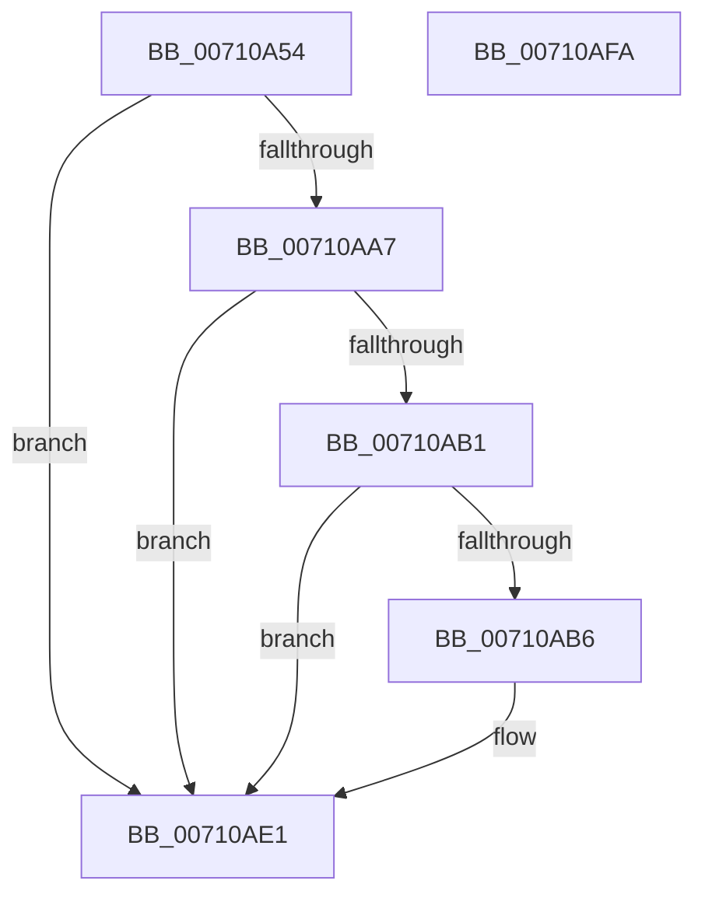

# DbgkExitThread

- RVA: `0x00710A54`–`0x00710AFB` (길이 `167` bytes)
- VA: `0x0000000140710A54`
- 실행 섹션: `PAGE`
- PDB 이름 있음: `예`; PDB Function 태그: `아니요`
- unwind 정보 RVA: `0x000C5950`
- 디코드: `34`개 명령, `167/167` bytes 표시
- 미해석 바이트: `0` (있으면 어셈블리에 `.byte`로 보존)

> 이 문서는 커널 이미지의 기계어와 PDB 기호를 분석해 생성했습니다. 4번과 5번은 함수 원형과 자료형을 바이너리 사용 방식에서 추정한 C 해석이며 원본 소스 복구 결과는 아닙니다.

## 1. Dependencies

- 직접 호출 지점: **3**; 고유 호출 대상: **3**
- 직접 호출자로 확인된 함수: **1**
- RIP 상대 이미지 참조: **1**

### Outgoing calls
- `0x00710A7E` → [memset](../../text/6C/memset_function_006C6C40.md) (function, `0x006C6C40`)
- `0x00710ADC` → [DbgkpSendApiMessage](../A7/DbgkpSendApiMessage_function_00A79458.md) (function, `0x00A79458`)
- `0x00710AEC` → [_security_check_cookie](../../text/6A/_security_check_cookie_function_006AC640.md) (function, `0x006AC640`)

### Direct callers
- [sub_00B20D7E](../B2/Unknown_function_00B20D7E.md) at `0x00B20DFC`

### Static image references
- `0x00710A5D` → RVA `0x00E0A740` (`.data`; read)

## 2. Other-region calls and transfers

- 다른 실행 섹션으로 향하는 call: **2**
  - `0x00710A7E` → [memset](../../text/6C/memset_function_006C6C40.md) (`PAGE` → `.text`)
  - `0x00710AEC` → [_security_check_cookie](../../text/6A/_security_check_cookie_function_006AC640.md) (`PAGE` → `.text`)
- 별도 외부 분기/꼬리 이동을 확인하지 못했습니다.

## 3. Assembly (complete function range)

```asm
00710A54  40 53                           push rbx
00710A56  48 81 EC 40 01 00 00            sub rsp, 0x140
00710A5D  48 8B 05 DC 9C 6F 00            mov rax, qword ptr [rip + 0x6f9cdc]
00710A64  48 33 C4                        xor rax, rsp
00710A67  48 89 84 24 30 01 00 00         mov qword ptr [rsp + 0x130], rax
00710A6F  8B D9                           mov ebx, ecx
00710A71  33 D2                           xor edx, edx
00710A73  48 8D 4C 24 20                  lea rcx, [rsp + 0x20]
00710A78  41 B8 10 01 00 00               mov r8d, 0x110
00710A7E  E8 BD 61 FB FF                  call 0x1406c6c40
00710A83  65 48 8B 04 25 88 01 00 00      mov rax, qword ptr gs:[0x188]
00710A8C  48 8B 88 B8 00 00 00            mov rcx, qword ptr [rax + 0xb8]
00710A93  65 48 8B 04 25 88 01 00 00      mov rax, qword ptr gs:[0x188]
00710A9C  8B 90 A0 05 00 00               mov edx, dword ptr [rax + 0x5a0]
00710AA2  F6 C2 04                        test dl, 4
00710AA5  75 3A                           jne 0x140710ae1
00710AA7  48 83 B9 08 03 00 00 00         cmp qword ptr [rcx + 0x308], 0
00710AAF  74 30                           je 0x140710ae1
00710AB1  F6 C2 02                        test dl, 2
00710AB4  74 2B                           je 0x140710ae1
00710AB6  4C 8D 44 24 20                  lea r8, [rsp + 0x20]
00710ABB  89 5C 24 50                     mov dword ptr [rsp + 0x50], ebx
00710ABF  BA 01 00 00 00                  mov edx, 1
00710AC4  C7 44 24 20 0C 00 34 00         mov dword ptr [rsp + 0x20], 0x34000c
00710ACC  C7 44 24 24 08 00 00 00         mov dword ptr [rsp + 0x24], 8
00710AD4  C7 44 24 48 03 00 00 00         mov dword ptr [rsp + 0x48], 3
00710ADC  E8 77 89 36 00                  call 0x140a79458
00710AE1  48 8B 8C 24 30 01 00 00         mov rcx, qword ptr [rsp + 0x130]
00710AE9  48 33 CC                        xor rcx, rsp
00710AEC  E8 4F BB F9 FF                  call 0x1406ac640
00710AF1  48 81 C4 40 01 00 00            add rsp, 0x140
00710AF8  5B                              pop rbx
00710AF9  C3                              ret
00710AFA  CC                              int3
```

## 4. C-style interpretation (structured pseudocode)

```c
__int64 __fastcall DbgkExitThread(int a1, int a2)
{
    __int64 result;
    __int64 v_rsp;
    unsigned int v_stack_m100;
    unsigned int v_stack_m124;
    unsigned __int64 v_stack_m128;
    unsigned __int64 v_stack_m18;
    unsigned int v_stack_mF8;

    v_rsp = (v_rsp) - (320);
    result = (*(unsigned __int64 *)(v_rip + 7314652)) ^ (v_rsp);
    v_stack_m18 = result;
    a2 = 0;
    result = memset(v_stack_m128, a2, 272, a4);
    if ((((unsigned __int8)((unsigned int)(*(unsigned int *)(*(unsigned __int64 *)(gs_base + (0 + 392)) + 1440)))) & (4)) != 0) goto loc_00710AE1;
    if ((*(unsigned __int64 *)(*(unsigned __int64 *)(*(unsigned __int64 *)(gs_base + (0 + 392)) + 184) + 776)) == 0) goto loc_00710AE1;
    result = *(unsigned __int64 *)(gs_base + (0 + 392));
    if ((((unsigned __int8)((unsigned int)(*(unsigned int *)(*(unsigned __int64 *)(gs_base + (0 + 392)) + 1440)))) & (2)) != 0) {
        a3 = v_stack_m128;
        v_stack_mF8 = (unsigned int)((unsigned int)(a1));
        a2 = 1;
        v_stack_m128 = 0x34000CULL;
        v_stack_m124 = 8;
        v_stack_m100 = 3;
        result = DbgkpSendApiMessage(*(unsigned __int64 *)(*(unsigned __int64 *)(gs_base + (0 + 392)) + 184), a2, a3, a4);
    }
    a1 = (v_stack_m18) ^ (v_rsp);
    result = _security_check_cookie(a1, a2, a3, a4);
    v_rsp = (v_rsp) + (320);
    return result;
}
```

## 5. (Beta) C Style

```c
int64_t DbgkExitThread(int32_t Arg1, int32_t Arg2)
{
    int64_t result;
    int64_t local_rsp;
    uint32_t v_stack_m100;
    uint32_t v_stack_m124;
    uint64_t v_stack_m128;
    uint64_t v_stack_m18;
    uint32_t v_stack_mF8;

    local_rsp = (local_rsp) - (320);
    result = (*(uint64_t *)(v_rip + 0x6F9CDC)) ^ (local_rsp);
    v_stack_m18 = result;
    Arg2 = 0;
    result = memset(v_stack_m128, Arg2, 272, a4);
    if ((((uint8_t)((uint32_t)(*(uint32_t *)(*(uint64_t *)(gs_base + (0 + 0x188)) + 0x5A0)))) & (4)) != 0) goto loc_00710AE1;
    if ((*(uint64_t *)(*(uint64_t *)(*(uint64_t *)(gs_base + (0 + 0x188)) + 0xB8) + 0x308)) == 0) goto loc_00710AE1;
    result = *(uint64_t *)(gs_base + (0 + 0x188));
    if ((((uint8_t)((uint32_t)(*(uint32_t *)(*(uint64_t *)(gs_base + (0 + 0x188)) + 0x5A0)))) & (2)) != 0) {
        a3 = v_stack_m128;
        v_stack_mF8 = (uint32_t)((uint32_t)(Arg1));
        Arg2 = 1;
        v_stack_m128 = 0x34000CULL;
        v_stack_m124 = 8;
        v_stack_m100 = 3;
        result = DbgkpSendApiMessage(*(uint64_t *)(*(uint64_t *)(gs_base + (0 + 0x188)) + 0xB8), Arg2, a3, a4);
    }
    Arg1 = (v_stack_m18) ^ (local_rsp);
    result = _security_check_cookie(Arg1, Arg2, a3, a4);
    local_rsp = (local_rsp) + (320);
    return result;
}
```

## 6. Execution-region graph

[열기: 2D/3D 그래프와 함수 탐색 컨트롤 패널](../../../control-panel.html?section=page&rva=0x00710A54&view=graph)

- 2D 그래프는 위에서 아래로 흐르고, 3D 그래프는 빈 공간을 드래그해 회전합니다. Shift+드래그는 이동, 휠은 확대·축소, 함수 노드 선택은 대상 보고서 이동입니다.

### Static fallback


